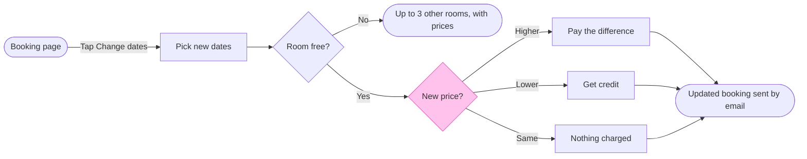

**Write gate.** Nothing is written yet.

**Question and outcome:** After a guest taps Change dates, what do they see and pay for each outcome? The board lets support and product staff tell a guest which of the three price outcomes applies and what happens next.

**Sketch, the checked model as the check read it**

`PASSED 1 diagram(s) in model.md`, with 9 nodes, 10 connectors and 0 crossing pairs. The composer printed `COMPOSED` for 9 nodes and 10 connectors in the FigJam default design.

**Glance lines**
- First: the New price? decision, because it sets which of the three outcomes the guest gets
- Second: Booking page, Pick new dates, Room free?, Pay the difference, Get credit, Nothing charged and Updated booking sent by email, in the order the check prints them
- Last: Up to 3 other rooms, with prices, the side exit that stays available without competing

**Critique**
- Where the eye goes first: the New price? diamond in the accent colour. It is the node the board most needs read, because the three price outcomes are what a support reader looks up
- What it reads second: the main row from the booking page through the room check. That advances the first glance, since the price question only arises once the room is free
- What a reader could miss: that the other rooms list is a dead end on this board. A reader who assumes it continues would wrongly think the guest can rebook from there. The source line says so, and so does Left out
- Next cut by the remove test: Nothing charged. It stays, because a reader asking "what if the price is the same?" has no other node that answers it

**Changes from the playback**
- Bodies are only allowed on step rectangles, and the other rooms list and the final booking are ends. So the other rooms rule moved into its label, `Up to 3 other rooms, with prices`, and the email moved into the last label, `Updated booking sent by email`
- The same hotel and the "price for the new dates" detail are no longer on the board. They stay in the source line's source, the help article
- Pay the difference, Get credit and Pick new dates keep their bodies: card on file, 12 months, and only open nights

**Target:** the existing FigJam file `<test-file-key>` in the Roamstay Product plan. I read it with `get_figjam` and it is empty, with no sections and no board sharing the title, so nothing already there is touched.

**What will be written:** one section titled `Change booking dates`, holding the 9 nodes, 10 connectors, a key and the source line.

**Calls the write will spend:** one `use_figma` call to compose the board and one `get_figjam` call to read it back. The session and the earlier read are already spent. If the file sits on a Starter plan or you hold a View or Collab seat, Figma limits tool calls to six a month, and those two count against it.

**Rollback:** delete that one section with `use_figma`, only on a reply that names it. The file itself stays, since it existed before this work.

**Left out:** what the guest does after the other rooms list, because the help article does not say.

Do you want me to write this board into `<test-file-key>`?