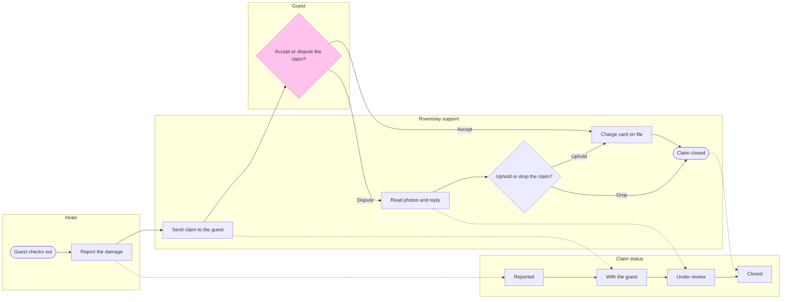

# FJ-049 turn 4 transcript

**User:** Yes, that reading is right.

**Tool call:** `Read` `{"file_path": "/private/var/folders/3c/zfqcqsts0kn19cgblj82gqhm0000gn/T/devin-compare-bench/FJ-049/sk-create-figjam/assets/examples/process-fernhouse-commission.md"}`

**Tool result:** `Read`

```text
"1\t---\n2\ttitle: \"Example - Process - Fernhouse Commission\"\n3\tdescription: \"A worked laned process with a status lane and detail cards on the fictional Fernhouse store: a client and a maker move one planter commission through its statuses, from the order to the approved planter.\"\n4\tcontextType: general\n5\timportance_tier: normal\n6\ttrigger_phrases:\n7\t  - \"status lane example\"\n8\t  - \"detail cards example\"\n9\t  - \"fernhouse commission process\"\n10\tversion: 1.0.0.0\n11\t---\n12\t\n13\t# Example - Process - Fernhouse Commission\n14\t\n15\tFernhouse is a fictional store used across the Product Owner fixtures. Every name, step and rule here is invented for the example.\n16\t\n17\t---\n18\t\n19\t## 1. REQUEST\n20\t\n21\t```text\n22\tmake a FigJam board of how a made-to-order planter moves between the client and the maker, with the status the commission is in at each step, from the commission spec, and keep the spec's detail on the steps\n23\t```\n24\t\n25\t| Spec line | Says | Class |\n26\t|---|---|---|\n27\t| 2.1 | The client places a commission through the order form. Its status is Requested | current behavior |\n28\t| 2.2 | The maker confirms the commission within two working days: size, wood, finish and delivery or fitting. Its status moves to Confirmed | current behavior |\n29\t| 2.3 | The maker builds the planter. Its status moves to In the making | current behavior |\n30\t| 2.4 | A delivered planter ships in a wooden crate with a tracking link. A fitte
```

**Tool call:** `Read` `{"file_path": "/private/var/folders/3c/zfqcqsts0kn19cgblj82gqhm0000gn/T/devin-compare-bench/FJ-049/sk-create-figjam/references/quality-rubric.md"}`

**Tool result:** `Read`

```text
"1\t---\n2\ttitle: \"FigJam Diagram Quality Rubric\"\n3\tdescription: \"The taste gate a FigJam model passes before the write gate, translated from sk-design-diagram's success criteria: type fit, the remove test, signal, the check, the board, the design rubric that scores a composed board and the reply.\"\n4\tcontextType: implementation\n5\timportance_tier: important\n6\ttrigger_phrases:\n7\t  - \"figjam quality rubric\"\n8\t  - \"diagram taste gate\"\n9\t  - \"remove test\"\n10\t  - \"figjam review checklist\"\n11\t  - \"figjam design rubric\"\n12\tversion: 1.0.13.0\n13\t---\n14\t\n15\t# FigJam Diagram Quality Rubric\n16\t\n17\tThe script checks what a script can see. This rubric is the rest: whether the diagram should exist, whether every node earns its place and whether the reader can trust what lands on the board. Walk it after the check passes and before the write gate.\n18\t\n19\t**Loading Condition:** CONDITIONAL, on every Flow route before the write gate\n20\t**Purpose:** The judgement pass between the pre-write check and the gate\n21\t**Scope:** The model, the provenance table, the planned extensions and, after the write, the board and the reply\n22\t\n23\t---\n24\t\n25\t## 1. TYPE FIT\n26\t\n27\t- [ ] The type answers the reader's question, as `references/flow-mode.md` Section 3 maps it\n28\t- [ ] A table, a list or a paragraph would not do the same job. If it would, say so and offer that instead\n29\t- [ ] The type's reference in `references/types/` was loaded and 
```

**Tool call:** `ToolSearch` `{"query": "select:mcp__figma-remote__create_session,mcp__figma-remote__get_figjam,mcp__figma-remote__use_figma,mcp__figma-remote__whoami", "max_results": 4}`

**Tool result:** `ToolSearch`

```text
[{"type": "tool_reference", "tool_name": "mcp__figma-remote__create_session"}, {"type": "tool_reference", "tool_name": "mcp__figma-remote__get_figjam"}, {"type": "tool_reference", "tool_name": "mcp__figma-remote__use_figma"}, {"type": "tool_reference", "tool_name": "mcp__figma-remote__whoami"}]
```

**Tool call:** `Bash` `{"command": "S=$(mktemp -d) && echo $S && cat > \"$S/model.md\" <<'EOF'\n```mermaid\n%% type: process\nflowchart LR\n    %% title: Roamstay damage claim\n    %% subtitle: From the hotel's report after check-out to a Closed claim, for Roamstay support and product\n    %% source: Source: the Roamstay claims policy. Left out: the waiver under 25 euros, not live. Silence after 7 days and the start of each day count, not stated.\n    %% goal: closedEnd\n    %% status: status\n    %% level: faithful\n    %% about: status | Accepted claims skip Under review\n    %% about: support | Decides a dispute `

**Tool result (error):** `Bash`

```text
"Exit code 1\n/var/folders/3c/zfqcqsts0kn19cgblj82gqhm0000gn/T/tmp.IEItc6p8Ac\n  diagram 1, process: the longest path runs 9 steps, at most 8: split the flow\nFAILED 1 of 1 diagram(s) in model.md"
```

**Tool call:** `Bash` `{"command": "S=/var/folders/3c/zfqcqsts0kn19cgblj82gqhm0000gn/T/tmp.IEItc6p8Ac && cd \"$S\" && python3 -I - <<'EOF'\np=\"model.md\"\nt=open(p).read()\nt=t.replace(\"    %% detail: send | Sends the photos and the quote\\n\",\"    %% detail: send | Sends the photos and the quote | The guest sees the photos, the quote | and the amount in the app\\n\")\nt=t.replace(\"    %% detail: appView | Sees the photos in the app | Sees the quote in the app | Sees the amount in the app\\n\",\"\")\nt=t.replace(\"        appView[Review claim in the app]\\n\",\"\")\nt=t.replace(\"    send --> appView\\n\",\"    `

**Tool result:** `Bash`

```text
"  diagram 1, process: ok, 12 nodes and 16 connectors, widest rank 1 steps, longest path 8 steps, 1.1 connectors per step, labels average 18 characters, 0 crossing pairs\nLabel: Uphold or drop? leaves 'drop?' alone on its last line, so shorten it, or reword it in the source's words, when that keeps the meaning\nLabel: Accept or dispute? leaves 'dispute?' alone on its last line, so shorten it, or reword it in the source's words, when that keeps the meaning\nGlance: Accept or dispute? (accent) > Guest checks out > Report the damage > Reported > Send claim to the guest > With the guest > Read photos and reply > Under review > Uphold or drop? > Charge card on file > Claim closed (goal) > Closed\nPASSED 1 diagram(s) in model.md"
```

**Tool call:** `Bash` `{"command": "S=/var/folders/3c/zfqcqsts0kn19cgblj82gqhm0000gn/T/tmp.IEItc6p8Ac && cd \"$S\" && sed -i '' 's/{Uphold or drop?}/{Uphold or drop the claim?}/; s/{Accept or dispute?}/{Accept or dispute the claim?}/' model.md && cd /private/var/folders/3c/zfqcqsts0kn19cgblj82gqhm0000gn/T/devin-compare-bench/FJ-049/sk-create-figjam && python3 -I scripts/flow_check.py \"$S/model.md\"; cat \"$S/model.md\"", "description": "Reword decision labels and rerun the check"}`

**Tool result:** `Bash`

```text
"  diagram 1, process: ok, 12 nodes and 16 connectors, widest rank 1 steps, longest path 8 steps, 1.1 connectors per step, labels average 20 characters, 0 crossing pairs\nLabel: Accept or dispute the claim? leaves 'claim?' alone on its last line, so shorten it, or reword it in the source's words, when that keeps the meaning\nGlance: Accept or dispute the claim? (accent) > Guest checks out > Report the damage > Reported > Send claim to the guest > With the guest > Read photos and reply > Under review > Uphold or drop the claim? > Charge card on file > Claim closed (goal) > Closed\nPASSED 1 diagram(s) in model.md\n```mermaid\n%% type: process\nflowchart LR\n    %% title: Roamstay damage claim\n    %% subtitle: From the hotel's report after check-out to a Closed claim, for Roamstay support and product\n    %% source: Source: the Roamstay claims policy. Left out: the waiver under 25 euros, not live. Silence after 7 days and the start of each day count, not stated.\n    %% goal: closedEnd\n    %% status: status\n    %% level: faithful\n    %% about: status | Accepted claims skip Under review\n    %% about: support | Decides a dispute within 5 working days\n    %% about: guest | Has 7 days to accept or dispute the claim\n    %% detail: report | After check-out | Photos of the damage | Repair quote | Quote from a listed supplier\n    %% detail: send | Sends the photos and the quote | The guest sees the photos, the quote | and the amount in the app\n    %% detail: review | Reads the 
```

**Tool call:** `Bash` `{"command": "S=/var/folders/3c/zfqcqsts0kn19cgblj82gqhm0000gn/T/tmp.IEItc6p8Ac && cd \"$S\" && python3 -I - <<'EOF'\np=\"model.md\"\nt=open(p).read()\nt=t.replace(\"Left out: the waiver under 25 euros, not live. Silence after 7 days and the start of each day count, not stated.\",\"Left out: the waiver under 25 euros, not live. Not stated by the policy: silence after 7 days and where each day count starts.\")\nopen(p,\"w\").write(t)\nEOF\ncd /private/var/folders/3c/zfqcqsts0kn19cgblj82gqhm0000gn/T/devin-compare-bench/FJ-049/sk-create-figjam && python3 -I scripts/flow_check.py \"$S/model.md\" | `

**Tool call:** `mcp__figma-remote__create_session` `{"fileKey": "<test-file-key>", "description": "Add a Roamstay damage claim process board as a new section in the existing FigJam file"}`

**Tool result:** `Bash`

```text
"Label: Accept or dispute the claim? leaves 'claim?' alone on its last line, so shorten it, or reword it in the source's words, when that keeps the meaning\nGlance: Accept or dispute the claim? (accent) > Guest checks out > Report the damage > Reported > Send claim to the guest > With the guest > Read photos and reply > Under review > Uphold or drop the claim? > Charge card on file > Claim closed (goal) > Closed\nPASSED 1 diagram(s) in model.md"
```

**Tool result:** `mcp__figma-remote__create_session`

```text
"{\"sessionId\":\"bd448882-748d-4cd9-b510-1f351039a46e\"}"
```

**Tool call:** `mcp__figma-remote__get_figjam` `{"fileKey": "<test-file-key>", "nodeId": "0:1", "includeImagesOfNodes": false, "sessionId": "bd448882-748d-4cd9-b510-1f351039a46e"}`

**Tool result:** `mcp__figma-remote__get_figjam`

```text
[{"type": "text", "text": "<canvas id=\"0:1\" name=\"Page 1\" x=\"0\" y=\"0\" width=\"0\" height=\"0\" />"}]
```

**Assistant:**

The reading is confirmed and the model has passed the check. I read the file once and found nothing on it, so there is no same-titled section to worry about. This message is the write gate, and nothing is written yet.

Question the board answers: who holds a damage claim at each step and what status it carries. Outcome: a Roamstay support or product reader sees where the claim waits and which policy rule applies at each step.

Glance lines, written before the model
* First glance: "Accept or dispute the claim?", the accented decision in the Guest lane
* Second glance: the main row in path order, Guest checks out, Report the damage, Reported, Send claim to the guest, With the guest, Read photos and reply, Under review, Uphold or drop the claim?, Charge card on file and Claim closed
* Last glance: the Closed status, the key and the source line

Sketch, the checked model as the check read it


```text
  diagram 1, process: ok, 12 nodes and 16 connectors, widest rank 1 steps, longest path 8 steps, 1.1 connectors per step, labels average 20 characters, 0 crossing pairs
Label: Accept or dispute the claim? leaves 'claim?' alone on its last line, so shorten it, or reword it in the source's words, when that keeps the meaning
Glance: Accept or dispute the claim? (accent) > Guest checks out > Report the damage > Reported > Send claim to the guest > With the guest > Read photos and reply > Under review > Uphold or drop the claim? > Charge card on file > Claim closed (goal) > Closed
PASSED 1 diagram(s) in model.md
```

Two changes from the playback, both forced by the check:
* The model has 12 nodes, not 13. The check refused a 9-step longest path, so the separate "Review claim in the app" step became lines on "Send claim to the guest": "The guest sees the photos, the quote and the amount in the app"
* The decisions read "Accept or dispute the claim?" and "Uphold or drop the claim?". The shorter wording stranded one word on a line at the wrapping width. "Accept or dispute the claim?" still leaves "claim?" alone on its last line, and no wording in the policy's own words clears it, so I'm keeping it

The four critique questions
* Where the eye goes first: the pink "Accept or dispute the claim?", which is the node you asked to highlight
* What it reads second: the hotel's report and the send step before it, then the review and verdict after it. Together they show what the guest decides on and where each choice leads
* What a reader could miss: that accepted claims skip Under review, so they could assume every claim is reviewed. The status lane note says so, but the dotted moves are faint
* What the remove test would cut next: "Guest checks out". It stays because a step needs a way in, and it anchors "after check-out"

Left out
* The waiver for claims under 25 euros, because it is not live
* The outcome of 7 days with no reply, because the policy states none
* The start point of the 7, 5 and 2 day counts, because the policy states none

What the write does
* Target: file <test-file-key>, in the Roamstay Product plan as you named it. I haven't checked the plan, because the file key settles the target. The board goes in as a new section named "Roamstay damage claim", and the empty file has nothing else to change
* Extensions: none
* Calls: one `use_figma` call to compose the board and one `get_figjam` read-back. I have already spent one `create_session` and one `get_figjam` read. On a Starter plan or a View or Collab seat, Figma limits tool calls to six a month, so this write uses two more
* Rollback: delete the one board section the write returns, through `use_figma`. I would do that only on your reply that names the section

Do you want me to write this board into that file?
