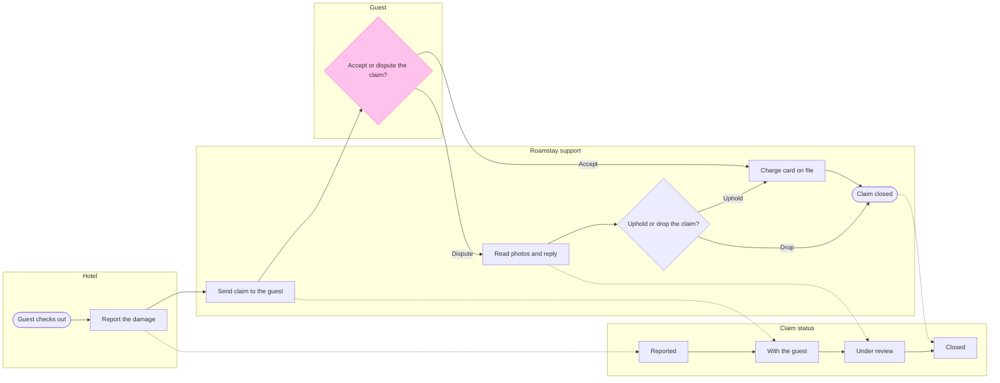

The reading is confirmed and the model has passed the check. I read the file once and found nothing on it, so there is no same-titled section to worry about. This message is the write gate, and nothing is written yet.

Question the board answers: who holds a damage claim at each step and what status it carries. Outcome: a Roamstay support or product reader sees where the claim waits and which policy rule applies at each step.

Glance lines, written before the model
* First glance: "Accept or dispute the claim?", the accented decision in the Guest lane
* Second glance: the main row in path order, Guest checks out, Report the damage, Reported, Send claim to the guest, With the guest, Read photos and reply, Under review, Uphold or drop the claim?, Charge card on file and Claim closed
* Last glance: the Closed status, the key and the source line

Sketch, the checked model as the check read it


```text
  diagram 1, process: ok, 12 nodes and 16 connectors, widest rank 1 steps, longest path 8 steps, 1.1 connectors per step, labels average 20 characters, 0 crossing pairs
Label: Accept or dispute the claim? leaves 'claim?' alone on its last line, so shorten it, or reword it in the source's words, when that keeps the meaning
Glance: Accept or dispute the claim? (accent) > Guest checks out > Report the damage > Reported > Send claim to the guest > With the guest > Read photos and reply > Under review > Uphold or drop the claim? > Charge card on file > Claim closed (goal) > Closed
PASSED 1 diagram(s) in model.md
```

Two changes from the playback, both forced by the check:
* The model has 12 nodes, not 13. The check refused a 9-step longest path, so the separate "Review claim in the app" step became lines on "Send claim to the guest": "The guest sees the photos, the quote and the amount in the app"
* The decisions read "Accept or dispute the claim?" and "Uphold or drop the claim?". The shorter wording stranded one word on a line at the wrapping width. "Accept or dispute the claim?" still leaves "claim?" alone on its last line, and no wording in the policy's own words clears it, so I'm keeping it

The four critique questions
* Where the eye goes first: the pink "Accept or dispute the claim?", which is the node you asked to highlight
* What it reads second: the hotel's report and the send step before it, then the review and verdict after it. Together they show what the guest decides on and where each choice leads
* What a reader could miss: that accepted claims skip Under review, so they could assume every claim is reviewed. The status lane note says so, but the dotted moves are faint
* What the remove test would cut next: "Guest checks out". It stays because a step needs a way in, and it anchors "after check-out"

Left out
* The waiver for claims under 25 euros, because it is not live
* The outcome of 7 days with no reply, because the policy states none
* The start point of the 7, 5 and 2 day counts, because the policy states none

What the write does
* Target: file <test-file-key>, in the Roamstay Product plan as you named it. I haven't checked the plan, because the file key settles the target. The board goes in as a new section named "Roamstay damage claim", and the empty file has nothing else to change
* Extensions: none
* Calls: one `use_figma` call to compose the board and one `get_figjam` read-back. I have already spent one `create_session` and one `get_figjam` read. On a Starter plan or a View or Collab seat, Figma limits tool calls to six a month, so this write uses two more
* Rollback: delete the one board section the write returns, through `use_figma`. I would do that only on your reply that names the section

Do you want me to write this board into that file?