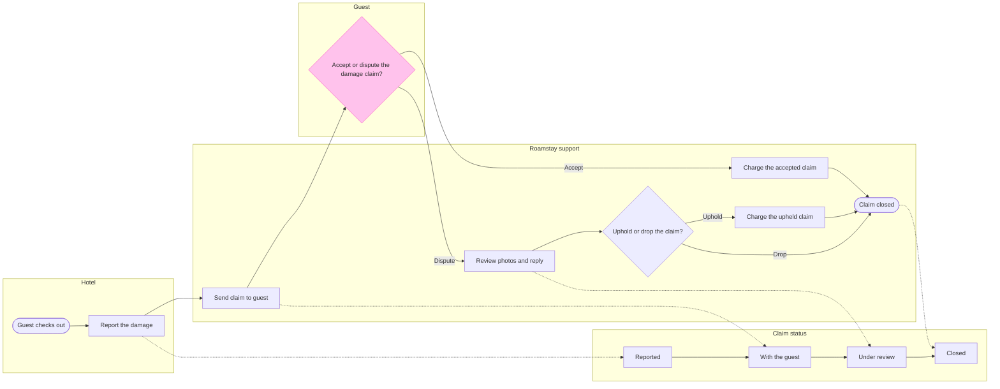

# FJ-049 turn 3 transcript

**User:** Yes, that reading is right.

**Tool call:** `Read` `{"file_path": "/private/var/folders/3c/zfqcqsts0kn19cgblj82gqhm0000gn/T/devin-compare-bench/FJ-049/sk-create-figjam/assets/examples/process-fernhouse-commission.md"}`

**Tool result:** `Read`

```text
"1\t---\n2\ttitle: \"Example - Process - Fernhouse Commission\"\n3\tdescription: \"A worked laned process with a status lane and detail cards on the fictional Fernhouse store: a client and a maker move one planter commission through its statuses, from the order to the approved planter.\"\n4\tcontextType: general\n5\timportance_tier: normal\n6\ttrigger_phrases:\n7\t  - \"status lane example\"\n8\t  - \"detail cards example\"\n9\t  - \"fernhouse commission process\"\n10\tversion: 1.0.0.0\n11\t---\n12\t\n13\t# Example - Process - Fernhouse Commission\n14\t\n15\tFernhouse is a fictional store used across the Product Owner fixtures. Every name, step and rule here is invented for the example.\n16\t\n17\t---\n18\t\n19\t## 1. REQUEST\n20\t\n21\t```text\n22\tmake a FigJam board of how a made-to-order planter moves between the client and the maker, with the status the commission is in at each step, from the commission spec, and keep the spec's detail on the steps\n23\t```\n24\t\n25\t| Spec line | Says | Class |\n26\t|---|---|---|\n27\t| 2.1 | The client places a commission through the order form. Its status is Requested | current behavior |\n28\t| 2.2 | The maker confirms the commission within two working days: size, wood, finish and delivery or fitting. Its status moves to Confirmed | current behavior |\n29\t| 2.3 | The maker builds the planter. Its status moves to In the making | current behavior |\n30\t| 2.4 | A delivered planter ships in a wooden crate with a tracking link. A fitte
```

**Tool call:** `Bash` `{"command": "mktemp -d; ls /private/var/folders/3c/zfqcqsts0kn19cgblj82gqhm0000gn/T/devin-compare-bench/FJ-049/sk-create-figjam/scripts", "description": "Create scratch folder and list scripts"}`

**Tool result:** `Bash`

```text
"/var/folders/3c/zfqcqsts0kn19cgblj82gqhm0000gn/T/tmp.FMd14B37JJ\ncompose_board.py\ncompose-trace.mjs\nfigjam_checks\nflow_check.py\nvendored"
```

**Tool call:** `Bash` `{"command": "S=/var/folders/3c/zfqcqsts0kn19cgblj82gqhm0000gn/T/tmp.FMd14B37JJ\ncat > $S/model.md <<'EOF'\n```mermaid\n%% type: process\nflowchart LR\n    %% title: Roamstay damage claim\n    %% subtitle: From the hotel's damage report to a closed claim, for the Roamstay product and support team\n    %% source: Source: Roamstay claims policy. Left out: the under-25-euro waiver, not live, and day 7 passing with no reply.\n    %% goal: done\n    %% status: status\n    %% level: faithful\n    %% detail: report | Photos of the damage | Repair quote from a listed supplier\n    %% detail: send | Sen`

**Tool result (error):** `Bash`

```text
"Exit code 1\n  diagram 1, process: %% detail on report, a stadium: only a step [Label] carries a body\nFAILED 1 of 1 diagram(s) in model.md"
```

**Tool call:** `Bash` `{"command": "S=/var/folders/3c/zfqcqsts0kn19cgblj82gqhm0000gn/T/tmp.FMd14B37JJ\npython3 - \"$S/model.md\" <<'EOF'\nimport sys\np=sys.argv[1]; t=open(p).read()\nt=t.replace(\"        report([Report the damage])\",\"        checkout([Guest checks out])\\n        report[Report the damage]\")\nt=t.replace(\"    report --> send\\n\",\"    checkout --> report\\n    report --> send\\n\")\nopen(p,'w').write(t)\nEOF\ncd /private/var/folders/3c/zfqcqsts0kn19cgblj82gqhm0000gn/T/devin-compare-bench/FJ-049/sk-create-figjam && python3 -I scripts/flow_check.py $S/model.md", "description": "Fix start node and`

**Tool result:** `Bash`

```text
"  diagram 1, process: ok, 13 nodes and 17 connectors, widest rank 2 steps, longest path 8 steps, 1.1 connectors per step, labels average 22 characters, 0 crossing pairs\nLabel: Uphold or drop in 5 working days? leaves 'days?' alone on its last line, so shorten it, or reword it in the source's words, when that keeps the meaning\nLabel: Accept or dispute in 7 days? leaves 'days?' alone on its last line, so shorten it, or reword it in the source's words, when that keeps the meaning\nGlance: Accept or dispute in 7 days? (accent) > Guest checks out > Report the damage > Reported > Send claim to guest > With the guest > Review photos and reply > Charge the accepted claim > Under review > Uphold or drop in 5 working days? > Charge the upheld claim > Claim closed (goal) > Closed\nPASSED 1 diagram(s) in model.md"
```

**Tool call:** `Bash` `{"command": "S=/var/folders/3c/zfqcqsts0kn19cgblj82gqhm0000gn/T/tmp.FMd14B37JJ\npython3 - \"$S/model.md\" <<'EOF'\nimport sys\np=sys.argv[1]; t=open(p).read()\nt=t.replace(\"Uphold or drop in 5 working days?\",\"Uphold or drop?\").replace(\"Accept or dispute in 7 days?\",\"Accept or dispute?\")\nt=t.replace(\"    subgraph status\",\"    %% about: guest | Has 7 days to accept or dispute\\n    %% about: support | Decides a dispute in 5 working days\\n    subgraph status\",1)\nopen(p,'w').write(t)\nEOF\ncd /private/var/folders/3c/zfqcqsts0kn19cgblj82gqhm0000gn/T/devin-compare-bench/FJ-049/sk-crea`

**Tool result:** `Bash`

```text
"  diagram 1, process: ok, 13 nodes and 17 connectors, widest rank 2 steps, longest path 8 steps, 1.1 connectors per step, labels average 19 characters, 0 crossing pairs\nLabel: Uphold or drop? leaves 'drop?' alone on its last line, so shorten it, or reword it in the source's words, when that keeps the meaning\nLabel: Accept or dispute? leaves 'dispute?' alone on its last line, so shorten it, or reword it in the source's words, when that keeps the meaning\nGlance: Accept or dispute? (accent) > Guest checks out > Report the damage > Reported > Send claim to guest > With the guest > Review photos and reply > Charge the accepted claim > Under review > Uphold or drop? > Charge the upheld claim > Claim closed (goal) > Closed\nPASSED 1 diagram(s) in model.md\nCOMPOSED diagram 1, 13 nodes and 17 connectors, widest rank 2 steps, longest path 8 steps, 1.1 connectors per step, labels average 19 characters, 0 crossing pairs: 13 nodes and 17 connectors to read back, 45396 characters in /var/folders/3c/zfqcqsts0kn19cgblj82gqhm0000gn/T/tmp.FMd14B37JJ/code.js, drawn in the design FigJam default\n13:    %% detail: chargeAccepted | Charged to the card on file\n15:    %% about: guest | Has 7 days to accept or dispute\n16:    %% about: support | Decides a dispute in 5 working days\n31:        chargeAccepted[Charge the accepted claim]\n36:        choose{Accept or dispute?}\n46:    choose -->|Accept| chargeAccepted\n52:    chargeAccepted --> done"
```

**Tool call:** `Bash` `{"command": "S=/var/folders/3c/zfqcqsts0kn19cgblj82gqhm0000gn/T/tmp.FMd14B37JJ\nsed -i 's/Uphold or drop?/Uphold or drop the claim?/; s/Accept or dispute?/Accept or dispute the claim?/' $S/model.md\ncd /private/var/folders/3c/zfqcqsts0kn19cgblj82gqhm0000gn/T/devin-compare-bench/FJ-049/sk-create-figjam && python3 -I scripts/flow_check.py $S/model.md", "description": "Reword decision labels and recheck"}`

**Tool result:** `Bash`

```text
"sed: 1: \"/var/folders/3c/zfqcqst ...\": invalid command code f\n  diagram 1, process: ok, 13 nodes and 17 connectors, widest rank 2 steps, longest path 8 steps, 1.1 connectors per step, labels average 19 characters, 0 crossing pairs\nLabel: Uphold or drop? leaves 'drop?' alone on its last line, so shorten it, or reword it in the source's words, when that keeps the meaning\nLabel: Accept or dispute? leaves 'dispute?' alone on its last line, so shorten it, or reword it in the source's words, when that keeps the meaning\nGlance: Accept or dispute? (accent) > Guest checks out > Report the damage > Reported > Send claim to guest > With the guest > Review photos and reply > Charge the accepted claim > Under review > Uphold or drop? > Charge the upheld claim > Claim closed (goal) > Closed\nPASSED 1 diagram(s) in model.md"
```

**Assistant:**

Still fixing two decision labels the check flags; the sed failed because `$S` was unset in that call, so I'm setting it and retrying.

**Tool call:** `Bash` `{"command": "S=/var/folders/3c/zfqcqsts0kn19cgblj82gqhm0000gn/T/tmp.FMd14B37JJ\npython3 - \"$S/model.md\" <<'EOF'\nimport sys\np=sys.argv[1]; t=open(p).read()\nt=t.replace(\"Uphold or drop?\",\"Uphold or drop the claim?\").replace(\"Accept or dispute?\",\"Accept or dispute the claim?\")\nopen(p,'w').write(t)\nEOF\ncd /private/var/folders/3c/zfqcqsts0kn19cgblj82gqhm0000gn/T/devin-compare-bench/FJ-049/sk-create-figjam && python3 -I scripts/flow_check.py $S/model.md", "description": "Reword decision labels and recheck"}`

**Tool result:** `Bash`

```text
"  diagram 1, process: ok, 13 nodes and 17 connectors, widest rank 2 steps, longest path 8 steps, 1.1 connectors per step, labels average 21 characters, 0 crossing pairs\nLabel: Accept or dispute the claim? leaves 'claim?' alone on its last line, so shorten it, or reword it in the source's words, when that keeps the meaning\nGlance: Accept or dispute the claim? (accent) > Guest checks out > Report the damage > Reported > Send claim to guest > With the guest > Review photos and reply > Charge the accepted claim > Under review > Uphold or drop the claim? > Charge the upheld claim > Claim closed (goal) > Closed\nPASSED 1 diagram(s) in model.md"
```

**Tool call:** `Bash` `{"command": "S=/var/folders/3c/zfqcqsts0kn19cgblj82gqhm0000gn/T/tmp.FMd14B37JJ\ncd /private/var/folders/3c/zfqcqsts0kn19cgblj82gqhm0000gn/T/devin-compare-bench/FJ-049/sk-create-figjam\nfor L in \"Guest accepts or disputes the claim?\" \"Accept or dispute the damage claim?\" \"Does the guest accept or dispute?\"; do\npython3 - \"$S/model.md\" \"$S/try.md\" \"$L\" <<'EOF'\nimport sys\nt=open(sys.argv[1]).read().replace(\"Accept or dispute the claim?\",sys.argv[3])\nopen(sys.argv[2],'w').write(t)\nEOF\necho \"== $L\"; python3 -I scripts/flow_check.py $S/try.md | grep -v Glance\ndone", "descriptio`

**Tool result:** `Bash`

```text
"== Guest accepts or disputes the claim?\n  diagram 1, process: ok, 13 nodes and 17 connectors, widest rank 2 steps, longest path 8 steps, 1.1 connectors per step, labels average 22 characters, 0 crossing pairs\nLabel: Guest accepts or disputes the claim? leaves 'claim?' alone on its last line, so shorten it, or reword it in the source's words, when that keeps the meaning\nPASSED 1 diagram(s) in try.md\n== Accept or dispute the damage claim?\n  diagram 1, process: ok, 13 nodes and 17 connectors, widest rank 2 steps, longest path 8 steps, 1.1 connectors per step, labels average 22 characters, 0 crossing pairs\nPASSED 1 diagram(s) in try.md\n== Does the guest accept or dispute?\n  diagram 1, process: ok, 13 nodes and 17 connectors, widest rank 2 steps, longest path 8 steps, 1.1 connectors per step, labels average 21 characters, 0 crossing pairs\nLabel: Does the guest accept or dispute? leaves 'dispute?' alone on its last line, so shorten it, or reword it in the source's words, when that keeps the meaning\nPASSED 1 diagram(s) in try.md"
```

**Tool call:** `Bash` `{"command": "S=/var/folders/3c/zfqcqsts0kn19cgblj82gqhm0000gn/T/tmp.FMd14B37JJ\ncp $S/try.md /dev/null; python3 - \"$S/model.md\" <<'EOF'\nimport sys\np=sys.argv[1]; t=open(p).read().replace(\"Accept or dispute the claim?\",\"Accept or dispute the damage claim?\")\nopen(p,'w').write(t)\nEOF\ncd /private/var/folders/3c/zfqcqsts0kn19cgblj82gqhm0000gn/T/devin-compare-bench/FJ-049/sk-create-figjam && python3 -I scripts/flow_check.py $S/model.md; cat $S/model.md", "description": "Apply final label, recheck and print model"}`

**Tool call:** `ToolSearch` `{"query": "select:mcp__figma-remote__create_session,mcp__figma-remote__get_figjam,mcp__figma-remote__use_figma", "max_results": 3}`

**Tool result:** `Bash`

```text
"  diagram 1, process: ok, 13 nodes and 17 connectors, widest rank 2 steps, longest path 8 steps, 1.1 connectors per step, labels average 22 characters, 0 crossing pairs\nGlance: Accept or dispute the damage claim? (accent) > Guest checks out > Report the damage > Reported > Send claim to guest > With the guest > Review photos and reply > Charge the accepted claim > Under review > Uphold or drop the claim? > Charge the upheld claim > Claim closed (goal) > Closed\nPASSED 1 diagram(s) in model.md\n```mermaid\n%% type: process\nflowchart LR\n    %% title: Roamstay damage claim\n    %% subtitle: From the hotel's damage report to a closed claim, for the Roamstay product and support team\n    %% source: Source: Roamstay claims policy. Left out: the under-25-euro waiver, not live, and day 7 passing with no reply.\n    %% goal: done\n    %% status: status\n    %% level: faithful\n    %% detail: report | Photos of the damage | Repair quote from a listed supplier\n    %% detail: send | Sends the photos and the quote | Guest sees them and the amount in the app\n    %% detail: review | Reads the photos and the guest's reply | Asks the hotel for more photos | if the photos do not show the damage\n    %% detail: chargeAccepted | Charged to the card on file\n    %% detail: chargeUpheld | Charged to the card on file | Within 2 working days\n    %% about: guest | Has 7 days to accept or dispute\n    %% about: support | Decides a dispute in 5 working days\n    subgraph status [\"Claim status\"
```

**Tool result:** `ToolSearch`

```text
[{"type": "tool_reference", "tool_name": "mcp__figma-remote__create_session"}, {"type": "tool_reference", "tool_name": "mcp__figma-remote__get_figjam"}, {"type": "tool_reference", "tool_name": "mcp__figma-remote__use_figma"}]
```

**Tool call:** `mcp__figma-remote__create_session` `{"fileKey": "<test-file-key>", "description": "Read the FigJam file before adding a Roamstay damage claim process board"}`

**Tool result:** `mcp__figma-remote__create_session`

```text
"{\"sessionId\":\"f66be7fc-9242-41b0-87df-eba8a1569c36\"}"
```

**Tool call:** `mcp__figma-remote__get_figjam` `{"fileKey": "<test-file-key>", "nodeId": "0:1", "includeImagesOfNodes": false, "sessionId": "f66be7fc-9242-41b0-87df-eba8a1569c36"}`

**Tool result:** `mcp__figma-remote__get_figjam`

```text
[{"type": "text", "text": "<canvas id=\"0:1\" name=\"Page 1\" x=\"0\" y=\"0\" width=\"0\" height=\"0\" />"}]
```

**Assistant:**

Gate for the write.

Purpose: the board must show who does what on a Roamstay damage claim, where it changes hands and what status it holds at each step. The Roamstay product and support team should be able to check each hand-off against the claims policy.

Glance lines:
- First glance: the guest's Accept or dispute the damage claim? decision, highlighted
- Second glance: the Dispute branch into Review photos and reply, which leads to support's decision
- Last glance: the Claim closed end and the Closed status, which can wait

Sketch, the checked model exactly as the check read it:



Check result: `PASSED 1 diagram(s) in model.md` (13 nodes, 17 connectors, 0 crossing pairs, no label warnings).

Critique of the sketch:
- Where the eye goes first: the pink Accept or dispute the damage claim? decision. It is the node the board most needs read, because you asked for it highlighted
- What it reads second: the Dispute branch into Review photos and reply. That advances the first glance, since a dispute is what sends the claim to support
- What a reader could miss: the dotted lines into the status lane. Missing them loses which step moves the claim to which status, which is half of your request. The key names them "Moves the status"
- What the remove test would cut next: Guest checks out. It stays because a step needs a way in and the policy starts the claim after check-out

Write plan:
- Target: file <test-file-key>, which you said sits in the Roamstay Product plan. I did not call `whoami`, so I have not confirmed the plan myself
- What is written: one new section titled "Roamstay damage claim" with the title, the subtitle, the four lanes, the key and the source line
- The file is empty, so no section shares the title and nothing already there can change
- Extensions: none planned
- Calls: 1 `use_figma` to compose the board and 1 `get_figjam` for the read-back. The session and the pre-read are already spent
- Rollback: delete the one section the write returns, only on your yes to a question that names it

Left out: the under-25-euro waiver, not live. Day 7 passing with no reply, not in the policy.

Write the board to that file?
