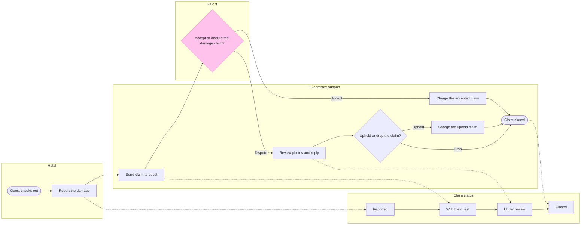

Gate for the write.

Purpose: the board must show who does what on a Roamstay damage claim, where it changes hands and what status it holds at each step. The Roamstay product and support team should be able to check each hand-off against the claims policy.

Glance lines:
- First glance: the guest's Accept or dispute the damage claim? decision, highlighted
- Second glance: the Dispute branch into Review photos and reply, which leads to support's decision
- Last glance: the Claim closed end and the Closed status, which can wait

Sketch, the checked model exactly as the check read it:

Check result: `PASSED 1 diagram(s) in model.md` (13 nodes, 17 connectors, 0 crossing pairs, no label warnings).

Critique of the sketch:
- Where the eye goes first: the pink Accept or dispute the damage claim? decision. It is the node the board most needs read, because you asked for it highlighted
- What it reads second: the Dispute branch into Review photos and reply. That advances the first glance, since a dispute is what sends the claim to support
- What a reader could miss: the dotted lines into the status lane. Missing them loses which step moves the claim to which status, which is half of your request. The key names them "Moves the status"
- What the remove test would cut next: Guest checks out. It stays because a step needs a way in and the policy starts the claim after check-out

Write plan:
- Target: file <test-file-key>, which you said sits in the Roamstay Product plan. I did not call `whoami`, so I have not confirmed the plan myself
- What is written: one new section titled "Roamstay damage claim" with the title, the subtitle, the four lanes, the key and the source line
- The file is empty, so no section shares the title and nothing already there can change
- Extensions: none planned
- Calls: 1 `use_figma` to compose the board and 1 `get_figjam` for the read-back. The session and the pre-read are already spent
- Rollback: delete the one section the write returns, only on your yes to a question that names it

Left out: the under-25-euro waiver, not live. Day 7 passing with no reply, not in the policy.

Write the board to that file?