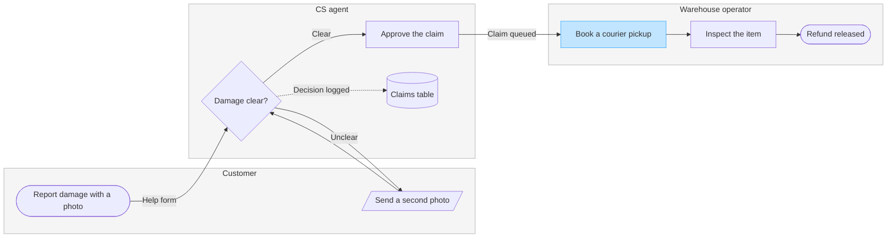

**Question:** who does what in a damaged-item refund, and where does the claim change hands?

**Outcome:** a reader can see which team owns each step, and where the claim moves from CS to the warehouse.

**First glance:** Book a courier pickup, the step where the claim lands in the warehouse lane
**Second glance:** Damage clear?, the check that decides whether the claim moves on
**Last glance:** the claims table, where every decision is logged

**Plan:** Fernhouse Product. **File:** the existing FigJam file `<test-file-key>`, with the board added as a new section.

**Existing:** that file already holds a section titled "Damaged-item refund" from an earlier board. The new board lands to its right, and that section stays as it is. Removing it would be a separate request.

**Writes:** one composed board, 3 lanes, 8 nodes and 8 connectors, with a title, a key and a source line, at the Laptop reading distance.

**Extensions:** none.

**Calls:** one `use_figma` to compose the board and one `get_figjam` to read it back. The session and the first file read are already spent.

**Rollback:** delete the board section this write returns, and only if you say yes to that deletion separately.

The checked sketch:

Write it?