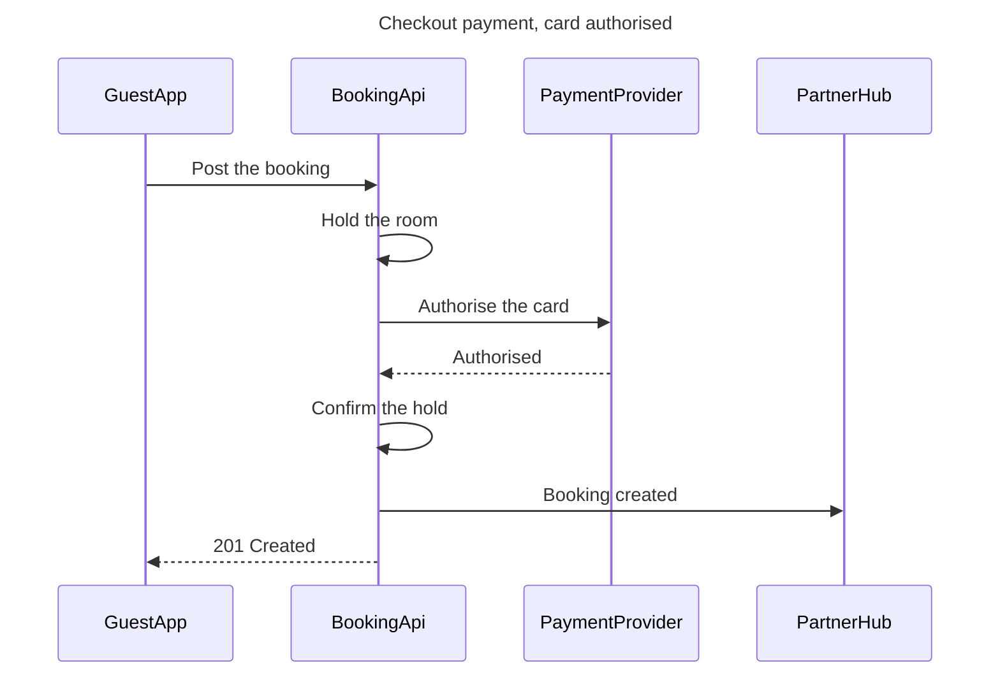

# FJ-025 turn 2 transcript

**User:** Yes, that reading is right.

**Assistant:**


**Tool call:** `exec` `{"command": "ls /private/var/folders/3c/zfqcqsts0kn19cgblj82gqhm0000gn/T/devin-compare-bench/FJ-025/sk-create-figjam/scripts/"}`

**Tool result:** `exec`

```text
Output from command in shell d02424:
compose_board.py
compose-trace.mjs
figjam_checks
flow_check.py
vendored


Exit code: 0
```

**Assistant:**


**Tool call:** `exec` `{"command": "mkdir -p /tmp/fj025-flow && cat > /tmp/fj025-flow/model.md <<'EOF'\n```mermaid\nsequenceDiagram\n    title Checkout payment, card authorised\n    %% subtitle: The calls a Roamstay checkout makes when the card is authorised, for the payments team\n    %% source: Source: the payments brief. Left out: the declined-card path, the held-room release and the 402 answer, kept for a second diagram.\n    %% focus: 3\n    participant GuestApp\n    participant BookingApi\n    participant PaymentProvider\n    participant PartnerHub\n    GuestApp->>BookingApi: Post the booking\n    BookingApi->`

**Tool result:** `exec`

```text
Output from command in shell 1f4dbd:
  diagram 1, sequence: ok, 4 participants and 7 messages
PASSED 1 diagram(s) in model.md


Exit code: 0
```

**Assistant:**


**Tool call:** `exec` `{"command": "cd /private/var/folders/3c/zfqcqsts0kn19cgblj82gqhm0000gn/T/devin-compare-bench/FJ-025 && python3 sk-create-figjam/scripts/compose_board.py /tmp/fj025-flow/model.md --diagram 1 --out /tmp/fj025-flow/compose.js"}`

**Tool result:** `exec`

```text
Output from command in shell 222cc8:
COMPOSED diagram 1, 4 participants and 7 messages: 4 nodes and 7 connectors to read back, 47692 characters in /tmp/fj025-flow/compose.js, drawn in the design FigJam default


Exit code: 0
```

**Assistant:**

Question: in what order do the guest app, the booking API, the payment provider and the partner hub exchange messages at checkout?
Outcome: the payments team can follow the calls in order, with the status code, for a card that is authorised.
First glance: Authorise the card, the call that decides the checkout.
Second glance: Authorised, the answer that lets the booking API confirm the hold and answer the app.
Last glance: Booking created, the message to the partner hub that does not hold up the answer.



Check: `PASSED 1 diagram(s)`, read as a sequence, 4 participants and 7 messages. Composed at 4 nodes and 7 connectors, inside the 50,000 character call limit.

Plan: Roamstay Product. File: the existing FigJam file `<test-file-key>`, which gets one new board section titled "Checkout payment, card authorised", placed to the right of anything already on the page. No new file is created.
Writes: one composed board with the title, a subtitle, a key, the source line and 7 numbered messages, at the Laptop reading distance.
Extensions: none.
Calls: `create_session`, one `get_figjam` read of the file before the write, one `use_figma` and one `get_figjam` read-back.
Rollback: delete the new board section, which needs its own yes and removes only what this write drew.

Write it?
