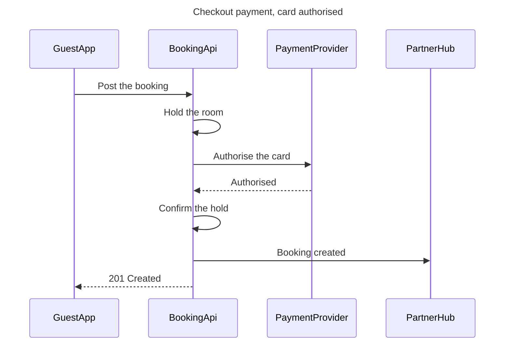

Question: in what order do the guest app, the booking API, the payment provider and the partner hub exchange messages at checkout?
Outcome: the payments team can follow the calls in order, with the status code, for a card that is authorised.
First glance: Authorise the card, the call that decides the checkout.
Second glance: Authorised, the answer that lets the booking API confirm the hold and answer the app.
Last glance: Booking created, the message to the partner hub that does not hold up the answer.

Check: `PASSED 1 diagram(s)`, read as a sequence, 4 participants and 7 messages. Composed at 4 nodes and 7 connectors, inside the 50,000 character call limit.

Plan: Roamstay Product. File: the existing FigJam file `<test-file-key>`, which gets one new board section titled "Checkout payment, card authorised", placed to the right of anything already on the page. No new file is created.
Writes: one composed board with the title, a subtitle, a key, the source line and 7 numbered messages, at the Laptop reading distance.
Extensions: none.
Calls: `create_session`, one `get_figjam` read of the file before the write, one `use_figma` and one `get_figjam` read-back.
Rollback: delete the new board section, which needs its own yes and removes only what this write drew.

Write it?