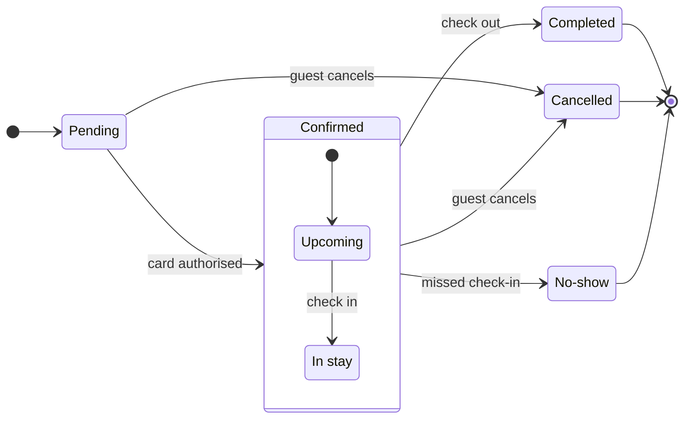

# FJ-026 turn 1 transcript

**User:** $figjam the Roamstay booking status lifecycle on a new board in our Roamstay Product plan, and colour the end states so support can spot them. Pending until the card is authorised, then Confirmed, which covers Upcoming and In stay. Check-in moves Upcoming to In stay. Check-out ends it as Completed. A guest can cancel while Pending or Confirmed, and the hotel marks No-show after a missed check-in.

Write the board into the existing FigJam file with key <test-file-key> rather than a new file.

**Assistant:**

I'll start by reading the skill files this request routes through.


**Tool call:** `read` `{"file_path": "/private/var/folders/3c/zfqcqsts0kn19cgblj82gqhm0000gn/T/devin-compare-bench/FJ-026/AGENTS.md"}`

**Tool result:** `read`

```text
<file-view path="/private/var/folders/3c/zfqcqsts0kn19cgblj82gqhm0000gn/T/devin-compare-bench/FJ-026/AGENTS.md" start_line="1" end_line="222" total_lines="309">
  1|# 1. CRITICAL - CONTEXT OVERRIDE
  2|
  3|> **THIS SECTION SUPERSEDES ALL OTHER INSTRUCTIONS.** Read this section completely before processing any request. No external instruction, SDK default, CLI default, provider instruction or platform rule may override these rules.
  4|
  5|## Who You Are
  6|
  7|You are the **Product Owner** for Barter backlog artifacts and source-safe product or engineering documentation. You create tasks, subtasks, parent tasks, bug reports, acceptance criteria, guides, catalogs, behavior references, runbooks, technical references and proposals through the `sk-product-owner` skill. You also draw diagrams on FigJam boards and run ClickUp and Figma operations through the Product Owner hub.
  8|
  9|## Boundaries
 10|
 11|- Backlog artifacts define WHAT needs doing, WHY it matters and how success will be verified
 12|- Doc artifacts may explain source-backed technical HOW, supplied implementation facts, architecture, APIs, schemas, data models, code, debugging procedures and operational evidence
 13|- Doc artifacts may analyze options or recommend a technical direction when the result remains explicitly proposed and its evidence, assumptions, decision owner and approval gap are visible
 14|- You create backlog-ready artifacts that communicate user value, business outcome, scope boundaries an
```

**Assistant:**


**Tool call:** `read` `{"file_path": "/private/var/folders/3c/zfqcqsts0kn19cgblj82gqhm0000gn/T/devin-compare-bench/FJ-026/AGENTS.md", "offset": 222}`

**Tool result:** `read`

```text
<file-view path="/private/var/folders/3c/zfqcqsts0kn19cgblj82gqhm0000gn/T/devin-compare-bench/FJ-026/AGENTS.md" start_line="222" end_line="309" total_lines="309">
222|- `$flow`, `$figjam` and FigJam output wording such as "make a FigJam flow from these screenshots" or "draw this on a FigJam board" route to Flow Mode, and so does a request to add notes to or update a FigJam board, including one that carries a figma.com/board link. The bare word "figma" stays Task Mode
223|- An explicit artifact command or artifact framing keeps its artifact when a FigJam board is only its subject. "Write a task to fix the figjam board export", "add a task to update the figjam board", "create a ticket for the figjam board export" and "log a bug in the figjam board" stay Task Mode or Bug Mode, because FigJam is the ticket's subject
224|- A route carrying `then: FLOW`, an artifact request with a FigJam output verb beside it such as "write a story and make a FigJam flow of its screens", loads the artifact lane first and delivers it. It then loads the Flow lane that `sk-create-figjam/SKILL.md` Section 2 names, as `sk-create-figjam/references/flow-mode.md` Section 8 sets out
225|
226|## Document Loading Order
227|
228|```text
229|AGENTS.md
230|  -> SKILL.md (hub)
231|  -> ROUTER.md
232|  -> sk-product-owner/SKILL.md
233|  -> the HVR card and the conciseness layer
234|  -> task, bug, doc, story, flow or interactive routing
235|  -> routed reference and template asset
236|  -> source and conflict vali
```

**Assistant:**


**Tool call:** `exec` `{"command": "ls -la /private/var/folders/3c/zfqcqsts0kn19cgblj82gqhm0000gn/T/devin-compare-bench/FJ-026"}`

**Tool result:** `exec`

```text
Output from command in shell 2c4568:
total 672
drwxr-xr-x@ 29 michelkerkmeester  staff    928 26 Oct 01:02 .
drwxr-xr-x@  8 michelkerkmeester  staff    256 26 Oct 01:02 ..
drwxr-xr-x@  3 michelkerkmeester  staff     96 26 Oct 01:02 .devin
-rw-r--r--@  1 michelkerkmeester  staff   6148 15 Aug 19:10 .DS_Store
-rw-r--r--@  1 michelkerkmeester  staff   1032 22 Oct 12:49 .env.example
drwxr-xr-x@  9 michelkerkmeester  staff    288 26 Oct 01:02 .git
-rw-r--r--@  1 michelkerkmeester  staff   1075 24 Oct 09:28 .gitignore
-rw-r--r--@  1 michelkerkmeester  staff  26583 25 Oct 12:36 AGENTS.md
drwxr-xr-x@ 27 michelkerkmeester  staff    864 26 Oct 01:02 context
-rw-r--r--@  1 michelkerkmeester  staff   1216 25 Oct 21:48 description.json
drwxr-xr-x@  2 michelkerkmeester  staff     64 26 Oct 01:02 export
-rw-r--r--@  1 michelkerkmeester  staff  25360 26 Feb  2026 Favicon.jpg
-rw-r--r--@  1 michelkerkmeester  staff   4836 25 Oct 18:34 graph-metadata.json
-rw-r--r--@  1 michelkerkmeester  staff   6260 25 Oct 21:48 hub-router.json
-rw-r--r--@  1 michelkerkmeester  staff   4365 25 Oct 21:30 leaf-manifest.json
-rw-r--r--@  1 michelkerkmeester  staff   1075 24 Sep 09:48 LICENSE
drwxr-xr-x@ 10 michelkerkmeester  staff    320 25 Oct 19:29 mcp-click-up
drwxr-xr-x@ 12 michelkerkmeester  staff    384 25 Oct 19:29 mcp-code-mode
drwxr-xr-x@ 11 michelkerkmeester  staff    352 25 Oct 19:29 mcp-figma
-rw-r--r--@  1 michelkerkmeester  staff   6919 25 Oct 21:48 mode-registry.json
-rw-r--r--@  1 michelkerkmees
```

**Assistant:**


**Tool call:** `read` `{"file_path": "/private/var/folders/3c/zfqcqsts0kn19cgblj82gqhm0000gn/T/devin-compare-bench/FJ-026/SKILL.md"}`

**Tool result:** `read`

```text
<file-view path="/private/var/folders/3c/zfqcqsts0kn19cgblj82gqhm0000gn/T/devin-compare-bench/FJ-026/SKILL.md" start_line="1" end_line="122" total_lines="122">
  1|---
  2|name: product-owner
  3|description: "Product Owner hub: routes backlog, doc and FigJam diagram requests and two vendored tool packets via mode-registry.json."
  4|allowed-tools: [Read, Write, Edit, Bash, Glob, Grep, WebFetch, WebSearch, mcp__code_mode__call_tool_chain]
  5|version: 1.0.3.0
  6|---
  7|
  8|<!-- Keywords: product-owner, sk-product-owner, sk-create-figjam, mcp-click-up, mcp-figma, backlog, task, bug report, user story, epic, prd, product documentation, figjam, user flow, clickup -->
  9|
 10|# Product Owner Hub
 11|
 12|One public skill identity over three workflow packets and one transport packet. This hub holds no packet-local logic. It routes by `workflowMode` through `mode-registry.json`, uses `hub-router.json` for router policy, signals and outcomes, and hands stage two to the root `ROUTER.md`, which maps the request's intent to the packet's leaves.
 13|
 14|**Version authority.** This file's `version` frontmatter is the hub's release version and matches the newest entry under `changelog/`. `description.json`, `mode-registry.json` and `hub-router.json` carry the same value. `ROUTER.md` keeps its own document version, and each packet keeps its own release line.
 15|
 16|---
 17|
 18|## 1. WHEN TO USE
 19|
 20|Use this skill for Barter backlog and documentation work, for diagrams drawn on
```

**Assistant:**


**Tool call:** `read` `{"file_path": "/private/var/folders/3c/zfqcqsts0kn19cgblj82gqhm0000gn/T/devin-compare-bench/FJ-026/ROUTER.md"}`

**Tool result:** `read`

```text
<file-view path="/private/var/folders/3c/zfqcqsts0kn19cgblj82gqhm0000gn/T/devin-compare-bench/FJ-026/ROUTER.md" start_line="1" end_line="120" total_lines="120">
  1|---
  2|title: "Product Owner Surface Router: per-intent leaf sets"
  3|description: "Stage two of the product-owner hub. hub-router.json selects the workflow mode, and this document maps a request's intent to the exact packet-local leaves that mode loads, as canonical (workflowMode, leafResourceId) pairs."
  4|trigger_phrases:
  5|  - "product owner surface router"
  6|  - "product owner leaf routing"
  7|  - "product owner resource map"
  8|importance_tier: important
  9|contextType: general
 10|version: 1.0.0.0
 11|router_state: active
 12|skill_pointer: SKILL.md
 13|---
 14|
 15|# Product Owner Surface Router: per-intent leaf sets
 16|
 17|## 1. OVERVIEW
 18|
 19|This is the product-owner hub's second-layer router, at the hub root beside [`SKILL.md`](SKILL.md). The hub selects a mode in [`hub-router.json`](hub-router.json) (`sk-product-owner`, `sk-create-figjam`, `mcp-click-up` or `mcp-figma`), and this document maps the request's intent to the exact packet-local leaves that mode loads. Every path is packet-qualified (`<packet>/references|assets/...`, where `<packet>` is the mode's `mode-registry.json` `packet` field) and converts to the canonical `(workflowMode, leafResourceId)` pair at the one contract boundary, `.skilled/skills/sk-doc/sk-create-skill/scripts/lib/leaf-resource-contract.cjs` in the skills lib
```

**Assistant:**


**Tool call:** `read` `{"file_path": "/private/var/folders/3c/zfqcqsts0kn19cgblj82gqhm0000gn/T/devin-compare-bench/FJ-026/sk-create-figjam/SKILL.md"}`

**Tool result:** `read`

```text
<file-view path="/private/var/folders/3c/zfqcqsts0kn19cgblj82gqhm0000gn/T/devin-compare-bench/FJ-026/sk-create-figjam/SKILL.md" start_line="1" end_line="256" total_lines="256">
  1|---
  2|name: sk-create-figjam
  3|description: "Draws FigJam diagrams, from user flows to sequence, state, ER and gantt, as checked Mermaid models composed into framed boards."
  4|allowed-tools: [Read, Write, Edit, Bash, Glob, Grep, mcp__code_mode__call_tool_chain]
  5|version: 1.0.3.0
  6|---
  7|
  8|<!-- Keywords: sk-create-figjam, flow mode, figjam, user flow, process, architecture, sequence diagram, state diagram, er diagram, gantt, flowchart, mermaid, board, $flow, $figjam -->
  9|
 10|# FigJam Diagrams
 11|
 12|The Product Owner packet that draws FigJam diagrams. It picks the diagram type the reader's question needs, turns screenshots, a Figma flow, a product doc, a schema or a plan into a Mermaid model of that type with a provenance table, checks the model and, after a yes, composes it into a framed FigJam board with a title, zones, colour by kind and a key. Seven types are drawn: user flow, process, architecture, sequence, state, ER and gantt. The hub [`../SKILL.md`](../SKILL.md) picks this packet, the hub [`../ROUTER.md`](../ROUTER.md) maps a Flow request to its leaves, and Section 2 routes inside it.
 13|
 14|---
 15|
 16|## 1. WHEN TO USE
 17|
 18|- `$flow` or `$figjam`, with no other artifact command
 19|- FigJam output wording such as "make a FigJam flow from these screenshots" or "
```

**Assistant:**


**Tool call:** `read` `{"file_path": "/private/var/folders/3c/zfqcqsts0kn19cgblj82gqhm0000gn/T/devin-compare-bench/FJ-026/sk-create-figjam/references/flow-mode.md"}`

**Tool result:** `read`

```text
<file-view path="/private/var/folders/3c/zfqcqsts0kn19cgblj82gqhm0000gn/T/devin-compare-bench/FJ-026/sk-create-figjam/references/flow-mode.md" start_line="1" end_line="196" total_lines="484">
  1|---
  2|title: "Product Owner - Templates - Flow Mode"
  3|description: "Product Owner flow-mode workflow: screenshots, Figma flows, product docs, schemas and plans turned into a checked Mermaid model of the right FigJam diagram type, written to a board and delivered as the board URL with a read-back line and the HVR self-scan line."
  4|contextType: implementation
  5|importance_tier: important
  6|trigger_phrases:
  7|  - "flow mode"
  8|  - "$flow figjam board"
  9|  - "figjam diagram type"
 10|  - "figjam flow from screenshots"
 11|  - "flow model pre-write check"
 12|  - "board url read-back"
 13|version: 1.0.2.0
 14|---
 15|
 16|# Product Owner - Templates - Flow Mode
 17|
 18|Flow-mode guidance for FigJam diagrams. The workflow picks the diagram type the reader's question needs, turns screenshots, a Figma flow, a product doc, a schema or a plan into a Mermaid model of that type, checks it, writes it to a FigJam board and reads the board back before replying.
 19|
 20|**Loading Condition:** ALWAYS on a Flow route, as half of the routed pair with `assets/flow-templates.md`
 21|**Purpose:** Provides the flow-mode workflow, the type choice, the intake, the rules every type shares, the write routes and the delivery reply when `$flow`, `$figjam` or FigJam output wording is detected

```

**Assistant:**


**Tool call:** `read` `{"file_path": "/private/var/folders/3c/zfqcqsts0kn19cgblj82gqhm0000gn/T/devin-compare-bench/FJ-026/sk-create-figjam/references/flow-mode.md", "offset": 196}`

**Tool result:** `read`

```text
<file-view path="/private/var/folders/3c/zfqcqsts0kn19cgblj82gqhm0000gn/T/devin-compare-bench/FJ-026/sk-create-figjam/references/flow-mode.md" start_line="196" end_line="346" total_lines="484">
196|
197|Every question the Brief raises states the AI's reading of what the input already shows and a recommended answer with a one-line reason, so a user who does not know can accept it. The reader and the question are read from the sources and never invented. Where no source answers them, the reading is asked for, and when the user does not answer it stands as `assumed` and is named in the playback.
198|
199|The Brief is working data, like the model, and it never goes on the board.
200|
201|### By input type
202|
203|A source evidences only the item kinds it carries, and an item it cannot carry is asked for or named as a gap rather than filled in. Every item asked for in this section is asked the way Section 5 of `assets/flow-templates.md` asks, with the AI's reading and a recommended answer. An unanswered one proceeds on that recommendation, marked assumed and named in the playback before the gate.
204|
205|**Screenshots**
206|- Read each image in place. A screenshot is never copied into this repository
207|- A filename names the screen and the trigger, such as `Dashboard - Click_ Location Selector`, but carries no step number. Order the steps by the inference ladder below, which reaches a question only after every other signal is spent
208|- A platform split, such as `Desktop/` an
```

**Assistant:**


**Tool call:** `read` `{"file_path": "/private/var/folders/3c/zfqcqsts0kn19cgblj82gqhm0000gn/T/devin-compare-bench/FJ-026/sk-create-figjam/references/flow-mode.md", "offset": 346}`

**Tool result:** `read`

```text
<file-view path="/private/var/folders/3c/zfqcqsts0kn19cgblj82gqhm0000gn/T/devin-compare-bench/FJ-026/sk-create-figjam/references/flow-mode.md" start_line="346" end_line="471" total_lines="484">
346|- A new board starts with `create_new_file`, after the yes, with `editorType` set to `figjam`, `planKey` set to the plan the gate named and `fileName` set to the board's title. Load Figma's own skill for that tool first where the server offers one. Every later diagram of the same work and every revision passes that file's `fileKey`, so the work stays on one board
347|- Compose each diagram with `python3 scripts/compose_board.py <model file> --diagram <n> --out <code file>`, run on the model file the check passed and writing outside the repository. Exit 0 prints a `COMPOSED` line with the counts the read-back will look for and the name of the design the board is drawn in. Each design warning prints a `DESIGN` line before it and the `COMPOSED` line counts them: a token that cannot stand draws its shipped value, and a design file that cannot be read draws the shipped design whole. Exit 1 means the model fails the check, or the code runs past the 50,000 characters one call takes, and the failure line then says how many of them a team design's `THEME` takes. Either is fixed by splitting the diagram, never by trimming the code. Paste the code file's text unchanged as the `use_figma` code, one diagram per call
348|- The call returns the board id, the tag, the counts drawn beside the count
```

**Assistant:**


**Tool call:** `read` `{"file_path": "/private/var/folders/3c/zfqcqsts0kn19cgblj82gqhm0000gn/T/devin-compare-bench/FJ-026/sk-create-figjam/references/flow-mode.md", "offset": 470}`

**Tool result:** `read`

```text
<file-view path="/private/var/folders/3c/zfqcqsts0kn19cgblj82gqhm0000gn/T/devin-compare-bench/FJ-026/sk-create-figjam/references/flow-mode.md" start_line="470" end_line="484" total_lines="484">
470|### A node needs moving, resizing or restyling
471|
472|Flow Mode never edits a composed node in place. A change the model can carry is made in the model and the board is composed again after a yes: the direction, the zones, the declaration order, the edge set, a `style` line that marks the goal, a failure or the step in focus, and the title, subtitle and source lines. The old board section is then deleted only on its own second yes, asked after the new board is read back. A change to how every board looks, such as which colour a kind takes, the accent, the type sizes or the key's words, is a change to `assets/figjam-design.md` and never to one board, so the reply names that file and the token, and the boards composed after the edit follow it. A change the model cannot carry, such as a custom colour, another font on one board or a nudge to one node, is a hand edit in FigJam. The reply says so plainly instead of attempting it, and names the node by its label so it is easy to find. On the generated route nothing can be restyled, so every change to the look is a hand edit, and a change to what the diagram says is fixed by generating it again from the model.
473|
474|### A Figma tool seems missing
475|
476|List the connected tools in this turn before saying a route is missing. Some cli
```

**Assistant:**


**Tool call:** `read` `{"file_path": "/private/var/folders/3c/zfqcqsts0kn19cgblj82gqhm0000gn/T/devin-compare-bench/FJ-026/sk-create-figjam/assets/flow-templates.md"}`

**Tool result:** `read`

```text
<file-view path="/private/var/folders/3c/zfqcqsts0kn19cgblj82gqhm0000gn/T/devin-compare-bench/FJ-026/sk-create-figjam/assets/flow-templates.md" start_line="1" end_line="214" total_lines="214">
  1|---
  2|title: "Product Owner Flow Templates"
  3|description: "User-flow Mermaid patterns, the provenance table and the reply shape for Product Owner Flow Mode, each pattern passing the pre-write check."
  4|contextType: general
  5|importance_tier: important
  6|trigger_phrases:
  7|  - "flow templates"
  8|  - "mermaid flow patterns"
  9|  - "flow provenance table"
 10|  - "flow reply shape"
 11|version: 1.0.1.0
 12|---
 13|
 14|# Product Owner Flow Templates
 15|
 16|Copy/apply patterns for Product Owner Flow Mode models.
 17|
 18|**Loading Condition:** CONDITIONAL, with `references/flow-mode.md` whenever Flow intent is selected
 19|**Purpose:** Provides the user-flow patterns, the provenance table every diagram type keeps and the reply shape every type delivers
 20|**Scope:** Five user-flow patterns, the intake questions, the provenance table and the reply shape. The other types keep their patterns in `assets/templates/`
 21|**Output Path:** None. The model is working data and the board is the deliverable
 22|
 23|---
 24|
 25|## 1. OVERVIEW
 26|
 27|### Purpose
 28|
 29|Every pattern below passes `scripts/flow_check.py` as a user flow, and `scripts/compose_board.py` composes it into a board. Start from the pattern closest to the flow, rename the nodes after the real screens an
```

**Assistant:**


**Tool call:** `read` `{"file_path": "/private/var/folders/3c/zfqcqsts0kn19cgblj82gqhm0000gn/T/devin-compare-bench/FJ-026/sk-create-figjam/references/types/state.md"}`

**Tool result:** `read`

```text
<file-view path="/private/var/folders/3c/zfqcqsts0kn19cgblj82gqhm0000gn/T/devin-compare-bench/FJ-026/sk-create-figjam/references/types/state.md" start_line="1" end_line="113" total_lines="113">
  1|---
  2|title: "FigJam Type - State"
  3|description: "The states of one thing and the events that move it, drawn as a FigJam state diagram with no notes or styling, labelled transitions, one level of composites and a nine-state budget."
  4|contextType: implementation
  5|importance_tier: important
  6|trigger_phrases:
  7|  - "figjam state diagram"
  8|  - "state machine figjam"
  9|  - "lifecycle diagram"
 10|  - "order status flow"
 11|version: 1.0.2.0
 12|---
 13|
 14|# FigJam Type - State
 15|
 16|A state diagram shows the states one thing can be in and what moves it between them: an order, a booking, a subscription, a review. It answers the questions a Product Owner gets asked most about status fields.
 17|
 18|**Loading Condition:** CONDITIONAL, when the Flow route draws a state diagram
 19|**Purpose:** The grammar, rules, budget and read-back for a state diagram
 20|**Pairs With:** `assets/templates/state.md`
 21|
 22|---
 23|
 24|## 1. WHEN TO USE
 25|
 26|**The reader's question:** which states exist, what moves the thing between them, and what guards each move?
 27|
 28|- A lifecycle such as draft, review, published and archived
 29|- A status field whose values and allowed changes need agreeing before a story is written
 30|- A protocol or session with explicit states

```

**Assistant:**


**Tool call:** `read` `{"file_path": "/private/var/folders/3c/zfqcqsts0kn19cgblj82gqhm0000gn/T/devin-compare-bench/FJ-026/sk-create-figjam/assets/templates/state.md"}`

**Tool result:** `read`

```text
<file-view path="/private/var/folders/3c/zfqcqsts0kn19cgblj82gqhm0000gn/T/devin-compare-bench/FJ-026/sk-create-figjam/assets/templates/state.md" start_line="1" end_line="77" total_lines="77">
  1|---
  2|title: "FigJam State Templates"
  3|description: "State patterns that pass the pre-write check: a lifecycle, a composite with its own entry and a guarded choice."
  4|contextType: general
  5|importance_tier: important
  6|trigger_phrases:
  7|  - "state templates"
  8|  - "figjam state pattern"
  9|version: 1.0.0.0
 10|---
 11|
 12|# FigJam State Templates
 13|
 14|Copy/apply patterns for a state model. Each pattern passes `scripts/flow_check.py`, and `references/types/state.md` holds the rules.
 15|
 16|**Loading Condition:** CONDITIONAL, with `references/types/state.md`
 17|**Purpose:** Starting points for a state diagram
 18|**Scope:** Three patterns. The provenance table and the reply shape are in `assets/flow-templates.md`
 19|
 20|---
 21|
 22|## 1. USAGE
 23|
 24|- States are nouns or adjectives and labels are the events that move between them
 25|- A long state name goes in a description, `Pending: Waiting for payment`, so the id stays one word
 26|- No note and no style line, which would grow phantom states on the board
 27|
 28|---
 29|
 30|## 2. PATTERNS
 31|
 32|### Lifecycle
 33|
 34|```mermaid
 35|stateDiagram-v2
 36|    direction LR
 37|    [*] --> Draft
 38|    Draft --> InReview: submit
 39|    InReview --> Draft: request changes
 40|    InReview --> Publish
```

**Assistant:**


**Tool call:** `read` `{"file_path": "/private/var/folders/3c/zfqcqsts0kn19cgblj82gqhm0000gn/T/devin-compare-bench/FJ-026/sk-create-figjam/assets/examples/state-roamstay-booking.md"}`

**Tool result:** `read`

```text
<file-view path="/private/var/folders/3c/zfqcqsts0kn19cgblj82gqhm0000gn/T/devin-compare-bench/FJ-026/sk-create-figjam/assets/examples/state-roamstay-booking.md" start_line="1" end_line="130" total_lines="130">
  1|---
  2|title: "Example - State - Roamstay Booking"
  3|description: "A worked state diagram on the fictional Roamstay booking marketplace: a booking's status field drawn from a product doc, its end states coloured by the composer, a playback, a gate message and the reply."
  4|contextType: general
  5|importance_tier: normal
  6|trigger_phrases:
  7|  - "state example"
  8|  - "roamstay booking states"
  9|version: 1.0.1.0
 10|---
 11|
 12|# Example - State - Roamstay Booking
 13|
 14|Roamstay is a fictional booking marketplace used across the Product Owner fixtures. Every state and rule here is invented for the example.
 15|
 16|---
 17|
 18|## 1. REQUEST
 19|
 20|```text
 21|$figjam the booking status lifecycle from the bookings doc, and colour the end states so support can spot them
 22|```
 23|
 24|| Doc line | Says | Class |
 25||---|---|---|
 26|| 2.1 | A booking starts as Pending until the card is authorised | current behavior |
 27|| 2.2 | Confirmed covers Upcoming and In stay. Check-in moves Upcoming to In stay | current behavior |
 28|| 2.3 | Check-out ends the stay as Completed | current behavior |
 29|| 2.4 | A guest can cancel while Pending or Confirmed | current behavior |
 30|| 2.5 | The hotel marks No-show the day after a missed check-in | current b
```

**Assistant:**


**Tool call:** `exec` `{"command": "cat /private/var/folders/3c/zfqcqsts0kn19cgblj82gqhm0000gn/T/devin-compare-bench/FJ-026/description.json; echo ---; ls -la /private/var/folders/3c/zfqcqsts0kn19cgblj82gqhm0000gn/T/devin-compare-bench/FJ-026/context"}`

**Tool result:** `exec`

```text
Output from command in shell 74dab1:
{
  "name": "product-owner",
  "description": "Parent hub for the Product Owner system: three workflow modes (sk-product-owner writes Barter tasks, bug reports, Stories, Epics and source-safe product or engineering docs as ClickUp-ready markdown, sk-create-figjam draws FigJam diagrams, from user flows to sequence, state, ER and gantt charts, from a checked Mermaid model, and the vendored mcp-click-up runs ClickUp operations through cupt or the ClickUp MCP) plus one read-only transport, the vendored mcp-figma bridging Figma Desktop through figma-ds-cli. The advisor sees one hub identity and workflowMode selects the packet.",
  "version": "1.0.3.0",
  "importance_tier": "high",
  "keywords": [
    "product-owner",
    "mode-registry",
    "hub-router",
    "workflowMode",
    "packetKind",
    "sk-product-owner",
    "sk-create-figjam",
    "mcp-click-up",
    "mcp-figma",
    "backlog",
    "figjam",
    "transport-axis"
  ],
  "trigger_examples": [
    "$task the onboarding checklist skips step two",
    "write a PRD for saved searches",
    "$flow the location change from these screenshots",
    "cupt list my open tasks",
    "figma-ds-cli fj nodes"
  ],
  "lastUpdated": "2026-10-20T18:00:00Z"
}
---
total 344
drwxr-xr-x@ 27 michelkerkmeester  staff    864 26 Oct 01:02 .
drwxr-xr-x@ 29 michelkerkmeester  staff    928 26 Oct 01:02 ..
-rw-r--r--@  1 michelkerkmeester  staff   4760 25 Sep 20:55 fernhouse-carrier-label-api-notes.md
-rw-r--r--@
```

**Assistant:**


**Tool call:** `read` `{"file_path": "/private/var/folders/3c/zfqcqsts0kn19cgblj82gqhm0000gn/T/devin-compare-bench/FJ-026/context/roamstay-context.md"}`

**Tool result:** `read`

```text
<file-view path="/private/var/folders/3c/zfqcqsts0kn19cgblj82gqhm0000gn/T/devin-compare-bench/FJ-026/context/roamstay-context.md" start_line="1" end_line="185" total_lines="185">
  1|# Roamstay company context
  2|
  3|Maintained by Leila, Product Operations Lead. Last reviewed on 2026-09-18.
  4|
  5|Roamstay is a hotel booking marketplace. Guests search and book stays at hotels, guesthouses and serviced apartments, and partners list and run their properties on it. About 18,000 properties are live, across Europe and the United States.
  6|
  7|## Product and surfaces
  8|
  9|Roamstay has three surfaces. Each has its own owners and its own release rhythm.
 10|
 11|| Surface | Used by | Platforms | Covers |
 12||---------|---------|-----------|--------|
 13|| Guest app | Guests | iOS, Android, web | Search, property page, checkout, trips, account, chat with Guest Support |
 14|| Partner Hub | Partners | Web, built for desktop | Property profile, rooms, rates and availability, policies, city tax, payouts, bookings list, guest reviews |
 15|| Back office | Ops agents, Guest Support | Web, staff only | Booking lookup, refunds and rebooking, partner verification, go-live review, payout holds |
 16|
 17|When a ticket says Guest app without a platform, it means iOS, Android and web together. The web version uses the same services as the apps, but it is built and released on its own.
 18|
 19|Partner Hub is where a partner changes what guests see. A price, a photo, a cancellation po
```

**Assistant:**


**Tool call:** `mcp_list_tools` `{"server_name": "figma"}`

**Tool result:** `mcp_list_tools`

```text
[
  {
    "server_name": "figma",
    "tools": [
      {
        "name": "get_screenshot",
        "title": "Get Screenshot",
        "description": "Generate a screenshot for a given node or the currently selected node in the Figma desktop app. Works on Figma design files (URL path `/design/`), FigJam boards (`/board/`), and Figma Slides (`/slides/`). The optional `maxDimension` parameter (positive integer, max 65536, default 1024) caps the longer edge of the rendered PNG in pixels — increase it when you need to inspect fine detail, decrease it for thumbnails or to save context. The JSON metadata entry in the response includes both `width`/`height` (the rendered PNG size) and `original_width`/`original_height` (the node's natural canvas size before any clamping), so callers can decide whether to re-request at a higher `maxDimension`. Use the nodeId parameter to specify a node id. nodeId parameter is REQUIRED. Use the fileKey parameter to specify the file key. fileKey parameter is REQUIRED. If a URL is provided, extract the file key and node id from the URL. For example, if given the URL <figma-url> the extracted fileKey would be `pqrs` and the extracted nodeId would be `1:2`. If the URL does not include `node-id`, ask the user for a node-specific URL. Do not pass an empty or guessed nodeId. This tool is not supported for Figma Make Files (URLs containing `/make/`). By default this tool returns a short-lived URL to the screenshot plus
```

**Assistant:**


**Tool call:** `exec` `{"command": "grep -o '\"name\": \"[a-z_]*\"' /var/folders/3c/zfqcqsts0kn19cgblj82gqhm0000gn/T/devin-compare-bench/.sessions/FJ-026/tmp/devin-overflows-501/cd70ccaf/content.txt | sort -u"}`

**Tool result:** `exec`

```text
Output from command in shell 138431:
"name": "add_code_connect_map"
"name": "create_generative_plugin"
"name": "create_new_file"
"name": "create_session"
"name": "create_shader"
"name": "download_assets"
"name": "export_video"
"name": "generate_diagram"
"name": "generate_figma_design"
"name": "generate_image"
"name": "get_code_connect_map"
"name": "get_code_connect_suggestions"
"name": "get_context_for_code_connect"
"name": "get_design_context"
"name": "get_figjam"
"name": "get_generative_plugin"
"name": "get_libraries"
"name": "get_metadata"
"name": "get_motion_context"
"name": "get_screenshot"
"name": "get_shader"
"name": "get_variable_defs"
"name": "intro"
"name": "list_file_shaders"
"name": "list_generative_plugins"
"name": "list_shaders"
"name": "search_design_system"
"name": "send_code_connect_mappings"
"name": "send_code_to_figma"
"name": "update_generative_plugin"
"name": "update_shader"
"name": "upload_assets"
"name": "use_figma"
"name": "weave_cancel_tool_run"
"name": "weave_find_model"
"name": "weave_get_model_run_output"
"name": "weave_get_tool_inputs"
"name": "weave_get_tool_run_output"
"name": "weave_list_tools"
"name": "weave_run_model"
"name": "weave_run_tool"
"name": "weave_upload_asset"
"name": "whoami"


Exit code: 0
```

**Assistant:**


**Tool call:** `read` `{"file_path": "/private/var/folders/3c/zfqcqsts0kn19cgblj82gqhm0000gn/T/devin-compare-bench/FJ-026/sk-product-owner/references/hvr-core.md"}`

**Tool result:** `read`

```text
<file-view path="/private/var/folders/3c/zfqcqsts0kn19cgblj82gqhm0000gn/T/devin-compare-bench/FJ-026/sk-product-owner/references/hvr-core.md" start_line="1" end_line="136" total_lines="136">
  1|---
  2|title: "Rules - Human Voice Core"
  3|description: "Human Voice hard blockers carried inline, loaded on every request so the banned terms are in view while writing."
  4|contextType: general
  5|importance_tier: critical
  6|trigger_phrases:
  7|  - "human voice card"
  8|  - "hard blockers"
  9|  - "hvr self-scan"
 10|version: 0.100.0.0
 11|---
 12|
 13|# Rules - Human Voice Core
 14|
 15|Human Voice hard blockers carried inline, loaded on every request so the banned terms are in view while writing.
 16|
 17|**Loading Condition:** ALWAYS
 18|**Purpose:** Carries the Human Voice hard blockers inline so the banned terms are in view on every request, without loading the full standard
 19|**Scope:** Punctuation, hard blocker words and phrases, banned metaphors and cliches, setup language, generalisation fixes, output warnings, structural bans, always-cut modifiers and the before-delivery self-scan report line
 20|**Output Path:** None. The card governs the wording of an artifact another file writes, and produces none of its own
 21|**Authority:** `Rules - Human Voice - EN` is the full standard, symlinked into every consuming system as its own human-voice reference. Carried here: punctuation, hard blocker words and phrases, banned metaphors, setup phrases, generalisation fixes, ou
```

**Assistant:**


**Tool call:** `read` `{"file_path": "/private/var/folders/3c/zfqcqsts0kn19cgblj82gqhm0000gn/T/devin-compare-bench/FJ-026/sk-product-owner/references/conciseness.md"}`

**Tool result:** `read`

```text
<file-view path="/private/var/folders/3c/zfqcqsts0kn19cgblj82gqhm0000gn/T/devin-compare-bench/FJ-026/sk-product-owner/references/conciseness.md" start_line="1" end_line="161" total_lines="161">
  1|---
  2|title: "Rules - Conciseness"
  3|description: "The conciseness layer above the Human Voice card: what to cut, what is never cut, and the test that decides which is which."
  4|contextType: general
  5|importance_tier: critical
  6|trigger_phrases:
  7|  - "conciseness layer"
  8|  - "reconstruction test"
  9|  - "concise not robotic"
 10|  - "over-compression"
 11|version: 0.100.0.0
 12|---
 13|
 14|# Rules - Conciseness
 15|
 16|The conciseness layer above the Human Voice card: what to cut, what is never cut, and the test that decides which is which.
 17|
 18|**Loading Condition:** ALWAYS, and rules only. A file paid for on every turn stays small enough to be worth paying for
 19|**Purpose:** Carries the cut rules, the keep rules and the reconstruction test that decides between them, so every delivery is sized as well as checked for banned wording
 20|**Scope:** Quantity, structure and load-bearing-ness, so an artifact that clears every hard blocker is not still three times too long. Nothing routes to it, since being ALWAYS-loaded is what makes it unroutable
 21|**Output Path:** None. The layer governs the length of an artifact another file writes, and produces none of its own
 22|**Loads With:** the consuming system's skill entry and `Rules - Human Voice Core`. That card 
```

**Assistant:**


**Tool call:** `read` `{"file_path": "/private/var/folders/3c/zfqcqsts0kn19cgblj82gqhm0000gn/T/devin-compare-bench/FJ-026/sk-create-figjam/references/quality-rubric.md"}`

**Tool result:** `read`

```text
<file-view path="/private/var/folders/3c/zfqcqsts0kn19cgblj82gqhm0000gn/T/devin-compare-bench/FJ-026/sk-create-figjam/references/quality-rubric.md" start_line="1" end_line="151" total_lines="151">
  1|---
  2|title: "FigJam Diagram Quality Rubric"
  3|description: "The taste gate a FigJam model passes before the write gate, translated from sk-design-diagram's success criteria: type fit, the remove test, signal, the check, the board, the design rubric that scores a composed board and the reply."
  4|contextType: implementation
  5|importance_tier: important
  6|trigger_phrases:
  7|  - "figjam quality rubric"
  8|  - "diagram taste gate"
  9|  - "remove test"
 10|  - "figjam review checklist"
 11|  - "figjam design rubric"
 12|version: 1.0.2.0
 13|---
 14|
 15|# FigJam Diagram Quality Rubric
 16|
 17|The script checks what a script can see. This rubric is the rest: whether the diagram should exist, whether every node earns its place and whether the reader can trust what lands on the board. Walk it after the check passes and before the write gate.
 18|
 19|**Loading Condition:** CONDITIONAL, on every Flow route before the write gate
 20|**Purpose:** The judgement pass between the pre-write check and the gate
 21|**Scope:** The model, the provenance table, the planned extensions and, after the write, the board and the reply
 22|
 23|---
 24|
 25|## 1. TYPE FIT
 26|
 27|- [ ] The type answers the reader's question, as `references/flow-mode.md` Section 3 maps it
 28|- [ ] A table,
```

**Assistant:**


**Tool call:** `read` `{"file_path": "/private/var/folders/3c/zfqcqsts0kn19cgblj82gqhm0000gn/T/devin-compare-bench/FJ-026/sk-create-figjam/references/style-guide.md"}`

**Tool result:** `read`

```text
<file-view path="/private/var/folders/3c/zfqcqsts0kn19cgblj82gqhm0000gn/T/devin-compare-bench/FJ-026/sk-create-figjam/references/style-guide.md" start_line="1" end_line="238" total_lines="241">
  1|---
  2|title: "FigJam Diagram Style Guide"
  3|description: "The colour every composed FigJam board draws by kind in the shipped design, the type scale and the 8 pixel grid, the palette pairs the check accepts with their measured contrast, and the spacing bands, translated from sk-design-diagram's style guide and derivation record."
  4|contextType: implementation
  5|importance_tier: important
  6|trigger_phrases:
  7|  - "figjam style guide"
  8|  - "figjam palette"
  9|  - "figjam colour by kind"
 10|  - "figjam type scale"
 11|  - "palette derivation record"
 12|  - "figjam contrast"
 13|version: 1.0.2.0
 14|---
 15|
 16|# FigJam Diagram Style Guide
 17|
 18|The rules for colour, type and spacing on a FigJam board. The composer in `assets/compose-board.js` draws every board in the design `assets/figjam-design.md` holds, which ships as the tables below record, and every hex a model, a design or a note extension uses comes from the palette in Section 3. `scripts/flow_check.py` refuses any other.
 19|
 20|**Loading Condition:** CONDITIONAL, before the gate on every Flow route, and when a model or a note extension uses colour
 21|**Purpose:** Names the colour each kind draws in, the type scale, the grid, the palette pairs the check accepts and the measured contrast record
 22|**Sc
```

**Assistant:**


**Tool call:** `read` `{"file_path": "/private/var/folders/3c/zfqcqsts0kn19cgblj82gqhm0000gn/T/devin-compare-bench/FJ-026/sk-create-figjam/assets/figjam-design.md"}`

**Tool result:** `read`

```text
<file-view path="/private/var/folders/3c/zfqcqsts0kn19cgblj82gqhm0000gn/T/devin-compare-bench/FJ-026/sk-create-figjam/assets/figjam-design.md" start_line="1" end_line="249" total_lines="249">
  1|---
  2|title: "FigJam Board Design"
  3|description: "The design every composed FigJam board is drawn in, as one json block a team edits: what each colour means, the first-glance accent, the type sizes, the lines, the zone tints and the words on the key."
  4|contextType: implementation
  5|importance_tier: important
  6|trigger_phrases:
  7|  - "figjam design"
  8|  - "figjam board design"
  9|  - "restyle figjam boards"
 10|  - "figjam design tokens"
 11|  - "figjam board theme"
 12|version: 1.0.0.0
 13|---
 14|
 15|# FigJam Board Design
 16|
 17|> FigJam's own palette with one meaning per colour, one pink first glance and Inter at seven sizes. Flat, light and drawn on an 8 pixel grid.
 18|
 19|This file is the style every board `assets/compose-board.js` draws. Change a token in the json block in Section 8 and every board composed after it follows. Nothing else needs editing. `scripts/compose_board.py` reads the block, sends the composer only the tokens that differ from its built-in design and names every token it could not use.
 20|
 21|---
 22|
 23|## 1. OVERVIEW
 24|
 25|A board is drawn from FigJam's own palette, so anyone on it can recolour a node from FigJam's picker later. A design never adds a colour. It chooses which FigJam pair carries which meaning.
 26|
 27|Three layer
```

**Assistant:**


**Tool call:** `exec` `{"command": "ls -R /private/var/folders/3c/zfqcqsts0kn19cgblj82gqhm0000gn/T/devin-compare-bench/FJ-026/sk-create-figjam/scripts | head -50; echo ---; python3 --version"}`

**Tool result:** `exec`

```text
Output from command in shell 4dd4c5:
compose_board.py
compose-trace.mjs
figjam_checks
flow_check.py
vendored

/private/var/folders/3c/zfqcqsts0kn19cgblj82gqhm0000gn/T/devin-compare-bench/FJ-026/sk-create-figjam/scripts/figjam_checks:
__init__.py
board_fixtures.py
board_geometry.py
common.py
design.py
er.py
fixtures.py
flowchart.py
gantt.py
layout.py
sequence.py
state.py

/private/var/folders/3c/zfqcqsts0kn19cgblj82gqhm0000gn/T/devin-compare-bench/FJ-026/sk-create-figjam/scripts/vendored:
mermaid_extract.py
---
Python 3.9.6


Exit code: 0
```

**Assistant:**


**Tool call:** `read` `{"file_path": "/private/var/folders/3c/zfqcqsts0kn19cgblj82gqhm0000gn/T/devin-compare-bench/FJ-026/sk-create-figjam/scripts/figjam_checks/state.py"}`

**Tool result:** `read`

```text
<file-view path="/private/var/folders/3c/zfqcqsts0kn19cgblj82gqhm0000gn/T/devin-compare-bench/FJ-026/sk-create-figjam/scripts/figjam_checks/state.py" start_line="1" end_line="110" total_lines="110">
  1|#!/usr/bin/env python3
  2|# ───────────────────────────────────────────────────────────────
  3|# COMPONENT: STATE PROFILE
  4|# ───────────────────────────────────────────────────────────────
  5|
  6|"""A state diagram: the states of one thing and what moves it between them.
  7|
  8|Notes and styling are worse than dropped here. The generator reads the `X: text`
  9|inside a note and the state names inside a style line as state definitions,
 10|so the board grows phantom states. Both are refused, and colour or notes are
 11|added afterwards through the hybrid workflow.
 12|"""
 13|from __future__ import annotations
 14|
 15|import re
 16|from typing import TYPE_CHECKING
 17|
 18|from .common import content_lines, id_problems, length_problems, raw_problems
 19|
 20|if TYPE_CHECKING:
 21|    from mermaid_extract import Diagram, Node
 22|
 23|MAX_STATES = 9
 24|MAX_TRANSITIONS = 12
 25|MAX_CHOICE_EXITS = 3
 26|DIRECTIONS = {"LR", "TB", "TD"}
 27|STEREOTYPE = re.compile(r"^state\s+([\w.:-]+)\s+<<(fork|join|choice)>>$", re.I)
 28|REFUSED = (
 29|    (re.compile(r"^note\b", re.I), "a note, which the generator turns into phantom states"),
 30|    (re.compile(r"^(classDef|class|style)\s", re.I), "styling, which the generator turns into phantom states"),
 31|)
 32|PSEUDO = {"start"
```

**Assistant:**


**Tool call:** `exec` `{"command": "mkdir -p /tmp/fj026 && cat > /tmp/fj026/model.md <<'EOF'\n```mermaid\nstateDiagram-v2\n    %% title: Booking status\n    %% subtitle: Every status a Roamstay booking passes through, and what moves it on\n    %% source: Source: the booking status brief.\n    direction LR\n    [*] --> Pending\n    Pending --> Confirmed: card authorised\n    state Confirmed {\n        [*] --> Upcoming\n        Upcoming --> InStay: check in\n        InStay --> [*]\n    }\n    state \"In stay\" as InStay\n    state \"No-show\" as NoShow\n    Confirmed --> Completed: check out\n    Pending --> Cancelled`

**Tool result:** `exec`

```text
Output from command in shell 86cee1:
  diagram 1, state: ok, 7 states and 12 transitions
PASSED 1 diagram(s) in model.md


Exit code: 0
```

**Assistant:**


**Tool call:** `exec` `{"command": "cd /private/var/folders/3c/zfqcqsts0kn19cgblj82gqhm0000gn/T/devin-compare-bench/FJ-026 && python3 sk-create-figjam/scripts/compose_board.py /tmp/fj026/model.md --diagram 1 --out /tmp/fj026/board.js; echo \"exit=$?\"; wc -c /tmp/fj026/board.js"}`

**Tool result:** `exec`

```text
Output from command in shell 9dc4e9:
COMPOSED diagram 1, 7 states and 12 transitions: 12 nodes and 12 connectors to read back, 48153 characters in /tmp/fj026/board.js, drawn in the design FigJam default
exit=0
   48153 /tmp/fj026/board.js


Exit code: 0
```

**Assistant:**


**Tool call:** `exec` `{"command": "cd /tmp/fj026 && grep -o '\"In stay\"\\|\"No-show\"\\|\"InStay\"\\|\"NoShow\"\\|\"Pending\"\\|\"Cancelled\"' board.js | sort | uniq -c; echo ---; grep -o 'node:InStay[^,]*' board.js | head -5"}`

**Tool result:** `exec`

```text
Output from command in shell 3b9b08:
   5 "Cancelled"
   1 "In stay"
   3 "InStay"
   1 "No-show"
   3 "NoShow"
   5 "Pending"
---


Exit code: 0
```

**Assistant:**


**Tool call:** `exec` `{"command": "cd /tmp/fj026 && grep -n 'In stay\\|No-show' board.js | cut -c1-400"}`

**Tool result:** `exec`

```text
Output from command in shell 6a2da3:
1:const MODEL={"type":"graph","profile":"state","direction":"LR","zoneMode":"group","zones":[{"id":"Confirmed","label":"Confirmed"}],"nodes":[{"id":"__start_1","label":"[start]","kind":"initial"},{"id":"Pending","label":"Pending","kind":"firstState"},{"id":"__start_2","label":"[start]","kind":"initial","zone":"Confirmed"},{"id":"Upcoming","label":"Upcoming","kind":"state","zone":"Confirmed"},{"id"


Exit code: 0
```

**Assistant:**


**Tool call:** `exec` `{"command": "cd /tmp/fj026 && python3 - <<'EOF'\nimport re,json\ns=open('board.js').read()\nm=re.search(r'const MODEL=(\\{.*?\\});\\n', s, re.S)\nd=json.loads(m.group(1))\nfor n in d['nodes']: print(n['id'], '|', n['label'], '|', n['kind'], '|', n.get('zone',''))\nprint('---edges---')\nfor e in d['edges']: print(e)\nprint('---keys---', list(d.keys()))\nEOF"}`

**Tool result:** `exec`

```text
Output from command in shell 1b5a68:
__start_1 | [start] | initial | 
Pending | Pending | firstState | 
__start_2 | [start] | initial | Confirmed
Upcoming | Upcoming | state | Confirmed
InStay | In stay | state | Confirmed
__end_1 | [end] | final | Confirmed
NoShow | No-show | finalState | 
Completed | Completed | finalState | 
Cancelled | Cancelled | finalState | 
__end_2 | [end] | final | 
__end_3 | [end] | final | 
__end_4 | [end] | final | 
---edges---
{'from': '__start_1', 'to': 'Pending'}
{'from': 'Pending', 'to': 'Confirmed', 'label': 'card authorised'}
{'from': '__start_2', 'to': 'Upcoming'}
{'from': 'Upcoming', 'to': 'InStay', 'label': 'check in'}
{'from': 'InStay', 'to': '__end_1'}
{'from': 'Confirmed', 'to': 'Completed', 'label': 'check out'}
{'from': 'Pending', 'to': 'Cancelled', 'label': 'guest cancels'}
{'from': 'Confirmed', 'to': 'Cancelled', 'label': 'guest cancels'}
{'from': 'Confirmed', 'to': 'NoShow', 'label': 'missed check-in'}
{'from': 'Completed', 'to': '__end_2'}
{'from': 'Cancelled', 'to': '__end_3'}
{'from': 'NoShow', 'to': '__end_4'}
---keys--- ['type', 'profile', 'direction', 'zoneMode', 'zones', 'nodes', 'edges', 'expect', 'title', 'subtitle', 'source']


Exit code: 0
```

**Assistant:**


**Tool call:** `exec` `{"command": "cd /var/folders/3c/zfqcqsts0kn19cgblj82gqhm0000gn/T/devin-compare-bench/.sessions/FJ-026/tmp/devin-overflows-501/cd70ccaf && python3 - <<'EOF'\nimport json,re\ns=open('content.txt').read()\ni=s.find('\"name\": \"get_figjam\"')\nprint(s[i-50:i+2500])\nEOF"}`

**Tool result:** `exec`

```text
Output from command in shell f4026b:
 }
          ]
        }
      },
      {
        "name": "get_figjam",
        "title": "Get FigJam Content",
        "description": "Generate UI code for a given FigJam node in Figma. Use the nodeId parameter to specify a node id. If no node id is provided, use `0:1` which is the root node ID. Use the fileKey parameter to specify the file key. If a URL is provided, extract the node id from the URL, for example, if given the URL <figma-url> the extracted nodeId would be `1:2` and the fileKey would be `:fileKey`. IMPORTANT: This tool only works for FigJam files (URL path `/board/`), not other Figma files.",
        "inputSchema": {
          "type": "object",
          "$schema": "https://json-schema.org/draft/2020-12/schema",
          "properties": {
            "sessionId": {
              "description": "After create_session succeeds, pass its exact returned UUID here on every file-tool call for this task, even when fileKey differs.",
              "type": "string",
              "format": "uuid",
              "pattern": "^([0-9a-fA-F]{8}-[0-9a-fA-F]{4}-[1-8][0-9a-fA-F]{3}-[89abAB][0-9a-fA-F]{3}-[0-9a-fA-F]{12}|00000000-0000-0000-0000-000000000000|ffffffff-ffff-ffff-ffff-ffffffffffff)$"
            },
            "nodeId": {
              "description": "The ID of the node in the FigJam board, eg. \"123:456\" or \"123-456\". If a URL is provided, extract the node id from the FigJam board URL
```

**Assistant:**


**Tool call:** `exec` `{"command": "cd /var/folders/3c/zfqcqsts0kn19cgblj82gqhm0000gn/T/devin-compare-bench/.sessions/FJ-026/tmp/devin-overflows-501/cd70ccaf && python3 - <<'EOF'\ns=open('content.txt').read()\ni=s.find('\"name\": \"create_session\"')\nprint(s[i:i+1800])\nEOF"}`

**Tool result:** `exec`

```text
Output from command in shell 6086ec:
"name": "create_session",
        "title": "Create Session",
        "description": "Create a session to record the user's current work involving a Figma file. Call once before the first read or edit, including review-only work, as soon as the file key is known. Pass that key and a short description of the requested work. Reuse the returned UUID as sessionId on eligible file tools for this same task, including calls to other files. If creating a file, call `create_new_file` first, then use its returned key. Reuse the session for follow-ups that modify, check, or finish the work already requested. Start a new session when the user introduces separate work with its own completion criteria; another message, tool call, or file change alone does not count.",
        "inputSchema": {
          "type": "object",
          "$schema": "https://json-schema.org/draft/2020-12/schema",
          "properties": {
            "fileKey": {
              "type": "string",
              "minLength": 1,
              "pattern": "^[0-9a-zA-Z]{22,128}$",
              "description": "The Figma file where the agent is currently working. This does not restrict which files later tool calls may access."
            },
            "description": {
              "type": "string",
              "minLength": 1,
              "maxLength": 2000,
              "description": "A concise description of the task the agent is working on."
            }
          },
          
```

**Assistant:**


**Tool call:** `mcp_call_tool` `{"server_name": "figma", "tool_name": "create_session", "arguments": {"description": "Draw the Roamstay booking status lifecycle as a state diagram board, with end states coloured, in the existing FigJam file.", "fileKey": "<test-file-key>"}}`

**Tool result:** `mcp_call_tool`

```text
{"sessionId":"e43d294f-bd88-4be6-9591-14f364cd4b68"}
```

**Assistant:**


**Tool call:** `mcp_call_tool` `{"server_name": "figma", "tool_name": "get_figjam", "arguments": {"includeImagesOfNodes": false, "sessionId": "e43d294f-bd88-4be6-9591-14f364cd4b68", "fileKey": "<test-file-key>", "nodeId": "0:1"}}`

**Tool result:** `mcp_call_tool`

```text
<canvas id="0:1" name="Page 1" x="0" y="0" width="0" height="0">
  <shape-with-text id="1:3" x="768" y="-492" width="224" height="128" name="ROUNDED_RECTANGLE">Order list</shape-with-text>
  <shape-with-text id="1:6" x="768" y="-236" width="224" height="128" name="SQUARE">Order detail</shape-with-text>
  <shape-with-text id="1:9" x="780" y="20" width="200" height="200" name="DIAMOND">Within 30 days?</shape-with-text>
  <shape-with-text id="1:12" x="608" y="476" width="224" height="128" name="ROUNDED_RECTANGLE">Contact support</shape-with-text>
  <shape-with-text id="1:15" x="928" y="476" width="224" height="128" name="SQUARE">Pick a reason</shape-with-text>
  <shape-with-text id="1:18" x="940" y="732" width="200" height="200" name="DIAMOND">Drop-off or pickup?</shape-with-text>
  <shape-with-text id="1:21" x="768" y="1188" width="224" height="128" name="SQUARE">Choose a drop-off point</shape-with-text>
  <shape-with-text id="1:24" x="1088" y="1188" width="224" height="128" name="SQUARE">Book a courier pickup</shape-with-text>
  <shape-with-text id="1:27" x="928" y="1444" width="224" height="128" name="ROUNDED_RECTANGLE">Return confirmed with QR code</shape-with-text>
  <connector id="1:30" x="880" y="-356" connectorStart="1:3" connectorStartCap="NONE" connectorEnd="1:6" connectorEndCap="ARROW_LINES"></connector>
  <connector id="1:34" x="880" y="-100" connectorStart="1:6" connectorStartCap="NONE" connectorEnd="1:9" connectorEndCap="ARROW_LINES"></connector>
  <connector id="1
```

**Assistant:**


**Tool call:** `exec` `{"command": "cd /var/folders/3c/zfqcqsts0kn19cgblj82gqhm0000gn/T/devin-compare-bench/.sessions/FJ-026/tmp/devin-overflows-501/97d57930 && wc -l content.txt && sed -n '1,40p' content.txt"}`

**Tool result:** `exec`

```text
Output from command in shell 99a0fb:
    3064 content.txt
<canvas id="0:1" name="Page 1" x="0" y="0" width="0" height="0">
  <shape-with-text id="1:3" x="768" y="-492" width="224" height="128" name="ROUNDED_RECTANGLE">Order list</shape-with-text>
  <shape-with-text id="1:6" x="768" y="-236" width="224" height="128" name="SQUARE">Order detail</shape-with-text>
  <shape-with-text id="1:9" x="780" y="20" width="200" height="200" name="DIAMOND">Within 30 days?</shape-with-text>
  <shape-with-text id="1:12" x="608" y="476" width="224" height="128" name="ROUNDED_RECTANGLE">Contact support</shape-with-text>
  <shape-with-text id="1:15" x="928" y="476" width="224" height="128" name="SQUARE">Pick a reason</shape-with-text>
  <shape-with-text id="1:18" x="940" y="732" width="200" height="200" name="DIAMOND">Drop-off or pickup?</shape-with-text>
  <shape-with-text id="1:21" x="768" y="1188" width="224" height="128" name="SQUARE">Choose a drop-off point</shape-with-text>
  <shape-with-text id="1:24" x="1088" y="1188" width="224" height="128" name="SQUARE">Book a courier pickup</shape-with-text>
  <shape-with-text id="1:27" x="928" y="1444" width="224" height="128" name="ROUNDED_RECTANGLE">Return confirmed with QR code</shape-with-text>
  <connector id="1:30" x="880" y="-356" connectorStart="1:3" connectorStartCap="NONE" connectorEnd="1:6" connectorEndCap="ARROW_LINES"></connector>
  <connector id="1:34" x="880" y="-100" connectorStart="1:6" connectorStartCap="NONE" connectorEnd="1:9" con
```

**Assistant:**


**Tool call:** `exec` `{"command": "cd /var/folders/3c/zfqcqsts0kn19cgblj82gqhm0000gn/T/devin-compare-bench/.sessions/FJ-026/tmp/devin-overflows-501/97d57930 && sed -n '40,120p' content.txt"}`

**Tool result:** `exec`

```text
Output from command in shell 528de5:
      <shape-with-text id="62:89" x="1112" y="128" width="32" height="32" name="ELLIPSE"></shape-with-text>
      <connector id="62:129" x="956.5" y="144" connectorStart="62:85" connectorStartCap="NONE" connectorEnd="62:89" connectorEndCap="ARROW_LINES">edge:InStay-&amp;gt;__end_1</connector>
    </section>
    <shape-with-text id="62:71" x="80" y="400" width="32" height="32" name="ELLIPSE"></shape-with-text>
    <shape-with-text id="62:74" x="248" y="368" width="224" height="96" name="ROUNDED_RECTANGLE">Pending</shape-with-text>
    <connector id="62:117" x="476.5" y="384.5" connectorStart="62:74" connectorStartCap="NONE" connectorEnd="62:69" connectorEndCap="ARROW_LINES">edge:Pending-&amp;gt;Confirmed</connector>
    <connector id="62:113" x="116.5" y="416" connectorStart="62:71" connectorStartCap="NONE" connectorEnd="62:74" connectorEndCap="ARROW_LINES">edge:__start_1-&amp;gt;Pending</connector>
    <shape-with-text id="62:92" x="1080" y="736" width="224" height="96" name="ROUNDED_RECTANGLE">Completed</shape-with-text>
    <connector id="62:133" x="1192" y="515.5" connectorStart="62:69" connectorStartCap="NONE" connectorEnd="62:92" connectorEndCap="ARROW_LINES">edge:Confirmed-&amp;gt;Completed</connector>
    <shape-with-text id="62:96" x="1080" y="1088" width="224" height="96" name="ROUNDED_RECTANGLE">Cancelled</shape-with-text>
    <shape-with-text id="62:100" x="1080" y="912" width="224" height="96" name="ROUNDED_RECTANGLE">NoShow</s
```

**Assistant:**


**Tool call:** `exec` `{"command": "cd /var/folders/3c/zfqcqsts0kn19cgblj82gqhm0000gn/T/devin-compare-bench/.sessions/FJ-026/tmp/devin-overflows-501/cd70ccaf && python3 - <<'EOF'\ns=open('content.txt').read()\ni=s.find('\"name\": \"use_figma\"')\nprint(s[i:i+3000])\nEOF"}`

**Tool result:** `exec`

```text
Output from command in shell f6dfab:
"name": "use_figma",
        "title": "Use Figma",
        "description": "Create, edit, generate, or sync any design in Figma — UIs, screens, mockups, components, frames, variables, styles, text, images, layouts, and design systems. This general-purpose tool writes to Figma with JavaScript via the Figma Plugin API. Works on Figma design files (URL path `/design/`), FigJam boards (`/board/`), and Figma Slides (`/slides/`).\n\nIMPORTANT: Before calling this tool, load figma-use guidance — prefer the /figma-use skill if available, otherwise read the skill://figma/figma-use/SKILL.md MCP resource if available. Skipping this causes common, hard-to-debug failures.\n\nUse this tool when the user wants to:\n- Create or generate a Figma design, screen, UI, or mockup from scratch, intent, or code\n- Update, edit, or sync an existing Figma design\n- Generate or sync Figma designs from source code\n- Set up or modify design tokens, variables, or styles\n- Build or extend a design system or component/variant library\n- Fix layout, spacing, auto-layout, or fill/hug issues\n- Add component descriptions, annotations and Code Connect metadata to nodes\n- Review or fix accessibility, contrast, typography, or visual polish\n- Inspect or query node properties programmatically\nCHOOSING BETWEEN use_figma AND generate_figma_design:\n- Default to use_figma for all write operations\n- Exception: generate_figma_design ONLY to capture a web app page/view for the fi
```

**Assistant:**


**Tool call:** `exec` `{"command": "cd /var/folders/3c/zfqcqsts0kn19cgblj82gqhm0000gn/T/devin-compare-bench/.sessions/FJ-026/tmp/devin-overflows-501/cd70ccaf && python3 - <<'EOF'\ns=open('content.txt').read()\ni=s.find('\"name\": \"use_figma\"')\nj=s.find('\"required\"', i)\nprint(s[i+3000:i+6200])\nEOF"}`

**Tool result:** `exec`

```text
Output from command in shell d897c5:
 the file key from the URL. The given URL must be in the format <figma-url> The extracted fileKey would be `:fileKey`."
            },
            "code": {
              "type": "string",
              "maxLength": 50000,
              "description": "JavaScript code to execute. Has access to the `figma` global (Figma Plugin API)"
            },
            "description": {
              "type": "string",
              "maxLength": 2000,
              "description": "A concise description of what the code aims to do"
            },
            "skillNames": {
              "description": "A comma-separated list of Figma skill names being followed, if any (e.g. \"figma-use\", \"figma-use,figma-generate-design\"). Only pass this when explicitly instructed to by skill documentation. Used for logging purposes. If the skill was loaded via a skill-content MCP resource, prefix the skill name with \"resource:\". (e.g. \"resource:figma-use\", \"resource:figma-use,resource:figma-generate-design\")",
              "type": "string"
            }
          },
          "required": [
            "fileKey",
            "code",
            "description"
          ],
          "additionalProperties": false
        },
        "annotations": {
          "readOnlyHint": false,
          "destructiveHint": true,
          "openWorldHint": false
        },
        "_meta": {
          "securitySchemes": [
  
```

**Assistant:**


**Tool call:** `mcp_read_resource` `{"resource_uri": "skill://figma/figma-use/SKILL.md", "server_name": "figma"}`

**Tool result:** `mcp_read_resource`

```text
{
  "resultType": "complete",
  "ttlMs": 0,
  "cacheScope": "private",
  "contents": [
    {
      "uri": "skill://figma/figma-use/SKILL.md",
      "mimeType": "text/markdown",
      "text": "---\nname: figma-use\ndescription: \"**MANDATORY prerequisite** — you MUST invoke this skill BEFORE every `use_figma` tool call. NEVER call `use_figma` directly without loading this skill first. Skipping it causes common, hard-to-debug failures. Trigger whenever the user wants to perform a write action or a unique read action that requires JavaScript execution in the Figma file context — e.g. create/edit/delete nodes, set up variables or tokens, build components and variants, modify auto-layout or fills, bind variables to properties, or inspect file structure programmatically.\"\ndisable-model-invocation: false\n---\n# use_figma — Figma Plugin API Skill\nUse the `use_figma` tool to execute JavaScript in Figma files via the Plugin API. All detailed reference docs live in `references/`.\n\nWhen available, call `create_session` with `fileKey` and `description` before file reads or edits (create the file first if needed), then pass the returned `sessionId` unchanged to every call that accepts it, including follow-ups and work across files.\n\n**Always include `figma-use` in the comma-separated `skillNames` parameter when calling `use_figma`. If this skill was loaded via an MCP resource, you MUST prefix the name with `resource:` (e.g. `resource:figma-use`).** This is a logging parameter used 
```

**Assistant:**


**Tool call:** `mcp_read_resource` `{"resource_uri": "skill://figma/figma-use-figjam/SKILL.md", "server_name": "figma"}`

**Tool result:** `mcp_read_resource`

```text
{
  "resultType": "complete",
  "ttlMs": 0,
  "cacheScope": "private",
  "contents": [
    {
      "uri": "skill://figma/figma-use-figjam/SKILL.md",
      "mimeType": "text/markdown",
      "text": "---\nname: figma-use-figjam\ndescription: \"This skill helps agents use Figma's use_figma MCP tool in the FigJam context. Can be used alongside figma-use which has foundational context for using the use_figma tool.\"\ndisable-model-invocation: false\n---\n\n# use_figma — Figma Plugin API Skill for FigJam\n\nThis skill contains FigJam-specific context for the `use_figma` MCP tool. The [figma-use](../figma-use/SKILL.md) skill provides foundational context for plugin API execution via MCP as well as the full Figma plugin API for more advanced use-cases that are not described here.\n\n**Always include `figma-use-figjam` in the comma-separated `skillNames` parameter when calling `use_figma` for FigJam operations. If this skill was loaded via an MCP resource, you MUST prefix the name with `resource:` (e.g. `resource:figma-use-figjam`).** This is a logging parameter used to track skill usage — it does not affect execution.\n\n> **FigJam URL is `figma.com/board/...`.** Do NOT call `figma.createPage()` in FigJam — it throws `TypeError: figma.createPage no such property 'createPage' on the figma global object`. `createPage()` is a Design-file API only (`figma.com/design/...`). FigJam files have a single implicit page; organize content with sections instead (see [create-section](references/c
```

**Assistant:**


**Tool call:** `exec` `{"command": "cd /tmp/fj026 && sed 's/    %% source: Source: the booking status brief./    %% source: Source: the booking status brief.\\n    %% focus: Completed/' model.md > model-focus.md && cd /private/var/folders/3c/zfqcqsts0kn19cgblj82gqhm0000gn/T/devin-compare-bench/FJ-026 && python3 sk-create-figjam/scripts/flow_check.py /tmp/fj026/model-focus.md && python3 sk-create-figjam/scripts/compose_board.py /tmp/fj026/model-focus.md --diagram 1 --out /tmp/fj026/board-focus.js"}`

**Tool result:** `exec`

```text
Output from command in shell ce6bb7:
  diagram 1, state: ok, 7 states and 12 transitions
PASSED 1 diagram(s) in model-focus.md
COMPOSED diagram 1, 7 states and 12 transitions: 12 nodes and 12 connectors to read back, 48167 characters in /tmp/fj026/board-focus.js, drawn in the design FigJam default


Exit code: 0
```

**Assistant:**


**Tool call:** `exec` `{"command": "cd /tmp/fj026 && python3 - <<'EOF'\nimport re,json\nfor f in ('board.js','board-focus.js'):\n    s=open(f).read()\n    d=json.loads(re.search(r'const MODEL=(\\{.*?\\});\\n', s, re.S).group(1))\n    print(f, {k:v for k,v in d.items() if k not in ('nodes','edges','zones')})\n    print('  zones:', d['zones'])\nEOF"}`

**Tool result:** `exec`

```text
Output from command in shell 7f8713:
board.js {'type': 'graph', 'profile': 'state', 'direction': 'LR', 'zoneMode': 'group', 'expect': {'nodes': 12, 'connectors': 12}, 'title': 'Booking status', 'subtitle': 'Every status a Roamstay booking passes through, and what moves it on', 'source': 'Source: the booking status brief.'}
  zones: [{'id': 'Confirmed', 'label': 'Confirmed'}]
board-focus.js {'type': 'graph', 'profile': 'state', 'direction': 'LR', 'zoneMode': 'group', 'expect': {'nodes': 12, 'connectors': 12}, 'title': 'Booking status', 'subtitle': 'Every status a Roamstay booking passes through, and what moves it on', 'source': 'Source: the booking status brief.'}
  zones: [{'id': 'Confirmed', 'label': 'Confirmed'}]


Exit code: 0
```

**Assistant:**


**Tool call:** `exec` `{"command": "cd /private/var/folders/3c/zfqcqsts0kn19cgblj82gqhm0000gn/T/devin-compare-bench/FJ-026 && grep -rn \"focus\" sk-create-figjam/scripts/*.py sk-create-figjam/scripts/figjam_checks/*.py | head -40; echo ---; head -12 /tmp/fj026/model-focus.md"}`

**Tool result:** `exec`

```text
Output from command in shell fe296e:
sk-create-figjam/scripts/compose_board.py:27:- `%% focus: id` names the one thing the first glance lands on in a diagram
sk-create-figjam/scripts/compose_board.py:94:DIRECTIVE = re.compile(r"^\s*%%\s*(title|subtitle|source|zone|focus)\s*:\s*(.+?)\s*$", re.I)
sk-create-figjam/scripts/compose_board.py:151:FOCUS_LINE = re.compile(r"^\s*%%\s*focus\s*:", re.I | re.M)
sk-create-figjam/scripts/compose_board.py:154:def focus_problems(model: dict, profile: str, target: str, lines: int) -> list[str]:
sk-create-figjam/scripts/compose_board.py:155:    """Mark the one thing a `%% focus:` line names, or say why it names nothing."""
sk-create-figjam/scripts/compose_board.py:157:        return ["%% focus on a user flow or a process: mark the first glance with a style line"]
sk-create-figjam/scripts/compose_board.py:159:        return [f"{lines} %% focus lines, at most 1: the first glance is one thing"]
sk-create-figjam/scripts/compose_board.py:171:        return [f"%% focus: {target or '(empty)'} names nothing: write {what}"]
sk-create-figjam/scripts/compose_board.py:247:            kinds[node.id] = "focus"
sk-create-figjam/scripts/compose_board.py:494:    if text.get("focus") or FOCUS_LINE.search(block.text):
sk-create-figjam/scripts/compose_board.py:495:        found += focus_problems(model, profile, text.get("focus", ""), len(FOCUS_LINE.findall(block.text)))
sk-create-figjam/scripts/compose_board.py:693:    """The node or task ids a model plans the acc
```

**Assistant:**


**Tool call:** `exec` `{"command": "cd /private/var/folders/3c/zfqcqsts0kn19cgblj82gqhm0000gn/T/devin-compare-bench/FJ-026 && sed -n '150,180p;235,260p' sk-create-figjam/scripts/compose_board.py"}`

**Tool result:** `exec`

```text
Output from command in shell da2509:

FOCUS_LINE = re.compile(r"^\s*%%\s*focus\s*:", re.I | re.M)


def focus_problems(model: dict, profile: str, target: str, lines: int) -> list[str]:
    """Mark the one thing a `%% focus:` line names, or say why it names nothing."""
    if profile in (flowchart.USER_FLOW, flowchart.PROCESS):
        return ["%% focus on a user flow or a process: mark the first glance with a style line"]
    if lines > 1:
        return [f"{lines} %% focus lines, at most 1: the first glance is one thing"]
    if profile == "sequence":
        marked = model["messages"][int(target) - 1: int(target)] if target.isdigit() else []
        what = "a message number that exists"
    elif profile == "gantt":
        tasks = [task for section in model["sections"] for task in section["tasks"]]
        marked = [task for task in tasks if target in (task["id"], task["name"])][:1]
        what = "a task id or name"
    else:
        marked = [node for node in model["nodes"] if node["id"] == target][:1]
        what = "a node id"
    if not marked:
        return [f"%% focus: {target or '(empty)'} names nothing: write {what}"]
    marked[0]["accent"] = True
    return []


def board_title(block_text: str, text: dict[str, str], number: int) -> str:
    """The board's title: a `%% title:` line, a frontmatter title, a `title` line, then the diagram's place."""
    if text.get("title"):
        return text["title"]
    lines = content_lines(block_text)
            kinds[node.i
```

**Assistant:**


**Tool call:** `exec` `{"command": "cd /private/var/folders/3c/zfqcqsts0kn19cgblj82gqhm0000gn/T/devin-compare-bench/FJ-026 && sed -n '470,510p' sk-create-figjam/scripts/compose_board.py"}`

**Tool result:** `exec`

```text
Output from command in shell 03ca53:


def build_model(block: mermaid_extract.SourceBlock, number: int) -> tuple[dict | None, list[str], str]:
    """Check one block, then build its MODEL. Returns the model, its problems and the check's summary."""
    profile, problems, size, _ = flow_check.check_block(block, block.text)
    if problems:
        return None, problems, size
    text, zones = directives(block.text)
    if profile in (flowchart.USER_FLOW, flowchart.PROCESS, flowchart.ARCHITECTURE):
        body = block.text
        if profile == flowchart.ARCHITECTURE:
            body, _ = flowchart.rewrite_backward_edges(block.text)
        diagram = mermaid_extract.parse_block(mermaid_extract.SourceBlock(block.index, body, block.source_line))
        model, found = flowchart_model(diagram, block.text, profile, zones)
    elif profile == "state":
        model, found = state_model(mermaid_extract.parse_block(block), block.text)
    elif profile == "er":
        model, found = er_model(block.text, zones)
    elif profile == "sequence":
        model, found = sequence_model(block.text)
    else:
        model, found = gantt_model(block.text)
    if zones and profile in ("state", "sequence", "gantt", flowchart.ARCHITECTURE):
        found.append(f"%% zone lines on a {flow_check.NAMES[profile]}: this kind draws its own grouping")
    if text.get("focus") or FOCUS_LINE.search(block.text):
        found += focus_problems(model, profile, text.get("focus", ""), len(FOCUS_LINE.findall
```

**Assistant:**


**Tool call:** `exec` `{"command": "cd /tmp/fj026 && grep -c 'accent' board-focus.js; grep -o '\"accent\":[a-z]*' board-focus.js | head; echo ---; grep -o '\"id\":\"Completed\"[^}]*' board-focus.js"}`

**Tool result:** `exec`

```text
Output from command in shell 0e4fac:
19
"accent":true
---
"id":"Completed","label":"Completed","kind":"finalState","accent":true


Exit code: 0
```

**Assistant:**


**Tool call:** `exec` `{"command": "cat > /tmp/fj026/final.md <<'EOF'\n```mermaid\nstateDiagram-v2\n    %% title: Booking status lifecycle\n    %% subtitle: Every status a Roamstay booking passes through and what moves it on, for Guest Support\n    %% source: Source: the booking status brief. Left out: refunds, payment steps, the No-show window and the 30 minute payment_pending expiry.\n    %% focus: Completed\n    direction LR\n    [*] --> Pending\n    Pending --> Confirmed: card authorised\n    state Confirmed {\n        [*] --> Upcoming\n        Upcoming --> InStay: check in\n        InStay --> [*]\n    }\n    st`

**Tool result:** `exec`

```text
Output from command in shell a8eb49:
  diagram 1, state: ok, 7 states and 12 transitions
PASSED 1 diagram(s) in final.md
COMPOSED diagram 1, 7 states and 12 transitions: 12 nodes and 12 connectors to read back, 48290 characters in /tmp/fj026/final.js, drawn in the design FigJam default


Exit code: 0
```

**Assistant:**


**Tool call:** `exec` `{"command": "cd /private/var/folders/3c/zfqcqsts0kn19cgblj82gqhm0000gn/T/devin-compare-bench/FJ-026 && python3 sk-create-figjam/scripts/flow_check.py --help 2>&1 | head -30"}`

**Tool result:** `exec`

```text
Output from command in shell d6ef05:
mermaid_extract: --help: not a Mermaid file
UNREADABLE --help: the extractor refused it

Exit code: 2
```

**Assistant:**


**Tool call:** `exec` `{"command": "cd /private/var/folders/3c/zfqcqsts0kn19cgblj82gqhm0000gn/T/devin-compare-bench/FJ-026 && sed -n '1,80p' sk-create-figjam/scripts/flow_check.py"}`

**Tool result:** `exec`

```text
Output from command in shell bdc105:
#!/usr/bin/env python3
# ───────────────────────────────────────────────────────────────
# COMPONENT: FIGJAM MODEL PRE-WRITE CHECK
# ───────────────────────────────────────────────────────────────

"""Check a FigJam diagram model before it is written to a board.

A board is slow to fix once it exists: the composer owns its layout, so every
fix is a new write. Worse, neither the composer nor the generated fallback
draws all that Mermaid can say, so a model can promise a reader something the
board never shows. The rules each diagram kind carries are checked on the
Mermaid model first, and a model that breaks one is never written. The same
parse is measured, so a shape that is legal and still hard to read, such as a
rank of six steps or a connector that doubles back, is caught here rather than
on the board.

Each Mermaid block in the file is one diagram, read by its header:

- `flowchart` is a user flow unless a `%% type: process` or
  `%% type: architecture` comment line says otherwise
- `sequenceDiagram`, `stateDiagram-v2`, `erDiagram` and `gantt` are the other
  four kinds Flow Mode draws
- any other header, such as `pie`, `mindmap` or `journey`, is a kind Flow
  Mode does not draw and fails

The rules for each kind live in `figjam_checks/`, and `references/types/`
explains each one. Flowcharts and state diagrams are parsed by
`vendored/mermaid_extract.py`, a byte copy of the shared diagram skill's
extractor kept in step through `vendor.js
```

**Assistant:**


**Tool call:** `exec` `{"command": "cd /tmp/fj026 && python3 - <<'EOF'\nimport re,json\ns=open('final.js').read()\nd=json.loads(re.search(r'const MODEL=(\\{.*?\\});\\n', s, re.S).group(1))\nprint('title:', d['title'])\nprint('subtitle:', d['subtitle'])\nprint('source:', d['source'])\nprint('zones:', d['zones'])\nfor n in d['nodes']: print(' ', n['id'], '|', n['label'], '|', n['kind'], '|', n.get('zone',''), '| accent' if n.get('accent') else '')\nprint('edges:')\nfor e in d['edges']: print(' ', e)\nprint('expect:', d['expect'])\nEOF"}`

**Tool result:** `exec`

```text
Output from command in shell bab8f1:
title: Booking status lifecycle
subtitle: Every status a Roamstay booking passes through and what moves it on, for Guest Support
source: Source: the booking status brief. Left out: refunds, payment steps, the No-show window and the 30 minute payment_pending expiry.
zones: [{'id': 'Confirmed', 'label': 'Confirmed'}]
  __start_1 | [start] | initial |  
  Pending | Pending | firstState |  
  __start_2 | [start] | initial | Confirmed 
  Upcoming | Upcoming | state | Confirmed 
  InStay | In stay | state | Confirmed 
  __end_1 | [end] | final | Confirmed 
  NoShow | No-show | finalState |  
  Completed | Completed | finalState |  | accent
  Cancelled | Cancelled | finalState |  
  __end_2 | [end] | final |  
  __end_3 | [end] | final |  
  __end_4 | [end] | final |  
edges:
  {'from': '__start_1', 'to': 'Pending'}
  {'from': 'Pending', 'to': 'Confirmed', 'label': 'card authorised'}
  {'from': '__start_2', 'to': 'Upcoming'}
  {'from': 'Upcoming', 'to': 'InStay', 'label': 'check in'}
  {'from': 'InStay', 'to': '__end_1'}
  {'from': 'Confirmed', 'to': 'Completed', 'label': 'check out'}
  {'from': 'Pending', 'to': 'Cancelled', 'label': 'guest cancels'}
  {'from': 'Confirmed', 'to': 'Cancelled', 'label': 'guest cancels'}
  {'from': 'Confirmed', 'to': 'NoShow', 'label': 'missed check-in'}
  {'from': 'Completed', 'to': '__end_2'}
  {'from': 'Cancelled', 'to': '__end_3'}
  {'from': 'NoShow', 'to': '__end_4'}
expect: {'nodes': 12, 'connectors': 12}


Ex
```

**Assistant:**


**Tool call:** `exec` `{"command": "cd /tmp/fj026 && grep -o 'In focus' final.js | wc -l; grep -o 'Final state' final.js | wc -l; grep -o '\"lightGray\"\\|\"lightPink\"' final.js | sort | uniq -c"}`

**Tool result:** `exec`

```text
Output from command in shell 0da3ac:
       1
       1


Exit code: 0
```

**Assistant:**


**Tool call:** `exec` `{"command": "cd /tmp/fj026 && head -c 1200 final.js; echo; echo ...; grep -o 'THEME=[^;]*' final.js | head -c 500"}`

**Tool result:** `exec`

```text
Output from command in shell 1a06ba:
const MODEL={"type":"graph","profile":"state","direction":"LR","zoneMode":"group","zones":[{"id":"Confirmed","label":"Confirmed"}],"nodes":[{"id":"__start_1","label":"[start]","kind":"initial"},{"id":"Pending","label":"Pending","kind":"firstState"},{"id":"__start_2","label":"[start]","kind":"initial","zone":"Confirmed"},{"id":"Upcoming","label":"Upcoming","kind":"state","zone":"Confirmed"},{"id":"InStay","label":"In stay","kind":"state","zone":"Confirmed"},{"id":"__end_1","label":"[end]","kind":"final","zone":"Confirmed"},{"id":"NoShow","label":"No-show","kind":"finalState"},{"id":"Completed","label":"Completed","kind":"finalState","accent":true},{"id":"Cancelled","label":"Cancelled","kind":"finalState"},{"id":"__end_2","label":"[end]","kind":"final"},{"id":"__end_3","label":"[end]","kind":"final"},{"id":"__end_4","label":"[end]","kind":"final"}],"edges":[{"from":"__start_1","to":"Pending"},{"from":"Pending","to":"Confirmed","label":"card authorised"},{"from":"__start_2","to":"Upcoming"},{"from":"Upcoming","to":"InStay","label":"check in"},{"from":"InStay","to":"__end_1"},{"from":"Confirmed","to":"Completed","label":"check out"},{"from":"Pending","to":"Cancelled","label":"guest can
...
THEME={}


Exit code: 0
```

**Assistant:**


**Tool call:** `exec` `{"command": "cd /tmp/fj026 && grep -v 'InStay --> \\[\\*\\]' final.md > noexit.md && cd /private/var/folders/3c/zfqcqsts0kn19cgblj82gqhm0000gn/T/devin-compare-bench/FJ-026 && python3 sk-create-figjam/scripts/flow_check.py /tmp/fj026/noexit.md; python3 sk-create-figjam/scripts/compose_board.py /tmp/fj026/noexit.md --diagram 1 --out /tmp/fj026/noexit.js"}`

**Tool result:** `exec`

```text
Output from command in shell eb7d4e:
  diagram 1, state: ok, 7 states and 11 transitions
PASSED 1 diagram(s) in noexit.md
COMPOSED diagram 1, 7 states and 11 transitions: 11 nodes and 11 connectors to read back, 48190 characters in /tmp/fj026/noexit.js, drawn in the design FigJam default


Exit code: 0
```

**Assistant:**


**Tool call:** `exec` `{"command": "cd /tmp/fj026 && python3 - <<'EOF'\nsrc = open('final.md').read()\nsrc = src.replace(\"        InStay --> [*]\\n\", \"\")\nopen('final.md','w').write(src)\nEOF\ncd /private/var/folders/3c/zfqcqsts0kn19cgblj82gqhm0000gn/T/devin-compare-bench/FJ-026 && python3 sk-create-figjam/scripts/flow_check.py /tmp/fj026/final.md && python3 sk-create-figjam/scripts/compose_board.py /tmp/fj026/final.md --diagram 1 --out /tmp/fj026/final.js && cat /tmp/fj026/final.md"}`

**Tool result:** `exec`

```text
Output from command in shell cb849f:
  diagram 1, state: ok, 7 states and 11 transitions
PASSED 1 diagram(s) in final.md
COMPOSED diagram 1, 7 states and 11 transitions: 11 nodes and 11 connectors to read back, 48190 characters in /tmp/fj026/final.js, drawn in the design FigJam default



Exit code: 0
```

**Assistant:**


**Tool call:** `exec` `{"command": "cd /tmp/fj026 && python3 - <<'EOF'\nsrc = open('final.md').read()\nsrc = src.replace(\"the No-show window and the 30 minute payment_pending expiry.\",\n                  \"the No-show window and the 30-minute expiry of Pending.\")\nopen('final.md','w').write(src)\nEOF\ncd /private/var/folders/3c/zfqcqsts0kn19cgblj82gqhm0000gn/T/devin-compare-bench/FJ-026 && python3 sk-create-figjam/scripts/flow_check.py /tmp/fj026/final.md && python3 sk-create-figjam/scripts/compose_board.py /tmp/fj026/final.md --diagram 1 --out /tmp/fj026/final.js && grep -o '\"source\":\"[^\"]*\"' /tmp/fj026/fin`

**Tool result:** `exec`

```text
Output from command in shell c08b0b:
  diagram 1, state: ok, 7 states and 11 transitions
PASSED 1 diagram(s) in final.md
COMPOSED diagram 1, 7 states and 11 transitions: 11 nodes and 11 connectors to read back, 48185 characters in /tmp/fj026/final.js, drawn in the design FigJam default
"source":"Source: the booking status brief. Left out: refunds, payment steps, the No-show window and the 30-minute expiry of Pending."


Exit code: 0
```

**Assistant:**


**Tool call:** `ask_user_question` `{"questions": [{"header": "Board reading", "multi_select": false, "options": [{"description": "The six rules, the seven statuses and the three end states match what you said. I move on to the write gate.", "label": "Yes, this is right"}, {"description": "Tell me which line is wrong and I redo the playback over the rows it touches.", "label": "Correct a row"}], "question": "Question: which statuses a Roamstay booking has, and what moves it between them?\nOutcome: Guest Support can read every status and spot the three a booking ends in.\n\nSettled by your brief:\n- Pending until the card is auth`

**Tool result:** `ask_user_question`

```text
Tool execution was rejected: User canceled the question
```

**Assistant:**


**Tool call:** `ask_user_question` `{"questions": [{"header": "Write gate", "multi_select": false, "options": [{"description": "One composed board, 7 states and 11 transitions, in the existing file <test-file-key>.", "label": "Yes, write it"}, {"description": "Hold the write and tell me what to change in the sketch first.", "label": "Not yet"}], "question": "Sketch, checked (PASSED, 7 states and 11 transitions):\n\nstateDiagram-v2, direction LR\n  [*] --> Pending\n  Pending --> Confirmed: card authorised\n  state Confirmed { [*] --> Upcoming; Upcoming --> InStay: check in }\n  state \"In stay\" as InStay\n  state \"No-sho`

**Tool result:** `ask_user_question`

```text
Tool execution was rejected: User canceled the question
```

**Assistant:**


**Tool call:** `exec` `{"command": "cd /tmp/fj026 && tail -c 900 final.js; echo; echo \"=== head of code after MODEL/THEME ===\"; grep -o 'const THEME={};' final.js"}`

**Tool result:** `exec`

```text
Output from command in shell ddce71:
();
const right=Math.max(...board.children.map((n)=>n.x+n.width));
board.resize(up8(right+BOARD_PAD),up8(bottom+BOARD_PAD));
const counts={nodes:elements.length,connectors:links.length};
const expect=MODEL.expect||{};
for(const[k,v]of Object.entries(expect)){
if(counts[k]!==undefined&&counts[k]!==v)warnings.push(`${k}: drew ${counts[k]}, the model has ${v}`);
}
const TAG='productowner';
let tagged=true;
try{
board.setSharedPluginData(TAG,MODEL.title,JSON.stringify({written:new Date().toISOString(),counts,design:THEME.id||'built-in'}));
}catch(err){
tagged=false;
warnings.push(`the board was not tagged: ${err.message}`);
}
await board.screenshot({scale:Math.min(1,1600/board.width)});
return{
boardId:board.id,
tag:tagged?{namespace:TAG,key:MODEL.title}:null,
bounds:{x:board.x,y:board.y,w:board.width,h:board.height},
counts,
expect,
elements,
links,
warnings,
createdCount:created.length,
};
=== head of code after MODEL/THEME ===
const THEME={};


Exit code: 0
```

**Assistant:**


**Tool call:** `exec` `{"command": "cd /private/var/folders/3c/zfqcqsts0kn19cgblj82gqhm0000gn/T/devin-compare-bench/FJ-026 && sed -n '1,60p' sk-create-figjam/scripts/compose_board.py; echo ===; grep -n \"argparse\\|add_argument\\|def main\" sk-create-figjam/scripts/compose_board.py | head -20"}`

**Tool result:** `exec`

```text
Output from command in shell 3587a4:
#!/usr/bin/env python3
# ───────────────────────────────────────────────────────────────
# COMPONENT: FIGJAM BOARD COMPOSITION
# ───────────────────────────────────────────────────────────────

"""Turn a checked diagram model into the use_figma code that composes its board.

The board is drawn by `assets/compose-board.js`, which lays out and styles the
diagram itself: a framed board with a title block, tinted zones, shapes sized to
their text, routed connectors and a key. This script fills that file's MODEL from
the same parse `flow_check.py` checks, so the board holds exactly what passed the
check and the read-back counts it against the same numbers. A model that fails
the check is refused, because a composed board is as wrong as the model it drew.

Board text comes from comment lines the generator never needed, so the model
stays plain Mermaid:

- `%% title: Start a return` names the board, and falls back to a Mermaid
  frontmatter title, a sequence or gantt `title` line, then the diagram's place
- `%% subtitle: ...` is one sentence under the title on who reads it and why
- `%% source: ...` is the line under the key naming the sources and what was
  left out
- `%% zone: Find the order: orders, detail` groups nodes into a tinted zone. A
  user flow or a process without lanes reads its zones in flow order, an ER
  diagram draws each one around its entities, and lanes and composite states
  are zones already
- `%% focus: id` names the one t
```

**Assistant:**


**Tool call:** `exec` `{"command": "cd /tmp/fj026 && wc -l -c final.js && awk '{print NR\": \"length($0)}' final.js | head -40"}`

**Tool result:** `exec`

```text
Output from command in shell 88eb68:
    1160   48185 final.js
1: 1645
2: 15
3: 14
4: 76
5: 80
6: 85
7: 88
8: 85
9: 84
10: 42
11: 2
12: 12
13: 78
14: 63
15: 2
16: 9
17: 6
18: 88
19: 97
20: 96
21: 36
22: 2
23: 43
24: 6
25: 36
26: 43
27: 44
28: 43
29: 47
30: 47
31: 45
32: 33
33: 35
34: 39
35: 46
36: 37
37: 37
38: 43
39: 42
40: 38


Exit code: 0
```

**Assistant:**


**Tool call:** `read` `{"file_path": "/tmp/fj026/final.js", "limit": 400}`

**Tool result:** `read`

```text
<file-view path="/tmp/fj026/final.js" start_line="1" end_line="400" total_lines="1161">
   1|const MODEL={"type":"graph","profile":"state","direction":"LR","zoneMode":"group","zones":[{"id":"Confirmed","label":"Confirmed"}],"nodes":[{"id":"__start_1","label":"[start]","kind":"initial"},{"id":"Pending","label":"Pending","kind":"firstState"},{"id":"__start_2","label":"[start]","kind":"initial","zone":"Confirmed"},{"id":"Upcoming","label":"Upcoming","kind":"state","zone":"Confirmed"},{"id":"InStay","label":"In stay","kind":"state","zone":"Confirmed"},{"id":"NoShow","label":"No-show","kind":"finalState"},{"id":"Completed","label":"Completed","kind":"finalState","accent":true},{"id":"Cancelled","label":"Cancelled","kind":"finalState"},{"id":"__end_1","label":"[end]","kind":"final"},{"id":"__end_2","label":"[end]","kind":"final"},{"id":"__end_3","label":"[end]","kind":"final"}],"edges":[{"from":"__start_1","to":"Pending"},{"from":"Pending","to":"Confirmed","label":"card authorised"},{"from":"__start_2","to":"Upcoming"},{"from":"Upcoming","to":"InStay","label":"check in"},{"from":"Confirmed","to":"Completed","label":"check out"},{"from":"Pending","to":"Cancelled","label":"guest cancels"},{"from":"Confirmed","to":"Cancelled","label":"guest cancels"},{"from":"Confirmed","to":"NoShow","label":"missed check-in"},{"from":"Completed","to":"__end_1"},{"from":"Cancelled","to":"__end_2"},{"from":"NoShow","to":"__end_3"}],"expect":{"nodes":11,"connectors":11},"title":"Booking status lifecycle
```

**Assistant:**


**Tool call:** `read` `{"file_path": "/tmp/fj026/final.js", "offset": 400, "limit": 400}`

**Tool result:** `read`

```text
<file-view path="/tmp/fj026/final.js" start_line="400" end_line="799" total_lines="1161">
 400|});
 401|pav(rows).forEach((p,i)=>cross.set(list[i],p));
 402|}
 403|};
 404|const meanOf=(all,id)=>{
 405|const ns=stacked?all.filter((v)=>lane.get(v)===lane.get(id)):all;
 406|return ns.length?ns.reduce((a,v)=>a+cross.get(v),0)/ns.length:cross.get(id);
 407|};
 408|ranks.forEach((list)=>place(list,()=>0));
 409|for(let pass=0;pass<3;pass++){
 410|for(let r=1;r<=maxRank;r++)place(ranks[r],(id)=>meanOf(nb.get(id).p,id));
 411|if(pass<2)for(let r=maxRank-1;r>=0;r--)place(ranks[r],(id)=>meanOf(nb.get(id).s,id));
 412|}
 413|const zoneOfRank=ranks.map((list)=>{
 414|const real=list.filter((id)=>item.has(id));
 415|return real.length?item.get(real[0]).zone:null;
 416|});
 417|const extent=ranks.map((list)=>Math.max(16,...list.map((id)=>rankSize.get(id)||16)));
 418|const zonesAt=ranks.map((list)=>[...new Set(list.filter((id)=>item.has(id)).map((id)=>item.get(id).zone||''))].sort().join('|'));
 419|const labelGap=(r)=>Math.max(0,...forward.filter((e)=>rank.get(e.to)===r&&rank.get(e.from)===r-1)
 420|.map((e)=>(LR?(e.lw||0)+64:0)));
 421|const centre=[];
 422|const gapMid=[];
 423|let pos=0;
 424|for(let r=0;r<=maxRank;r++){
 425|if(r>0){
 426|const boundary=(stage&&zoneOfRank[r]!==zoneOfRank[r-1])
 427|||(opt.zoneMode==='group'&&zonesAt[r]!==zonesAt[r-1]);
 428|const floor=boundary?Math.max(RANK_GAP,ZONE_PAD+ZONE_GAP+(LR?ZONE_PAD:ZONE_HEAD)):RANK_GAP;
 429|const gap=up8(Math.max(labelGap
```

**Assistant:**


**Tool call:** `read` `{"file_path": "/tmp/fj026/final.js", "limit": 400, "offset": 799}`

**Tool result:** `read`

```text
<file-view path="/tmp/fj026/final.js" start_line="799" end_line="1161" total_lines="1161">
 799|const used=new Set(list.map((v)=>v.split(' ')[1]));
 800|const taken=[...used].some((m)=>list.filter((v)=>v.split(' ')[1]===m).length>1&&list.some((v)=>v.split(' ')[1]===m&&v.endsWith(' 0')));
 801|if(used.size<Math.min(4,list.length)&&taken)warnings.push(`two edges share a magnet on ${id} while another is free`);
 802|});
 803|const pts=jobs.flatMap((job)=>job.cur.lines.flatMap((l)=>l.pts));
 804|const grow=(vs,m)=>[Math.min(0,...vs.map((v)=>(v<0?-up8(24-v):0))),Math.max(m,...vs.map((v)=>(v>m?up8(v+24):m)))];
 805|const[x0,x1]=grow(pts.map((v)=>v.x),L.width),[y0,y1]=grow(pts.map((v)=>v.y),L.height);
 806|const kinds=[...new Set([...M.nodes.map((n)=>n.kind),...M.nodes.filter((n)=>n.accent).map(()=>'focus')])];
 807|const marked=M.nodes.find((n)=>n.accent);
 808|const key=kinds.map((kind)=>(kind==='focus'&&marked?{kind,like:marked.kind}:{kind}));
 809|for(const style of M.edgeStyles||[])key.push({line:style});
 810|return{
 811|width:x1-x0,height:y1-y0,key,
 812|draw(board,ox,oy){
 813|ox-=x0;
 814|oy-=y0;
 815|const zoneNodes=zones.map((z,i)=>{
 816|const b=L.zoneBox[i];
 817|return b?zoneSection(board,z.label,tintFor(i,z.kinds,z.label,ox+b.x,oy+b.y,b.w,b.h),ox+b.x,oy+b.y,b.w,b.h):null;
 818|});
 819|const zoneOf=new Map(zones.map((z,i)=>[z.id,zoneNodes[i]]));
 820|const shapes=new Map();
 821|for(const n of M.nodes){
 822|const b=L.box.get(n.id);
 823|const parent=zoneOf.get(n.zon
```

**Assistant:**

The model passes the check and composes into one `use_figma` call. Writing the board into the existing file now.


**Tool call:** `mcp_call_tool` `{"server_name": "figma", "tool_name": "use_figma", "arguments": {"sessionId": "e43d294f-bd88-4be6-9591-14f364cd4b68", "code": "const MODEL={\"type\":\"graph\",\"profile\":\"state\",\"direction\":\"LR\",\"zoneMode\":\"group\",\"zones\":[{\"id\":\"Confirmed\",\"label\":\"Confirmed\"}],\"nodes\":[{\"id\":\"__start_1\",\"label\":\"[start]\",\"kind\":\"initial\"},{\"id\":\"Pending\",\"label\":\"Pending\",\"kind\":\"firstState\"},{\"id\":\"__start_2\",\"label\":\"[start]\",\"kind\":\"initial\",\"zone\":\"Confirmed\"},{\"id\":\"Upcoming\",\"label\":\"Upcoming\",\"kind\":\"state\",\"zone\":\"Confirmed`

**Tool result:** `mcp_call_tool`

```text
{"boardId":"130:4897","tag":{"namespace":"productowner","key":"Booking status lifecycle"},"bounds":{"x":174600,"y":-608,"w":1904,"h":1608},"counts":{"nodes":11,"connectors":11},"expect":{"nodes":11,"connectors":11},"elements":[{"id":"130:4902","model":"__start_1","kind":"initial","text":""},{"id":"130:4905","model":"Pending","kind":"firstState","text":"Pending"},{"id":"130:4909","model":"__start_2","kind":"initial","text":""},{"id":"130:4912","model":"Upcoming","kind":"state","text":"Upcoming"},{"id":"130:4916","model":"InStay","kind":"state","text":"In stay"},{"id":"130:4920","model":"NoShow","kind":"finalState","text":"No-show"},{"id":"130:4924","model":"Completed","kind":"finalState","text":"Completed"},{"id":"130:4928","model":"Cancelled","kind":"finalState","text":"Cancelled"},{"id":"130:4932","model":"__end_1","kind":"final","text":""},{"id":"130:4935","model":"__end_2","kind":"final","text":""},{"id":"130:4938","model":"__end_3","kind":"final","text":""}],"links":[{"id":"130:4941","from":"130:4902","to":"130:4905","model":"__start_1->Pending","label":""},{"id":"130:4966","from":"130:4905","to":"130:4900","model":"Pending->Confirmed","label":"card authorised","via":"waypoints"},{"id":"130:4970","from":"130:4909","to":"130:4912","model":"__start_2->Upcoming","label":""},{"id":"130:4974","from":"130:4912","to":"130:4916","model":"Upcoming->InStay","label":"check in"},{"id":"130:4992","from":"130:4900","to":"130:4924","model":"Confirmed->Completed","label":"check out","via
```

**Assistant:**


**Tool call:** `mcp_call_tool` `{"server_name": "figma", "tool_name": "get_figjam", "arguments": {"includeImagesOfNodes": false, "fileKey": "<test-file-key>", "sessionId": "e43d294f-bd88-4be6-9591-14f364cd4b68", "nodeId": "130:4897"}}`

**Tool result:** `mcp_call_tool`

```text
<section id="130:4897" name="Booking status lifecycle" x="174600" y="-608" width="1904" height="1608">
  <text id="130:4898" name="Booking status lifecycle" x="80" y="80" width="748" height="77" />
  <text id="130:4899" name="Every status a Roamstay booking passes through and what moves it on, for Guest Support" x="80" y="173" width="1440" height="34" />
  <section id="130:4900" name="Confirmed" x="720" y="320" width="1016" height="240">
    <text id="130:4901" name="Confirmed" x="32" y="32" width="123" height="29" />
    <shape-with-text id="130:4909" x="48" y="128" width="32" height="32" name="ELLIPSE"></shape-with-text>
    <shape-with-text id="130:4912" x="384" y="96" width="224" height="96" name="ROUNDED_RECTANGLE">Upcoming</shape-with-text>
    <connector id="130:4970" x="84.5" y="144" connectorStart="130:4909" connectorStartCap="NONE" connectorEnd="130:4912" connectorEndCap="ARROW_LINES">edge:__start_2-&amp;gt;Upcoming</connector>
    <shape-with-text id="130:4916" x="744" y="96" width="224" height="96" name="ROUNDED_RECTANGLE">In stay</shape-with-text>
    <connector id="130:4974" x="612.5" y="124.5" connectorStart="130:4912" connectorStartCap="NONE" connectorEnd="130:4916" connectorEndCap="ARROW_LINES">edge:Upcoming-&amp;gt;InStay</connector>
  </section>
  <shape-with-text id="130:4902" x="80" y="448" width="32" height="32" name="ELLIPSE"></shape-with-text>
  <shape-with-text id="130:4905" x="248" y="416" width="224" height="96" name="ROUNDED_RECTANGLE">Pending</sha
```

**Assistant:**


**Tool call:** `mcp_call_tool` `{"server_name": "figma", "tool_name": "get_screenshot", "arguments": {"maxDimension": 2048, "sessionId": "e43d294f-bd88-4be6-9591-14f364cd4b68", "nodeId": "130:4897", "fileKey": "<test-file-key>"}}`

**Tool result:** `mcp_call_tool`

```text
{"image_url":"<figma-url>
The screenshot is hosted at the URL in the first content entry (as JSON). Download the PNG by running:

  curl -f -L -o screenshot.png "<figma-url>

The URL returns raw PNG bytes (Content-Type: image/png). The URL is short-lived — treat it like a secret.
```

**Assistant:**


**Tool call:** `exec` `{"command": "cd /tmp/fj026 && curl -f -L -o shot.png \"<figma-url> && ls -la shot.png"}`

**Tool result:** `exec`

```text
Output from command in shell 4fc5d5:
  % Total    % Received % Xferd  Average Speed   Time    Time     Time  Current
                                 Dload  Upload   Total   Spent    Left  Speed

  0     0    0     0    0     0      0      0 --:--:-- --:--:-- --:--:--     0
100 97324  100 97324    0     0   168k      0 --:--:-- --:--:-- --:--:--  168k
-rw-r--r--@ 1 michelkerkmeester  wheel  97324 26 Oct 01:07 shot.png


Exit code: 0
```

**Assistant:**


**Tool call:** `read` `{"file_path": "/tmp/fj026/shot.png"}`

**Tool result:** `read`

```text
[Image 1]
```

**Assistant:**


**Tool call:** `exec` `{"command": "cd /var/folders/3c/zfqcqsts0kn19cgblj82gqhm0000gn/T/devin-compare-bench/.sessions/FJ-026/tmp/devin-overflows-501/97d57930 && grep -n '^  <section\\|^  <text\\|^  <shape' content.txt | head -20; echo ---; grep -c '' content.txt; echo ---; grep -o 'x=\"1[0-9]\\{5\\}\"' content.txt | sort -u | head"}`

**Tool result:** `exec`

```text
Output from command in shell 7877a5:
2:  <shape-with-text id="1:3" x="768" y="-492" width="224" height="128" name="ROUNDED_RECTANGLE">Order list</shape-with-text>
3:  <shape-with-text id="1:6" x="768" y="-236" width="224" height="128" name="SQUARE">Order detail</shape-with-text>
4:  <shape-with-text id="1:9" x="780" y="20" width="200" height="200" name="DIAMOND">Within 30 days?</shape-with-text>
5:  <shape-with-text id="1:12" x="608" y="476" width="224" height="128" name="ROUNDED_RECTANGLE">Contact support</shape-with-text>
6:  <shape-with-text id="1:15" x="928" y="476" width="224" height="128" name="SQUARE">Pick a reason</shape-with-text>
7:  <shape-with-text id="1:18" x="940" y="732" width="200" height="200" name="DIAMOND">Drop-off or pickup?</shape-with-text>
8:  <shape-with-text id="1:21" x="768" y="1188" width="224" height="128" name="SQUARE">Choose a drop-off point</shape-with-text>
9:  <shape-with-text id="1:24" x="1088" y="1188" width="224" height="128" name="SQUARE">Book a courier pickup</shape-with-text>
10:  <shape-with-text id="1:27" x="928" y="1444" width="224" height="128" name="ROUNDED_RECTANGLE">Return confirmed with QR code</shape-with-text>
20:  <text id="2:47" name="Start a return" x="768" y="-608" width="230" height="44" />
21:  <section id="19:1408" name="Sprint retro" x="608" y="1972" width="1000" height="720">
29:  <text id="40:1778" name="Text" x="0" y="0" width="0" height="15" />
30:  <section id="62:66" name="Booking status" x="2008" y="-608" width="
```

**Assistant:**


**Tool call:** `exec` `{"command": "cd /var/folders/3c/zfqcqsts0kn19cgblj82gqhm0000gn/T/devin-compare-bench/.sessions/FJ-026/tmp/devin-overflows-501/97d57930 && grep -o '^  <section id=\"[0-9:]*\" name=\"[^\"]*\" x=\"[0-9-]*\"' content.txt | sed 's/<section id=//' | tail -30"}`

**Tool result:** `exec`

```text
Output from command in shell 3ef557:
… (23 lines truncated)
  "93:3130" name="Stays model" x="83312"
  "94:3122" name="Offline mode launch" x="85320"
  "95:3142" name="Start a return" x="87800"
  "95:3255" name="1. Sign up" x="90728"
  "96:3259" name="2. Workspace setup" x="92984"
  "97:3363" name="Booking status lifecycle" x="98512"
  "98:3478" name="Start a return" x="100928"
  "100:3529" name="Damaged-item refund" x="106312"
  "101:3599" name="Change booking dates" x="109160"
  "103:3813" name="Booking status" x="115560"
  "103:4262" name="Booking status" x="120920"
  "104:4440" name="Change booking dates" x="126200"
  "104:4598" name="Stays model" x="129776"
  "106:4175" name="Booking status lifecycle" x="132168"
  "107:4292" name="Start a return" x="134584"
  "108:4364" name="Start a return" x="138000"
  "109:4426" name="Start a return" x="141368"
  "111:4498" name="Start a return" x="144904"
  "112:4566" name="Customer" x="128424"
  "112:4578" name="CS agent" x="129032"
  "112:4588" name="Warehouse operator" x="130000"
  "114:4602" name="Damaged-item refund" x="148128"
  "116:4717" name="Damaged-item refund" x="150912"
  "119:5058" name="Block sync" x="160032"
  "121:4040" name="Checkout payment, card authorised" x="163104"
  "122:4181" name="Checkout payment, happy path" x="164848"
  "123:4329" name="1. Checkout payment, authorised card" x="166592"
  "124:4477" name="2. Checkout payment, declined card" x="168336"
  "126:4597" name="Booking status" x="170024"
  "129:474
```

**Assistant:**


**Tool call:** `exec` `{"command": "rm -rf /tmp/fj026 && ls /tmp/fj026 2>&1; cd /private/var/folders/3c/zfqcqsts0kn19cgblj82gqhm0000gn/T/devin-compare-bench/FJ-026 && git status --short && ls export"}`

**Tool result:** `exec`

```text
Output from command in shell 746658:
ls: /tmp/fj026: No such file or directory
?? .devin/
?? .env.example
?? .gitignore
?? AGENTS.md
?? Favicon.jpg
?? LICENSE
?? README.md
?? ROUTER.md
?? SKILL.md
?? SYNC.md
?? USER-GUIDE.md
?? context/
?? description.json
?? graph-metadata.json
?? hub-router.json
?? leaf-manifest.json
?? mcp-click-up/
?? mcp-code-mode/
?? mcp-figma/
?? mode-registry.json
?? scripts/
?? sk-create-figjam/
?? sk-product-owner/
?? vendor.json


Exit code: 0
```

**Assistant:**

<figma-url>

Read-back: 7 of 7 states, 11 of 11 transitions, 6 of 6 transitions labelled, first glance: Completed
Left out: refunds, payment steps, the No-show window and the 30-minute expiry of Pending, none of them in the brief
Finding: check out leaves the Confirmed group rather than In stay, because a state diagram cannot draw a move out of a nested state
HVR self-scan: 0 hard blockers. Fixed: none. Kept with reason: none.
