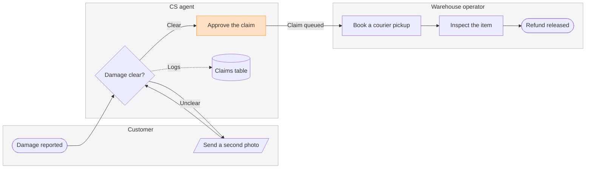

The check passed and the route is settled. The gate, as its own reply:

The check passed: 8 nodes and 8 connectors, widest rank 3, longest path 6, 0 crossing pairs, labels averaging 16 characters.

**Question:** who does what, and where does the claim change hands?
**Outcome:** a reader can see which team owns each step of a damaged-item refund and where the claim moves from CS to the warehouse.
**First glance:** Approve the claim, the handoff from CS to the warehouse you asked to highlight.
**Second glance:** Damage clear?, the check that routes the claim, with the second-photo loop beside it.
**Last glance:** the claims table, where every decision is logged.

The sketch the yes covers:

**File:** the existing FigJam file <test-file-key>, the one you named. **Plan:** you named the Fernhouse Product plan, and no plan the account holds carries that name (whoami returns <figma-plan-3>, <figma-plan-1> and <figma-plan-2>), so the board lands in the plan the file already sits in.

**Route:** use_figma, the composed route that would draw the title, the tinted lanes, the key and the source line, failed to connect on every attempt, so the write falls to generate_diagram, Figma's generator. It draws the diagram alone in its own font, colours and layout: no title, no subtitle, no key and no source line, and the highlight rides on the style line, which the generator draws in that pair or its own.

**Writes:** one generated diagram, 3 lanes, 8 nodes and 8 connectors, into the existing file, beside the four sections titled Damaged-item refund that earlier runs left there.
**Extensions:** none.
**Calls:** one generate_diagram, then the get_figjam read-backs, including a re-read of the existing content so I can confirm nothing there changed.
**Rollback:** the generated diagram is removed by hand in FigJam, because a deletion needs use_figma, which is not connecting.

Write it?