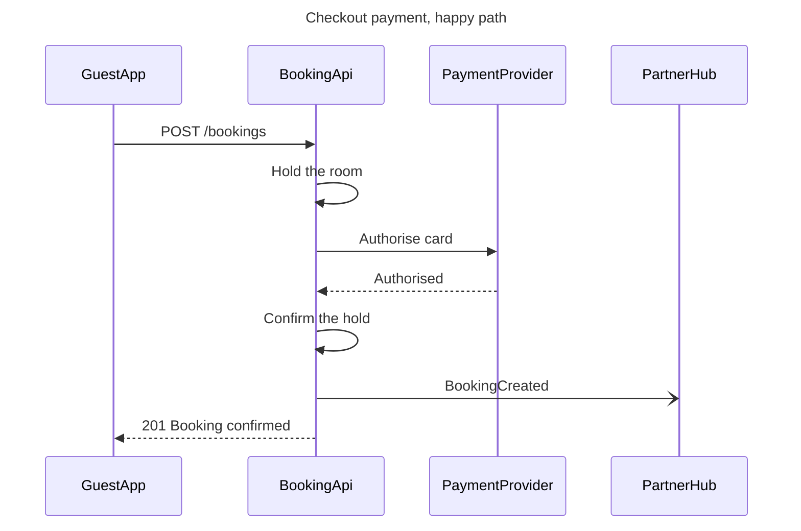

# FJ-025 turn 2 transcript

**User:** Yes, that reading is right.

**Assistant:**

Reading confirmed. The checked model is below, then the gate.



```text
Question: in what order do the app, the booking API, the payment provider and the partner hub exchange messages during checkout payment?
Outcome: the payments team can read the checkout calls in order, with their paths and status codes, for a card that is authorised.
First glance: Authorise card, the call to the payment provider that decides the checkout.
Second glance: Authorised, the answer that lets the booking API confirm the hold and answer the app.
Last glance: BookingCreated, the message to the partner hub that does not hold up the answer.
Plan: Roamstay Product. File: the existing FigJam file with key <test-file-key>, the new board landing to the right of what is already in the file.
Writes: one composed board, 4 participants and 7 numbered messages, with a title, a key and a source line, at balanced detail, engineer audience, Laptop reading distance.
Extensions: none.
Calls: create_session, one use_figma and one get_figjam read-back.
Rollback: delete the one board section this write returns, only on your yes to that deletion alone.
Write it?
```
