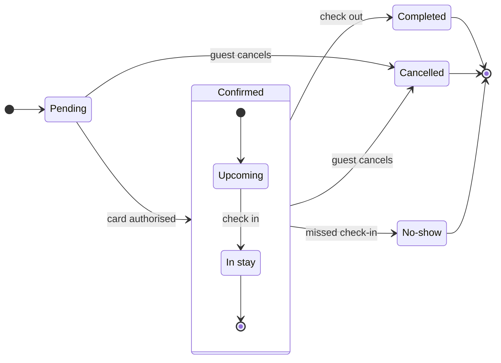

# FJ-026 turn 2 transcript

**User:** Yes, that reading is right.

**Assistant:**

The reading is confirmed. Now I'll write the model to a temp file outside the repository, run the pre-write check, and compose the board code for the gate.

**Tool call:** `exec` `{"command": "grep -n \"argparse\\|add_argument\\|def main\\|sys.argv\" \"/private/var/folders/3c/zfqcqsts0kn19cgblj82gqhm0000gn/T/devin-compare-bench/FJ-026/sk-create-figjam/scripts/flow_check.py\" | head; echo ===; grep -n \"add_argument\\|def main\" \"/private/var/folders/3c/zfqcqsts0kn19cgblj82gqhm0000gn/T/devin-compare-bench/FJ-026/sk-create-figjam/scripts/compose_board.py\" | head"}`

**Tool result:** `exec`

```text
Output from command in shell 381727:
285:def main() -> int:
287:    args = sys.argv[1:]
===
1293:def main() -> int:


Exit code: 0
```

**Tool call:** `read` `{"limit": 31, "offset": 285, "file_path": "/private/var/folders/3c/zfqcqsts0kn19cgblj82gqhm0000gn/T/devin-compare-bench/FJ-026/sk-create-figjam/scripts/flow_check.py"}`

**Tool result:** `read`

```text
<file-view path="/private/var/folders/3c/zfqcqsts0kn19cgblj82gqhm0000gn/T/devin-compare-bench/FJ-026/sk-create-figjam/scripts/flow_check.py" start_line="285" end_line="297" total_lines="297">
285|def main() -> int:
286|    """Dispatch the command line and return the exit code the usage lines document."""
287|    args = sys.argv[1:]
288|    if args == ["--self-test"]:
289|        return self_test()
290|    if len(args) != 1:
291|        print(__doc__.strip().split("Usage:")[1], file=sys.stderr)
292|        return 2
293|    return check(Path(args[0]))
294|
295|
296|if __name__ == "__main__":
297|    sys.exit(main())
</file-view>
```

**Tool call:** `read` `{"file_path": "/private/var/folders/3c/zfqcqsts0kn19cgblj82gqhm0000gn/T/devin-compare-bench/FJ-026/sk-create-figjam/scripts/compose_board.py", "limit": 31, "offset": 1293}`

**Tool result:** `read`

```text
<file-view path="/private/var/folders/3c/zfqcqsts0kn19cgblj82gqhm0000gn/T/devin-compare-bench/FJ-026/sk-create-figjam/scripts/compose_board.py" start_line="1293" end_line="1323" total_lines="1323">
1293|def main() -> int:
1294|    """Dispatch the command line and return the exit code the usage lines document."""
1295|    args = sys.argv[1:]
1296|    if args == ["--self-test"]:
1297|        return self_test()
1298|    if args == ["--template"]:
1299|        print(compact_template())
1300|        return 0
1301|    if args == ["--design-check"]:
1302|        return design_check()
1303|    if not args or args[0].startswith("--"):
1304|        print(__doc__.strip().split("Usage:")[1], file=sys.stderr)
1305|        return 2
1306|    path, number, out, model_only = Path(args[0]), 1, None, False
1307|    rest = args[1:]
1308|    while rest:
1309|        flag = rest.pop(0)
1310|        if flag == "--diagram" and rest:
1311|            number = int(rest.pop(0))
1312|        elif flag == "--out" and rest:
1313|            out = Path(rest.pop(0))
1314|        elif flag == "--model":
1315|            model_only = True
1316|        else:
1317|            print(__doc__.strip().split("Usage:")[1], file=sys.stderr)
1318|            return 2
1319|    return compose(path, number, out, model_only)
1320|
1321|
1322|if __name__ == "__main__":
1323|    sys.exit(main())
</file-view>
```

**Tool call:** `exec` `{"command": "TMPD=$(mktemp -d /tmp/figjam-flow.XXXXXX) && echo \"$TMPD\" > /tmp/figjam-flow-last-dir && cat > \"$TMPD/booking-status.model.md\" <<'EOF'\nstateDiagram-v2\n    %% title: Booking status\n    %% subtitle: Every status a Roamstay booking passes through, and what moves it on, for Guest Support\n    %% source: Source: the Product Owner's lifecycle description.\n    direction LR\n    state \"No-show\" as NoShow\n    [*] --> Pending\n    Pending --> Confirmed: card authorised\n    state Confirmed {\n        state \"In stay\" as InStay\n        [*] --> Upcoming\n        Upcoming --> InSt`

**Tool result:** `exec`

```text
Output from command in shell 2b2698:
mermaid_extract: booking-status.model.md: no fenced mermaid block found
UNREADABLE /tmp/figjam-flow.4sxlCN/booking-status.model.md: the extractor refused it


Exit code: 2
```

**Assistant:**

The check wants a fenced Mermaid block. Wrapping and re-running:

**Tool call:** `exec` `{"command": "TMPD=$(cat /tmp/figjam-flow-last-dir) && cat > \"$TMPD/booking-status.model.md\" <<'EOF'\n```mermaid\nstateDiagram-v2\n    %% title: Booking status\n    %% subtitle: Every status a Roamstay booking passes through, and what moves it on, for Guest Support\n    %% source: Source: the Product Owner's lifecycle description.\n    direction LR\n    state \"No-show\" as NoShow\n    [*] --> Pending\n    Pending --> Confirmed: card authorised\n    state Confirmed {\n        state \"In stay\" as InStay\n        [*] --> Upcoming\n        Upcoming --> InStay: check in\n        InStay --> [*]\n`

**Tool result:** `exec`

```text
Output from command in shell 65dc09:
  diagram 1, state: ok, 7 states and 12 transitions
PASSED 1 diagram(s) in booking-status.model.md


Exit code: 0
```

**Assistant:**

Check passed: 7 states, 12 transitions. Now composing the board code:

**Tool call:** `exec` `{"command": "TMPD=$(cat /tmp/figjam-flow-last-dir) && python3 \"/private/var/folders/3c/zfqcqsts0kn19cgblj82gqhm0000gn/T/devin-compare-bench/FJ-026/sk-create-figjam/scripts/compose_board.py\" \"$TMPD/booking-status.model.md\" --diagram 1 --out \"$TMPD/booking-status.compose.js\"; echo \"exit=$?\"; ls -la \"$TMPD\""}`

**Tool result:** `exec`

```text
Output from command in shell 9f416b:
COMPOSED diagram 1, 7 states and 12 transitions: 12 nodes and 12 connectors to read back, 48189 characters in /tmp/figjam-flow.4sxlCN/booking-status.compose.js, drawn in the design FigJam default
exit=0
total 104
drwx------@   4 michelkerkmeester  wheel    128 26 Oct 00:46 .
drwxrwxrwt  991 root               wheel  31712 26 Oct 00:46 ..
-rw-r--r--@   1 michelkerkmeester  wheel  48189 26 Oct 00:46 booking-status.compose.js
-rw-r--r--@   1 michelkerkmeester  wheel    717 26 Oct 00:46 booking-status.model.md


Exit code: 0
```

**Assistant:**

Composed cleanly: 12 nodes and 12 connectors to read back, drawn in the shipped FigJam default design, no design warnings, and the code fits one `use_figma` call. The quality rubric holds — every state and edge is one you named, the board sits inside the state budget (7 of 9 states, 12 of 12 transitions), the composite groups what belongs together, and the key names every mark.

Here is the checked sketch the board will draw:



**Question:** which statuses exist and what moves a booking between them?
**Outcome:** support can read every booking status and spot the statuses a booking ends in.
**First glance:** Pending, the light blue state every booking starts in, at the left end of the spine.
**Second glance:** the three gray end states, Completed, Cancelled and No-show, which the key names Final state.
**Last glance:** the key and the source line under the diagram.
**Plan:** Roamstay Product, as you named it. **File:** the existing FigJam file `<test-file-key>`, written as a new board section to the right of everything already there; the nine earlier boards stay untouched.
**Writes:** one composed board, 7 states and 12 transitions, the end states in light gray, with a title, a key and a source line, at the Laptop reading distance.
**Extensions:** none.
**Calls:** one `use_figma` write and one `get_figjam` read-back (the session is already open).
**Rollback:** delete the one board section the write returns, on your yes.

Write it?
