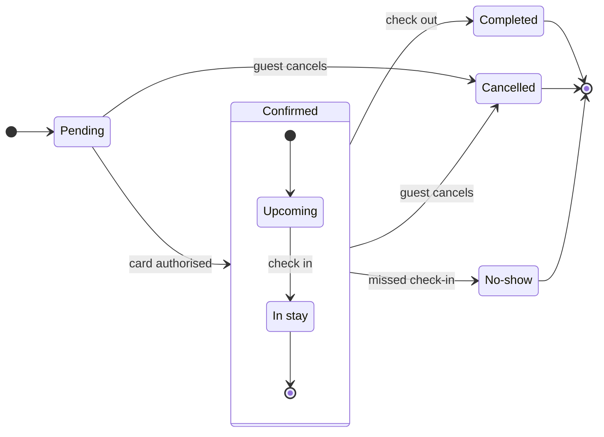

Composed cleanly: 12 nodes and 12 connectors to read back, drawn in the shipped FigJam default design, no design warnings, and the code fits one `use_figma` call. The quality rubric holds — every state and edge is one you named, the board sits inside the state budget (7 of 9 states, 12 of 12 transitions), the composite groups what belongs together, and the key names every mark.

Here is the checked sketch the board will draw:

**Question:** which statuses exist and what moves a booking between them?
**Outcome:** support can read every booking status and spot the statuses a booking ends in.
**First glance:** Pending, the light blue state every booking starts in, at the left end of the spine.
**Second glance:** the three gray end states, Completed, Cancelled and No-show, which the key names Final state.
**Last glance:** the key and the source line under the diagram.
**Plan:** Roamstay Product, as you named it. **File:** the existing FigJam file `<test-file-key>`, written as a new board section to the right of everything already there; the nine earlier boards stay untouched.
**Writes:** one composed board, 7 states and 12 transitions, the end states in light gray, with a title, a key and a source line, at the Laptop reading distance.
**Extensions:** none.
**Calls:** one `use_figma` write and one `get_figjam` read-back (the session is already open).
**Rollback:** delete the one board section the write returns, on your yes.

Write it?