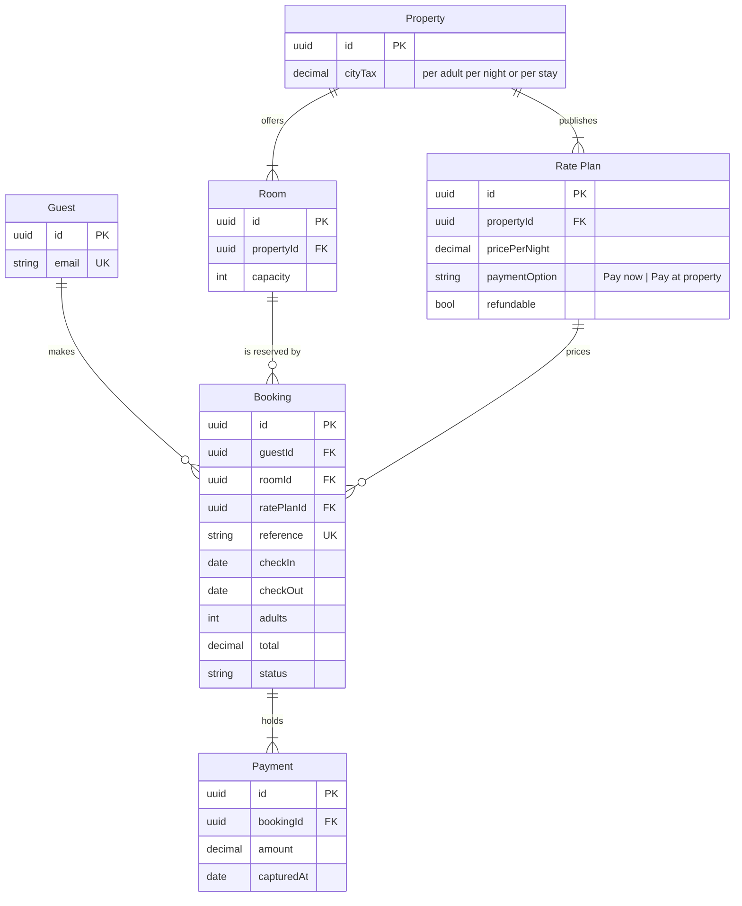

# FJ-027 turn 2 transcript

**User:** Yes, that reading is right.

**Assistant:**

The reading is confirmed. Now I'll write the model to a temp file outside the repository and run the pre-write check.

**Tool call:** `exec` `{"command": "mkdir -p /tmp/flow-er-stays && cat > /tmp/flow-er-stays/model.md <<'EOF'\n```mermaid\nerDiagram\n    %% title: Stays model\n    %% subtitle: The tables behind a stay, split into the guest side and the partner side\n    %% source: Sources: the stays schema note and support ticket 58213. Left out: the schema note's other columns.\n    %% zone: Guest side: Guest, Booking, Payment\n    %% zone: Partner side: Property, Room, RatePlan\n    Guest ||--o{ Booking : makes\n    Booking ||--|{ Payment : holds\n    Room ||--o{ Booking : \"is reserved by\"\n    RatePlan ||--o{ Booking : prices\`

**Tool result:** `exec`

```text
Output from command in shell 1fee0e:
  diagram 1, ER: ok, 6 entities and 6 relationships
PASSED 1 diagram(s) in model.md


Exit code: 0
```

**Assistant:**

Check passed. Now the quality rubric walk and the compose, so the gate can state the counts.

**Tool call:** `exec` `{"command": "cd \"/private/var/folders/3c/zfqcqsts0kn19cgblj82gqhm0000gn/T/devin-compare-bench/FJ-027\" && python3 sk-create-figjam/scripts/compose_board.py /tmp/flow-er-stays/model.md --diagram 1 --out /tmp/flow-er-stays/board-code.txt && wc -c /tmp/flow-er-stays/board-code.txt"}`

**Tool result:** `exec`

```text
Output from command in shell 2e94a3:
COMPOSED diagram 1, 6 entities and 6 relationships: 6 nodes and 6 connectors to read back, 49043 characters in /tmp/flow-er-stays/board-code.txt, drawn in the design FigJam default
   49043 /tmp/flow-er-stays/board-code.txt


Exit code: 0
```

**Assistant:**

COMPOSED with no design warnings: 6 entities, 6 relationships, 49,043 characters, inside the one-call limit. The rubric walk holds (every entity and edge is stated by the request, the three glance lines are written, provenance is all current behavior). The gate is its own reply, so this waits for your yes before anything is written.

**Question:** which entities exist, which fields join them and how many of each?
**Outcome:** a reader can see the six stay tables, how they join and which tables sit on the guest side and which on the partner side
**First glance:** Booking, the table every other stay table joins
**Second glance:** the keys on Booking that tie it to the guest, the room and the rate plan
**Last glance:** Property, the partner table that offers rooms and rate plans
**Plan:** Roamstay Product, the plan you named. **File:** the existing FigJam file with key `<test-file-key>`, not a new file
**Writes:** one composed board, 6 entities and 6 relationships in two zones, guest side and partner side, 26 attributes, with a title, a subtitle, a key and a source line, at the Laptop reading distance. It lands beside what the file already holds, 400 pixels to the right of it
**Extensions:** none
**Calls:** create_session, one `get_figjam` read of the file before the write, one `use_figma` compose and one `get_figjam` read-back
**Rollback:** delete the one board section the write returns, only on its own yes

The sketch, the checked model:



Write it?
