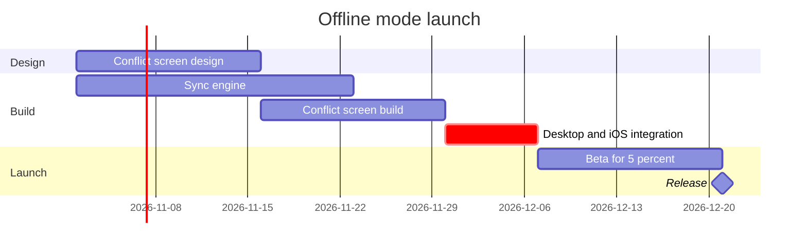

# FJ-028 turn 2 transcript

**User:** Yes, that reading is right.

**Assistant:**

The reading is confirmed. Now I'll write the model to a temp file outside the repository and run the pre-write check on it.

**Tool call:** `write` `{"file_path": "/tmp/loomlist-offline-gantt.md", "content": "gantt\n    title Offline mode launch\n    %% subtitle: Which work runs when before the offline mode release, and what holds it\n    %% source: Source: the offline mode launch plan as requested. Left out: Android next quarter, a proposal that is not yet approved, with no dates.\n    %% focus: integrate\n    dateFormat YYYY-MM-DD\n    section Design\n    Conflict screen design :design, 2026-11-02, 2w\n    section Build\n    Sync engine :engine, 2026-11-02, 3w\n    Conflict screen build :screen, after design, 2w\n    Desktop and iOS inte`

**Tool result:** `write`

```text
File created successfully at: /tmp/loomlist-offline-gantt.md
```

**Tool call:** `exec` `{"command": "cd \"/private/var/folders/3c/zfqcqsts0kn19cgblj82gqhm0000gn/T/devin-compare-bench/FJ-028\" && python3 sk-create-figjam/scripts/flow_check.py /tmp/loomlist-offline-gantt.md"}`

**Tool result:** `exec`

```text
Output from command in shell e7d521:
mermaid_extract: loomlist-offline-gantt.md: no fenced mermaid block found
UNREADABLE /tmp/loomlist-offline-gantt.md: the extractor refused it


Exit code: 2
```

**Assistant:**

The checker wants a fenced mermaid block. Wrapping the model and re-running.

**Tool call:** `write` `{"file_path": "/tmp/loomlist-offline-gantt.md", "content": "```mermaid\ngantt\n    title Offline mode launch\n    %% subtitle: Which work runs when before the offline mode release, and what holds it\n    %% source: Source: the offline mode launch plan as requested. Left out: Android next quarter, a proposal that is not yet approved, with no dates.\n    %% focus: integrate\n    dateFormat YYYY-MM-DD\n    section Design\n    Conflict screen design :design, 2026-11-02, 2w\n    section Build\n    Sync engine :engine, 2026-11-02, 3w\n    Conflict screen build :screen, after design, 2w\n    Desktop `

**Tool result:** `write`

```text
The file /tmp/loomlist-offline-gantt.md has been updated. Here's the result of running `cat -n` on a snippet of the edited file:
  1|```mermaid
  2|gantt
  3|    title Offline mode launch
  4|    %% subtitle: Which work runs when before the offline mode release, and what holds it
  5|    %% source: Source: the offline mode launch plan as requested. Left out: Android next quarter, a proposal that is not yet approved, with no dates.
  6|    %% focus: integrate
  7|    dateFormat YYYY-MM-DD
  8|    section Design
  9|    Conflict screen design :design, 2026-11-02, 2w
 10|    section Build
 11|    Sync engine :engine, 2026-11-02, 3w
 12|    Conflict screen build :screen, after design, 2w
 13|    Desktop and iOS integration :crit, integrate, after engine screen, 1w
 14|    section Launch
 15|    Beta for 5 percent :beta, after integrate, 2w
 16|    Release :milestone, after beta, 0d
 17|```
```

**Tool call:** `exec` `{"command": "cd \"/private/var/folders/3c/zfqcqsts0kn19cgblj82gqhm0000gn/T/devin-compare-bench/FJ-028\" && python3 sk-create-figjam/scripts/flow_check.py /tmp/loomlist-offline-gantt.md"}`

**Tool result:** `exec`

```text
Output from command in shell 7fe86f:
  diagram 1, gantt: ok, 6 tasks in 3 sections
PASSED 1 diagram(s) in loomlist-offline-gantt.md


Exit code: 0
```

**Assistant:**

The check passed. Let me see whether the checker prints layout measures for a gantt, then walk the quality rubric before the gate.

**Tool call:** `exec` `{"command": "cd \"/private/var/folders/3c/zfqcqsts0kn19cgblj82gqhm0000gn/T/devin-compare-bench/FJ-028\" && python3 sk-create-figjam/scripts/flow_check.py --help 2>&1 | head -30"}`

**Tool result:** `exec`

```text
Output from command in shell 75db01:
mermaid_extract: --help: not a Mermaid file
UNREADABLE --help: the extractor refused it

Exit code: 2
```

**Assistant:**

The check passed: `diagram 1, gantt: ok, 6 tasks in 3 sections`. I walked the quality rubric (type fit, remove test, signal, provenance all hold; the plan's five lines are stated facts, the dependencies are stated from both ends, and nothing runs today so no bar carries the active tag). Here is the gate.

Question: which work runs when, and what holds the release?
Outcome: a reader can see the order of the offline mode work, the critical path and where the release lands.

First glance: Desktop and iOS integration, the critical path task that holds the release.
Second glance: Sync engine and Conflict screen build, the two builds integration waits for.
Last glance: Beta for 5 percent and the Release milestone at the end.

The checked model the board will draw:



Plan: Loomlist Product, the plan you named. File: the existing FigJam file you named, key <test-file-key>.
Writes: one composed board, 3 sections, 5 tasks and 1 milestone on one axis, with a title, a key and a source line, at the Laptop reading distance.
Extensions: none.
Calls: one use_figma and one get_figjam read-back (the session on the file is already open).
Rollback: delete the one board section the write returns, on its own yes.

One thing to know before you answer: this file already holds three boards titled Offline mode launch that earlier sessions wrote (sections 75:1067, 94:3122 and 141:5330). The new board lands to the right of everything on the page and does not touch them. After the new board is written and read back, I will ask whether to delete those three, and that deletion waits for its own yes, so this yes never covers it.

Write it?
