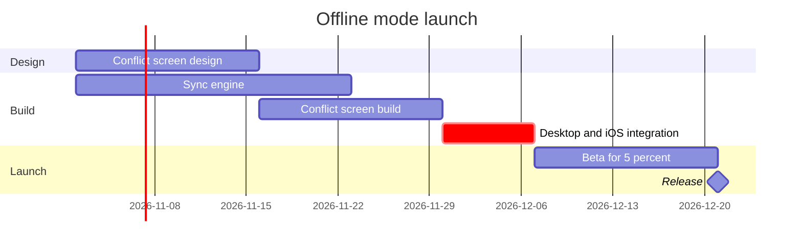

The check passed: `diagram 1, gantt: ok, 6 tasks in 3 sections`. I walked the quality rubric (type fit, remove test, signal, provenance all hold; the plan's five lines are stated facts, the dependencies are stated from both ends, and nothing runs today so no bar carries the active tag). Here is the gate.

Question: which work runs when, and what holds the release?
Outcome: a reader can see the order of the offline mode work, the critical path and where the release lands.

First glance: Desktop and iOS integration, the critical path task that holds the release.
Second glance: Sync engine and Conflict screen build, the two builds integration waits for.
Last glance: Beta for 5 percent and the Release milestone at the end.

The checked model the board will draw:

Plan: Loomlist Product, the plan you named. File: the existing FigJam file you named, key <test-file-key>.
Writes: one composed board, 3 sections, 5 tasks and 1 milestone on one axis, with a title, a key and a source line, at the Laptop reading distance.
Extensions: none.
Calls: one use_figma and one get_figjam read-back (the session on the file is already open).
Rollback: delete the one board section the write returns, on its own yes.

One thing to know before you answer: this file already holds three boards titled Offline mode launch that earlier sessions wrote (sections 75:1067, 94:3122 and 141:5330). The new board lands to the right of everything on the page and does not touch them. After the new board is written and read back, I will ask whether to delete those three, and that deletion waits for its own yes, so this yes never covers it.

Write it?