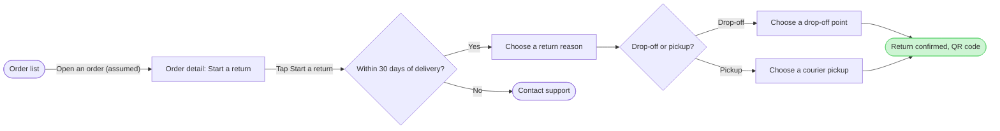

# FJ-022 turn 3 transcript

**User:** Yes, go ahead.

**Assistant:**

The outline is confirmed. I’m preparing the checked Mermaid model and composition payload now; the next message will show the exact write plan and ask about that write before I change the FigJam file.

**Tool call:** `command_execution` `{"command": "/bin/zsh -lc 'mktemp -d /tmp/fernhouse-return-flow.XXXXXX'", "changes": null}`

**Tool result:** `command_execution`

```text
/tmp/fernhouse-return-flow.xOUUB9

```

**Tool call:** `command_execution` `{"command": "/bin/zsh -lc \"cat > '/tmp/fernhouse-return-flow.xOUUB9/model.md' <<'EOF'\n## Provenance\n\n| Item | Kind | Source | Source class | Confidence | Rung / resolution |\n| --- | --- | --- | --- | --- | --- |\n| orders | node | User-confirmed app summary | current behavior | high | stated |\n| detail | node | User-confirmed app summary | current behavior | high | stated |\n| window | node | User-confirmed returns-doc summary | current behavior | high | stated |\n| support | node | User-confirmed returns-doc summary | current behavior | high | stated |\n| reason | node | User-confirmed `

**Tool result:** `command_execution`

```text

```

**Tool call:** `command_execution` `{"command": "/bin/zsh -lc \"python3 sk-create-figjam/scripts/flow_check.py '/tmp/fernhouse-return-flow.xOUUB9/model.md'\"", "changes": null}`

**Tool result:** `command_execution`

```text
  diagram 1, user flow: ok, 9 nodes and 9 connectors, widest rank 2 steps, longest path 7 steps, 1.0 connectors per step, labels average 20 characters, 0 crossing pairs
PASSED 1 diagram(s) in model.md

```

**Tool call:** `command_execution` `{"command": "/bin/zsh -lc \"python3 sk-create-figjam/scripts/compose_board.py '/tmp/fernhouse-return-flow.xOUUB9/model.md' --diagram 1 --out '/tmp/fernhouse-return-flow.xOUUB9/code.js'\"", "changes": null}`

**Tool result:** `command_execution`

```text
COMPOSED diagram 1, 9 nodes and 9 connectors, widest rank 2 steps, longest path 7 steps, 1.0 connectors per step, labels average 20 characters, 0 crossing pairs: 9 nodes and 9 connectors to read back, 48989 characters in /tmp/fernhouse-return-flow.xOUUB9/code.js, drawn in the design FigJam default

```

**Tool call:** `command_execution` `{"command": "/bin/zsh -lc \"cat '/tmp/fernhouse-return-flow.xOUUB9/code.js'\"", "changes": null}`

**Tool result:** `command_execution`

```text
const MODEL={"type":"graph","profile":"user-flow","direction":"LR","zoneMode":"stage","zones":[{"id":"find-the-order","label":"Find the order"},{"id":"request-the-return","label":"Request the return"},{"id":"done","label":"Done"}],"nodes":[{"id":"orders","label":"Order list","kind":"start","zone":"find-the-order"},{"id":"detail","label":"Order detail: Start a return","kind":"screen","zone":"find-the-order"},{"id":"window","label":"Within 30 days?","kind":"decision","zone":"request-the-return"},{"id":"reason","label":"Choose a return reason","kind":"screen","zone":"request-the-return"},{"id":"support","label":"Contact support","kind":"exit","zone":"request-the-return"},{"id":"method","label":"Drop-off or pickup?","kind":"decision","zone":"request-the-return"},{"id":"dropoff","label":"Choose a drop-off point","kind":"screen","zone":"request-the-return"},{"id":"pickup","label":"Choose a courier pickup","kind":"screen","zone":"request-the-return"},{"id":"confirmed","label":"Return confirmed, QR code","kind":"success","zone":"done","accent":true}],"edges":[{"from":"orders","to":"detail","label":"Open an order (assumed)"},{"from":"detail","to":"window","label":"Tap Start a return"},{"from":"window","to":"reason","label":"Yes"},{"from":"window","to":"support","label":"No"},{"from":"reason","to":"method"},{"from":"method","to":"dropoff","label":"Drop-off"},{"from":"method","to":"pickup","label":"Pickup"},{"from":"dropoff","to":"confirmed"},{"from":"pickup","to":"confirmed"}],"expect"
```

**Assistant:**

I’m making one wording correction before the gate: the decision label will say “30 days of delivery” so the cutoff has its source-defined anchor. I’ll rerun the check and composition on that final wording.

**Tool call:** `command_execution` `{"command": "/bin/zsh -lc \"cat > '/tmp/fernhouse-return-flow.xOUUB9/model.md' <<'EOF'\n## Provenance\n\n| Item | Kind | Source | Source class | Confidence | Rung / resolution |\n| --- | --- | --- | --- | --- | --- |\n| orders | node | User-confirmed app summary | current behavior | high | stated |\n| detail | node | User-confirmed app summary | current behavior | high | stated |\n| window | node | User-confirmed returns-doc summary | current behavior | high | stated |\n| support | node | User-confirmed returns-doc summary | current behavior | high | stated |\n| reason | node | User-confirmed `

**Tool result:** `command_execution`

```text

```

**Tool call:** `command_execution` `{"command": "/bin/zsh -lc \"python3 sk-create-figjam/scripts/flow_check.py '/tmp/fernhouse-return-flow.xOUUB9/model.md'\"", "changes": null}`

**Tool result:** `command_execution`

```text
  diagram 1, user flow: ok, 9 nodes and 9 connectors, widest rank 2 steps, longest path 7 steps, 1.0 connectors per step, labels average 21 characters, 0 crossing pairs
PASSED 1 diagram(s) in model.md

```

**Tool call:** `command_execution` `{"command": "/bin/zsh -lc \"python3 sk-create-figjam/scripts/compose_board.py '/tmp/fernhouse-return-flow.xOUUB9/model.md' --diagram 1 --out '/tmp/fernhouse-return-flow.xOUUB9/code.js'\"", "changes": null}`

**Tool result:** `command_execution`

```text
COMPOSED diagram 1, 9 nodes and 9 connectors, widest rank 2 steps, longest path 7 steps, 1.0 connectors per step, labels average 21 characters, 0 crossing pairs: 9 nodes and 9 connectors to read back, 48999 characters in /tmp/fernhouse-return-flow.xOUUB9/code.js, drawn in the design FigJam default

```

**Tool call:** `command_execution` `{"command": "/bin/zsh -lc \"cat '/tmp/fernhouse-return-flow.xOUUB9/code.js'\"", "changes": null}`

**Tool result:** `command_execution`

```text
const MODEL={"type":"graph","profile":"user-flow","direction":"LR","zoneMode":"stage","zones":[{"id":"find-the-order","label":"Find the order"},{"id":"request-the-return","label":"Request the return"},{"id":"done","label":"Done"}],"nodes":[{"id":"orders","label":"Order list","kind":"start","zone":"find-the-order"},{"id":"detail","label":"Order detail: Start a return","kind":"screen","zone":"find-the-order"},{"id":"window","label":"Within 30 days of delivery?","kind":"decision","zone":"request-the-return"},{"id":"reason","label":"Choose a return reason","kind":"screen","zone":"request-the-return"},{"id":"support","label":"Contact support","kind":"exit","zone":"request-the-return"},{"id":"method","label":"Drop-off or pickup?","kind":"decision","zone":"request-the-return"},{"id":"dropoff","label":"Choose a drop-off point","kind":"screen","zone":"request-the-return"},{"id":"pickup","label":"Choose a courier pickup","kind":"screen","zone":"request-the-return"},{"id":"confirmed","label":"Return confirmed, QR code","kind":"success","zone":"done","accent":true}],"edges":[{"from":"orders","to":"detail","label":"Open an order (assumed)"},{"from":"detail","to":"window","label":"Tap Start a return"},{"from":"window","to":"reason","label":"Yes"},{"from":"window","to":"support","label":"No"},{"from":"reason","to":"method"},{"from":"method","to":"dropoff","label":"Drop-off"},{"from":"method","to":"pickup","label":"Pickup"},{"from":"dropoff","to":"confirmed"},{"from":"pickup","to":"confirmed
```

**Tool call:** `command_execution` `{"command": "/bin/zsh -lc \"cat '/private/var/folders/3c/zfqcqsts0kn19cgblj82gqhm0000gn/T/codex-compare-home/plugins/cache/openai-curated-remote/figma/16.0.0/skills/figma-use/references/gotchas.md'\"", "changes": null}`

**Tool result:** `command_execution`

```text
# Gotchas & Common Mistakes

> Part of the [use_figma skill](../SKILL.md). Every known pitfall with WRONG/CORRECT code examples.

## Contents

- Component properties and variant creation pitfalls
- Paint, color, and variable binding pitfalls
- Page context and plugin lifecycle pitfalls (set current page once per `use_figma` call; split multi-page work across calls)
- Auto Layout and sizing order pitfalls (including HUG/FILL interactions, and TEXT nodes that ignore FILL and collapse to a zero-width thread)
- Variant layout and geometry pitfalls
- Canonical text-edit recipe + font loading and text/typography pitfalls
- Sequential awaits — batch independent async calls with `Promise.all` (including `import*ByKeyAsync` families)
- Prefer indexed lookups (`getNodeByIdAsync`, `findAllWithCriteria`, `node.query`) over `findAll`/`findOne` full-tree scans
- Scope traversal to the smallest known ancestor (never `figma.root.findAll`; prefer `someFrame.findAllWithCriteria` over `figma.currentPage.findAllWithCriteria`)
- Variable scopes and mode pitfalls
- Node cleanup and empty-fill pitfalls
- "no such property" errors — reading or calling members not defined on the node type
- Non-existent property writes and "object is not extensible"
- width/height are read-only — use resize()
- detachInstance() and node ID invalidation
- Icons — import the SVG, never reconstruct from rotated line primitives


## New nodes default to (0,0) and overlap existing content

Every `figma.create*()` call pla
```

**Tool call:** `command_execution` `{"command": "/bin/zsh -lc \"cat '/private/var/folders/3c/zfqcqsts0kn19cgblj82gqhm0000gn/T/codex-compare-home/plugins/cache/openai-curated-remote/figma/16.0.0/skills/figma-use-figjam/references/create-section.md'\"", "changes": null}`

**Tool result:** `command_execution`

```text
# Create Sections

> Part of the [figma-use-figjam skill](../SKILL.md). Creating, modifying, and organizing sections.

**Scope:** Sections are FigJam containers created with `figma.createSection()`. They organize related objects on the board. For creating stickies to place inside sections, see [create-sticky](create-sticky.md). For creating text to place inside sections, see [create-text](create-text.md).

## Creating a Section

Create sections and resize them carefully according to the layout guidance in [plan-board-content](plan-board-content.md).

```javascript
const section = figma.createSection()
section.name = 'My Section'

// Sections start very small — resize to a usable size
section.resize(400, 300)

console.log('Created section:', section.id, section.name, section.width, 'x', section.height)
figma.closePlugin()
```

## Stickies vs. Text Nodes as section content

Stickies and text play different roles. Before adding section child content, make sure to read and understand the usage guidance for each in [create-sticky](create-sticky.md) and [create-text](create-text.md) skills.

## Naming

Section names should be **short, navigational identifiers** (e.g. "Brainstorm", "Action Items", "Went Well") — they are used for browsing and quick identification in FigJam's UI. The section name is NOT the user-facing header. Create a separate **H2 text node** inside the section for the visible, descriptive header. See [plan-board-content](plan-board-content.md) for guidance on clea
```

**Tool call:** `command_execution` `{"command": "/bin/zsh -lc \"cat '/private/var/folders/3c/zfqcqsts0kn19cgblj82gqhm0000gn/T/codex-compare-home/plugins/cache/openai-curated-remote/figma/16.0.0/skills/figma-use-figjam/references/create-shape-with-text.md'\"", "changes": null}`

**Tool result:** `command_execution`

```text
# Create Shapes with Text

> Part of the [figma-use-figjam skill](../SKILL.md). Creating shapes with embedded text for diagrams and visual layouts.

**Scope:** ShapeWithText nodes are FigJam-specific geometric shapes with built-in text, created with `figma.createShapeWithText()`. For tables, see [create-table](create-table.md). For sections, see [create-section](create-section.md). For stickies, see [create-sticky](create-sticky.md).

**When NOT to use this skill:** For tabular-data (e.g. data tables, spreadsheets, comparison tables, rosters, or any row/column grid of text or data), use the [create-table](create-table.md) skill instead. Do not build a table-like layout from a grid of shapes.

## Creating a Shape

```javascript
const shape = figma.createShapeWithText()
// Default shapeType is 'ELLIPSE'

await figma.loadFontAsync(shape.text.fontName)
shape.text.characters = 'Step 1'

console.log('Created shape:', shape.id, shape.shapeType, shape.text.characters)
figma.closePlugin()
```

## Shape Types

Set the `shapeType` property **after** creation. It defaults to `'ELLIPSE'`.

```javascript
const shape = figma.createShapeWithText()
shape.shapeType = 'DIAMOND'
```

Available shape types:

| Category          | Shape types                                                                                                              |
| ----------------- | ------------------------------------------------------------------------------------------------------------------------ |
| B
```

**Tool call:** `command_execution` `{"command": "/bin/zsh -lc \"cat '/private/var/folders/3c/zfqcqsts0kn19cgblj82gqhm0000gn/T/codex-compare-home/plugins/cache/openai-curated-remote/figma/16.0.0/skills/figma-use-figjam/references/create-connector.md'\"", "changes": null}`

**Tool result:** `command_execution`

```text
# Create Connectors

> Part of the [figma-use-figjam skill](../SKILL.md). Creating connectors between nodes — endpoints, arrows, line types, labels, and colors.

**Scope:** Connectors are FigJam-specific nodes created with `figma.createConnector()`. They connect shapes, stickies, sections, and other nodes to show relationships. For creating shapes to connect, see [create-shape-with-text](create-shape-with-text.md). For stickies, see [create-sticky](create-sticky.md). For sections, see [create-section](create-section.md).

## Creating a Connector Between Two Nodes

```javascript
const connector = figma.createConnector()
connector.connectorStart = { endpointNodeId: '123:456', magnet: 'AUTO' }
connector.connectorEnd = { endpointNodeId: '123:789', magnet: 'AUTO' }

console.log('Created connector:', connector.id)
figma.closePlugin()
```

## Connector Endpoints

Endpoints define where the connector starts and ends. There are three forms:

### Attached to a node with auto-magnet (most common)

```javascript
connector.connectorStart = { endpointNodeId: nodeA.id, magnet: 'AUTO' }
connector.connectorEnd = { endpointNodeId: nodeB.id, magnet: 'AUTO' }
```

### Attached to a node at a specific side

Magnet values: `'AUTO'`, `'TOP'`, `'BOTTOM'`, `'LEFT'`, `'RIGHT'`, `'CENTER'`, `'NONE'`

```javascript
connector.connectorStart = { endpointNodeId: nodeA.id, magnet: 'RIGHT' }
connector.connectorEnd = { endpointNodeId: nodeB.id, magnet: 'LEFT' }
```

### Floating (not attached to any node)

``
```

**Tool call:** `command_execution` `{"command": "/bin/zsh -lc \"cat '/private/var/folders/3c/zfqcqsts0kn19cgblj82gqhm0000gn/T/codex-compare-home/plugins/cache/openai-curated-remote/figma/16.0.0/skills/figma-use-figjam/references/create-text.md' && cat '/private/var/folders/3c/zfqcqsts0kn19cgblj82gqhm0000gn/T/codex-compare-home/plugins/cache/openai-curated-remote/figma/16.0.0/skills/figma-use-figjam/references/position-figjam-nodes.md'\"", "changes": null}`

**Tool result:** `command_execution`

```text
# Create Text Nodes

> Part of the [figma-use-figjam skill](../SKILL.md). Creating and styling standalone text nodes and mind map operations.

Use this skill when creating, modifying, or styling standalone text in FigJam (text created with the **Text** tool, not text inside stickies, shapes, or connectors). Also use this skill for mind map operations — adding, inserting, or extending connected text nodes.

**Scope:** Text nodes are created with `figma.createText()` and have type `'TEXT'`. For editing existing text content or mixed styles, see [edit-text](edit-text.md).

## When to use a Text Node

Use text nodes for titles, headers, labels, prompts, instructions, and any content that provides structure or context. They can also be used for longer descriptions or explanations.

## Creating a Text Node

```javascript
const text = figma.createText()

// Load the font before setting content (required for characters, fontSize, etc.)
await figma.loadFontAsync(text.fontName)
text.characters = 'Brainstorming instructions'

console.log('Created text:', text.id, text.characters)
figma.closePlugin()
```

## Text Wrapping and Width Constraints

By default, text nodes auto-resize in both width and height (`textAutoResize = 'WIDTH_AND_HEIGHT'`), meaning they never wrap — text extends in one line until it ends.

To make text wrap within a specific width (e.g., instructional text inside sections):

1. Set `textAutoResize = 'HEIGHT'` — text will grow vertically but respect the width constrain
```

**Tool call:** `command_execution` `{"command": "/bin/zsh -lc \"rg -n \\\"setSharedPluginData|createSection\\\\(|createShapeWithText\\\\(|createConnector\\\\(\\\" '/private/var/folders/3c/zfqcqsts0kn19cgblj82gqhm0000gn/T/codex-compare-home/plugins/cache/openai-curated-remote/figma/16.0.0/skills/figma-use/references/plugin-api-standalone.d.ts' | sed -n '1,70p'\"", "changes": null}`

**Tool result:** `command_execution`

```text
569:   * const connector = figma.createConnector()
581:  createConnector(): ConnectorNode
593:   *   const shape = figma.createShapeWithText()
602:  createShapeWithText(): ShapeWithTextNode
613:  createSection(): SectionNode
4063:   * Retrieves custom information that was stored on this node or style using {@link PluginDataMixin.setSharedPluginData}. If there is no data stored for the provided namespace and key, an empty string is returned.
4083:  setSharedPluginData(namespace: string, key: string, value: string): void
4085:   * Retrieves a list of all keys stored on this node or style using {@link PluginDataMixin.setSharedPluginData}. This enables iterating through all data stored in a given namespace.

```

**Assistant:**

I’m also keeping “Fernhouse customer” in the subtitle; the decision node carries the precise “30 days of delivery” cutoff. Then I’ll present the final checked sketch at the gate.

**Tool call:** `command_execution` `{"command": "/bin/zsh -lc \"cat > '/tmp/fernhouse-return-flow.xOUUB9/model.md' <<'EOF'\n## Provenance\n\n| Item | Kind | Source | Source class | Confidence | Rung / resolution |\n| --- | --- | --- | --- | --- | --- |\n| orders | node | User-confirmed app summary | current behavior | high | stated |\n| detail | node | User-confirmed app summary | current behavior | high | stated |\n| window | node | User-confirmed returns-doc summary | current behavior | high | stated |\n| support | node | User-confirmed returns-doc summary | current behavior | high | stated |\n| reason | node | User-confirmed `

**Tool result:** `command_execution`

```text

```

**Tool call:** `command_execution` `{"command": "/bin/zsh -lc \"python3 sk-create-figjam/scripts/flow_check.py '/tmp/fernhouse-return-flow.xOUUB9/model.md'\"", "changes": null}`

**Tool result:** `command_execution`

```text
  diagram 1, user flow: ok, 9 nodes and 9 connectors, widest rank 2 steps, longest path 7 steps, 1.0 connectors per step, labels average 21 characters, 0 crossing pairs
PASSED 1 diagram(s) in model.md

```

**Tool call:** `command_execution` `{"command": "/bin/zsh -lc \"python3 sk-create-figjam/scripts/compose_board.py '/tmp/fernhouse-return-flow.xOUUB9/model.md' --diagram 1 --out '/tmp/fernhouse-return-flow.xOUUB9/code.js'\"", "changes": null}`

**Tool result:** `command_execution`

```text
COMPOSED diagram 1, 9 nodes and 9 connectors, widest rank 2 steps, longest path 7 steps, 1.0 connectors per step, labels average 21 characters, 0 crossing pairs: 9 nodes and 9 connectors to read back, 48997 characters in /tmp/fernhouse-return-flow.xOUUB9/code.js, drawn in the design FigJam default

```

**Tool call:** `command_execution` `{"command": "/bin/zsh -lc \"cat '/tmp/fernhouse-return-flow.xOUUB9/code.js'\"", "changes": null}`

**Tool result:** `command_execution`

```text
const MODEL={"type":"graph","profile":"user-flow","direction":"LR","zoneMode":"stage","zones":[{"id":"find-the-order","label":"Find the order"},{"id":"request-the-return","label":"Request the return"},{"id":"done","label":"Done"}],"nodes":[{"id":"orders","label":"Order list","kind":"start","zone":"find-the-order"},{"id":"detail","label":"Order detail: Start a return","kind":"screen","zone":"find-the-order"},{"id":"window","label":"Within 30 days of delivery?","kind":"decision","zone":"request-the-return"},{"id":"reason","label":"Choose a return reason","kind":"screen","zone":"request-the-return"},{"id":"support","label":"Contact support","kind":"exit","zone":"request-the-return"},{"id":"method","label":"Drop-off or pickup?","kind":"decision","zone":"request-the-return"},{"id":"dropoff","label":"Choose a drop-off point","kind":"screen","zone":"request-the-return"},{"id":"pickup","label":"Choose a courier pickup","kind":"screen","zone":"request-the-return"},{"id":"confirmed","label":"Return confirmed, QR code","kind":"success","zone":"done","accent":true}],"edges":[{"from":"orders","to":"detail","label":"Open an order (assumed)"},{"from":"detail","to":"window","label":"Tap Start a return"},{"from":"window","to":"reason","label":"Yes"},{"from":"window","to":"support","label":"No"},{"from":"reason","to":"method"},{"from":"method","to":"dropoff","label":"Drop-off"},{"from":"method","to":"pickup","label":"Pickup"},{"from":"dropoff","to":"confirmed"},{"from":"pickup","to":"confirmed
```

**Assistant:**

**Write gate**

**User intent:** How does a Fernhouse customer start a return in the app, and where does the 30-day limit direct them?

**Outcome:** The reader can follow the path from the order list to a QR code confirmation, or to Contact support after 30 days of delivery.

**First glance:** Return confirmed, QR code  
**Second glance:** Drop-off or pickup  
**Last glance:** Contact support



The pre-write check passed: 9 nodes, 9 connectors, 4 labelled decision exits, 0 crossings. The assumption that a customer opens an order to reach its detail is marked in the flow. Exact reason labels and the proposed free pickup stay out of the current-behavior path.

**Plan:** Fernhouse Product, as supplied  
**File:** Existing FigJam file `<test-file-key>`  
**Write:** Add one section titled “Start a return in the app,” placed to the right of existing page content. The existing “Start a return” section remains intact.  
**Extensions:** None  
**Calls:** One `use_figma` composition call and one `get_figjam` read-back  
**Rollback:** Delete only the new section after a separate explicit yes naming it

Write this section to the existing file?
