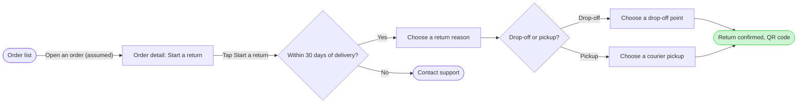

**Write gate**

**User intent:** How does a Fernhouse customer start a return in the app, and where does the 30-day limit direct them?

**Outcome:** The reader can follow the path from the order list to a QR code confirmation, or to Contact support after 30 days of delivery.

**First glance:** Return confirmed, QR code  
**Second glance:** Drop-off or pickup  
**Last glance:** Contact support

The pre-write check passed: 9 nodes, 9 connectors, 4 labelled decision exits, 0 crossings. The assumption that a customer opens an order to reach its detail is marked in the flow. Exact reason labels and the proposed free pickup stay out of the current-behavior path.

**Plan:** Fernhouse Product, as supplied  
**File:** Existing FigJam file `<test-file-key>`  
**Write:** Add one section titled “Start a return in the app,” placed to the right of existing page content. The existing “Start a return” section remains intact.  
**Extensions:** None  
**Calls:** One `use_figma` composition call and one `get_figjam` read-back  
**Rollback:** Delete only the new section after a separate explicit yes naming it

Write this section to the existing file?