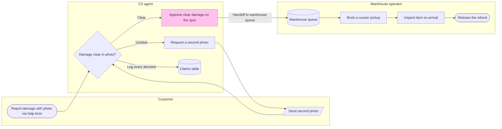

# FJ-023 turn 2 transcript

**User:** Yes, that reading is right.

**Assistant:**

Got it. I’ll append a new highlighted section to the existing file and leave the current section intact. I’m now building and checking the process model before I show you the separate write gate.

**Tool call:** `command_execution` `{"command": "/bin/zsh -lc 'cat /private/var/folders/3c/zfqcqsts0kn19cgblj82gqhm0000gn/T/codex-compare-home/plugins/cache/openai-curated-remote/figma/16.0.0/skills/figma-use-figjam/references/plan-board-content.md'", "changes": null}`

**Tool result:** `command_execution`

```text
# Plan Content for FigJam Boards

**When NOT to use this skill:** Do NOT read this skill for analysis, summarization, or investigation of existing board content (e.g. "summarize this board", "what themes are here?", "analyze the feedback"). This skill is exclusively for planning NEW content to be created on the board.

Do NOT use this skill for flowcharts, architecture diagrams, sequence diagrams, state diagrams, or entity relationship diagrams (ERDs). For those, use the `figma-plugin:figma-generate-diagram` skill and the `generate_diagram` tool.

Use this skill when determining **what content to include** for generated FigJam board content. Given a user's request (e.g. "make a brainstorm template", "retro board", "ice breaker", "scaffold"), produce a **sequential outline** that downstream skills can use to create sections, text, stickies, and layout.

**Must be loaded alongside the `figma-use-figjam` skill**, which provides the FigJam Plugin API references (create-section, create-sticky, create-text, position-figjam-nodes) needed to render the planned content.

## Part 1: Design Principles

### Reading direction and grouping

Left-to-right, top-to-bottom. Context on the left, evidence in the middle, proposal/asks on the right. Supporting detail and appendix below.

**Tight clustering** (60-92px) = same thought. **Loose spacing** (200-400px) = different topics. **Zone breaks** (1000px+) = different part of the board.

### Type scale

Use **Inter** exclusively. Subtitles shoul
```

**Tool call:** `command_execution` `{"command": "/bin/zsh -lc \"rg -n 'Evidence|inference|ladder|round|audience|Reading distance|DETAIL|detail' sk-create-figjam/references/flow-mode.md\"", "changes": null}`

**Tool result:** `command_execution`

```text
53:- **Thinking:** Standard energy, which caps the intake at three rounds, and Deep energy is five. Quick energy is zero rounds: it fills the Brief in Section 4 from the sources and the defaults rather than asking, marks each row it inferred `assumed` with what would settle it and sends one message with the rows, the chosen type and an offer to draw unless corrected. Just-do-it wording selects Quick and never Raw, which skips the phase flow. No energy skips the check or the gate, because they guard a write to a shared Figma plan
61:3. **Intake.** Read every source by its input type, as Section 4 sets out, classify each claim, set the detail level, the audience and the reading distance, and ask the questions the brief leaves open until the draw-ready threshold below is met, then settle the one sentence the board answers. That sentence is the `userIntent` the remove test and the write call both use. The intake writes one record per item, node or edge, before any Mermaid, into the provenance table that `assets/flow-templates.md` Section 3 lays out: the item, its kind, its source, its source class, its confidence and the rung of the inference ladder in Section 4 that reached it. Where a frame name and the heading a reader sees differ, both land in the row and the heading labels the node. No item reaches the model without a row
73:Two failures bracket the intake. Drawing before the rows are covered puts a guessed feature on the board, and asking past a settled row spends a round t
```

**Tool call:** `command_execution` `{"command": "/bin/zsh -lc 'python3 sk-create-figjam/scripts/flow_check.py --help'", "changes": null}`

**Tool result (error):** `command_execution`

```text
mermaid_extract: --help: not a Mermaid file
UNREADABLE --help: the extractor refused it

```

**Tool call:** `command_execution` `{"command": "/bin/zsh -lc 'python3 sk-create-figjam/scripts/compose_board.py --help'", "changes": null}`

**Tool result (error):** `command_execution`

```text

  compose_board.py <model.md> [--diagram N] [--out path]  -> 0 the filled code is written, 1 the model fails
                                                             the check, 2 unreadable or no such diagram
  compose_board.py <model.md> --model                      -> print the MODEL as JSON instead of the code
  compose_board.py --template                              -> print the compact code with its MODEL and THEME
                                                             placeholders, the text the Project's composer
                                                             Knowledge file carries
  compose_board.py --design-check                          -> print the design a board is drawn in, what it
                                                             changes, its measures and the THEME it sends: 0 the
                                                             design reads with no warning, 1 one or more warnings
  compose_board.py --self-test                             -> prove every shipped model composes, its counts
                                                             match the check, the code fits one use_figma call and
                                                             the board it draws keeps its geometry and its design

```

**Tool call:** `command_execution` `{"command": "/bin/zsh -lc \"rg -n 'dashedOptional|-.->|style .*fill|focus|type: process|source:' sk-create-figjam/scripts/flow_check.py sk-create-figjam/scripts/figjam_checks sk-create-figjam/scripts/compose_board.py sk-create-figjam/assets/compose-board.js && sed -n '250,292p' sk-create-figjam/references/flow-mode.md && cat /private/var/folders/3c/zfqcqsts0kn19cgblj82gqhm0000gn/T/codex-compare-home/plugins/cache/openai-curated-remote/figma/16.0.0/skills/figma-use/references/plugin-api-standalone.index.md | head -90\"", "changes": null}`

**Tool result:** `command_execution`

```text
sk-create-figjam/scripts/flow_check.py:19:- `flowchart` is a user flow unless a `%% type: process` or
sk-create-figjam/assets/compose-board.js:78:    focus: { key: 'In focus' },
sk-create-figjam/assets/compose-board.js:84:    title: 'Key', tint: 'gray', pin: 'Step number', dashedOptional: 'Optional or proposed',
sk-create-figjam/assets/compose-board.js:104:// A kind's fill, stroke and text. The focus kind draws the accent's own pair.
sk-create-figjam/assets/compose-board.js:105:const pairOf = (kind) => SWATCH[kind === 'focus' ? T.accent.pair : T.role[T.kind[kind].role]] || SWATCH.white;
sk-create-figjam/assets/compose-board.js:198:  const hot = accent || kind === 'focus';
sk-create-figjam/assets/compose-board.js:940:  const kinds = [...new Set([...M.nodes.map((n) => n.kind), ...M.nodes.filter((n) => n.accent).map(() => 'focus')])];
sk-create-figjam/assets/compose-board.js:942:  const key = kinds.map((kind) => (kind === 'focus' && marked ? { kind, like: marked.kind } : { kind }));
sk-create-figjam/assets/compose-board.js:1018:  focus: { cap: 'ARROW_EQUILATERAL', color: ACCENT, weight: T.accent.message },
sk-create-figjam/assets/compose-board.js:1060:  const used = [...new Set([...M.messages.map((m) => m.arrow), ...M.messages.filter((m) => m.accent).map(() => 'focus')])];
sk-create-figjam/assets/compose-board.js:1152:  const key = [...new Set(tasks.map(statusOf))].map((kind) => ({ kind })).concat(marked ? [{ kind: 'focus', like: statusOf(marked) }] : []);
sk-create-figjam/asset
```

**Tool call:** `command_execution` `{"command": "/bin/zsh -lc \"sed -n '1,125p' sk-create-figjam/scripts/figjam_checks/fixtures.py && sed -n '1,95p' sk-create-figjam/scripts/figjam_checks/board_fixtures.py && sed -n '1,110p' sk-create-figjam/scripts/flow_check.py && sed -n '250,390p' sk-create-figjam/scripts/figjam_checks/flowchart.py\"", "changes": null}`

**Tool result:** `command_execution`

```text
#!/usr/bin/env python3
# ───────────────────────────────────────────────────────────────
# COMPONENT: SELF-TEST FIXTURES
# ───────────────────────────────────────────────────────────────

"""Good models that must pass, and planted models that each break one rule.

Each planted model names the message its failure must print, so a rule that
stops firing, or fires with a message that no longer says what is wrong,
fails the self-test.
"""

GOOD = {
    "a user flow with one accent": """flowchart TD
    start([Open settings]) --> pick[Pick an option]
    pick --> saved{"Saved (to the account)?"}
    saved -->|Yes| done([Option shown])
    saved -->|No| retry[Show the error]
    retry --> pick
    %% a comment may hold `backticks`
    style done fill:#CDF4D3,stroke:#66D575
    style pick stroke:#66D575
    linkStyle 2 stroke:#66d575
""",
    "a left-to-right user flow in shorthand hex": """flowchart LR
    a([Open settings]) --> b["Pick an option: Brand™"]
    b --> c([Option shown])
    style c fill:#cdf4d3
""",
    "a laned process": """%% type: process
flowchart LR
    subgraph customer ["Customer"]
        ask([Return asked])
        label[/Print the label/]
    end
    subgraph agent ["CS agent"]
        review{Within 30 days?}
        approve[Approve the return]
        decline([Return declined])
    end
    subgraph warehouse ["Warehouse"]
        receive[Receive the parcel]
        orders[(Orders)]
        refund([Refund sent])
    end
    ask --> review
    review -->|Yes|
```

**Tool call:** `command_execution` `{"command": "/bin/zsh -lc \"rg -n 'ACCENT_PAIRS|def colour_problems|def node_problems|def lane_problems' sk-create-figjam/scripts/figjam_checks/common.py sk-create-figjam/scripts/figjam_checks/flowchart.py && sed -n '40,95p' sk-create-figjam/scripts/figjam_checks/common.py && sed -n '100,165p' sk-create-figjam/scripts/figjam_checks/flowchart.py\"", "changes": null}`

**Tool result:** `command_execution`

```text
sk-create-figjam/scripts/figjam_checks/flowchart.py:21:    ACCENT_PAIRS,
sk-create-figjam/scripts/figjam_checks/flowchart.py:98:def colour_problems(block_text: str, lanes: set[str], need_accent: bool = False) -> list[str]:
sk-create-figjam/scripts/figjam_checks/flowchart.py:118:            if fill not in ACCENT_PAIRS:
sk-create-figjam/scripts/figjam_checks/flowchart.py:121:            if stroke and stroke != ACCENT_PAIRS[fill]:
sk-create-figjam/scripts/figjam_checks/flowchart.py:122:                problems.append(f"fill {fill} takes the stroke {stroke}, but FigJam pairs it with {ACCENT_PAIRS[fill]}")
sk-create-figjam/scripts/figjam_checks/flowchart.py:160:def node_problems(diagram: Diagram, node: Node, block_text: str, first_id: str, shapes: dict) -> list[str]:
sk-create-figjam/scripts/figjam_checks/flowchart.py:188:def lane_problems(diagram: Diagram) -> tuple[list[str], set[str]]:
sk-create-figjam/scripts/figjam_checks/common.py:47:ACCENT_PAIRS = {
sk-create-figjam/scripts/figjam_checks/common.py:58:PAIRED_FILL = {stroke: fill for fill, stroke in ACCENT_PAIRS.items()}
STATE_GRAMMAR = re.compile(r"\[\*\]|<<(?:choice|fork|join)>>", re.I)
TYPE_DIRECTIVE = re.compile(r"^\s*%%\s*type\s*:\s*([A-Za-z-]+)\s*$", re.M)

# FigJam's light fills, each with the darker stroke FigJam pairs it with. Dark
# text reads on every one of them. The saturated fills are left out: FigJam
# sets white text on them, Mermaid cannot set a text colour, and which colour
# the generator uses on a saturated
```

**Tool call:** `command_execution` `{"command": "/bin/zsh -lc \"cat > /tmp/fernhouse-damage-claim-process.md <<'EOF'\n\"'```mermaid\n%% type: process\n%% title: Fernhouse damage claim process\n%% subtitle: For CS and warehouse teams, follow a customer'\"'s photo report through review and refund release\n%% source: Source: supplied support runbook. Left out: the under-€20 pickup-skip pilot, not live. The runbook gives no outcome for an unsuccessful inspection.\nflowchart LR\n    subgraph customer [\\\"Customer\\\"]\n        report([Report damage with photo via help form])\n        sendSecond[/Send second photo/]\n    end\n    sub`

**Tool result:** `command_execution`

```text

```

**Tool call:** `command_execution` `{"command": "/bin/zsh -lc 'python3 sk-create-figjam/scripts/flow_check.py /tmp/fernhouse-damage-claim-process.md'", "changes": null}`

**Tool result:** `command_execution`

```text
  diagram 1, process: ok, 11 nodes and 11 connectors, widest rank 2 steps, longest path 8 steps, 1.0 connectors per step, labels average 26 characters, 1 crossing pairs
PASSED 1 diagram(s) in fernhouse-damage-claim-process.md

```

**Tool call:** `command_execution` `{"command": "/bin/zsh -lc 'python3 sk-create-figjam/scripts/compose_board.py /tmp/fernhouse-damage-claim-process.md --diagram 1 --out /tmp/fernhouse-damage-claim-process.js'", "changes": null}`

**Tool result:** `command_execution`

```text
COMPOSED diagram 1, 11 nodes and 11 connectors, widest rank 2 steps, longest path 8 steps, 1.0 connectors per step, labels average 26 characters, 1 crossing pairs: 11 nodes and 11 connectors to read back, 49090 characters in /tmp/fernhouse-damage-claim-process.js, drawn in the design FigJam default

```

**Tool call:** `command_execution` `{"command": "/bin/zsh -lc \"rg -n 'crossing|CROSS|widest rank|longest path|CONNECTORS|average label|BANDS|threshold' sk-create-figjam/scripts/figjam_checks/layout.py sk-create-figjam/references/quality-rubric.md sk-create-figjam/references/types/process.md && sed -n '130,240p' sk-create-figjam/scripts/figjam_checks/layout.py && sed -n '85,145p' sk-create-figjam/references/quality-rubric.md\"", "changes": null}`

**Tool result:** `command_execution`

```text
sk-create-figjam/references/quality-rubric.md:90:- [ ] The measures printed beside the counts were read: the widest rank, the longest path, the connectors per step, the average label length and the crossing pairs, against the budgets `scripts/figjam_checks/layout.py` sets
sk-create-figjam/references/quality-rubric.md:108:- [ ] Two screenshots of the board were taken for this pass: one of the whole board in a single frame and one at 100% zoom. Composition is judged on the overview, because a crossing and a crowded label are invisible at reading size
sk-create-figjam/references/quality-rubric.md:110:- [ ] The overview shows no connector crossing another, no connector or label on a zone title, no two edges sharing a trunk the model draws apart and no two labels touching
sk-create-figjam/references/quality-rubric.md:115:- [ ] The same screenshot shows no connector crossing and no edge that reads as joining the wrong node. Each edge is followed by eye from end to end, because a connector count does not prove that a route is clear
sk-create-figjam/scripts/figjam_checks/layout.py:15:ranks are read. The crossing count is an estimate: the layout reorders each rank
sk-create-figjam/scripts/figjam_checks/layout.py:36:MAX_CROSSINGS = 2
sk-create-figjam/scripts/figjam_checks/layout.py:41:MAX_CONNECTORS_PER_STEP = 2.0
sk-create-figjam/scripts/figjam_checks/layout.py:85:    """The number of steps on the longest path that reaches each step."""
sk-create-figjam/scripts/figjam_checks/layout.py
```

**Tool call:** `command_execution` `{"command": "/bin/zsh -lc \"cat > /tmp/fernhouse-damage-claim-provenance.md <<'EOF'\n| Item | Kind | Source | Source class | Confidence | Rung / status |\n|---|---|---|---|---|---|\n| report | node | Supplied support runbook | current behavior | high | stated |\n| photoClear | node | Supplied support runbook | current behavior | high | stated |\n| claims | node | Supplied support runbook | current behavior | high | stated |\n| approve | node | Supplied support runbook | current behavior | high | stated |\n| request | node | Supplied support runbook | current behavior | high | stated |\n| sendS`

**Tool result:** `command_execution`

```text
| Item | Kind | Source | Source class | Confidence | Rung / status |
|---|---|---|---|---|---|
| report | node | Supplied support runbook | current behavior | high | stated |
| photoClear | node | Supplied support runbook | current behavior | high | stated |
| claims | node | Supplied support runbook | current behavior | high | stated |
| approve | node | Supplied support runbook | current behavior | high | stated |
| request | node | Supplied support runbook | current behavior | high | stated |
| sendSecond | node | Existing Damaged-item refund section, playback confirmed | current behavior | high | corrected |
| queue | node | Supplied support runbook | current behavior | high | stated |
| book | node | Supplied support runbook | current behavior | high | stated |
| inspect | node | Supplied support runbook | current behavior | high | stated |
| refund | node | Supplied support runbook | current behavior | high | stated |
| report to photoClear | edge | Supplied support runbook | current behavior | high | stated |
| photoClear to approve | edge | Supplied support runbook | current behavior | high | stated |
| photoClear to request | edge | Supplied support runbook | current behavior | high | stated |
| photoClear to claims | edge | Supplied support runbook | current behavior | high | stated |
| request to sendSecond | edge | Existing Damaged-item refund section, playback confirmed | current behavior | high | corrected |
| sendSecond to photoClear | edge | Existing Damaged-i
```

**Tool call:** `command_execution` `{"command": "/bin/zsh -lc 'cat sk-product-owner/references/hvr-core.md'", "changes": null}`

**Tool result:** `command_execution`

```text
---
title: "Rules - Human Voice Core"
description: "Human Voice hard blockers carried inline, loaded on every request so the banned terms are in view while writing."
contextType: general
importance_tier: critical
trigger_phrases:
  - "human voice card"
  - "hard blockers"
  - "hvr self-scan"
version: 0.100.0.0
---

# Rules - Human Voice Core

Human Voice hard blockers carried inline, loaded on every request so the banned terms are in view while writing.

**Loading Condition:** ALWAYS
**Purpose:** Carries the Human Voice hard blockers inline so the banned terms are in view on every request, without loading the full standard
**Scope:** Punctuation, hard blocker words and phrases, banned metaphors and cliches, setup language, generalisation fixes, output warnings, structural bans, always-cut modifiers and the before-delivery self-scan report line
**Output Path:** None. The card governs the wording of an artifact another file writes, and produces none of its own
**Authority:** `Rules - Human Voice - EN` is the full standard, symlinked into every consuming system as its own human-voice reference. Carried here: punctuation, hard blocker words and phrases, banned metaphors, setup phrases, generalisation fixes, output warnings, structural bans, always-cut modifiers. Left there: soft deductions, context-dependent flags, voice directives, the precedence hierarchy and the point scoring. Load the standard ON_DEMAND to settle a borderline term or run a scored pass.

---

## 1. OVERVIEW

#
```

**Tool call:** `command_execution` `{"command": "/bin/zsh -lc 'python3 sk-create-figjam/scripts/flow_check.py /tmp/fernhouse-damage-claim-process.md'", "changes": null}`

**Tool result:** `command_execution`

```text
  diagram 1, process: ok, 10 nodes and 10 connectors, widest rank 3 steps, longest path 7 steps, 1.0 connectors per step, labels average 22 characters, 1 crossing pairs
PASSED 1 diagram(s) in fernhouse-damage-claim-process.md

```

**Tool call:** `command_execution` `{"command": "/bin/zsh -lc 'python3 sk-create-figjam/scripts/compose_board.py /tmp/fernhouse-damage-claim-process.md --diagram 1 --out /tmp/fernhouse-damage-claim-process.js'", "changes": null}`

**Tool result:** `command_execution`

```text
COMPOSED diagram 1, 10 nodes and 10 connectors, widest rank 3 steps, longest path 7 steps, 1.0 connectors per step, labels average 22 characters, 1 crossing pairs: 10 nodes and 10 connectors to read back, 49057 characters in /tmp/fernhouse-damage-claim-process.js, drawn in the design FigJam default

```

**Tool call:** `command_execution` `{"command": "/bin/zsh -lc 'cat /tmp/fernhouse-damage-claim-process.js'", "changes": null}`

**Tool result:** `command_execution`

```text
const MODEL={"type":"graph","profile":"process","direction":"LR","zoneMode":"lane","zones":[{"id":"customer","label":"Customer"},{"id":"cs","label":"CS agent"},{"id":"warehouse","label":"Warehouse operator"}],"nodes":[{"id":"report","label":"Report damage with photo via help form","kind":"start","zone":"customer"},{"id":"sendSecond","label":"Send second photo","kind":"io","zone":"customer"},{"id":"photoClear","label":"Damage clear in photo?","kind":"decision","zone":"cs"},{"id":"approve","label":"Approve clear damage on the spot","kind":"focus","zone":"cs","accent":true},{"id":"request","label":"Request a second photo","kind":"step","zone":"cs"},{"id":"claims","label":"Claims table","kind":"datastore","zone":"cs"},{"id":"queue","label":"Warehouse queue","kind":"datastore","zone":"warehouse"},{"id":"book","label":"Book a courier pickup","kind":"step","zone":"warehouse"},{"id":"inspect","label":"Inspect item on arrival","kind":"step","zone":"warehouse"},{"id":"refund","label":"Release the refund","kind":"success","zone":"warehouse"}],"edges":[{"from":"report","to":"photoClear"},{"from":"photoClear","to":"approve","label":"Clear"},{"from":"photoClear","to":"request","label":"Unclear"},{"from":"photoClear","to":"claims","label":"Log every decision"},{"from":"request","to":"sendSecond"},{"from":"sendSecond","to":"photoClear"},{"from":"approve","to":"queue","label":"Handoff to warehouse queue"},{"from":"queue","to":"book"},{"from":"book","to":"inspect"},{"from":"inspect","to":"refu
```

**Assistant:**

The board will answer: **who handles a damaged-item claim, and where does the approved claim pass to the warehouse?** It will show the claim through refund release for CS and warehouse teams. The supplied runbook is the source. The second-photo return to CS review follows the existing section, as you confirmed.

**Target:** Fernhouse Product plan, existing FigJam file `<test-file-key>`  
**Section:** Fernhouse damage claim process  
**Contents:** 3 actor lanes, 10 nodes and 10 connectors  
**Highlight:** The approval step gets the pink focus accent, and its cross-lane connector is labeled “Handoff to warehouse queue”  
**Pilot:** The under-€20 pickup skip stays out of the current path and is labeled as not live  
**Open gap:** The runbook gives no outcome for an unsuccessful inspection  
**Planned extensions:** None  
**After approval:** 1 `use_figma` write, 1 `get_figjam` read-back and 1 screenshot review  
**Rollback target:** The new `Fernhouse damage claim process` section



The focus check lands on approval beside the labeled warehouse handoff. The unclear-photo loop returns to CS review. Decision logging points to the claims table, while the inactive pilot stays out of the live flow.

May I add this section to the existing FigJam file?
