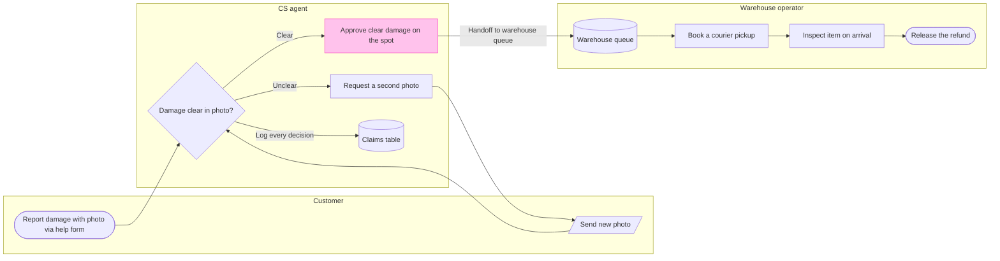

# FJ-023 turn 3 transcript

**User:** Yes, go ahead.

**Assistant:**

Thanks. I’m adding the checked process section to the existing FigJam file now, then I’ll read it back and inspect the rendered board.

**Tool call:** `command_execution` `{"command": "/bin/zsh -lc 'cat /tmp/fernhouse-damage-claim-process.js'", "changes": null}`

**Tool result:** `command_execution`

```text
const MODEL={"type":"graph","profile":"process","direction":"LR","zoneMode":"lane","zones":[{"id":"customer","label":"Customer"},{"id":"cs","label":"CS agent"},{"id":"warehouse","label":"Warehouse operator"}],"nodes":[{"id":"report","label":"Report damage with photo via help form","kind":"start","zone":"customer"},{"id":"sendSecond","label":"Send second photo","kind":"io","zone":"customer"},{"id":"photoClear","label":"Damage clear in photo?","kind":"decision","zone":"cs"},{"id":"approve","label":"Approve clear damage on the spot","kind":"focus","zone":"cs","accent":true},{"id":"request","label":"Request a second photo","kind":"step","zone":"cs"},{"id":"claims","label":"Claims table","kind":"datastore","zone":"cs"},{"id":"queue","label":"Warehouse queue","kind":"datastore","zone":"warehouse"},{"id":"book","label":"Book a courier pickup","kind":"step","zone":"warehouse"},{"id":"inspect","label":"Inspect item on arrival","kind":"step","zone":"warehouse"},{"id":"refund","label":"Release the refund","kind":"success","zone":"warehouse"}],"edges":[{"from":"report","to":"photoClear"},{"from":"photoClear","to":"approve","label":"Clear"},{"from":"photoClear","to":"request","label":"Unclear"},{"from":"photoClear","to":"claims","label":"Log every decision"},{"from":"request","to":"sendSecond"},{"from":"sendSecond","to":"photoClear"},{"from":"approve","to":"queue","label":"Handoff to warehouse queue"},{"from":"queue","to":"book"},{"from":"book","to":"inspect"},{"from":"inspect","to":"refu
```

**Tool call:** `command_execution` `{"command": "/bin/zsh -lc \"rg -n 'skillNames' /private/var/folders/3c/zfqcqsts0kn19cgblj82gqhm0000gn/T/codex-compare-home/plugins/cache/openai-curated-remote/figma/16.0.0/skills/figma-use-figjam/SKILL.md\"", "changes": null}`

**Tool result:** `command_execution`

```text
11:**Always include `figma-use-figjam` in the comma-separated `skillNames` parameter when calling `use_figma` for FigJam operations. If this skill was loaded via an MCP resource, you MUST prefix the name with `resource:` (e.g. `resource:figma-use-figjam`).** This is a logging parameter used to track skill usage — it does not affect execution.

```

**Tool call:** `figma.use_figma` `{"fileKey": "<test-file-key>", "sessionId": "dffd2cbc-e798-4712-9856-094f54830560", "description": "Append the checked Fernhouse damage claim process section with the warehouse handoff highlighted", "code": "const MODEL={\"type\":\"graph\",\"profile\":\"process\",\"direction\":\"LR\",\"zoneMode\":\"lane\",\"zones\":[{\"id\":\"customer\",\"label\":\"Customer\"},{\"id\":\"cs\",\"label\":\"CS agent\"},{\"id\":\"warehouse\",\"label\":\"Warehouse operator\"}],\"nodes\":[{\"id\":\"report\",\"label\":\"Report damage with photo via help form\",\"kind\":\"start\",\"zone\":\"customer\"},{\"id\":\`

**Tool result:** `figma.use_figma`

```text
{'content': [{'type': 'text', 'text': '{"boardId":"168:6021","tag":{"namespace":"productowner","key":"Fernhouse damage claim process"},"bounds":{"x":216184,"y":-616,"w":3152,"h":1952},"counts":{"nodes":10,"connectors":10},"expect":{"nodes":10,"connectors":10},"elements":[{"id":"168:6030","model":"report","kind":"start","text":"Report damage with photo via help form"},{"id":"168:6034","model":"sendSecond","kind":"io","text":"Send second photo"},{"id":"168:6038","model":"photoClear","kind":"decision","text":"Damage clear in photo?"},{"id":"168:6042","model":"approve","kind":"focus","text":"Approve clear damage on the spot"},{"id":"168:6046","model":"request","kind":"step","text":"Request a second photo"},{"id":"168:6050","model":"claims","kind":"datastore","text":"Claims table"},{"id":"168:6056","model":"queue","kind":"datastore","text":"Warehouse queue"},{"id":"168:6062","model":"book","kind":"step","text":"Book a courier pickup"},{"id":"168:6066","model":"inspect","kind":"step","text":"Inspect item on arrival"},{"id":"168:6070","model":"refund","kind":"success","text":"Release the refund"}],"links":[{"id":"168:6088","from":"168:6030","to":"168:6038","model":"report->photoClear","label":"","via":"waypoints"},{"id":"168:6092","from":"168:6038","to":"168:6042","model":"photoClear->approve","label":"Clear"},{"id":"168:6096","from":"168:6038","to":"168:6046","model":"photoClear->request","label":"Unclear"},{"id":"168:6100","from":"168:6038","to":"168:6050","model":"photoClear->cla
```

**Assistant:**

The write returned the expected 10 nodes and 10 connectors with no warnings. The first screenshot suggests the “Send second photo” label may be clipped, so I’m checking the board read-back and a full-size view before deciding whether a model adjustment is needed.

**Tool call:** `figma.get_figjam` `{"fileKey": "<test-file-key>", "nodeId": "168:6021", "sessionId": "dffd2cbc-e798-4712-9856-094f54830560", "includeImagesOfNodes": true}`

**Tool result:** `figma.get_figjam`

```text
{'content': [{'type': 'text', 'text': '<section id="168:6021" name="Fernhouse damage claim process" x="216184" y="-616" width="3152" height="1952">\n  <text id="168:6022" name="Fernhouse damage claim process" x="80" y="80" width="1049" height="77" />\n  <text id="168:6023" name="For CS and warehouse teams, follow a customer&#39;s photo report through review and refund release" x="80" y="173" width="1440" height="34" />\n  <section id="168:6024" name="Customer" x="80" y="272" width="2992" height="256">\n    <text id="168:6025" name="Customer" x="32" y="32" width="115" height="29" />\n    <shape-with-text id="168:6030" x="48" y="96" width="248" height="112" name="ROUNDED_RECTANGLE">Report damage with photo via help form</shape-with-text>\n    <shape-with-text id="168:6034" x="1564" y="104" width="224" height="96" name="PARALLELOGRAM_RIGHT">Send second photo</shape-with-text>\n  </section>\n  <section id="168:6026" name="CS agent" x="80" y="576" width="2992" height="656">\n    <text id="168:6027" name="CS agent" x="32" y="32" width="107" height="29" />\n    <shape-with-text id="168:6038" x="428" y="236" width="336" height="216" name="DIAMOND">Damage clear in photo?</shape-with-text>\n    <shape-with-text id="168:6042" x="1000" y="288" width="248" height="112" name="ROUNDED_RECTANGLE">Approve clear damage on the spot</shape-with-text>\n    <connector id="168:6092" x="768.5" y="324.5" connectorStart="168:6038" connectorStartCap="NONE" connectorEnd="168:6042" connectorEndCap="ARROW
```

**Assistant:**

The read-back matches the model, but the screenshot confirms that “Send second photo” is clipped inside its shape. I’ve prepared a checked version using “Send new photo.” Adding that correction requires a new section; after read-back, I’ll ask separately whether to remove the first version.

**Tool call:** `command_execution` `{"command": "/bin/zsh -lc \"sed 's/Send second photo/Send new photo/g' /tmp/fernhouse-damage-claim-process.md > /tmp/fernhouse-damage-claim-process-fix.md\npython3 sk-create-figjam/scripts/flow_check.py /tmp/fernhouse-damage-claim-process-fix.md\npython3 sk-create-figjam/scripts/compose_board.py /tmp/fernhouse-damage-claim-process-fix.md --diagram 1 --out /tmp/fernhouse-damage-claim-process-fix.js\"", "changes": null}`

**Tool result:** `command_execution`

```text
  diagram 1, process: ok, 10 nodes and 10 connectors, widest rank 3 steps, longest path 7 steps, 1.0 connectors per step, labels average 22 characters, 1 crossing pairs
PASSED 1 diagram(s) in fernhouse-damage-claim-process-fix.md
COMPOSED diagram 1, 10 nodes and 10 connectors, widest rank 3 steps, longest path 7 steps, 1.0 connectors per step, labels average 22 characters, 1 crossing pairs: 10 nodes and 10 connectors to read back, 49054 characters in /tmp/fernhouse-damage-claim-process-fix.js, drawn in the design FigJam default

```

**Assistant:**

The read-back contains all 10 nodes and 10 connectors. The screenshot shows the “Send second photo” label clipped.

Flow Mode requires a new yes before rewriting after a screenshot finding. I’ve prepared a checked model with that label shortened to “Send new photo.” Adding it creates a corrected section; I’ll read it back, then ask separately whether to remove the first version, section `168:6021`.

**Target:** Fernhouse Product plan, existing FigJam file `<test-file-key>`  
**Correction:** Add the model below as a corrected section  
**Planned extensions:** None  
**After approval:** One `use_figma` write and one `get_figjam` read-back  
**Rollback target:** The corrected section



May I add this corrected section to the existing FigJam file?
