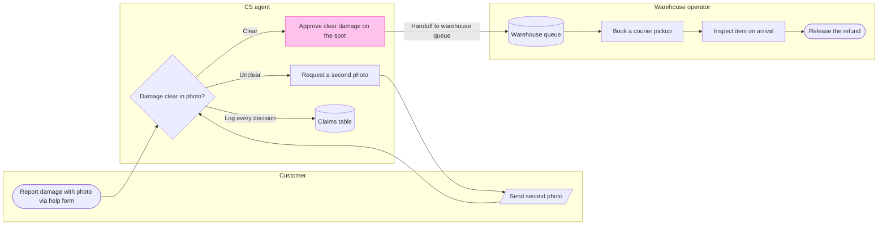

The board will answer: **who handles a damaged-item claim, and where does the approved claim pass to the warehouse?** It will show the claim through refund release for CS and warehouse teams. The supplied runbook is the source. The second-photo return to CS review follows the existing section, as you confirmed.

**Target:** Fernhouse Product plan, existing FigJam file `<test-file-key>`  
**Section:** Fernhouse damage claim process  
**Contents:** 3 actor lanes, 10 nodes and 10 connectors  
**Highlight:** The approval step gets the pink focus accent, and its cross-lane connector is labeled “Handoff to warehouse queue”  
**Pilot:** The under-€20 pickup skip stays out of the current path and is labeled as not live  
**Open gap:** The runbook gives no outcome for an unsuccessful inspection  
**Planned extensions:** None  
**After approval:** 1 `use_figma` write, 1 `get_figjam` read-back and 1 screenshot review  
**Rollback target:** The new `Fernhouse damage claim process` section

The focus check lands on approval beside the labeled warehouse handoff. The unclear-photo loop returns to CS review. Decision logging points to the claims table, while the inactive pilot stays out of the live flow.

May I add this section to the existing FigJam file?