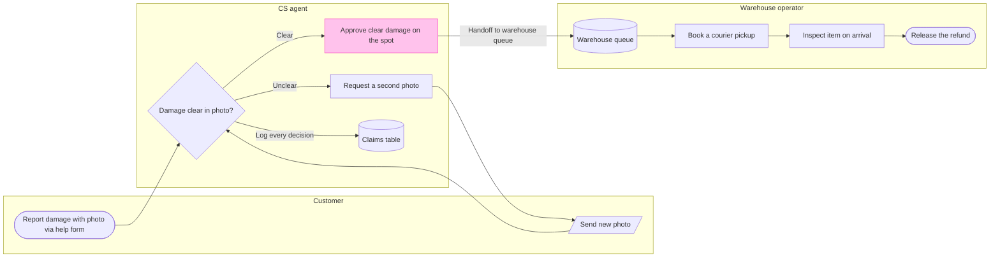

The read-back contains all 10 nodes and 10 connectors. The screenshot shows the “Send second photo” label clipped.

Flow Mode requires a new yes before rewriting after a screenshot finding. I’ve prepared a checked model with that label shortened to “Send new photo.” Adding it creates a corrected section; I’ll read it back, then ask separately whether to remove the first version, section `168:6021`.

**Target:** Fernhouse Product plan, existing FigJam file `<test-file-key>`  
**Correction:** Add the model below as a corrected section  
**Planned extensions:** None  
**After approval:** One `use_figma` write and one `get_figjam` read-back  
**Rollback target:** The corrected section

May I add this corrected section to the existing FigJam file?