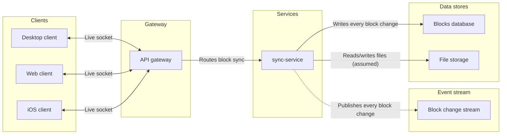
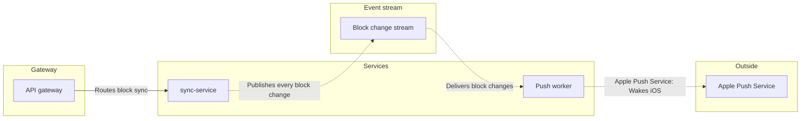

## Write gate

Architecture fits the question about system parts and connections. A sequence diagram would emphasize message order that the request does not fully specify. One architecture diagram would exceed the 9-node limit, so the checked model uses two path diagrams and repeats shared components where needed.

The first diagram focuses on `sync-service`; the second focuses on `pushWorker`. The change stream advances the reading between block writes and push delivery. File storage is shown as an assumed connection. Protocols, retries and failure behavior are left out.

**Block sync**

**iOS push wake**

The check passed for both diagrams with zero crossing pairs. The default FigJam design reported no warnings. Detail is faithful, the audience is engineering, and the reading distance is laptop. The existing page content stays in place; the composer will place these sections to its right. No extensions are planned.

Writing will use two `use_figma` calls, followed by one `get_figjam` read-back and two `get_screenshot` reads. The session and initial file read are complete. Rollback would remove only the two sections created by this write, after separate confirmation.

Do you approve writing these two framed diagrams to the existing file `<test-file-key>` in the Loomlist Engineering plan?