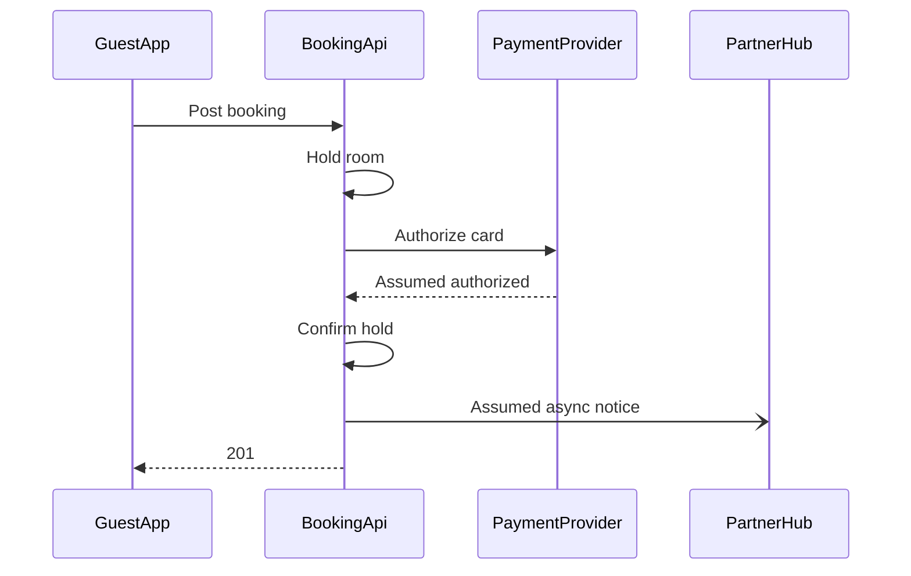
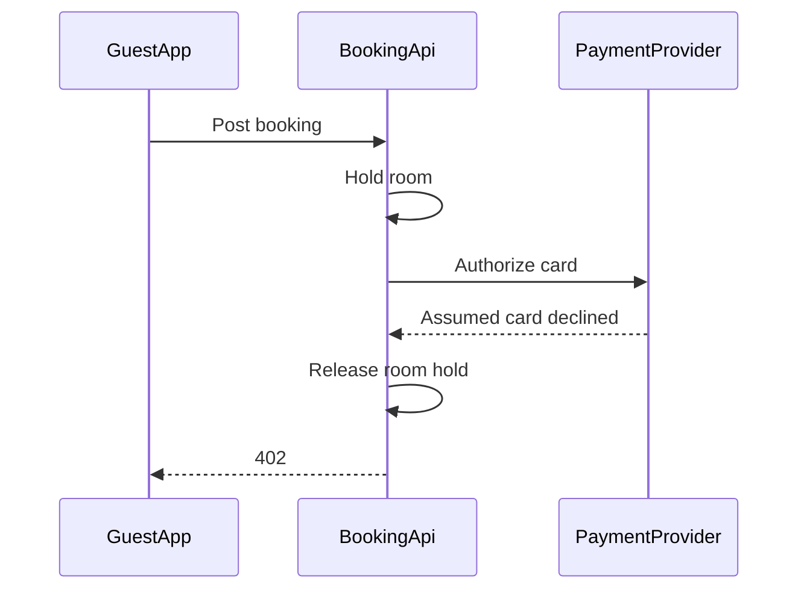

# FJ-025 turn 1 transcript

**User:** $figjam draw the Roamstay checkout payment as a sequence diagram on a new board in our Roamstay Product plan. From the payments brief: the guest app posts the booking, the booking API holds the room, asks the payment provider to authorise the card, confirms the hold, tells the partner hub and answers the app with 201. A declined card releases the hold and returns 402.

Write the board into the existing FigJam file with key <test-file-key> rather than a new file.

**Assistant:**

I’m loading the Product Owner Flow instructions and the FigJam diagram guidance first. I’ll check the existing file and the required write gate before adding the sequence diagram.

**Tool call:** `command_execution` `{"command": "/bin/zsh -lc \"pwd && rg --files -g 'SKILL.md' -g 'ROUTER.md' -g '*flow-mode.md' -g '*flow-templates.md' -g 'AGENTS.md' | head -80\"", "changes": null}`

**Tool result:** `command_execution`

```text
/var/folders/3c/zfqcqsts0kn19cgblj82gqhm0000gn/T/devin-compare-bench/FJ-025
mcp-click-up/SKILL.md
ROUTER.md
AGENTS.md
SKILL.md
mcp-code-mode/SKILL.md
sk-create-figjam/assets/flow-templates.md
mcp-figma/SKILL.md
sk-product-owner/SKILL.md
sk-create-figjam/SKILL.md
sk-create-figjam/references/flow-mode.md

```

**Tool call:** `command_execution` `{"command": "/bin/zsh -lc 'cat SKILL.md && cat ROUTER.md && cat sk-create-figjam/SKILL.md && cat sk-create-figjam/references/flow-mode.md && cat sk-create-figjam/assets/flow-templates.md && cat mcp-figma/SKILL.md'", "changes": null}`

**Tool result:** `command_execution`

```text
---
name: product-owner
description: "Product Owner hub: routes backlog, doc and FigJam diagram requests and two vendored tool packets via mode-registry.json."
allowed-tools: [Read, Write, Edit, Bash, Glob, Grep, WebFetch, WebSearch, mcp__code_mode__call_tool_chain]
version: 1.0.4.0
---

<!-- Keywords: product-owner, sk-product-owner, sk-create-figjam, mcp-click-up, mcp-figma, backlog, task, bug report, user story, epic, prd, product documentation, figjam, user flow, clickup -->

# Product Owner Hub

One public skill identity over three workflow packets and one transport packet. This hub holds no packet-local logic. It routes by `workflowMode` through `mode-registry.json`, uses `hub-router.json` for router policy, signals and outcomes, and hands stage two to the root `ROUTER.md`, which maps the request's intent to the packet's leaves.

**Version authority.** This file's `version` frontmatter is the hub's release version and matches the newest entry under `changelog/`. `description.json`, `mode-registry.json` and `hub-router.json` carry the same value. `ROUTER.md` keeps its own document version, and each packet keeps its own release line.

---

## 1. WHEN TO USE

Use this skill for Barter backlog and documentation work, for diagrams drawn on FigJam boards, and for the ClickUp and Figma operations those artifacts travel through.

| Mode | Kind | Use it for | Packet |
|------|------|------------|--------|
| **sk-product-owner** | workflow | Every task, bug, Story, Epic, Doc and 
```

**Tool call:** `command_execution` `{"command": "/bin/zsh -lc \"sed -n '1,260p' sk-create-figjam/SKILL.md && sed -n '1,320p' sk-create-figjam/references/flow-mode.md && sed -n '1,280p' sk-create-figjam/assets/flow-templates.md && cat sk-product-owner/references/hvr-core.md && cat sk-product-owner/references/conciseness.md\"", "changes": null}`

**Tool result:** `command_execution`

```text
---
name: sk-create-figjam
description: "Draws FigJam diagrams, from user flows to sequence, state, ER and gantt, as checked Mermaid models composed into framed boards."
allowed-tools: [Read, Write, Edit, Bash, Glob, Grep, mcp__code_mode__call_tool_chain]
version: 1.0.4.0
---

<!-- Keywords: sk-create-figjam, flow mode, figjam, user flow, process, architecture, sequence diagram, state diagram, er diagram, gantt, flowchart, mermaid, board, $flow, $figjam -->

# FigJam Diagrams

The Product Owner packet that draws FigJam diagrams. It picks the diagram type the reader's question needs, turns screenshots, a Figma flow, a product doc, a schema or a plan into a Mermaid model of that type with a provenance table, checks the model and, after a yes, composes it into a framed FigJam board with a title, zones, colour by kind and a key. Seven types are drawn: user flow, process, architecture, sequence, state, ER and gantt. The hub [`../SKILL.md`](../SKILL.md) picks this packet, the hub [`../ROUTER.md`](../ROUTER.md) maps a Flow request to its leaves, and Section 2 routes inside it.

---

## 1. WHEN TO USE

- `$flow` or `$figjam`, with no other artifact command
- FigJam output wording such as "make a FigJam flow from these screenshots" or "a sequence diagram in FigJam"
- A request to add notes to or update a FigJam board, including one that carries a `figma.com/board` link
- A Flow route handed on by the Product Owner router

### When NOT to Use

- Figma feedback on spacing, copy or align
```

**Tool call:** `command_execution` `{"command": "/bin/zsh -lc \"sed -n '1,240p' sk-create-figjam/references/flow-mode.md && sed -n '241,520p' sk-create-figjam/references/flow-mode.md && sed -n '1,220p' sk-create-figjam/references/types/sequence.md && sed -n '1,260p' sk-create-figjam/assets/templates/sequence.md\"", "changes": null}`

**Tool result:** `command_execution`

```text
---
title: "Product Owner - Templates - Flow Mode"
description: "Product Owner flow-mode workflow: screenshots, Figma flows, product docs, schemas and plans turned into a checked Mermaid model of the right FigJam diagram type, written to a board and delivered as the board URL with a read-back line and the HVR self-scan line."
contextType: implementation
importance_tier: important
trigger_phrases:
  - "flow mode"
  - "$flow figjam board"
  - "figjam diagram type"
  - "figjam flow from screenshots"
  - "flow model pre-write check"
  - "board url read-back"
version: 1.0.3.0
---

# Product Owner - Templates - Flow Mode

Flow-mode guidance for FigJam diagrams. The workflow picks the diagram type the reader's question needs, turns screenshots, a Figma flow, a product doc, a schema or a plan into a Mermaid model of that type, checks it, writes it to a FigJam board and reads the board back before replying.

**Loading Condition:** ALWAYS on a Flow route, as half of the routed pair with `assets/flow-templates.md`
**Purpose:** Provides the flow-mode workflow, the type choice, the intake, the rules every type shares, the write routes and the delivery reply when `$flow`, `$figjam` or FigJam output wording is detected
**Scope:** Type choice, intake per input type, the model, the pre-write check, the quality pass, the write gate, the composed, generated and `fj` write routes, the hybrid extension, the read-back and the reply
**Output Path:** None. Flow Mode delivers a FigJam board URL and w
```

**Assistant:**

The brief maps to two sequence diagrams: one for authorization success and one for decline, because the payment paths need separate diagrams. I’m treating the booking API’s hold, confirmation, and release actions as internal self messages since the brief names no separate inventory service. One detail remains open: whether the partner hub message is synchronous or asynchronous.

**Tool call:** `command_execution` `{"command": "/bin/zsh -lc \"rg -n '\"'^## [0-9]+'\"\\\\.|\"'^### '\"' sk-create-figjam/references/flow-mode.md sk-create-figjam/assets/flow-templates.md sk-create-figjam/references/quality-rubric.md sk-create-figjam/references/style-guide.md | head -120 && sed -n '145,310p' sk-create-figjam/references/flow-mode.md && sed -n '1,230p' sk-create-figjam/assets/flow-templates.md && sed -n '1,220p' sk-create-figjam/references/quality-rubric.md && sed -n '1,250p' sk-create-figjam/references/style-guide.md\"", "changes": null}`

**Tool result:** `command_execution`

```text
sk-create-figjam/references/quality-rubric.md:25:## 1. TYPE FIT
sk-create-figjam/references/quality-rubric.md:34:## 2. THE REMOVE TEST
sk-create-figjam/references/quality-rubric.md:54:## 3. SIGNAL
sk-create-figjam/references/quality-rubric.md:78:## 4. PROVENANCE
sk-create-figjam/references/quality-rubric.md:87:## 5. THE CHECK AND THE GATE
sk-create-figjam/references/quality-rubric.md:98:## 6. THE BOARD
sk-create-figjam/references/quality-rubric.md:126:## 7. THE DESIGN RUBRIC
sk-create-figjam/references/quality-rubric.md:146:## 8. THE REPLY
sk-create-figjam/assets/flow-templates.md:25:## 1. OVERVIEW
sk-create-figjam/assets/flow-templates.md:27:### Purpose
sk-create-figjam/assets/flow-templates.md:31:### Usage
sk-create-figjam/assets/flow-templates.md:41:### Board lines
sk-create-figjam/assets/flow-templates.md:60:## 2. PATTERNS
sk-create-figjam/assets/flow-templates.md:62:### Linear flow
sk-create-figjam/assets/flow-templates.md:72:### One decision
sk-create-figjam/assets/flow-templates.md:84:### Platform split with a merge dot
sk-create-figjam/assets/flow-templates.md:99:### Three outcomes
sk-create-figjam/assets/flow-templates.md:111:### A flow split across two diagrams
sk-create-figjam/assets/flow-templates.md:132:## 3. PROVENANCE TABLE
sk-create-figjam/assets/flow-templates.md:158:## 4. REPLY SHAPE
sk-create-figjam/assets/flow-templates.md:175:## 5. INTAKE QUESTIONS
sk-create-figjam/assets/flow-templates.md:185:### Every question carries a reading and a recommendation
sk-c
```

**Tool call:** `command_execution` `{"command": "/bin/zsh -lc \"rg --files | rg -i 'roamstay|payments?[-_ ]brief|checkout' | head -100\"", "changes": null}`

**Tool result:** `command_execution`

```text
context/roamstay-partner-self-onboarding-brief.md
context/roamstay-context.md
context/roamstay-date-picker-design-notes.md
context/roamstay-support-ticket-58213.md
context/roamstay-payment-webhook-incident-notes.md
context/roamstay-booking-funnel-tracking-plan.md
context/roamstay-free-cancellation-pm-notes.md
sk-create-figjam/assets/examples/state-roamstay-booking.md
sk-create-figjam/assets/examples/er-roamstay-stays.md
sk-create-figjam/assets/examples/sequence-roamstay-checkout.md

```

**Tool call:** `figma.create_session` `{"fileKey": "<test-file-key>", "description": "Add the Roamstay checkout payment sequence diagrams to the existing FigJam file"}`

**Tool result:** `figma.create_session`

```text
{'content': [{'type': 'text', 'text': '{"sessionId":"26ddb4a5-96a3-47ca-bf56-01fad351f868"}'}], '_meta': {'mcpRequestId': '1402c051-48fc-465c-9537-97b25d101b71', 'io.modelcontextprotocol/serverInfo': {'name': 'Figma MCP Server', 'version': '1.0.0', 'icons': [{'src': 'data:image/png;base64,iVBORw0KGgoAAAANSUhEUgAAAIAAAACgCAYAAADEkmT9AAAABGdBTUEAALGPC/xhBQAAACBjSFJNAAB6JgAAgIQAAPoAAACA6AAAdTAAAOpgAAA6mAAAF3CculE8AAAAhGVYSWZNTQAqAAAACAAFARIAAwAAAAEAAQAAARoABQAAAAEAAABKARsABQAAAAEAAABSASgAAwAAAAEAAgAAh2kABAAAAAEAAABaAAAAAAAAAEgAAAABAAAASAAAAAEAA6ABAAMAAAABAAEAAKACAAQAAAABAAAAgKADAAQAAAABAAAAoAAAAAB6dUZwAAAACXBIWXMAAAsTAAALEwEAmpwYAAABWWlUWHRYTUw6Y29tLmFkb2JlLnhtcAAAAAAAPHg6eG1wbWV0YSB4bWxuczp4PSJhZG9iZTpuczptZXRhLyIgeDp4bXB0az0iWE1QIENvcmUgNi4wLjAiPgogICA8cmRmOlJERiB4bWxuczpyZGY9Imh0dHA6Ly93d3cudzMub3JnLzE5OTkvMDIvMjItcmRmLXN5bnRheC1ucyMiPgogICAgICA8cmRmOkRlc2NyaXB0aW9uIHJkZjphYm91dD0iIgogICAgICAgICAgICB4bWxuczp0aWZmPSJodHRwOi8vbnMuYWRvYmUuY29tL3RpZmYvMS4wLyI+CiAgICAgICAgIDx0aWZmOk9yaWVudGF0aW9uPjE8L3RpZmY6T3JpZW50YXRpb24+CiAgICAgIDwvcmRmOkRlc2NyaXB0aW9uPgogICA8L3JkZjpSREY+CjwveDp4bXBtZXRhPgoZXuEHAAARfklEQVR4Ae1de4xU1Rn/zr1zd5ddWFgRorEvAkrUAhURSgx2MI3PVEvMbuTV1jZVu2Aq/GGFBBhsUtBUaNr6jNZWqCbMH2gbEK3pbtWGiiBBomktCbamUSG47rLvmXtPf9+5c5fdZRd2Zu7unoHvJPO6j3O+8/se5zvf+c4dIimCgCAgCAgCgoAgIAgIAoKAICAICAKCgCAgCAgCgoAgIAgIAoKAICAICAKCgCAgCAgCgoAgIAgIAoKAICAICAKCgCAgCAgCgoAgIAgIAoKAICAICAKCgCAgCAgCgoAgIAgIAoKAICAICAKCgCAgCAgCgoAgIAgIAoKAICAICAKCgCAgCAgCgoAgYAsCyhZCCqVDEzmUTDqF3k/Jgu/EjY2BSl
```

**Tool call:** `figma.get_figjam` `{"fileKey": "<test-file-key>", "nodeId": "0:1", "includeImagesOfNodes": false, "sessionId": "26ddb4a5-96a3-47ca-bf56-01fad351f868"}`

**Tool result:** `figma.get_figjam`

```text
{'content': [{'type': 'text', 'text': '<canvas id="0:1" name="Page 1" x="0" y="0" width="0" height="0">\n  <shape-with-text id="1:3" x="768" y="-492" width="224" height="128" name="ROUNDED_RECTANGLE">Order list</shape-with-text>\n  <shape-with-text id="1:6" x="768" y="-236" width="224" height="128" name="SQUARE">Order detail</shape-with-text>\n  <shape-with-text id="1:9" x="780" y="20" width="200" height="200" name="DIAMOND">Within 30 days?</shape-with-text>\n  <shape-with-text id="1:12" x="608" y="476" width="224" height="128" name="ROUNDED_RECTANGLE">Contact support</shape-with-text>\n  <shape-with-text id="1:15" x="928" y="476" width="224" height="128" name="SQUARE">Pick a reason</shape-with-text>\n  <shape-with-text id="1:18" x="940" y="732" width="200" height="200" name="DIAMOND">Drop-off or pickup?</shape-with-text>\n  <shape-with-text id="1:21" x="768" y="1188" width="224" height="128" name="SQUARE">Choose a drop-off point</shape-with-text>\n  <shape-with-text id="1:24" x="1088" y="1188" width="224" height="128" name="SQUARE">Book a courier pickup</shape-with-text>\n  <shape-with-text id="1:27" x="928" y="1444" width="224" height="128" name="ROUNDED_RECTANGLE">Return confirmed with QR code</shape-with-text>\n  <connector id="1:30" x="880" y="-356" connectorStart="1:3" connectorStartCap="NONE" connectorEnd="1:6" connectorEndCap="ARROW_LINES"></connector>\n  <connector id="1:34" x="880" y="-100" connectorStart="1:6" connectorStartCap="NONE" connectorEnd="1:9" connectorEn
```

**Tool call:** `command_execution` `{"command": "/bin/zsh -lc \"sed -n '65,205p' sk-create-figjam/references/flow-mode.md && sed -n '125,250p' sk-create-figjam/assets/flow-templates.md && sed -n '1,185p' sk-create-figjam/references/quality-rubric.md\"", "changes": null}`

**Tool result:** `command_execution`

```text
7. **Gate.** State the Brief's question and the outcome the board must deliver, so the yes covers the purpose and not only the destination, then the three glance lines `references/quality-rubric.md` Section 3 asks to be written before the model, the first glance the board must win, the second glance that advances it and the last glance that may wait. The first glance is the accented node on a user flow or a process, marked by its one required `style` line, and on any other type the node, message or task an optional `%% focus:` line names. The gate then gives the target plan and file, what will be written, any planned extensions, the calls the write will spend and the rollback in one message and waits for a yes. On the composed route the calls are `whoami` for the plan, `create_new_file` for a new board, the `use_figma` call that composes each diagram and the `get_figjam` read-back. Figma limits a Starter plan and a View or Collab seat to six tool calls a month. Read tools count against that allowance and some write tools are exempt, so such a user may spend the whole allowance on one or two boards. The file is a new file, which the write creates first, or the `fileKey` of a board this work already wrote. A FigJam file has one page and no write can add another, so a page is never the target. An earlier yes never carries over to a new board. The gate is its own reply, sent only after the playback's answer, as Section 8 sets out under The gate is its own reply
8. **Write.** Comp
```

**Assistant:**

Flow intake — Reading: the sequence should answer how the booking message moves through room hold and card authorization to either partner notification plus 201, or hold release plus 402. I recommend a mixed Product and Engineering audience, with only the steps in your brief shown; retries, refunds, 3DS, and unnamed internal services stay out. Is that the right reader, outcome, and boundary?
- Use this recommendation
- Tell me what to change

**Assistant:**

I’ve confirmed the supplied file is an existing, populated FigJam page. I’ll place the new payment diagrams as separate sections and preserve the existing content; I’m reading the FigJam write guidance and composer now.

**Tool call:** `command_execution` `{"command": "/bin/zsh -lc \"sed -n '1,260p' /private/var/folders/3c/zfqcqsts0kn19cgblj82gqhm0000gn/T/codex-compare-home/plugins/cache/openai-curated-remote/figma/16.0.0/skills/figma-use/SKILL.md && sed -n '1,220p' /private/var/folders/3c/zfqcqsts0kn19cgblj82gqhm0000gn/T/codex-compare-home/plugins/cache/openai-curated-remote/figma/16.0.0/skills/figma-use-figjam/SKILL.md && rg -n 'x=|origin|position|fileKey|section|COMPOSED|compose_board' sk-create-figjam/scripts/compose_board.py | head -100 && sed -n '1,240p' sk-create-figjam/scripts/compose_board.py\"", "changes": null}`

**Tool result:** `command_execution`

```text
---
name: figma-use
description: "**MANDATORY prerequisite** — you MUST invoke this skill BEFORE every `use_figma` tool call. NEVER call `use_figma` directly without loading this skill first. Skipping it causes common, hard-to-debug failures. Trigger whenever the user wants to perform a write action or a unique read action that requires JavaScript execution in the Figma file context — e.g. create/edit/delete nodes, set up variables or tokens, build components and variants, modify auto-layout or fills, bind variables to properties, or inspect file structure programmatically."
disable-model-invocation: false
---

# use_figma — Figma Plugin API Skill

Use the `use_figma` tool to execute JavaScript in Figma files via the Plugin API. All detailed reference docs live in `references/`.

**Always include `figma-use` in the comma-separated `skillNames` parameter when calling `use_figma`. If this skill was loaded via an MCP resource, you MUST prefix the name with `resource:` (e.g. `resource:figma-use`).** This is a logging parameter used to track skill usage — it does not affect execution.

**If Figma MCP tools appear as deferred tools, batch-load all their schemas in a single `ToolSearch` call** using the `select:` syntax — e.g. `ToolSearch query="select:use_figma,get_screenshot,get_metadata,create_new_file"`. One round trip beats six.

**If the task involves building or updating a full page, screen, or multi-section layout in Figma from code**, also load [figma-generate-design](../fi
```

**Tool call:** `command_execution` `{"command": "/bin/zsh -lc \"sed -n '1,220p' /private/var/folders/3c/zfqcqsts0kn19cgblj82gqhm0000gn/T/codex-compare-home/plugins/cache/openai-curated-remote/figma/16.0.0/skills/figma-use/references/plugin-api-standalone.index.md && sed -n '1,240p' /private/var/folders/3c/zfqcqsts0kn19cgblj82gqhm0000gn/T/codex-compare-home/plugins/cache/openai-curated-remote/figma/16.0.0/skills/figma-use-figjam/references/plan-board-content.md && rg -n 'x:|y:|createSection|appendChild\\\\(|createText|createConnector|const MODEL|section.x' sk-create-figjam/assets/compose-board.js | head -100 && sed -n '1,170p' sk`

**Tool result:** `command_execution`

```text
# Plugin API Index

> Full typings: `plugin-api-standalone.d.ts` (10,191 lines)
> Grep by symbol name to jump to definition. All `L#` line numbers refer to that file.
> This index describes the APIs available through `use_figma`. See the `.d.ts` for full type declarations.

---

## figma.\* — PluginAPI (L4)

### Identity & State

| Member                          | Type                                                                                                                                             |
| ------------------------------- | ------------------------------------------------------------------------------------------------------------------------------------------------ |
| `apiVersion`                    | `'1.0.0'`                                                                                                                                        |
| `editorType`                    | `'figma' \| 'figjam' \| 'dev' \| 'slides' \| 'buzz'`                                                                                             |
| `fileKey`                       | `string \| undefined`                                                                                                                            |
| `root`                          | `DocumentNode`                                                                                                                                   |
| `currentPage`                   | `PageNode` — **read-only**; sync s
```

**Tool call:** `command_execution` `{"command": "/bin/zsh -lc \"sed -n '1210,1370p' sk-create-figjam/assets/compose-board.js && rg -n 'position new top-level|children.*bounding|rightmost|clear position' /private/var/folders/3c/zfqcqsts0kn19cgblj82gqhm0000gn/T/codex-compare-home/plugins/cache/openai-curated-remote/figma/16.0.0/skills/figma-use/references/gotchas.md && rg -n 'x=|y=' /private/var/folders/3c/zfqcqsts0kn19cgblj82gqhm0000gn/T/codex-compare-home/plugins/cache/openai-curated-remote/figma/16.0.0/skills/figma-use-figjam/references/plan-board-content.md | head\"", "changes": null}`

**Tool result:** `command_execution`

```text
    },
  };
}

// ───────────────────────────────────────────────────────────────
// 8. THE BOARD
// ───────────────────────────────────────────────────────────────

const builders = { graph: buildGraph, sequence: buildSequence, gantt: buildGantt };
let body;
try {
  body = (builders[MODEL.type] || buildGraph)(MODEL);
} catch (err) {
  measurer.remove();
  throw err;
}
const page = figma.currentPage;
const others = page.children.filter((n) => n.id !== measurer.id);
const board = figma.createSection();
board.name = MODEL.title;
board.fills = solid('#FFFFFF');
board.x = others.length ? snap(Math.max(...others.map((n) => n.x + n.width)) + 400) : 0;
board.y = others.length ? snap(Math.min(...others.map((n) => n.y))) : 0;
created.push(board.id);
const wrap = Math.min(Math.max(body.width, 960), 1440);
const title = text(board, MODEL.title, BOLD, TYPE.title, BOARD_PAD, BOARD_PAD);
let cursor = title.y + title.height + 16;
if (MODEL.subtitle) {
  const sub = text(board, MODEL.subtitle, REGULAR, TYPE.subtitle, BOARD_PAD, cursor, wrap);
  // A subtitle that wraps is narrowed for as long as it keeps its number of lines, so its lines come out even
  // and the last one never holds a single word.
  const lines = sub.height;
  if (lines > TYPE.subtitle * 1.6) {
    let lo = wrap / 2, hi = wrap;
    while (hi - lo > 8) { const w = (lo + hi) / 2; sub.resize(w, sub.height); if (sub.height > lines) lo = w; else hi = w; }
    sub.resize(hi, sub.height);
  }
  cursor = sub.y + sub.height;
}
cons
```

**Assistant:**

I didn’t get a reply to the intake question, so I’ll carry its recommendation as an assumption: a mixed Product and Engineering audience, with the board limited to the supplied checkout steps. Two source details remain: the successful authorization reply and whether the partner hub notice is asynchronous.

**Assistant:**

Round 3 — Provider reply. Reading: the brief says the provider authorizes the card and the booking API confirms the hold, but it does not name the successful reply. What should the provider return on the approved path?
- Show “Authorized” (Recommended)
- Use a different reply

Round 3 — Partner hub notice. Reading: the booking API tells the hub after confirming the hold, but the brief gives no acknowledgment or delivery mode. Should the sequence show a one-way async notice? I recommend async because the brief says “tells” and gives no reply.
- Show one-way async notice (Recommended)
- Show synchronous call

**Tool call:** `command_execution` `{"command": "/bin/zsh -lc \"rg -n 'HARD|BLOCK|blockers|harness|foster|nurture|curate|elevate|resonate|Never use|Never write|never use|hard blocker' sk-product-owner/references/hvr-core.md && sed -n '1,260p' sk-product-owner/references/hvr-core.md | sed -n '1,220p' && rg -n 'When NOT|flowchart|architecture|sequence' /private/var/folders/3c/zfqcqsts0kn19cgblj82gqhm0000gn/T/codex-compare-home/plugins/cache/openai-curated-remote/figma/16.0.0/skills/figma-use-figjam/references/plan-board-content.md | head -30\"", "changes": null}`

**Tool result:** `command_execution`

```text
3:description: "Human Voice hard blockers carried inline, loaded on every request so the banned terms are in view while writing."
8:  - "hard blockers"
15:Human Voice hard blockers carried inline, loaded on every request so the banned terms are in view while writing.
18:**Purpose:** Carries the Human Voice hard blockers inline so the banned terms are in view on every request, without loading the full standard
19:**Scope:** Punctuation, hard blocker words and phrases, banned metaphors and cliches, setup language, generalisation fixes, output warnings, structural bans, always-cut modifiers and the before-delivery self-scan report line
21:**Authority:** `Rules - Human Voice - EN` is the full standard, symlinked into every consuming system as its own human-voice reference. Carried here: punctuation, hard blocker words and phrases, banned metaphors, setup phrases, generalisation fixes, output warnings, structural bans, always-cut modifiers. Left there: soft deductions, context-dependent flags, voice directives, the precedence hierarchy and the point scoring. Load the standard ON_DEMAND to settle a borderline term or run a scored pass.
29:A hard blocker is a failure, not a deduction. A structural removal is an edit with no penalty. Only hard blockers are counted on the self-scan line.
50:## 3. HARD BLOCKER WORDS
52:delve, embark, realm, tapestry, illuminate, unveil, elucidate, abyss, revolutionise, game-changer, groundbreaking, cutting-edge, ever-evolving, shed light, dive deep, le
```

**Tool call:** `command_execution` `{"command": "/bin/zsh -lc \"tail -130 sk-create-figjam/scripts/flow_check.py && sed -n '1,180p' sk-create-figjam/references/quality-rubric.md | tail -70 && rg -n 'userIntent|expect|%% title|%% subtitle|%% source|participant|messages' sk-create-figjam/scripts/figjam_checks/sequence.py | head -80\"", "changes": null}`

**Tool result:** `command_execution`

```text
        if problems:
            failed += 1
            for problem in problems:
                print(f"  {name}: {problem}")
        else:
            print(f"  {name}: ok, {size}")
        if profile in (flowchart.USER_FLOW, flowchart.PROCESS) and direction:
            ways.setdefault(profile, set()).add(flowchart.direction_family(direction))
    for profile, found in ways.items():
        if len(found) > 1:
            print(f"FAILED the {NAMES[profile]} diagrams in {path.name} run {' and '.join(sorted(found))}: "
                  "every diagram of one flow runs the same way")
            return 1
    if failed:
        print(f"FAILED {failed} of {len(results)} diagram(s) in {path.name}")
        return 1
    print(f"PASSED {len(results)} diagram(s) in {path.name}")
    return 0


# ───────────────────────────────────────────────────────────────
# 2. SELF-TEST
# ───────────────────────────────────────────────────────────────

# The shipped templates, the worked examples and their Project mirrors must
# keep passing the rules they teach. The mirrors are absent from a copy of the
# skill without the Project package, so a missing file is reported and not
# counted. A folder README under assets/ describes its files and the design
# file holds the board's style, so neither is a model.
KNOWLEDGE = PACKET.parent / "claude project" / "knowledge"
NOT_MODELS = {"README.md", "figjam-design.md"}
SHIPPED_MODELS = (
    sorted(p for p in (PACKET / "assets").rglob("*.md") if p.name n
```

**Assistant:**

The source status is also unclear: the brief summary doesn’t say whether it describes live behavior, approved direction, or a proposal. I’m checking that classification before I draft the board labels.

**Assistant:**

Round 3 — Source status. Reading: the supplied payments brief summary describes a flow, but it does not state whether that flow is live or approved. Which status should the board record? I recommend “Unknown” until the brief’s status is confirmed.
- Unknown (Recommended)
- Current behavior
- Approved direction
- Proposal
- Retired material

**Assistant:**

Full playback — I read this as a message-order diagram for a mixed Roamstay Product and Engineering audience (assumed), showing success and decline. I’ll add two separate sections to the existing file’s single page, with success first, and leave existing content in place. Success outline: GuestApp posts the booking; BookingApi holds the room; BookingApi asks PaymentProvider to authorize the card; PaymentProvider replies “Authorized” (assumed); BookingApi confirms the hold; BookingApi sends a one-way async notice to PartnerHub (assumed); BookingApi returns 201. Decline outline: same start and authorization request; PaymentProvider replies “Card declined”; BookingApi releases the hold; BookingApi returns 402. Hold, confirm, and release are BookingApi self-messages because the brief names no inventory service. The source status is assumed unknown, so the board will say that it does not establish live or approved behavior. Left out: retries, refunds, capture, 3DS, a separate inventory service, and PartnerHub behavior on decline because the brief does not state them. The sequence answers “In what order do the checkout parties exchange messages?” A combined path would flatten distinct outcomes, so I recommend two sections. First glance: 201 success response. Second: authorization and hold confirmation. Last: the 402 release path. Does this reading match, or what should I correct?
- Use this reading
- Correct the reading

**Tool call:** `command_execution` `{"command": "/bin/zsh -lc \"cat > '/tmp/roamstay-checkout-1793012034127.mmd' <<'FLOWMODEL'\n%% title: Roamstay checkout success\n%% subtitle: For Roamstay Product and Engineering, trace the success path from booking submission to a 201 response.\n%% source: Source: user supplied summary of the Roamstay payments brief. Status assumed unknown. Left out: retries, refunds, capture and 3DS.\nsequenceDiagram\ntitle Checkout payment success\nparticipant GuestApp\nparticipant BookingApi\nparticipant PaymentProvider\nparticipant PartnerHub\nGuestApp->>BookingApi: Post booking\nBookingApi->>BookingApi: `

**Tool result:** `command_execution`

```text

```

**Tool call:** `command_execution` `{"command": "/bin/zsh -lc \"python3 sk-create-figjam/scripts/flow_check.py '/tmp/roamstay-checkout-1793012034127.mmd'\"", "changes": null}`

**Tool result (error):** `command_execution`

```text
  diagram 1, sequence: line 22 is outside the sequence subset the generator draws: 'sequenceDiagram'
  diagram 1, sequence: 13 messages, at most 12: split into a happy path and a detail
FAILED 1 of 1 diagram(s) in roamstay-checkout-1793012034127.mmd

```

**Assistant:**

The pre-write check caught that the two paths were being read as one diagram. I’m separating them into distinct sequence blocks, which also keeps each path within its message limit.

**Tool call:** `command_execution` `{"command": "/bin/zsh -lc \"cat > '/tmp/roamstay-checkout-1793012034127.mmd' <<'FLOWMODEL'\n\"'```mermaid\n%% title: Roamstay checkout success\n%% subtitle: For Roamstay Product and Engineering, trace the success path from booking submission to a 201 response.\n%% source: Source: user supplied summary of the Roamstay payments brief. Status assumed unknown. Left out: retries, refunds, capture and 3DS.\nsequenceDiagram\ntitle Checkout payment success\nparticipant GuestApp\nparticipant BookingApi\nparticipant PaymentProvider\nparticipant PartnerHub\nGuestApp->>BookingApi: Post booking\nBookingApi`

**Tool result:** `command_execution`

```text

```

**Tool call:** `command_execution` `{"command": "/bin/zsh -lc \"python3 sk-create-figjam/scripts/flow_check.py '/tmp/roamstay-checkout-1793012034127.mmd'\"", "changes": null}`

**Tool result (error):** `command_execution`

```text
  diagram 1, unknown: the block header ```mermaid is no diagram kind Flow Mode draws
FAILED 1 of 1 diagram(s) in roamstay-checkout-1793012034127.mmd

```

**Tool call:** `command_execution` `{"command": "/bin/zsh -lc \"mv '/tmp/roamstay-checkout-1793012034127.mmd' '/tmp/roamstay-checkout-1793012034127.md'\"", "changes": null}`

**Tool result:** `command_execution`

```text

```

**Tool call:** `command_execution` `{"command": "/bin/zsh -lc \"python3 sk-create-figjam/scripts/flow_check.py '/tmp/roamstay-checkout-1793012034127.md'\"", "changes": null}`

**Tool result:** `command_execution`

```text
  diagram 1, sequence: ok, 4 participants and 7 messages
  diagram 2, sequence: ok, 3 participants and 6 messages
PASSED 2 diagram(s) in roamstay-checkout-1793012034127.md

```

**Tool call:** `command_execution` `{"command": "/bin/zsh -lc \"python3 sk-create-figjam/scripts/compose_board.py '/tmp/roamstay-checkout-1793012034127.md' --diagram 1 --out '/tmp/roamstay-checkout-1793012034127.md.1.js'\"", "changes": null}`

**Tool result:** `command_execution`

```text
COMPOSED diagram 1, 4 participants and 7 messages: 4 nodes and 7 connectors to read back, 48266 characters in /tmp/roamstay-checkout-1793012034127.md.1.js, drawn in the design FigJam default

```

**Tool call:** `command_execution` `{"command": "/bin/zsh -lc \"python3 sk-create-figjam/scripts/compose_board.py '/tmp/roamstay-checkout-1793012034127.md' --diagram 2 --out '/tmp/roamstay-checkout-1793012034127.md.2.js'\"", "changes": null}`

**Tool result:** `command_execution`

```text
COMPOSED diagram 2, 3 participants and 6 messages: 3 nodes and 6 connectors to read back, 48191 characters in /tmp/roamstay-checkout-1793012034127.md.2.js, drawn in the design FigJam default

```

**Tool call:** `command_execution` `{"command": "/bin/zsh -lc \"cat '/tmp/roamstay-checkout-1793012034127.md.1.js'\"", "changes": null}`

**Tool result:** `command_execution`

```text
const MODEL={"type":"sequence","participants":[{"id":"GuestApp","label":"GuestApp"},{"id":"BookingApi","label":"BookingApi"},{"id":"PaymentProvider","label":"PaymentProvider"},{"id":"PartnerHub","label":"PartnerHub"}],"messages":[{"from":"GuestApp","to":"BookingApi","arrow":"request","label":"Post booking"},{"from":"BookingApi","to":"BookingApi","arrow":"request","label":"Hold room"},{"from":"BookingApi","to":"PaymentProvider","arrow":"request","label":"Authorize card"},{"from":"PaymentProvider","to":"BookingApi","arrow":"reply","label":"Assumed authorized"},{"from":"BookingApi","to":"BookingApi","arrow":"request","label":"Confirm hold"},{"from":"BookingApi","to":"PartnerHub","arrow":"async","label":"Assumed async notice"},{"from":"BookingApi","to":"GuestApp","arrow":"reply","label":"201","accent":true}],"expect":{"nodes":4,"connectors":7},"title":"Roamstay checkout success","subtitle":"For Roamstay Product and Engineering, trace the success path from booking submission to a 201 response.","source":"Source: user supplied summary of the Roamstay payments brief. Status assumed unknown. Left out: retries, refunds, capture and 3DS."};
const THEME={};
const SWATCH={
white:['#FFFFFF','#B3B3B3','#1E1E1E'],black:['#1E1E1E','#B3B3B3','#FFFFFF'],
darkGray:['#757575','#5E5E5E','#FFFFFF'],violet:['#874FFF','#5427B4','#FFFFFF'],
lightBlue:['#C2E5FF','#3DADFF','#1E1E1E'],lightGreen:['#CDF4D3','#66D575','#1E1E1E'],
lightYellow:['#FFECBD','#FFC943','#1E1E1E'],lightOrange:['#FFE0C2','#FF9E42'
```

**Tool call:** `command_execution` `{"command": "/bin/zsh -lc \"cat '/tmp/roamstay-checkout-1793012034127.md.2.js'\"", "changes": null}`

**Tool result:** `command_execution`

```text
const MODEL={"type":"sequence","participants":[{"id":"GuestApp","label":"GuestApp"},{"id":"BookingApi","label":"BookingApi"},{"id":"PaymentProvider","label":"PaymentProvider"}],"messages":[{"from":"GuestApp","to":"BookingApi","arrow":"request","label":"Post booking"},{"from":"BookingApi","to":"BookingApi","arrow":"request","label":"Hold room"},{"from":"BookingApi","to":"PaymentProvider","arrow":"request","label":"Authorize card"},{"from":"PaymentProvider","to":"BookingApi","arrow":"reply","label":"Assumed card declined"},{"from":"BookingApi","to":"BookingApi","arrow":"request","label":"Release room hold"},{"from":"BookingApi","to":"GuestApp","arrow":"reply","label":"402","accent":true}],"expect":{"nodes":3,"connectors":6},"title":"Roamstay checkout decline","subtitle":"For Roamstay Product and Engineering, trace a declined card through room hold release to a 402 response.","source":"Source: user supplied summary of the Roamstay payments brief. Status assumed unknown. Left out: retries, refunds, capture and 3DS. PartnerHub behavior on decline is unstated."};
const THEME={};
const SWATCH={
white:['#FFFFFF','#B3B3B3','#1E1E1E'],black:['#1E1E1E','#B3B3B3','#FFFFFF'],
darkGray:['#757575','#5E5E5E','#FFFFFF'],violet:['#874FFF','#5427B4','#FFFFFF'],
lightBlue:['#C2E5FF','#3DADFF','#1E1E1E'],lightGreen:['#CDF4D3','#66D575','#1E1E1E'],
lightYellow:['#FFECBD','#FFC943','#1E1E1E'],lightOrange:['#FFE0C2','#FF9E42','#1E1E1E'],
lightRed:['#FFCDC2','#FF7556','#1E1E1E'],lightViolet:['#DCCCFF
```

**Assistant:**

Write gate — The checker passed both sequence diagrams. Target: Roamstay Product plan, existing FigJam file <test-file-key>. A FigJam file has one page, so I’ll add two new sections to that page, success first and decline second, at the right of its existing content. No extensions are planned. The write needs two use_figma calls and two get_figjam read-backs. Including the session and initial file read already used, this is six Figma calls for the task, which reaches the documented monthly limit on Starter plans and View or Collab seats. Rollback: remove only the two section IDs returned by the write calls. First glance: the 201 response. Second glance: authorization and hold confirmation. Last glance: hold release and 402.

Assumptions on the board: source status is unknown; the successful provider reply is labeled assumed authorized; the partner notice is labeled assumed async; the provider decline reply is also labeled assumed. The brief does not state partner-hub behavior on decline.

Model 1:


Model 2:


Do you approve writing these two sections to the specified file?
- Yes, write both sections
- Revise the model

**Tool call:** `command_execution` `{"command": "/bin/zsh -lc \"python3 -c \\\"from pathlib import Path; Path('/tmp/roamstay-checkout-1793012034127.mmd').unlink(missing_ok=True)\\\"\"", "changes": null}`

**Tool result:** `command_execution`

```text

```

**Assistant:**

The two sequence diagrams passed the pre-write check. The write gate is still awaiting your approval, so the FigJam file is unchanged.
