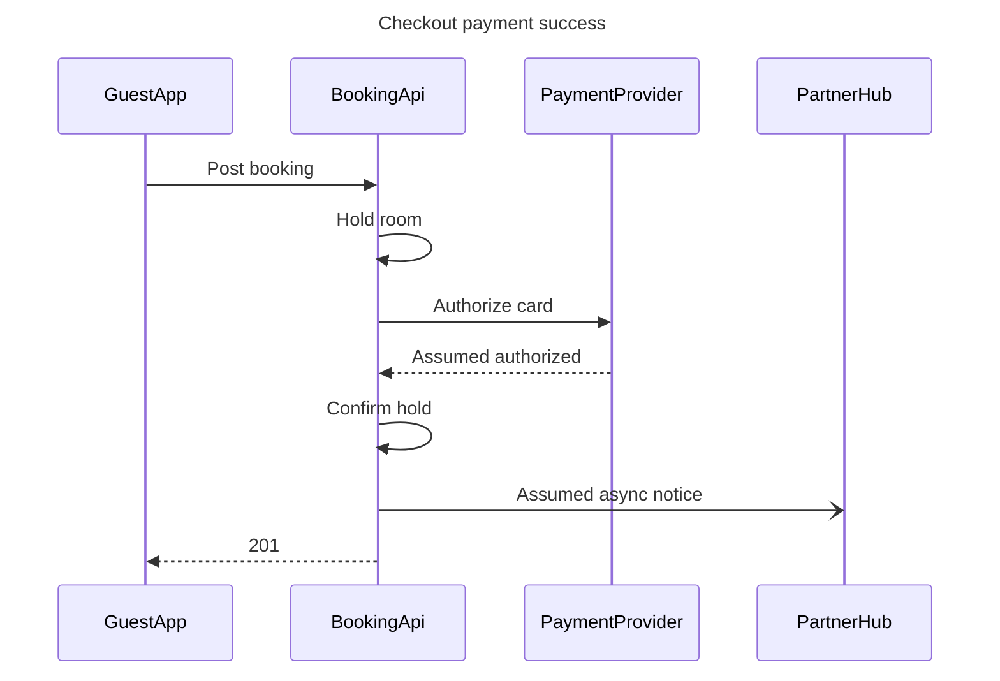
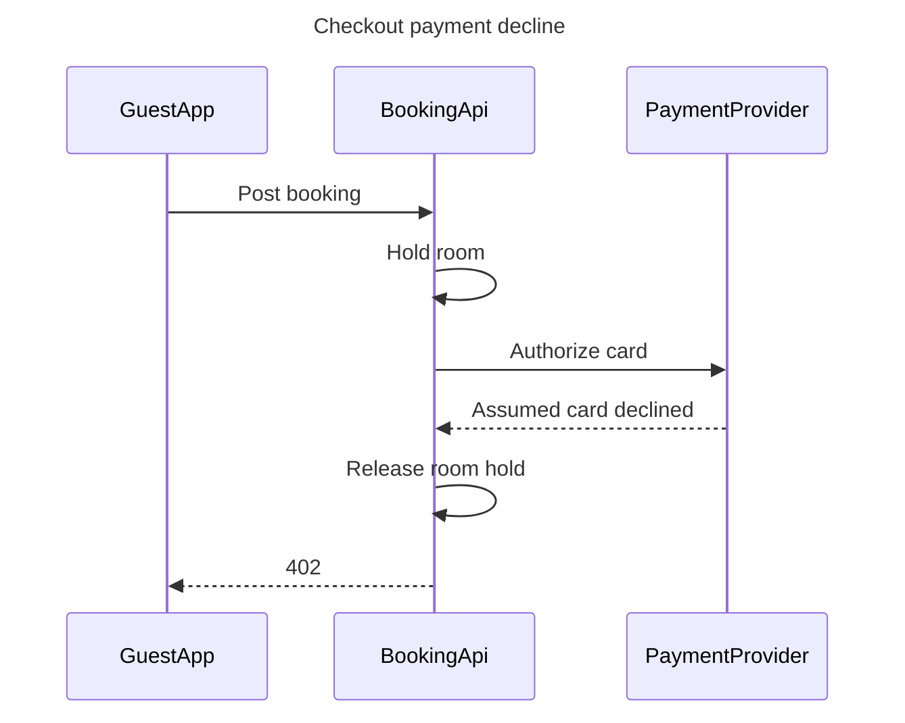

# FJ-025 turn 2 transcript

**User:** Yes, that reading is right.

**Assistant:**

Thanks, that confirms the reading. I still need your explicit approval at the write gate before I add the two sections to the FigJam file.

**Assistant:**

Write gate — checked model after your playback confirmation. Target plan: Roamstay Product plan. Target file: existing FigJam file <test-file-key>. I will add two sections to its existing page, success first and decline second, to the right of current content. No extensions. The write needs two use_figma calls and two get_figjam read-backs. Counting the session and initial file read already used, the task takes six Figma calls, reaching the documented monthly limit for Starter plans and View or Collab seats. Rollback: remove only the two new section IDs returned by the write calls.

Success first glance: the 201 response. Decline first glance: the 402 response. The source status stays unknown. Provider replies and the one-way async partner notice remain labeled as assumed. PartnerHub behavior on decline remains out because the brief does not state it.

Do you approve writing these two sections to the specified file now?
- Yes, write both sections
- Revise the model

**Assistant:**

The reading is confirmed. The separate write gate is still awaiting your approval, so the FigJam file remains unchanged.
