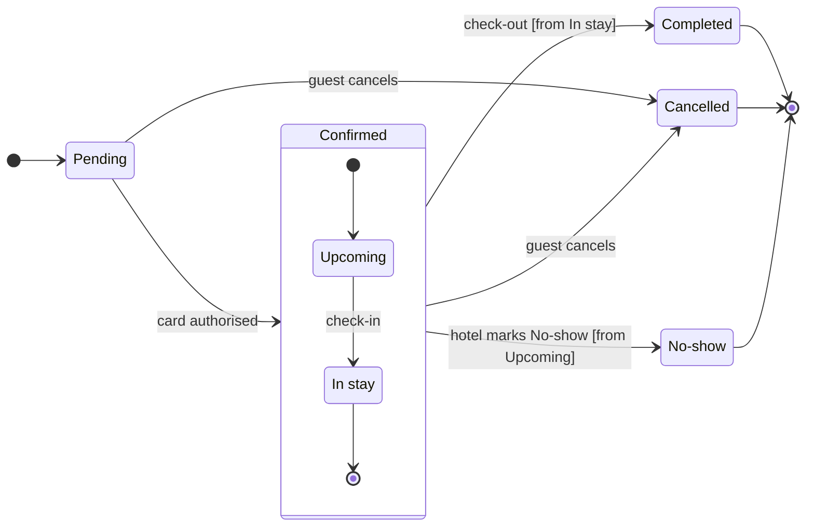

# FJ-026 turn 2 transcript

**User:** Yes, that reading is right.

**Assistant:**

Thanks, I’ll now build the state model and run Flow Mode’s required pre-write checks. The existing section will stay untouched; I’ll ask separately before adding the new section.

**Tool call:** `command_execution` `{"command": "/bin/zsh -lc 'python3 sk-create-figjam/scripts/flow_check.py --help'", "changes": null}`

**Tool result (error):** `command_execution`

```text
mermaid_extract: --help: not a Mermaid file
UNREADABLE --help: the extractor refused it

```

**Tool call:** `command_execution` `{"command": "/bin/zsh -lc \"rg -n 'argparse|sys.argv|ArgumentParser|usage|model_path|--self-test' sk-create-figjam/scripts/flow_check.py sk-create-figjam/scripts/compose_board.py\"", "changes": null}`

**Tool result:** `command_execution`

```text
sk-create-figjam/scripts/flow_check.py:42:  flow_check.py --self-test           -> prove each rule fails on a planted model with its own message,
sk-create-figjam/scripts/flow_check.py:286:    """Dispatch the command line and return the exit code the usage lines document."""
sk-create-figjam/scripts/flow_check.py:287:    args = sys.argv[1:]
sk-create-figjam/scripts/flow_check.py:288:    if args == ["--self-test"]:
sk-create-figjam/scripts/compose_board.py:49:  compose_board.py --self-test                             -> prove every shipped model composes, its counts
sk-create-figjam/scripts/compose_board.py:1341:    """Dispatch the command line and return the exit code the usage lines document."""
sk-create-figjam/scripts/compose_board.py:1342:    args = sys.argv[1:]
sk-create-figjam/scripts/compose_board.py:1343:    if args == ["--self-test"]:

```

**Tool call:** `command_execution` `{"command": "/bin/zsh -lc \"sed -n '1,60p' sk-create-figjam/scripts/flow_check.py && sed -n '1,80p' sk-create-figjam/scripts/compose_board.py && sed -n '280,325p' sk-create-figjam/scripts/flow_check.py && sed -n '1335,1375p' sk-create-figjam/scripts/compose_board.py\"", "changes": null}`

**Tool result:** `command_execution`

```text
#!/usr/bin/env python3
# ───────────────────────────────────────────────────────────────
# COMPONENT: FIGJAM MODEL PRE-WRITE CHECK
# ───────────────────────────────────────────────────────────────

"""Check a FigJam diagram model before it is written to a board.

A board is slow to fix once it exists: the composer owns its layout, so every
fix is a new write. Worse, neither the composer nor the generated fallback
draws all that Mermaid can say, so a model can promise a reader something the
board never shows. The rules each diagram kind carries are checked on the
Mermaid model first, and a model that breaks one is never written. The same
parse is measured, so a shape that is legal and still hard to read, such as a
rank of six steps or a connector that doubles back, is caught here rather than
on the board.

Each Mermaid block in the file is one diagram, read by its header:

- `flowchart` is a user flow unless a `%% type: process` or
  `%% type: architecture` comment line says otherwise
- `sequenceDiagram`, `stateDiagram-v2`, `erDiagram` and `gantt` are the other
  four kinds Flow Mode draws
- any other header, such as `pie`, `mindmap` or `journey`, is a kind Flow
  Mode does not draw and fails

The rules for each kind live in `figjam_checks/`, and `references/types/`
explains each one. Flowcharts and state diagrams are parsed by
`vendored/mermaid_extract.py`, a byte copy of the shared diagram skill's
extractor kept in step through `vendor.json`. It parses text only and never
re
```

**Tool call:** `command_execution` `{"command": "/bin/zsh -lc 'set -e\ntemp_dir=$(mktemp -d /tmp/roamstay-flow.XXXXXX)\nmodel_path=\"$temp_dir/booking-state.md\"\ncode_path=\"$temp_dir/compose.js\"\ncat > \"$model_path\" <<'\"'EOF'\nstateDiagram-v2\ndirection LR\n%% title: Roamstay booking lifecycle for support\n%% subtitle: Support can trace a booking from Pending to its final outcome.\n%% source: Source: user request and existing Booking status section. Left out: refunds, payment steps, hotel-side cancellation and the No-show timing window.\n%% focus: Completed\n[*] --> Pending\nPending --> Confirmed: card authorised\nPending `

**Tool result (error):** `command_execution`

```text
MODEL_PATH=/tmp/roamstay-flow.U5DPIs/booking-state.md
CODE_PATH=/tmp/roamstay-flow.U5DPIs/compose.js
mermaid_extract: booking-state.md: no fenced mermaid block found
UNREADABLE /tmp/roamstay-flow.U5DPIs/booking-state.md: the extractor refused it

```

**Tool call:** `command_execution` `{"command": "/bin/zsh -lc \"cat > '/tmp/roamstay-flow.U5DPIs/booking-state.md' <<'EOF'\n\\\\x60\\\\x60\\\\x60mermaid\nstateDiagram-v2\ndirection LR\n%% title: Roamstay booking lifecycle for support\n%% subtitle: Support can trace a booking from Pending to its final outcome.\n%% source: Source: user request and existing Booking status section. Left out: refunds, payment steps, hotel-side cancellation and the No-show timing window.\n%% focus: Completed\n[*] --> Pending\nPending --> Confirmed: card authorised\nPending --> Cancelled: guest cancels\nstate \\\"No-show\\\" as NoShow\nstate Confirmed `

**Tool result (error):** `command_execution`

```text
mermaid_extract: booking-state.md: no fenced mermaid block found
UNREADABLE /tmp/roamstay-flow.U5DPIs/booking-state.md: the extractor refused it
mermaid_extract: booking-state.md: no fenced mermaid block found
UNREADABLE /tmp/roamstay-flow.U5DPIs/booking-state.md: the extractor refused it

```

**Tool call:** `command_execution` `{"command": "/bin/zsh -lc \"cat '/tmp/roamstay-flow.U5DPIs/booking-state.md'\"", "changes": null}`

**Tool result:** `command_execution`

```text
\x60\x60\x60mermaid
stateDiagram-v2
direction LR
%% title: Roamstay booking lifecycle for support
%% subtitle: Support can trace a booking from Pending to its final outcome.
%% source: Source: user request and existing Booking status section. Left out: refunds, payment steps, hotel-side cancellation and the No-show timing window.
%% focus: Completed
[*] --> Pending
Pending --> Confirmed: card authorised
Pending --> Cancelled: guest cancels
state "No-show" as NoShow
state Confirmed {
    [*] --> Upcoming
    state "In stay" as InStay
    Upcoming --> InStay: check-in
    InStay --> [*]
}
Confirmed --> Completed: check-out [from In stay]
Confirmed --> Cancelled: guest cancels
Confirmed --> NoShow: hotel marks No-show [from Upcoming]
Completed --> [*]
Cancelled --> [*]
NoShow --> [*]
\x60\x60\x60

```

**Tool call:** `command_execution` `{"command": "/bin/zsh -lc \"cat > '/tmp/roamstay-flow.U5DPIs/booking-state.md' <<'EOF'\n\"'```mermaid\nstateDiagram-v2\ndirection LR\n%% title: Roamstay booking lifecycle for support\n%% subtitle: Support can trace a booking from Pending to its final outcome.\n%% source: Source: user request and existing Booking status section. Left out: refunds, payment steps, hotel-side cancellation and the No-show timing window.\n%% focus: Completed\n[*] --> Pending\nPending --> Confirmed: card authorised\nPending --> Cancelled: guest cancels\nstate \"No-show\" as NoShow\nstate Confirmed {\n    [*] --> Upco`

**Tool result:** `command_execution`

```text
  diagram 1, state: ok, 7 states and 12 transitions
PASSED 1 diagram(s) in booking-state.md
COMPOSED diagram 1, 7 states and 12 transitions: 12 nodes and 12 connectors to read back, 48911 characters in /tmp/roamstay-flow.U5DPIs/compose.js, drawn in the design FigJam default

```

**Tool call:** `command_execution` `{"command": "/bin/zsh -lc \"rg -n 'widest|longest|crossing|average|connectors per|measure|PASSED|print\\\\(' sk-create-figjam/scripts/flow_check.py sk-create-figjam/scripts/figjam_checks/layout.py\"", "changes": null}`

**Tool result:** `command_execution`

```text
sk-create-figjam/scripts/flow_check.py:13:parse is measured, so a shape that is legal and still hard to read, such as a
sk-create-figjam/scripts/flow_check.py:44:                                         and that the style guide's palette record still measures true
sk-create-figjam/scripts/flow_check.py:150:    measures, shape = layout.measure(diagram)
sk-create-figjam/scripts/flow_check.py:151:    return profile, found + measures, f"{nodes} nodes and {len(diagram.edges)} connectors, {shape}", diagram.direction
sk-create-figjam/scripts/flow_check.py:160:        print(f"UNREADABLE {path}: the extractor refused it")
sk-create-figjam/scripts/flow_check.py:163:        print(f"UNREADABLE {path}: no Mermaid block found")
sk-create-figjam/scripts/flow_check.py:171:                print(f"  {name}: {problem}")
sk-create-figjam/scripts/flow_check.py:173:            print(f"  {name}: ok, {size}")
sk-create-figjam/scripts/flow_check.py:178:            print(f"FAILED the {NAMES[profile]} diagrams in {path.name} run {' and '.join(sorted(found))}: "
sk-create-figjam/scripts/flow_check.py:182:        print(f"FAILED {failed} of {len(results)} diagram(s) in {path.name}")
sk-create-figjam/scripts/flow_check.py:184:    print(f"PASSED {len(results)} diagram(s) in {path.name}")
sk-create-figjam/scripts/flow_check.py:215:    """The style guide's palette record names exactly the pairs the check accepts, and its ratios measure true."""
sk-create-figjam/scripts/flow_check.py:226:        measured = (ro
```

**Tool call:** `command_execution` `{"command": "/bin/zsh -lc \"sed -n '115,190p' sk-create-figjam/scripts/flow_check.py && sed -n '120,160p' sk-create-figjam/scripts/figjam_checks/layout.py\"", "changes": null}`

**Tool result:** `command_execution`

```text
        return directive, []
    if directive and directive != kind:
        return "", [f"%% type: {directive} on a {word} block: the header already names the kind"]
    return kind, []


def check_block(block: mermaid_extract.SourceBlock, block_text: str) -> tuple[str, list[str], str, str]:
    """Return the profile, its problems, the size and shape summary and the flowchart direction."""
    profile, problems = profile_of(block_text)
    if problems:
        return profile, problems, "", ""
    if profile == "sequence":
        found, participants, messages = check_sequence(block_text)
        return profile, found, f"{participants} participants and {messages} messages", ""
    if profile == "er":
        found, entities, relationships = check_er(block_text)
        return profile, found, f"{entities} entities and {relationships} relationships", ""
    if profile == "gantt":
        found, tasks, sections = check_gantt(block_text)
        return profile, found, f"{tasks} tasks in {sections} sections", ""
    if profile == "state":
        legacy = check_state_header(block_text)
        if legacy:
            return profile, legacy, "", ""
        diagram = mermaid_extract.parse_block(block)
        states = sum(1 for node in diagram.nodes if node.shape not in ("start", "end"))
        return profile, check_state(diagram, block_text), f"{states} states and {len(diagram.edges)} transitions", ""
    if profile == flowchart.ARCHITECTURE:
        text, backward = flowchart.rewr
```

**Tool call:** `command_execution` `{"command": "/bin/zsh -lc \"python3 -c 'import sys\nfrom pathlib import Path\nsys.path.insert(0, \\\"sk-create-figjam/scripts/vendored\\\")\nsys.path.insert(0, \\\"sk-create-figjam/scripts\\\")\nimport mermaid_extract\nfrom figjam_checks import layout\np = Path(\\\"/tmp/roamstay-flow.U5DPIs/booking-state.md\\\")\nblocks = mermaid_extract.load_blocks(p)\ndiagram = mermaid_extract.parse_block(blocks[0])\nprint(layout.measure(diagram)[1])'\"", "changes": null}`

**Tool result:** `command_execution`

```text
widest rank 4 steps, longest path 4 steps, 0.7 connectors per step, labels average 7 characters, 3 crossing pairs

```

**Tool call:** `command_execution` `{"command": "/bin/zsh -lc \"sed -n '1,115p' sk-create-figjam/scripts/figjam_checks/layout.py && sed -n '1,220p' sk-create-figjam/scripts/figjam_checks/state.py\"", "changes": null}`

**Tool result:** `command_execution`

```text
#!/usr/bin/env python3
# ───────────────────────────────────────────────────────────────
# COMPONENT: LAYOUT MEASURES
# ───────────────────────────────────────────────────────────────

"""How much shape a diagram asks a reader to hold, measured on the same parse.

A count says how much a diagram holds and nothing about how hard it reads: a rank
of six steps, a chain of nine and two connectors that swap sides all pass one
count. The composer owns the layout, so a shape that reads badly is never
rearranged once the board exists. These measures run before the write, and one
out of band is fixed in the model before a write is spent.

A flow may loop back, so the connectors that close a loop are dropped before the
ranks are read. The crossing count is an estimate: the layout reorders each rank
by its neighbours, and the order the writer declared the steps stands in for it.
"""

from __future__ import annotations

from typing import TYPE_CHECKING

from .common import MAX_LABEL_CHARS

if TYPE_CHECKING:
    from mermaid_extract import Diagram, Edge

# A reader holds one rank at a time, so a rank wider than this cannot be read in
# one pass down the page.
MAX_RANK_WIDTH = 4
# One step under the largest diagram a type may hold: a flow read as one chain of
# nine steps is where a reader stops following the thread.
MAX_LONGEST_PATH = 8
# A pair of connectors that swap sides has to be followed across the diagram to
# see where it lands, and more than two of those is a tangle.
MAX_CROSSING
```

**Tool call:** `command_execution` `{"command": "/bin/zsh -lc \"python3 sk-create-figjam/scripts/compose_board.py '/tmp/roamstay-flow.U5DPIs/booking-state.md' --model\"", "changes": null}`

**Tool result:** `command_execution`

```text
COMPOSED diagram 1, 7 states and 12 transitions: 12 nodes and 12 connectors to read back, 2596 characters, drawn in the design FigJam default
{
 "type": "graph",
 "profile": "state",
 "direction": "LR",
 "zoneMode": "group",
 "zones": [
  {
   "id": "Confirmed",
   "label": "Confirmed"
  }
 ],
 "nodes": [
  {
   "id": "__start_1",
   "label": "[start]",
   "kind": "initial",
   "zone": null
  },
  {
   "id": "Pending",
   "label": "Pending",
   "kind": "firstState",
   "zone": null
  },
  {
   "id": "Cancelled",
   "label": "Cancelled",
   "kind": "finalState",
   "zone": null
  },
  {
   "id": "NoShow",
   "label": "No-show",
   "kind": "finalState",
   "zone": null
  },
  {
   "id": "__start_2",
   "label": "[start]",
   "kind": "initial",
   "zone": "Confirmed"
  },
  {
   "id": "Upcoming",
   "label": "Upcoming",
   "kind": "state",
   "zone": "Confirmed"
  },
  {
   "id": "InStay",
   "label": "In stay",
   "kind": "state",
   "zone": "Confirmed"
  },
  {
   "id": "__end_1",
   "label": "[end]",
   "kind": "final",
   "zone": "Confirmed"
  },
  {
   "id": "Completed",
   "label": "Completed",
   "kind": "finalState",
   "zone": null,
   "accent": true
  },
  {
   "id": "__end_2",
   "label": "[end]",
   "kind": "final",
   "zone": null
  },
  {
   "id": "__end_3",
   "label": "[end]",
   "kind": "final",
   "zone": null
  },
  {
   "id": "__end_4",
   "label": "[end]",
   "kind": "final",
   "zone": null
  }
 ],
 "edges": [
  {
   "from": "__start_1",
   "to": "Pending",
```

**Tool call:** `command_execution` `{"command": "/bin/zsh -lc \"rg -n 'profile == \\\"state\\\"|profile.*state|zoneMode.*group|state_diagram|state' sk-create-figjam/scripts/compose_board.py | sed -n '1,140p' && rg -n 'def .*state|state.*layout|confirmed' sk-create-figjam/scripts/figjam_checks/board_geometry.py sk-create-figjam/scripts/figjam_checks/flowchart.py\"", "changes": null}`

**Tool result:** `command_execution`

```text
25:  diagram draws each one around its entities, and lanes and composite states
28:  that takes no `style` line: a node of an architecture, a state or an ER
75:from figjam_checks import er, flowchart, gantt, sequence, state  # noqa: E402
77:from figjam_checks.common import ACCENT_PAIRS, CANVAS, content_lines, contrast, statements  # noqa: E402
202:    for statement in statements(block_text):
203:        words = statement.split()
205:            fill = flowchart.colour(statement, "fill")
206:            stroke = flowchart.colour(statement, "stroke")
302:def state_model(diagram: mermaid_extract.Diagram, block_text: str) -> tuple[dict, list[str]]:
303:    """The MODEL for a state diagram, with each composite drawn as the zone around its states."""
306:        match = state.STEREOTYPE.match(text)
324:        # Only the machine's own start and end colour a state. A composite's inner entry and exit are drawn
325:        # inside its zone, and a state that only leaves the composite has not ended the machine.
333:            kind = "state"
336:    model = {"type": "graph", "profile": "state", "direction": "TB" if diagram.direction in ("TD", "TB") else "LR",
337:             "zoneMode": "group", "zones": zones, "nodes": nodes, "edges": edges, "edgeStyles": [],
387:    model = {"type": "graph", "profile": "er", "direction": direction, "zoneMode": "group",
490:    elif profile == "state":
491:        model, found = state_model(mermaid_extract.parse_block(block), block.text)
498:    if z
```

**Tool call:** `command_execution` `{"command": "/bin/zsh -lc \"sed -n '295,345p' sk-create-figjam/scripts/compose_board.py && sed -n '840,950p' sk-create-figjam/assets/compose-board.js && sed -n '1260,1305p' sk-create-figjam/scripts/compose_board.py\"", "changes": null}`

**Tool result:** `command_execution`

```text
    model = {"type": "graph", "profile": profile, "direction": "TB" if diagram.direction in ("TD", "TB") else "LR",
             "zoneMode": mode, "zones": model_zones, "nodes": nodes, "edges": edges,
             "edgeStyles": list(dict.fromkeys(styles)),
             "expect": {"nodes": len(nodes), "connectors": len(edges)}}
    return model, problems


def state_model(diagram: mermaid_extract.Diagram, block_text: str) -> tuple[dict, list[str]]:
    """The MODEL for a state diagram, with each composite drawn as the zone around its states."""
    stereotypes = {}
    for _, text in content_lines(block_text):
        match = state.STEREOTYPE.match(text)
        if match:
            stereotypes[match.group(1)] = match.group(2).lower()
    by_id = {node.id: node for node in diagram.nodes}
    zones = [{"id": node.id, "label": node.label or node.id} for node in diagram.nodes if node.container]
    nodes = []
    for node in diagram.nodes:
        if node.container:
            continue
        stereotype = stereotypes.get(node.id)
        if node.shape == "start":
            kind = "initial"
        elif node.shape == "end":
            kind = "final"
        elif stereotype == "choice":
            kind = "choice"
        elif stereotype in ("fork", "join"):
            kind = "fork"
        # Only the machine's own start and end colour a state. A composite's inner entry and exit are drawn
        # inside its zone, and a state that only leaves the composite has not ended the
```

**Tool call:** `command_execution` `{"command": "/bin/zsh -lc \"cat '/tmp/roamstay-flow.U5DPIs/compose.js'\"", "changes": null}`

**Tool result:** `command_execution`

```text
const MODEL={"type":"graph","profile":"state","direction":"LR","zoneMode":"group","zones":[{"id":"Confirmed","label":"Confirmed"}],"nodes":[{"id":"__start_1","label":"[start]","kind":"initial"},{"id":"Pending","label":"Pending","kind":"firstState"},{"id":"Cancelled","label":"Cancelled","kind":"finalState"},{"id":"NoShow","label":"No-show","kind":"finalState"},{"id":"__start_2","label":"[start]","kind":"initial","zone":"Confirmed"},{"id":"Upcoming","label":"Upcoming","kind":"state","zone":"Confirmed"},{"id":"InStay","label":"In stay","kind":"state","zone":"Confirmed"},{"id":"__end_1","label":"[end]","kind":"final","zone":"Confirmed"},{"id":"Completed","label":"Completed","kind":"finalState","accent":true},{"id":"__end_2","label":"[end]","kind":"final"},{"id":"__end_3","label":"[end]","kind":"final"},{"id":"__end_4","label":"[end]","kind":"final"}],"edges":[{"from":"__start_1","to":"Pending"},{"from":"Pending","to":"Confirmed","label":"card authorised"},{"from":"Pending","to":"Cancelled","label":"guest cancels"},{"from":"__start_2","to":"Upcoming"},{"from":"Upcoming","to":"InStay","label":"check-in"},{"from":"InStay","to":"__end_1"},{"from":"Confirmed","to":"Completed","label":"check-out [from In stay]"},{"from":"Confirmed","to":"Cancelled","label":"guest cancels"},{"from":"Confirmed","to":"NoShow","label":"hotel marks No-show [from Upcoming]"},{"from":"Completed","to":"__end_2"},{"from":"Cancelled","to":"__end_3"},{"from":"NoShow","to":"__end_4"}],"expect":{"nodes":12,"connect
```

**Assistant:**

**Write gate**

The state model passed `flow_check.py`: 7 states and 12 transitions. `compose_board.py` produced one board in the FigJam default design, with 12 nodes and 12 connectors.

Target: the existing FigJam file `<test-file-key>` in the Roamstay Product plan you named. I’ll add one section titled “Roamstay booking lifecycle for support” to the right of existing page content. The current `Booking status` section and other content will stay untouched.

The new board will use the shared gray fill for Completed, Cancelled, and No-show, with a pink focus outline on Completed. It will leave out the No-show timing window, check-in/check-out ownership, refunds, payment steps, and hotel-side cancellation. No extensions are planned.



After approval, I’ll make one `use_figma` write, read it back with `get_figjam`, and inspect a full-size screenshot. If rollback is needed, it will remove only this new section by its returned ID, and will require separate confirmation. No file or page will be created.

**Assistant:**

Approve adding this new section to the supplied FigJam file with the model and rollback described above?
- Approve the write
- Hold the write

**Assistant:**

The model and composer are ready, but I haven’t written anything. The write approval prompt is still pending.

**Assistant:**

No changes have been made to the FigJam file. I’ll proceed only after the approval prompt is answered.

**Assistant:**

The write gate remains open for your decision. The planned board adds a new section in the existing file and preserves the current `Booking status` section.

**Assistant:**

The model passed Flow Mode’s pre-write check. No board changes have been made.

The write approval prompt is still pending. Approving it will add the new lifecycle section to the [existing FigJam file](<figma-url> and leave the current `Booking status` section unchanged.
