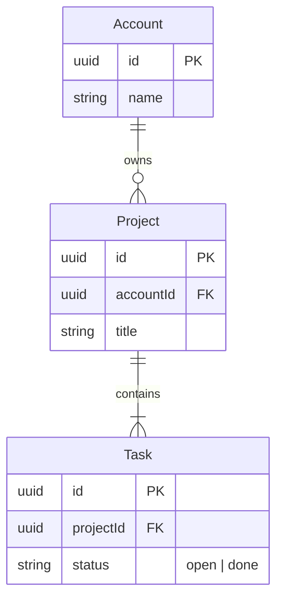

# FJ-027 turn 1 transcript

**User:** make a FigJam ER diagram of the Roamstay stays model on a new board in our Roamstay Product plan, and group the partner tables apart from the guest tables. From the schema note: guests, bookings, payments, properties, rooms and rate plans. A guest makes bookings, a booking reserves one room under one rate plan and holds its payments, and a property offers rooms and publishes rate plans. Keep the keys and the few columns support asks about.

Write the board into the existing FigJam file with key <test-file-key> rather than a new file.

**Assistant:**

I’ll load the Flow Mode instructions and diagram template, then prepare the ERD’s pre-write check before touching the FigJam file.

**Tool call:** `command_execution` `{"command": "/bin/zsh -lc \"pwd && rg --files -g 'SKILL.md' -g 'ROUTER.md' -g 'flow-mode.md' -g 'flow-templates.md' -g 'hvr-core.md' -g 'conciseness.md' -g 'interactive-response-templates.md' -g 'AGENTS.md'\"", "changes": null}`

**Tool result:** `command_execution`

```text
/var/folders/3c/zfqcqsts0kn19cgblj82gqhm0000gn/T/devin-compare-bench/FJ-027
mcp-click-up/SKILL.md
AGENTS.md
SKILL.md
mcp-code-mode/SKILL.md
ROUTER.md
sk-create-figjam/assets/flow-templates.md
sk-product-owner/SKILL.md
sk-product-owner/assets/interactive-response-templates.md
sk-create-figjam/references/flow-mode.md
sk-product-owner/references/conciseness.md
sk-product-owner/references/hvr-core.md
sk-create-figjam/SKILL.md
mcp-figma/SKILL.md

```

**Tool call:** `command_execution` `{"command": "/bin/zsh -lc 'cat sk-product-owner/references/hvr-core.md'", "changes": null}`

**Tool result:** `command_execution`

```text
---
title: "Rules - Human Voice Core"
description: "Human Voice hard blockers carried inline, loaded on every request so the banned terms are in view while writing."
contextType: general
importance_tier: critical
trigger_phrases:
  - "human voice card"
  - "hard blockers"
  - "hvr self-scan"
version: 0.100.0.0
---

# Rules - Human Voice Core

Human Voice hard blockers carried inline, loaded on every request so the banned terms are in view while writing.

**Loading Condition:** ALWAYS
**Purpose:** Carries the Human Voice hard blockers inline so the banned terms are in view on every request, without loading the full standard
**Scope:** Punctuation, hard blocker words and phrases, banned metaphors and cliches, setup language, generalisation fixes, output warnings, structural bans, always-cut modifiers and the before-delivery self-scan report line
**Output Path:** None. The card governs the wording of an artifact another file writes, and produces none of its own
**Authority:** `Rules - Human Voice - EN` is the full standard, symlinked into every consuming system as its own human-voice reference. Carried here: punctuation, hard blocker words and phrases, banned metaphors, setup phrases, generalisation fixes, output warnings, structural bans, always-cut modifiers. Left there: soft deductions, context-dependent flags, voice directives, the precedence hierarchy and the point scoring. Load the standard ON_DEMAND to settle a borderline term or run a scored pass.

---

## 1. OVERVIEW

#
```

**Tool call:** `command_execution` `{"command": "/bin/zsh -lc 'cat sk-create-figjam/SKILL.md'", "changes": null}`

**Tool result:** `command_execution`

```text
---
name: sk-create-figjam
description: "Draws FigJam diagrams, from user flows to sequence, state, ER and gantt, as checked Mermaid models composed into framed boards."
allowed-tools: [Read, Write, Edit, Bash, Glob, Grep, mcp__code_mode__call_tool_chain]
version: 1.0.4.0
---

<!-- Keywords: sk-create-figjam, flow mode, figjam, user flow, process, architecture, sequence diagram, state diagram, er diagram, gantt, flowchart, mermaid, board, $flow, $figjam -->

# FigJam Diagrams

The Product Owner packet that draws FigJam diagrams. It picks the diagram type the reader's question needs, turns screenshots, a Figma flow, a product doc, a schema or a plan into a Mermaid model of that type with a provenance table, checks the model and, after a yes, composes it into a framed FigJam board with a title, zones, colour by kind and a key. Seven types are drawn: user flow, process, architecture, sequence, state, ER and gantt. The hub [`../SKILL.md`](../SKILL.md) picks this packet, the hub [`../ROUTER.md`](../ROUTER.md) maps a Flow request to its leaves, and Section 2 routes inside it.

---

## 1. WHEN TO USE

- `$flow` or `$figjam`, with no other artifact command
- FigJam output wording such as "make a FigJam flow from these screenshots" or "a sequence diagram in FigJam"
- A request to add notes to or update a FigJam board, including one that carries a `figma.com/board` link
- A Flow route handed on by the Product Owner router

### When NOT to Use

- Figma feedback on spacing, copy or align
```

**Tool call:** `command_execution` `{"command": "/bin/zsh -lc 'cat ROUTER.md'", "changes": null}`

**Tool result:** `command_execution`

```text
---
title: "Product Owner Surface Router: per-intent leaf sets"
description: "Stage two of the product-owner hub. hub-router.json selects the workflow mode, and this document maps a request's intent to the exact packet-local leaves that mode loads, as canonical (workflowMode, leafResourceId) pairs."
trigger_phrases:
  - "product owner surface router"
  - "product owner leaf routing"
  - "product owner resource map"
importance_tier: important
contextType: general
version: 1.0.0.0
router_state: active
skill_pointer: SKILL.md
---

# Product Owner Surface Router: per-intent leaf sets

## 1. OVERVIEW

This is the product-owner hub's second-layer router, at the hub root beside [`SKILL.md`](SKILL.md). The hub selects a mode in [`hub-router.json`](hub-router.json) (`sk-product-owner`, `sk-create-figjam`, `mcp-click-up` or `mcp-figma`), and this document maps the request's intent to the exact packet-local leaves that mode loads. Every path is packet-qualified (`<packet>/references|assets/...`, where `<packet>` is the mode's `mode-registry.json` `packet` field) and converts to the canonical `(workflowMode, leafResourceId)` pair at the one contract boundary, `.skilled/skills/sk-doc/sk-create-skill/scripts/lib/leaf-resource-contract.cjs` in the skills library. A packet's `INSTALL-GUIDE.md` sits at its packet root, outside that contract, so it is never a leaf here: `mcp-click-up/SKILL.md` loads it from its own `ROOT_RESOURCES` on an install route, and the hub map below names only the pack
```

**Tool call:** `command_execution` `{"command": "/bin/zsh -lc 'cat SKILL.md'", "changes": null}`

**Tool result:** `command_execution`

```text
---
name: product-owner
description: "Product Owner hub: routes backlog, doc and FigJam diagram requests and two vendored tool packets via mode-registry.json."
allowed-tools: [Read, Write, Edit, Bash, Glob, Grep, WebFetch, WebSearch, mcp__code_mode__call_tool_chain]
version: 1.0.4.0
---

<!-- Keywords: product-owner, sk-product-owner, sk-create-figjam, mcp-click-up, mcp-figma, backlog, task, bug report, user story, epic, prd, product documentation, figjam, user flow, clickup -->

# Product Owner Hub

One public skill identity over three workflow packets and one transport packet. This hub holds no packet-local logic. It routes by `workflowMode` through `mode-registry.json`, uses `hub-router.json` for router policy, signals and outcomes, and hands stage two to the root `ROUTER.md`, which maps the request's intent to the packet's leaves.

**Version authority.** This file's `version` frontmatter is the hub's release version and matches the newest entry under `changelog/`. `description.json`, `mode-registry.json` and `hub-router.json` carry the same value. `ROUTER.md` keeps its own document version, and each packet keeps its own release line.

---

## 1. WHEN TO USE

Use this skill for Barter backlog and documentation work, for diagrams drawn on FigJam boards, and for the ClickUp and Figma operations those artifacts travel through.

| Mode | Kind | Use it for | Packet |
|------|------|------------|--------|
| **sk-product-owner** | workflow | Every task, bug, Story, Epic, Doc and 
```

**Tool call:** `command_execution` `{"command": "/bin/zsh -lc 'cat sk-product-owner/references/conciseness.md'", "changes": null}`

**Tool result:** `command_execution`

```text
---
title: "Rules - Conciseness"
description: "The conciseness layer above the Human Voice card: what to cut, what is never cut, and the test that decides which is which."
contextType: general
importance_tier: critical
trigger_phrases:
  - "conciseness layer"
  - "reconstruction test"
  - "concise not robotic"
  - "over-compression"
version: 0.100.0.0
---

# Rules - Conciseness

The conciseness layer above the Human Voice card: what to cut, what is never cut, and the test that decides which is which.

**Loading Condition:** ALWAYS, and rules only. A file paid for on every turn stays small enough to be worth paying for
**Purpose:** Carries the cut rules, the keep rules and the reconstruction test that decides between them, so every delivery is sized as well as checked for banned wording
**Scope:** Quantity, structure and load-bearing-ness, so an artifact that clears every hard blocker is not still three times too long. Nothing routes to it, since being ALWAYS-loaded is what makes it unroutable
**Output Path:** None. The layer governs the length of an artifact another file writes, and produces none of its own
**Loads With:** the consuming system's skill entry and `Rules - Human Voice Core`. That card governs word choice and this file governs quantity, so both run on every delivery
**Authority:** `Rules - Conciseness - On Demand Rationale` carries the reason behind every rule below, the vocabulary candidates that were refused, the worked cut and keep pairs, and the roster of wha
```

**Tool call:** `command_execution` `{"command": "/bin/zsh -lc 'cat sk-create-figjam/references/flow-mode.md'", "changes": null}`

**Tool result:** `command_execution`

```text
---
title: "Product Owner - Templates - Flow Mode"
description: "Product Owner flow-mode workflow: screenshots, Figma flows, product docs, schemas and plans turned into a checked Mermaid model of the right FigJam diagram type, written to a board and delivered as the board URL with a read-back line and the HVR self-scan line."
contextType: implementation
importance_tier: important
trigger_phrases:
  - "flow mode"
  - "$flow figjam board"
  - "figjam diagram type"
  - "figjam flow from screenshots"
  - "flow model pre-write check"
  - "board url read-back"
version: 1.0.3.0
---

# Product Owner - Templates - Flow Mode

Flow-mode guidance for FigJam diagrams. The workflow picks the diagram type the reader's question needs, turns screenshots, a Figma flow, a product doc, a schema or a plan into a Mermaid model of that type, checks it, writes it to a FigJam board and reads the board back before replying.

**Loading Condition:** ALWAYS on a Flow route, as half of the routed pair with `assets/flow-templates.md`
**Purpose:** Provides the flow-mode workflow, the type choice, the intake, the rules every type shares, the write routes and the delivery reply when `$flow`, `$figjam` or FigJam output wording is detected
**Scope:** Type choice, intake per input type, the model, the pre-write check, the quality pass, the write gate, the composed, generated and `fj` write routes, the hybrid extension, the read-back and the reply
**Output Path:** None. Flow Mode delivers a FigJam board URL and w
```

**Tool call:** `command_execution` `{"command": "/bin/zsh -lc 'cat sk-create-figjam/assets/flow-templates.md'", "changes": null}`

**Tool result:** `command_execution`

```text
---
title: "Product Owner Flow Templates"
description: "User-flow Mermaid patterns, the provenance table and the reply shape for Product Owner Flow Mode, each pattern passing the pre-write check."
contextType: general
importance_tier: important
trigger_phrases:
  - "flow templates"
  - "mermaid flow patterns"
  - "flow provenance table"
  - "flow reply shape"
version: 1.0.1.0
---

# Product Owner Flow Templates

Copy/apply patterns for Product Owner Flow Mode models.

**Loading Condition:** CONDITIONAL, with `references/flow-mode.md` whenever Flow intent is selected
**Purpose:** Provides the user-flow patterns, the provenance table every diagram type keeps and the reply shape every type delivers
**Scope:** Five user-flow patterns, the intake questions, the provenance table and the reply shape. The other types keep their patterns in `assets/templates/`
**Output Path:** None. The model is working data and the board is the deliverable

---

## 1. OVERVIEW

### Purpose

Every pattern below passes `scripts/flow_check.py` as a user flow, and `scripts/compose_board.py` composes it into a board. Start from the pattern closest to the flow, rename the nodes after the real screens and triggers, add the board lines below and run the check before the write gate. A process, an architecture, a sequence, a state diagram, an ER diagram or a gantt chart starts from its own file in `assets/templates/`, and keeps the provenance table and the reply shape below.

### Usage

- Node ids are short, s
```

**Tool call:** `command_execution` `{"command": "/bin/zsh -lc 'cat sk-product-owner/SKILL.md'", "changes": null}`

**Tool result:** `command_execution`

```text
---
name: sk-product-owner
description: "Writes Barter tasks, bug reports, Stories, Epics and source-safe product or engineering docs as ClickUp-ready markdown."
allowed-tools: [Read, Write, Edit, Glob, Grep, WebFetch, WebSearch]
version: 1.2.2.0
---

<!-- Keywords: product-owner, backlog, task, subtask, parent task, bug report, acceptance criteria, story mode, user story, prd, product requirements document, epic, doc mode, product documentation, engineering documentation, ClickUp, $task, $bug, $doc, $story, $prd, $epic, $quick -->

# Product Owner

Product Owner specialist for Barter backlog work and source-safe product or engineering documentation.

Creates tasks, subtasks, bug reports, acceptance criteria, stories, epics and product or engineering documents at the depth the audience needs. Backlog artifacts stay outcome-focused. Documentation artifacts may explain source-backed technical HOW or develop an explicitly labelled proposal without claiming it is approved or shipped. Never fabricates code behavior, architecture, implementation facts, root causes, operational evidence, approvals or professional sign-off.

**Identity adoption:** when this skill loads, you ARE the Product Owner. The energy-scaled thinking process, template gates, Human Voice Rules, quality floors and export protocol below replace generic assistant behavior. Non-negotiables while active: Product Owner scope, energy-scaled rigor, minimum perspectives by energy level, Human Voice Rules, six-dimension q
```

**Tool call:** `command_execution` `{"command": "/bin/zsh -lc 'cat sk-create-figjam/SKILL.md'", "changes": null}`

**Tool result:** `command_execution`

```text
---
name: sk-create-figjam
description: "Draws FigJam diagrams, from user flows to sequence, state, ER and gantt, as checked Mermaid models composed into framed boards."
allowed-tools: [Read, Write, Edit, Bash, Glob, Grep, mcp__code_mode__call_tool_chain]
version: 1.0.4.0
---

<!-- Keywords: sk-create-figjam, flow mode, figjam, user flow, process, architecture, sequence diagram, state diagram, er diagram, gantt, flowchart, mermaid, board, $flow, $figjam -->

# FigJam Diagrams

The Product Owner packet that draws FigJam diagrams. It picks the diagram type the reader's question needs, turns screenshots, a Figma flow, a product doc, a schema or a plan into a Mermaid model of that type with a provenance table, checks the model and, after a yes, composes it into a framed FigJam board with a title, zones, colour by kind and a key. Seven types are drawn: user flow, process, architecture, sequence, state, ER and gantt. The hub [`../SKILL.md`](../SKILL.md) picks this packet, the hub [`../ROUTER.md`](../ROUTER.md) maps a Flow request to its leaves, and Section 2 routes inside it.

---

## 1. WHEN TO USE

- `$flow` or `$figjam`, with no other artifact command
- FigJam output wording such as "make a FigJam flow from these screenshots" or "a sequence diagram in FigJam"
- A request to add notes to or update a FigJam board, including one that carries a `figma.com/board` link
- A Flow route handed on by the Product Owner router

### When NOT to Use

- Figma feedback on spacing, copy or align
```

**Tool call:** `command_execution` `{"command": "/bin/zsh -lc \"rg -n '\"'^## |''^### '\"' sk-create-figjam/references/flow-mode.md sk-create-figjam/references/types/er.md sk-create-figjam/assets/templates/er.md sk-create-figjam/assets/flow-templates.md sk-product-owner/assets/interactive-response-templates.md sk-create-figjam/references/quality-rubric.md sk-create-figjam/references/style-guide.md\"", "changes": null}`

**Tool result:** `command_execution`

```text
sk-create-figjam/assets/templates/er.md:22:## 1. USAGE
sk-create-figjam/assets/templates/er.md:30:## 2. PATTERNS
sk-create-figjam/assets/templates/er.md:32:### One-to-many core
sk-create-figjam/assets/templates/er.md:54:### Many-to-many through a junction
sk-create-figjam/assets/templates/er.md:75:### Aliased entity and a loose link
sk-create-figjam/references/style-guide.md:26:## 1. OVERVIEW
sk-create-figjam/references/style-guide.md:42:## 2. KINDS
sk-create-figjam/references/style-guide.md:46:### Flows and processes
sk-create-figjam/references/style-guide.md:66:### Architecture
sk-create-figjam/references/style-guide.md:70:### State, ER, sequence and gantt
sk-create-figjam/references/style-guide.md:85:### Lines and zones
sk-create-figjam/references/style-guide.md:101:## 3. PALETTE
sk-create-figjam/references/style-guide.md:103:### Accent and lane pairs
sk-create-figjam/references/style-guide.md:124:### What a `style` line means
sk-create-figjam/references/style-guide.md:137:### The accent
sk-create-figjam/references/style-guide.md:156:### Note palettes
sk-create-figjam/references/style-guide.md:170:## 4. GATES
sk-create-figjam/references/style-guide.md:178:### Recorded departures
sk-create-figjam/references/style-guide.md:191:## 5. TYPE AND GRID
sk-create-figjam/references/style-guide.md:213:## 6. WHAT HOLDS THE RECORD
sk-create-figjam/references/style-guide.md:224:## 7. SPACING
sk-create-figjam/references/quality-rubric.md:25:## 1. TYPE FIT
sk-create-figjam/references/qual
```

**Tool call:** `command_execution` `{"command": "/bin/zsh -lc \"sed -n '1,220p' sk-create-figjam/references/flow-mode.md && sed -n '220,520p' sk-create-figjam/references/flow-mode.md\"", "changes": null}`

**Tool result:** `command_execution`

```text
---
title: "Product Owner - Templates - Flow Mode"
description: "Product Owner flow-mode workflow: screenshots, Figma flows, product docs, schemas and plans turned into a checked Mermaid model of the right FigJam diagram type, written to a board and delivered as the board URL with a read-back line and the HVR self-scan line."
contextType: implementation
importance_tier: important
trigger_phrases:
  - "flow mode"
  - "$flow figjam board"
  - "figjam diagram type"
  - "figjam flow from screenshots"
  - "flow model pre-write check"
  - "board url read-back"
version: 1.0.3.0
---

# Product Owner - Templates - Flow Mode

Flow-mode guidance for FigJam diagrams. The workflow picks the diagram type the reader's question needs, turns screenshots, a Figma flow, a product doc, a schema or a plan into a Mermaid model of that type, checks it, writes it to a FigJam board and reads the board back before replying.

**Loading Condition:** ALWAYS on a Flow route, as half of the routed pair with `assets/flow-templates.md`
**Purpose:** Provides the flow-mode workflow, the type choice, the intake, the rules every type shares, the write routes and the delivery reply when `$flow`, `$figjam` or FigJam output wording is detected
**Scope:** Type choice, intake per input type, the model, the pre-write check, the quality pass, the write gate, the composed, generated and `fj` write routes, the hybrid extension, the read-back and the reply
**Output Path:** None. Flow Mode delivers a FigJam board URL and w
```

**Assistant:**

The request is clearly an ER diagram. I’m checking the supplied schema context and the target file’s existing contents so the model and its placement don’t invent fields or overwrite other work.

**Tool call:** `command_execution` `{"command": "/bin/zsh -lc \"sed -n '168,297p' sk-create-figjam/references/flow-mode.md\"", "changes": null}`

**Tool result:** `command_execution`

```text
## 4. INTAKE

Ask the intake as an interview, in the three rounds `assets/flow-templates.md` Section 5 sets out, so an answer in one round settles what the next may ask. Every question there carries the AI's reading of the input, a recommended answer and the one line of reason for it, so an unanswered question never blocks the work.

### The Brief

Nine rows hold what the intake learned, and the rows are filled as each source is read by the input types below. Each row carries a value, the source it came from and one status:

| Row | Holds |
|---|---|
| Reader | Who the board is for and the question they bring to it |
| Question | The question the diagram answers, in one sentence |
| Outcome | What the reader can decide or do after reading the board |
| Scope | What the board covers and what it leaves out |
| Entry | Where the flow starts |
| Exit | Where it ends and what counts as done |
| Actors | Who or what moves the work along |
| Decisions and states | The choices a person makes and the states the thing passes through |
| Sources and class | Each source read, with its class |

A row carries one of four statuses:

- `captured` when a supplied source states it
- `corrected` when the user changed what a source said
- `assumed` when no supplied source answers it. The row names what would settle it, and the assumption is said back in the playback before the gate, where the user can correct it
- `unasked` when the intake has not reached the row. Nothing is modelled while a row
```

**Tool call:** `command_execution` `{"command": "/bin/zsh -lc \"sed -n '298,458p' sk-create-figjam/references/flow-mode.md\"", "changes": null}`

**Tool result:** `command_execution`

```text
## 5. RULES EVERY TYPE SHARES

The check enforces these on every diagram, and each type adds its own in `references/types/`.

- **No emoji, no markup and no literal `\n`.** The board shows every label exactly as the model writes it, so markup would land as literal characters, and the `generate_diagram` fallback rejects emoji and a literal `\n`. Markup means an HTML tag, emphasis stars or underscores and backticks, anywhere in the block but a `%%` comment
- **Labels of at most 40 characters on one line.** Detail moves onto an edge label or into a second node
- **camelCase ids.** Letters and digits only, starting with a letter. No underscore, which breaks connector routing on the `generate_diagram` fallback, and never `end`, `subgraph`, `graph` or another Mermaid keyword. The composer names every layer after its id, such as `node:refund` and `edge:refund->done`, so the read-back finds each one by name
- **A budget per type.** sk-design-diagram's general budget of 9 nodes and 12 connectors applies unless the type sets its own. Over budget, split rather than shrink, and offer the overview board and the detail board together rather than choosing one quietly
- **Allocate before the first block.** The ordered source list is divided into diagram-sized groups before any Mermaid is written, each group ending on a hand-off node and named after that hand-off, so the ledger checks an allocation rather than a model that already overran. A group still over budget takes the fixed cut order t
```

**Tool call:** `command_execution` `{"command": "/bin/zsh -lc 'cat sk-create-figjam/assets/templates/er.md'", "changes": null}`

**Tool result:** `command_execution`

```text
---
title: "FigJam ER Templates"
description: "ER patterns that pass the pre-write check: a one-to-many core, a many-to-many junction and an aliased entity."
contextType: general
importance_tier: important
trigger_phrases:
  - "er templates"
  - "figjam er pattern"
version: 1.0.0.0
---

# FigJam ER Templates

Copy/apply patterns for an ER model. Each pattern passes `scripts/flow_check.py`, and `references/types/er.md` holds the rules.

**Loading Condition:** CONDITIONAL, with `references/types/er.md`
**Purpose:** Starting points for an ER diagram
**Scope:** Three patterns. The provenance table and the reply shape are in `assets/flow-templates.md`

---

## 1. USAGE

- Get the relationships and their cardinality right first, then add the 5 to 10 columns a reader needs
- Mark every `PK` and `FK`
- An alias goes on the entity block only, and relationships use the plain id

---

## 2. PATTERNS

### One-to-many core



### Many-to-many through a junction

```mermaid
erDiagram
    Member ||--o{ Membership : holds
    Team ||--o{ Membership : includes
    Member {
        uuid id PK
        string email UK
    }
    Team {
        uuid id PK
        stri
```

**Tool call:** `command_execution` `{"command": "/bin/zsh -lc 'cat sk-create-figjam/references/types/er.md'", "changes": null}`

**Tool result:** `command_execution`

```text
---
title: "FigJam Type - ER"
description: "Entities, their key fields and how they relate, drawn as a FigJam ER diagram with documented cardinalities, labelled relationships, aliases on declarations only and a nine-entity budget."
contextType: implementation
importance_tier: important
trigger_phrases:
  - "figjam er diagram"
  - "entity relationship figjam"
  - "data model figjam"
  - "schema diagram"
version: 1.0.3.0
---

# FigJam Type - ER

An ER diagram shows which entities exist, the fields that matter on each and how they relate. The composer draws each entity as a card in the `neutral` role, its name in bold above one line per field with its keys first, and each relationship as a line with no arrow, its cardinality marked at both ends and repeated in words in the label.

**Loading Condition:** CONDITIONAL, when the Flow route draws an ER diagram
**Purpose:** The grammar, rules, budget and read-back for an ER diagram
**Pairs With:** `assets/templates/er.md`

---

## 1. WHEN TO USE

**The reader's question:** which entities exist, what fields do they carry and how do they relate?

- A data model a story or a doc depends on, such as bookings and rooms
- The tables behind a feature, read from a schema or a migration
- A domain model agreed before the build, drawn from a product doc

Use an architecture for services and stores, and a state diagram for one entity's lifecycle.

---

## 2. WHAT THE BOARD DRAWS

```text
erDiagram
    Guest ||--o{ Booking : makes
    Guest {
   
```

**Tool call:** `command_execution` `{"command": "/bin/zsh -lc \"sed -n '152,218p' sk-product-owner/assets/interactive-response-templates.md\"", "changes": null}`

**Tool result:** `command_execution`

```text
## 3. DELIVERY REPLY SHAPE

Every reply after a saved artifact, a saved clarification or a rendered Deliverable Block uses this one shape. `AGENTS.md`, `SKILL.md`, the mode references and the kernel point here instead of restating it. Models copy a worked reply more closely than they follow a rule, so the worked replies below are part of the contract.

### Line Order

1. The path line: `Path: ` and the repository-relative export path in backticks. In a Claude Project it reads `Export-equivalent path: ` and comes after the Deliverable Block
2. `Verified: read-back succeeded; N lines`, on the skill only
3. The `HVR self-scan:` line in its exact shape
4. One quality line, `Quality: {verdict} | Kind: {kind} | Energy: {energy}`
5. Two or three sentences on what the artifact covers
6. The `### Open items` heading, then the numbered items or the one line `None identified`
7. One closing line

A Story bundle repeats lines 1 and 2 for each file, Story first, then gives one `HVR self-scan:` line for the whole bundle. When an export is still blocked after its retry, the reply prints no path line, opens with `Export blocked:` and the reason, and claims no delivery.

### The First Line

Nothing comes before the path line: no status line, no sentence announcing the reply, no report of the checks and no divider. After the last check, the next words written are the path.

- Wrong first line: `Export complete. The task is saved and read back.`
- Right first line: ``Path: `export/009 - task-pa
```

**Tool call:** `command_execution` `{"command": "/bin/zsh -lc \"sed -n '1,60p' sk-create-figjam/assets/flow-templates.md\"", "changes": null}`

**Tool result:** `command_execution`

```text
---
title: "Product Owner Flow Templates"
description: "User-flow Mermaid patterns, the provenance table and the reply shape for Product Owner Flow Mode, each pattern passing the pre-write check."
contextType: general
importance_tier: important
trigger_phrases:
  - "flow templates"
  - "mermaid flow patterns"
  - "flow provenance table"
  - "flow reply shape"
version: 1.0.1.0
---

# Product Owner Flow Templates

Copy/apply patterns for Product Owner Flow Mode models.

**Loading Condition:** CONDITIONAL, with `references/flow-mode.md` whenever Flow intent is selected
**Purpose:** Provides the user-flow patterns, the provenance table every diagram type keeps and the reply shape every type delivers
**Scope:** Five user-flow patterns, the intake questions, the provenance table and the reply shape. The other types keep their patterns in `assets/templates/`
**Output Path:** None. The model is working data and the board is the deliverable

---

## 1. OVERVIEW

### Purpose

Every pattern below passes `scripts/flow_check.py` as a user flow, and `scripts/compose_board.py` composes it into a board. Start from the pattern closest to the flow, rename the nodes after the real screens and triggers, add the board lines below and run the check before the write gate. A process, an architecture, a sequence, a state diagram, an ER diagram or a gantt chart starts from its own file in `assets/templates/`, and keeps the provenance table and the reply shape below.

### Usage

- Node ids are short, s
```

**Tool call:** `command_execution` `{"command": "/bin/zsh -lc \"rg -n -i 'roamstay|rate plan|rate_plan|stays model|support asks|schema note' . --glob '\"'!node_modules/**'\"' --glob '\"'!vendor/**'\"'\"", "changes": null}`

**Tool result:** `command_execution`

```text
./leaf-manifest.json:28:        "assets/examples/er-roamstay-stays.md",
./leaf-manifest.json:31:        "assets/examples/sequence-roamstay-checkout.md",
./leaf-manifest.json:32:        "assets/examples/state-roamstay-booking.md",
./context/roamstay-partner-self-onboarding-brief.md:8:Every new property on Roamstay is set up by hand. A partner fills in a short sign-up form, then an Ops agent collects the rest by email: photos, room types, rates, policies, city tax, bank details and identity documents. The agent builds the listing in Back office and makes it live.
./context/roamstay-partner-self-onboarding-brief.md:21:Target: 1,500 properties live through self-onboarding by 2027-06-30. For scale, Roamstay has 18,000 properties live today.
./context/roamstay-partner-self-onboarding-brief.md:29:3. Rooms and rates setup. Room types with their occupancy, a base price per night and at least one rate plan, free cancellation or non-refundable
./context/roamstay-partner-self-onboarding-brief.md:30:4. Policies and city tax. Check-in and check-out times, the cancellation policy per rate plan, house rules and the city tax rule, per adult per night or per stay
./context/roamstay-context.md:1:# Roamstay company context
./context/roamstay-context.md:5:Roamstay is a hotel booking marketplace. Guests search and book stays at hotels, guesthouses and serviced apartments, and partners list and run their properties on it. About 18,000 properties are live, across Europe and the United States.
./cont
```

**Tool call:** `command_execution` `{"command": "/bin/zsh -lc \"rg --files | rg -i 'schema|stays|roamstay'\"", "changes": null}`

**Tool result:** `command_execution`

```text
mcp-click-up/feature-catalog/cupt-task-details/status-schema.md
context/roamstay-partner-self-onboarding-brief.md
context/roamstay-context.md
context/roamstay-date-picker-design-notes.md
context/roamstay-support-ticket-58213.md
context/roamstay-payment-webhook-incident-notes.md
context/roamstay-booking-funnel-tracking-plan.md
context/roamstay-free-cancellation-pm-notes.md
mcp-click-up/feature-catalog/mcp-low-priority/get-schema.md
sk-create-figjam/assets/examples/sequence-roamstay-checkout.md
sk-create-figjam/assets/examples/er-roamstay-stays.md
sk-create-figjam/assets/examples/state-roamstay-booking.md

```

**Tool call:** `command_execution` `{"command": "/bin/zsh -lc 'cat context/roamstay-support-ticket-58213.md && cat context/roamstay-context.md'", "changes": null}`

**Tool result:** `command_execution`

```text
# Guest Support ticket 58213, Android total lower than the charge

Source: ticket export from the Guest Support queue in the support desk tool, escalated to the Booking squad
Opened on 2026-09-21 from in-app chat. Escalated by Maren, Guest Support agent (Tier 2), on 2026-09-21

| Field | Value |
|-------|-------|
| Ticket | 58213 |
| Status | Escalated to Booking squad |
| Priority | High |
| Channel | In-app chat, Android |
| Booking reference | RS-7Q4K2M |
| Booked on | 2026-09-20, with Pay now |
| Stay | 3 nights, 2 adults, 1 room |
| Property | 40217, city tax €3.00 per adult per night |
| Guest app | Android 8.12.1, app language en-GB |
| Tags | price-mismatch, android, confirmation-screen |

## Chat

Guest, 09:12
Hi, I booked a hotel yesterday for 3 nights. Your app said Total €387.00 on the confirmation but my bank took €405.00. That's €18.00 more than you told me. What is the extra?

Maren, 09:15
Hi, thanks for writing in. I'm checking booking RS-7Q4K2M for you now.

Guest, 09:16
Screenshot attached.

Maren, 09:24
Thanks. The room is €387.00 for the 3 nights, and the property charges a city tax of €3.00 per adult per night, so €18.00 for 2 adults over 3 nights. The charge of €405.00 is the full price with the city tax, and it is the only charge on your card. The Android app left the city tax out of the total on the confirmation screen. I'm sorry for the confusion. I'm emailing you the full breakdown now.

Guest, 09:27
OK, that makes sense. The app should show the righ
```

**Tool call:** `command_execution` `{"command": "/bin/zsh -lc \"sed -n '201,297p' sk-create-figjam/references/flow-mode.md && sed -n '168,245p' sk-create-figjam/assets/flow-templates.md && sed -n '1,230p' sk-create-figjam/references/quality-rubric.md && sed -n '1,270p' sk-create-figjam/references/style-guide.md\"", "changes": null}`

**Tool result:** `command_execution`

```text
### By input type

A source evidences only the item kinds it carries, and an item it cannot carry is asked for or named as a gap rather than filled in. Every item asked for in this section is asked the way Section 5 of `assets/flow-templates.md` asks, with the AI's reading and a recommended answer. An unanswered one proceeds on that recommendation, marked assumed and named in the playback before the gate.

**Screenshots**
- Read each image in place. A screenshot is never copied into this repository
- A filename names the screen and the trigger, such as `Dashboard - Click_ Location Selector`, but carries no step number. Order the steps by the inference ladder below, which reaches a question only after every other signal is spent
- A platform split, such as `Desktop/` and `Mobile/` folders, is one decision with one exit per platform, joined again by a merge dot where the paths meet
- The click target a filename leaves out is read off the image, such as the row under the cursor
- A label taken from an image is read twice before it becomes a node. The second read is a crop or an upscale of the area that holds the text, or a plain read of that area where the session has no tool for one, because those tools are off by default and a repeated token or a line of small text reads wrong on one pass
- The provenance table row for that label names the read it came from, and `read visually` marks a label whose only support is a plain look, in the model as well as in the read-back line Sect
```

**Assistant:**

The target key is explicit, so I’m loading Figma’s required `use_figma` guidance and opening a read session to inspect the file before deciding where the new ERD can sit.

**Tool call:** `command_execution` `{"command": "/bin/zsh -lc \"cat '/private/var/folders/3c/zfqcqsts0kn19cgblj82gqhm0000gn/T/codex-compare-home/plugins/cache/openai-curated-remote/figma/16.0.0/skills/figma-use/SKILL.md'\"", "changes": null}`

**Tool result:** `command_execution`

```text
---
name: figma-use
description: "**MANDATORY prerequisite** — you MUST invoke this skill BEFORE every `use_figma` tool call. NEVER call `use_figma` directly without loading this skill first. Skipping it causes common, hard-to-debug failures. Trigger whenever the user wants to perform a write action or a unique read action that requires JavaScript execution in the Figma file context — e.g. create/edit/delete nodes, set up variables or tokens, build components and variants, modify auto-layout or fills, bind variables to properties, or inspect file structure programmatically."
disable-model-invocation: false
---

# use_figma — Figma Plugin API Skill

Use the `use_figma` tool to execute JavaScript in Figma files via the Plugin API. All detailed reference docs live in `references/`.

**Always include `figma-use` in the comma-separated `skillNames` parameter when calling `use_figma`. If this skill was loaded via an MCP resource, you MUST prefix the name with `resource:` (e.g. `resource:figma-use`).** This is a logging parameter used to track skill usage — it does not affect execution.

**If Figma MCP tools appear as deferred tools, batch-load all their schemas in a single `ToolSearch` call** using the `select:` syntax — e.g. `ToolSearch query="select:use_figma,get_screenshot,get_metadata,create_new_file"`. One round trip beats six.

**If the task involves building or updating a full page, screen, or multi-section layout in Figma from code**, also load [figma-generate-design](../fi
```

**Tool call:** `figma.create_session` `{"fileKey": "<test-file-key>", "description": "Create a Roamstay stays ER diagram in the specified existing FigJam file"}`

**Tool result:** `figma.create_session`

```text
{'content': [{'type': 'text', 'text': '{"sessionId":"82064e0f-9918-49af-928e-b1fd4a30d31b"}'}], '_meta': {'mcpRequestId': '45d8e22d-9b76-44e9-b9d0-3fc03836490d', 'io.modelcontextprotocol/serverInfo': {'name': 'Figma MCP Server', 'version': '1.0.0', 'icons': [{'src': 'data:image/png;base64,iVBORw0KGgoAAAANSUhEUgAAAIAAAACgCAYAAADEkmT9AAAABGdBTUEAALGPC/xhBQAAACBjSFJNAAB6JgAAgIQAAPoAAACA6AAAdTAAAOpgAAA6mAAAF3CculE8AAAAhGVYSWZNTQAqAAAACAAFARIAAwAAAAEAAQAAARoABQAAAAEAAABKARsABQAAAAEAAABSASgAAwAAAAEAAgAAh2kABAAAAAEAAABaAAAAAAAAAEgAAAABAAAASAAAAAEAA6ABAAMAAAABAAEAAKACAAQAAAABAAAAgKADAAQAAAABAAAAoAAAAAB6dUZwAAAACXBIWXMAAAsTAAALEwEAmpwYAAABWWlUWHRYTUw6Y29tLmFkb2JlLnhtcAAAAAAAPHg6eG1wbWV0YSB4bWxuczp4PSJhZG9iZTpuczptZXRhLyIgeDp4bXB0az0iWE1QIENvcmUgNi4wLjAiPgogICA8cmRmOlJERiB4bWxuczpyZGY9Imh0dHA6Ly93d3cudzMub3JnLzE5OTkvMDIvMjItcmRmLXN5bnRheC1ucyMiPgogICAgICA8cmRmOkRlc2NyaXB0aW9uIHJkZjphYm91dD0iIgogICAgICAgICAgICB4bWxuczp0aWZmPSJodHRwOi8vbnMuYWRvYmUuY29tL3RpZmYvMS4wLyI+CiAgICAgICAgIDx0aWZmOk9yaWVudGF0aW9uPjE8L3RpZmY6T3JpZW50YXRpb24+CiAgICAgIDwvcmRmOkRlc2NyaXB0aW9uPgogICA8L3JkZjpSREY+CjwveDp4bXBtZXRhPgoZXuEHAAARfklEQVR4Ae1de4xU1Rn/zr1zd5ddWFgRorEvAkrUAhURSgx2MI3PVEvMbuTV1jZVu2Aq/GGFBBhsUtBUaNr6jNZWqCbMH2gbEK3pbtWGiiBBomktCbamUSG47rLvmXtPf9+5c5fdZRd2Zu7unoHvJPO6j3O+8/se5zvf+c4dIimCgCAgCAgCgoAgIAgIAoKAICAICAKCgCAgCAgCgoAgIAgIAoKAICAICAKCgCAgCAgCgoAgIAgIAoKAICAICAKCgCAgCAgCgoAgIAgIAoKAICAICAKCgCAgCAgCgoAgIAgIAoKAICAICAKCgCAgCAgCgoAgIAgIAoKAICAICAKCgCAgCAgCgoAgYAsCyhZCCqVDEzmUTDqF3k/Jgu/EjY2BSl
```

**Tool call:** `figma.get_figjam` `{"fileKey": "<test-file-key>", "nodeId": "0:1", "includeImagesOfNodes": false, "sessionId": "82064e0f-9918-49af-928e-b1fd4a30d31b"}`

**Tool result:** `figma.get_figjam`

```text
{'content': [{'type': 'text', 'text': '<canvas id="0:1" name="Page 1" x="0" y="0" width="0" height="0">\n  <shape-with-text id="1:3" x="768" y="-492" width="224" height="128" name="ROUNDED_RECTANGLE">Order list</shape-with-text>\n  <shape-with-text id="1:6" x="768" y="-236" width="224" height="128" name="SQUARE">Order detail</shape-with-text>\n  <shape-with-text id="1:9" x="780" y="20" width="200" height="200" name="DIAMOND">Within 30 days?</shape-with-text>\n  <shape-with-text id="1:12" x="608" y="476" width="224" height="128" name="ROUNDED_RECTANGLE">Contact support</shape-with-text>\n  <shape-with-text id="1:15" x="928" y="476" width="224" height="128" name="SQUARE">Pick a reason</shape-with-text>\n  <shape-with-text id="1:18" x="940" y="732" width="200" height="200" name="DIAMOND">Drop-off or pickup?</shape-with-text>\n  <shape-with-text id="1:21" x="768" y="1188" width="224" height="128" name="SQUARE">Choose a drop-off point</shape-with-text>\n  <shape-with-text id="1:24" x="1088" y="1188" width="224" height="128" name="SQUARE">Book a courier pickup</shape-with-text>\n  <shape-with-text id="1:27" x="928" y="1444" width="224" height="128" name="ROUNDED_RECTANGLE">Return confirmed with QR code</shape-with-text>\n  <connector id="1:30" x="880" y="-356" connectorStart="1:3" connectorStartCap="NONE" connectorEnd="1:6" connectorEndCap="ARROW_LINES"></connector>\n  <connector id="1:34" x="880" y="-100" connectorStart="1:6" connectorStartCap="NONE" connectorEnd="1:9" connectorEn
```

**Tool call:** `command_execution` `{"command": "/bin/zsh -lc \"rg -n -i 'guest(Id|_id)|booking(Id|_id)|payment(Id|_id)|property(Id|_id)|room(Id|_id)|ratePlan(Id|_id)|booking reference|guest count|city tax|payment amount|rate plan' context specs sk-create-figjam --glob '\"'!assets/examples/**'\"' --glob '\"'!scripts/figjam_checks/**'\"' --glob '\"'!assets/screenshots/**'\"' | head -n 220\"", "changes": null}`

**Tool result:** `command_execution`

```text
rg: specs: No such file or directory (os error 2)
context/roamstay-partner-self-onboarding-brief.md:8:Every new property on Roamstay is set up by hand. A partner fills in a short sign-up form, then an Ops agent collects the rest by email: photos, room types, rates, policies, city tax, bank details and identity documents. The agent builds the listing in Back office and makes it live.
context/roamstay-partner-self-onboarding-brief.md:29:3. Rooms and rates setup. Room types with their occupancy, a base price per night and at least one rate plan, free cancellation or non-refundable
context/roamstay-partner-self-onboarding-brief.md:30:4. Policies and city tax. Check-in and check-out times, the cancellation policy per rate plan, house rules and the city tax rule, per adult per night or per stay
context/roamstay-partner-self-onboarding-brief.md:45:- Guest complaints about wrong city tax or wrong photos on self-onboarded properties in their first 90 days live
context/roamstay-partner-self-onboarding-brief.md:50:- City tax set up wrong. It changes what a guest pays, so the Go-live review queue checks it on every listing
sk-create-figjam/assets/examples/er-roamstay-stays.md:24:The schema note lists six tables: guests, bookings, payments, properties, rooms and rate plans. A guest makes bookings, a booking reserves one room under one rate plan and holds its payments, a property offers rooms and rate plans. The note marks keys and foreign keys and lists twenty more columns that the diagra
```

**Assistant:**

Reading: I’ll place a separate Stays model section in the supplied FigJam file, with Guests, Bookings and Payments grouped apart from Properties, Rooms and Rate plans, and use the six relationships you described. The available Roamstay support context points to booking reference, dates and occupancy, payment amount/status, room and tax totals, payment option, and property tax rule, but it does not confirm their database columns, data types, or exact key names; some relationship cardinalities are also unstated.

Question: Can you provide the schema note or confirm the PK/FK names and types, cardinalities, and support-facing columns to include?

Recommended: Share the schema note and use only support fields it confirms, so the diagram does not invent database structure.

Why: The current context supports support questions but not the physical schema.
- Provide the schema note (Recommended)
- Use clearly marked assumptions
- Keep support fields out

**Assistant:**

The target FigJam file already has content. I’ll add the ERD as a separate section, preserving what’s there. I’m waiting on the schema details so I can use the actual keys, types, and cardinalities instead of guessing.
