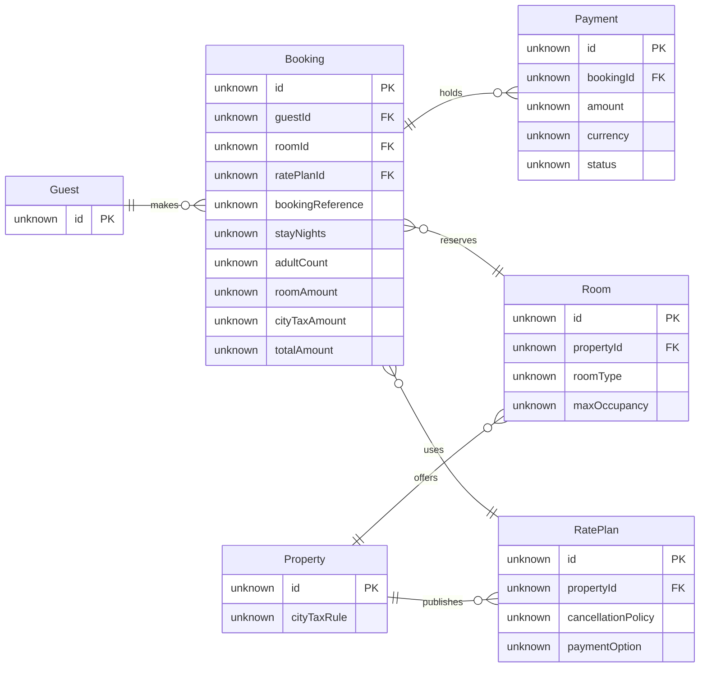

**Pre-write check:** Passed. The model has 6 entities, 6 relationships, and 26 attributes. The composer reports no design warnings.

**Question and outcome:** Guest Support can trace a booking reference to its guest, room, rate plan, payment, and property tax context.

**Glance order**

- First: Booking
- Second: Booking’s links to Guest, Payment, Room, and Rate Plan
- Last: Property tax context and the assumed field names, types, and multiplicities

**Review**

- Booking is marked as the focal entity
- The relationship labels show that each Booking uses one Room and one Rate Plan
- Guest records and Partner records are in separate zones
- The source line identifies the assumptions and the omitted direct Room–Rate Plan link

**Destination:** Roamstay Product plan, existing FigJam file `<test-file-key>`. I’ll add one section titled **Roamstay Stays Model for Guest Support**, positioned to the right of existing content. No extensions are planned, and existing sections will stay as they are.

The write needs one `use_figma` call and one `get_figjam` read-back. The initial file read is already complete. Rollback would remove only the new section and would need separate confirmation.

May I write this section to the existing FigJam file?