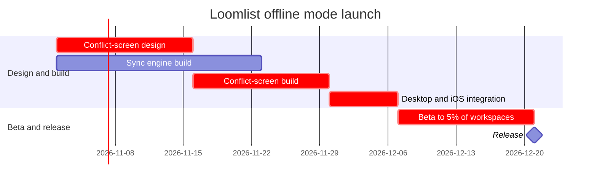

# FJ-028 turn 2 transcript

**User:** Yes, that reading is right.

**Assistant:**

Thanks, I’ll build the checked Gantt model from that reading and review its layout. Then I’ll show the separate write gate before changing the FigJam file.

**Tool call:** `command_execution` `{"command": "/bin/zsh -lc \"sed -n '25,60p' sk-create-figjam/assets/flow-templates.md && sed -n '390,419p' sk-create-figjam/references/flow-mode.md\"", "changes": null}`

**Tool result:** `command_execution`

```text
## 1. OVERVIEW

### Purpose

Every pattern below passes `scripts/flow_check.py` as a user flow, and `scripts/compose_board.py` composes it into a board. Start from the pattern closest to the flow, rename the nodes after the real screens and triggers, add the board lines below and run the check before the write gate. A process, an architecture, a sequence, a state diagram, an ER diagram or a gantt chart starts from its own file in `assets/templates/`, and keeps the provenance table and the reply shape below.

### Usage

- Node ids are short, stable and camelCase, because the provenance table names them, the composer names every layer after them and the generated fallback mis-routes an underscore
- A label names the screen or the action a person takes, in the words the product uses, in one to four words where those words allow
- A label with a parenthesis, a colon or a slash goes in double quotes, such as `pick["Pick a plan (monthly)"]`
- A decision label is a question, and each exit label is one of its answers
- Every connector is a solid arrow `-->`
- A user flow and a process each carry exactly one `style` line, which marks the first glance. A styled goal, failing end or decision keeps its kind and takes a pink outline, and a styled step is drawn light pink. `style done fill:#CDF4D3,stroke:#66D575` makes that end the goal and the light red pair makes an end a failure. Every pair comes from `references/style-guide.md`, and any other colour is refused or counts as a second acc
```

**Tool call:** `command_execution` `{"command": "/bin/zsh -lc 'python3 sk-create-figjam/scripts/flow_check.py --help'", "changes": null}`

**Tool result (error):** `command_execution`

```text
mermaid_extract: --help: not a Mermaid file
UNREADABLE --help: the extractor refused it

```

**Tool call:** `command_execution` `{"command": "/bin/zsh -lc 'python3 sk-create-figjam/scripts/compose_board.py --help'", "changes": null}`

**Tool result (error):** `command_execution`

```text

  compose_board.py <model.md> [--diagram N] [--out path]  -> 0 the filled code is written, 1 the model fails
                                                             the check, 2 unreadable or no such diagram
  compose_board.py <model.md> --model                      -> print the MODEL as JSON instead of the code
  compose_board.py --template                              -> print the compact code with its MODEL and THEME
                                                             placeholders, the text the Project's composer
                                                             Knowledge file carries
  compose_board.py --design-check                          -> print the design a board is drawn in, what it
                                                             changes, its measures and the THEME it sends: 0 the
                                                             design reads with no warning, 1 one or more warnings
  compose_board.py --self-test                             -> prove every shipped model composes, its counts
                                                             match the check, the code fits one use_figma call and
                                                             the board it draws keeps its geometry and its design

```

**Tool call:** `command_execution` `{"command": "/bin/zsh -lc \"rg -n 'argparse|sys\\\\.argv|usage:|Usage:|def main|argparse\\\\.ArgumentParser|if __name__' sk-create-figjam/scripts/flow_check.py && sed -n '1,95p' sk-create-figjam/scripts/flow_check.py && sed -n '1,55p' sk-create-figjam/scripts/compose_board.py\"", "changes": null}`

**Tool result:** `command_execution`

```text
40:Usage:
285:def main() -> int:
287:    args = sys.argv[1:]
291:        print(__doc__.strip().split("Usage:")[1], file=sys.stderr)
296:if __name__ == "__main__":
#!/usr/bin/env python3
# ───────────────────────────────────────────────────────────────
# COMPONENT: FIGJAM MODEL PRE-WRITE CHECK
# ───────────────────────────────────────────────────────────────

"""Check a FigJam diagram model before it is written to a board.

A board is slow to fix once it exists: the composer owns its layout, so every
fix is a new write. Worse, neither the composer nor the generated fallback
draws all that Mermaid can say, so a model can promise a reader something the
board never shows. The rules each diagram kind carries are checked on the
Mermaid model first, and a model that breaks one is never written. The same
parse is measured, so a shape that is legal and still hard to read, such as a
rank of six steps or a connector that doubles back, is caught here rather than
on the board.

Each Mermaid block in the file is one diagram, read by its header:

- `flowchart` is a user flow unless a `%% type: process` or
  `%% type: architecture` comment line says otherwise
- `sequenceDiagram`, `stateDiagram-v2`, `erDiagram` and `gantt` are the other
  four kinds Flow Mode draws
- any other header, such as `pie`, `mindmap` or `journey`, is a kind Flow
  Mode does not draw and fails

The rules for each kind live in `figjam_checks/`, and `references/types/`
explains each one. Flowcharts and state diagrams ar
```

**Tool call:** `command_execution` `{"command": "/bin/zsh -lc \"python3 - <<'PY'\nfrom pathlib import Path\nimport json\nimport subprocess\nimport sys\nimport tempfile\n\nroot = Path(\\\"/private/var/folders/3c/zfqcqsts0kn19cgblj82gqhm0000gn/T/devin-compare-bench/FJ-028\\\")\nmodel = \\\"\\\"\\\"%% title: Loomlist offline mode launch schedule\n%% subtitle: The Loomlist Product team can track the 5% beta and release against the critical path\n%% source: Source: user-provided launch plan. Main approval status is unstated. Left out: owners and an Android work bar without an approved date or duration\n%% focus: integration\ngantt\n `

**Tool result (error):** `command_execution`

```text
mermaid_extract: model.md: no fenced mermaid block found
UNREADABLE /var/folders/3c/zfqcqsts0kn19cgblj82gqhm0000gn/T/devin-compare-bench/.sessions/FJ-028/tmp/figjam-gantt-w2fhduyo/model.md: the extractor refused it

```

**Tool call:** `command_execution` `{"command": "/bin/zsh -lc \"python3 - <<'PY'\nfrom pathlib import Path\nimport json\nimport subprocess\nimport sys\nimport tempfile\n\nroot = Path(\\\"/private/var/folders/3c/zfqcqsts0kn19cgblj82gqhm0000gn/T/devin-compare-bench/FJ-028\\\")\nmodel = \\\"\"'```mermaid'\"\\\\n%% title: Loomlist offline mode launch schedule\\\\n%% subtitle: The Loomlist Product team can track the 5% beta and release against the critical path\\\\n%% source: Source: user-provided launch plan. Main approval status is unstated. Left out: owners and an Android work bar without an approved date or duration\\\\n%% focus:`

**Tool result:** `command_execution`

```text
COMPOSED diagram 1, 6 tasks in 2 sections: 6 nodes and 5 connectors to read back, 48273 characters in /var/folders/3c/zfqcqsts0kn19cgblj82gqhm0000gn/T/devin-compare-bench/.sessions/FJ-028/tmp/figjam-gantt-_6e7l5mc/compose.js, drawn in the design FigJam default
  diagram 1, gantt: ok, 6 tasks in 2 sections
PASSED 1 diagram(s) in model.md
{"code": "const MODEL={\"type\":\"gantt\",\"unit\":\"day\",\"origin\":\"2026-11-02\",\"span\":49.0,\"sections\":[{\"label\":\"Design and build\",\"tasks\":[{\"id\":\"screenDesign\",\"name\":\"Conflict-screen design\",\"tags\":[\"crit\"],\"start\":0.0,\"end\":14.0},{\"id\":\"syncEngine\",\"name\":\"Sync engine build\",\"tags\":[],\"start\":0.0,\"end\":21.0},{\"id\":\"screenBuild\",\"name\":\"Conflict-screen build\",\"tags\":[\"crit\"],\"start\":14.0,\"end\":28.0,\"after\":[\"screenDesign\"]},{\"id\":\"integration\",\"name\":\"Desktop and iOS integration\",\"tags\":[\"crit\"],\"start\":28.0,\"end\":35.0,\"after\":[\"screenBuild\",\"syncEngine\"],\"accent\":true}]},{\"label\":\"Beta and release\",\"tasks\":[{\"id\":\"beta\",\"name\":\"Beta to 5% of workspaces\",\"tags\":[\"crit\"],\"start\":35.0,\"end\":49.0,\"after\":[\"integration\"]},{\"id\":\"release\",\"name\":\"Release\",\"tags\":[\"milestone\"],\"start\":49.0,\"end\":49.0,\"after\":[\"beta\"]}]}],\"expect\":{\"nodes\":6,\"connectors\":5},\"title\":\"Loomlist offline mode launch schedule\",\"subtitle\":\"The Loomlist Product team can track the 5% beta and release against the critical path\"
```

**Assistant:**

The Gantt passes its pre-write check with six scheduled items across two sections. I’m capturing the existing page geometry so the final read-back can confirm the new section left prior content in place.

**Tool call:** `figma.get_figjam` `{"fileKey": "<test-file-key>", "nodeId": "0:1", "sessionId": "d6ff383e-3f4e-4c30-aa91-7b62a015ae76", "includeImagesOfNodes": false}`

**Tool result:** `figma.get_figjam`

```text
{'content': [{'type': 'text', 'text': '<canvas id="0:1" name="Page 1" x="0" y="0" width="0" height="0">\n  <shape-with-text id="1:3" x="768" y="-492" width="224" height="128" name="ROUNDED_RECTANGLE">Order list</shape-with-text>\n  <shape-with-text id="1:6" x="768" y="-236" width="224" height="128" name="SQUARE">Order detail</shape-with-text>\n  <shape-with-text id="1:9" x="780" y="20" width="200" height="200" name="DIAMOND">Within 30 days?</shape-with-text>\n  <shape-with-text id="1:12" x="608" y="476" width="224" height="128" name="ROUNDED_RECTANGLE">Contact support</shape-with-text>\n  <shape-with-text id="1:15" x="928" y="476" width="224" height="128" name="SQUARE">Pick a reason</shape-with-text>\n  <shape-with-text id="1:18" x="940" y="732" width="200" height="200" name="DIAMOND">Drop-off or pickup?</shape-with-text>\n  <shape-with-text id="1:21" x="768" y="1188" width="224" height="128" name="SQUARE">Choose a drop-off point</shape-with-text>\n  <shape-with-text id="1:24" x="1088" y="1188" width="224" height="128" name="SQUARE">Book a courier pickup</shape-with-text>\n  <shape-with-text id="1:27" x="928" y="1444" width="224" height="128" name="ROUNDED_RECTANGLE">Return confirmed with QR code</shape-with-text>\n  <connector id="1:30" x="880" y="-356" connectorStart="1:3" connectorStartCap="NONE" connectorEnd="1:6" connectorEndCap="ARROW_LINES"></connector>\n  <connector id="1:34" x="880" y="-100" connectorStart="1:6" connectorStartCap="NONE" connectorEnd="1:9" connectorEn
```

**Assistant:**

## Write gate

Flow Mode requires a separate yes after the checked-model preview. Your earlier yes confirmed the reading.

**Target:** Loomlist Product plan, existing FigJam file `<test-file-key>`

I’ll add a new section titled **Loomlist offline mode launch schedule** and one Android note beside the Release milestone. The note will say: “Android follows next quarter; not yet approved. Start date and duration are not set.”

**Check:** The model passed for one Gantt diagram. The composer reports six scheduled items, two sections, six nodes and five dependency arrows, using the FigJam default design.

**Question and outcome:** When can offline mode reach release, and which dependency chain sets the date? The chart shows the path to the 5% beta and release.

**First glance:** Desktop and iOS integration.  
**Second glance:** The critical chain through beta to the 21 December release.  
**Last glance:** Android’s unapproved status and the schedule gaps.

**Review checks:** The eye lands on integration, the task identified as critical; its dependencies lead to the release date; parallel build work remains visible; Android stays secondary because it has no approved schedule.



The write will use two `use_figma` calls, one for the Gantt and one for the Android note, followed by one `get_figjam` read-back. Rollback removes only the new section and its note; existing content stays untouched.

Should I write this section and note into the specified FigJam file?
