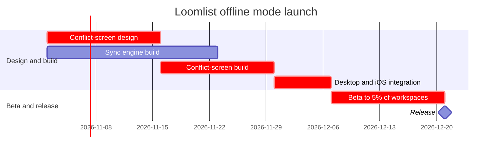

## Write gate

Flow Mode requires a separate yes after the checked-model preview. Your earlier yes confirmed the reading.

**Target:** Loomlist Product plan, existing FigJam file `<test-file-key>`

I’ll add a new section titled **Loomlist offline mode launch schedule** and one Android note beside the Release milestone. The note will say: “Android follows next quarter; not yet approved. Start date and duration are not set.”

**Check:** The model passed for one Gantt diagram. The composer reports six scheduled items, two sections, six nodes and five dependency arrows, using the FigJam default design.

**Question and outcome:** When can offline mode reach release, and which dependency chain sets the date? The chart shows the path to the 5% beta and release.

**First glance:** Desktop and iOS integration.  
**Second glance:** The critical chain through beta to the 21 December release.  
**Last glance:** Android’s unapproved status and the schedule gaps.

**Review checks:** The eye lands on integration, the task identified as critical; its dependencies lead to the release date; parallel build work remains visible; Android stays secondary because it has no approved schedule.

The write will use two `use_figma` calls, one for the Gantt and one for the Android note, followed by one `get_figjam` read-back. Rollback removes only the new section and its note; existing content stays untouched.

Should I write this section and note into the specified FigJam file?