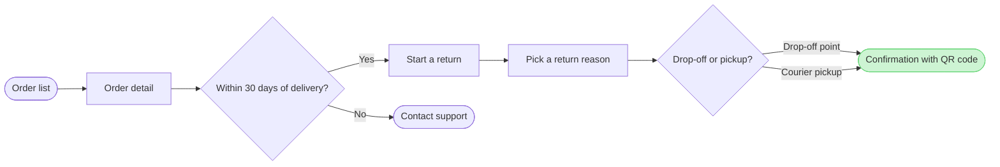

# FJ-022 turn 2 transcript

**User:** Yes, that reading is right.

**Tool call:** `Bash` `{"command": "cd /private/var/folders/3c/zfqcqsts0kn19cgblj82gqhm0000gn/T/devin-compare-bench/FJ-022/sk-create-figjam; sed -n 1,80p assets/flow-templates.md; python3 scripts/flow_check.py --help 2>&1 | head -20"}`

**Tool result:** `Bash`

```text
"---\ntitle: \"Product Owner Flow Templates\"\ndescription: \"User-flow Mermaid patterns, the provenance table and the reply shape for Product Owner Flow Mode, each pattern passing the pre-write check.\"\ncontextType: general\nimportance_tier: important\ntrigger_phrases:\n  - \"flow templates\"\n  - \"mermaid flow patterns\"\n  - \"flow provenance table\"\n  - \"flow reply shape\"\nversion: 1.0.1.0\n---\n\n# Product Owner Flow Templates\n\nCopy/apply patterns for Product Owner Flow Mode models.\n\n**Loading Condition:** CONDITIONAL, with `references/flow-mode.md` whenever Flow intent is selected\n**Purpose:** Provides the user-flow patterns, the provenance table every diagram type keeps and the reply shape every type delivers\n**Scope:** Five user-flow patterns, the intake questions, the provenance table and the reply shape. The other types keep their patterns in `assets/templates/`\n**Output Path:** None. The model is working data and the board is the deliverable\n\n---\n\n## 1. OVERVIEW\n\n### Purpose\n\nEvery pattern below passes `scripts/flow_check.py` as a user flow, and `scripts/compose_board.py` composes it into a board. Start from the pattern closest to the flow, rename the nodes after the real screens and triggers, add the board lines below and run the check before the write gate. A process, an architecture, a sequence, a state diagram, an ER diagram or a gantt chart starts from its own file in `assets/templates/`, and keeps the provenance table and the reply shape b
```

**Tool call:** `Bash` `{"command": "D=$(mktemp -d); cat > $D/m.md <<'EOF'\n```mermaid\nflowchart LR\n    %% title: Start a return\n    %% subtitle: How a Fernhouse customer starts a return in the app, from the order list to the QR confirmation\n    %% source: Sources: Fernhouse app screens and the returns doc. Free pickup over 100 euros is a proposal under review.\n    orders([Order list]) --> detail[Order detail]\n    detail --> window{Within 30 days of delivery?}\n    window -->|Yes| start[Start a return]\n    window -->|No| support([Contact support])\n    start --> reason[Pick a return reason]\n    reason --> met`

**Tool result:** `Bash`

```text
"  diagram 1, user flow: ok, 8 nodes and 8 connectors, widest rank 2 steps, longest path 7 steps, 1.0 connectors per step, labels average 18 characters, 0 crossing pairs\nPASSED 1 diagram(s) in m.md\nrc=0\n/var/folders/3c/zfqcqsts0kn19cgblj82gqhm0000gn/T/tmp.uxz1HspO0E"
```

**Assistant:**

**Write gate: Fernhouse return flow**

**Question:** How does a Fernhouse customer start a return in the app, and where does that path stop?
**Outcome:** A reader can follow each screen from the order list to the QR confirmation and see the 30-day cut-off.

**Where the eye should go:**
- **First glance:** the QR confirmation, the goal, shown with a green fill and a pink outline
- **Second glance:** the 30-day check and its exit to Contact support
- **Can wait:** the choice between drop-off and courier pickup

**Checked model (passed the pre-write check: 8 nodes, 8 connectors, 0 crossings):**



**What gets written and where:**
- **Target:** a new FigJam file in the Fernhouse Product plan, not `<test-file-key>`. You didn't answer the file question, so I'm using my recommendation and treating it as assumed. If you need that existing file, say so now. I'll stop rather than write there.
- **Board:** one user flow, titled "Start a return", with a subtitle and a source line
- **Extension:** one sticky beside Courier pickup reading "Proposed, under review: free pickup for orders over €100"
- **Calls:** 5 in total. `whoami` confirms the plan (if your account has no Fernhouse Product plan, I stop and ask), then `create_new_file`, one `use_figma` call to draw the board, one call for the sticky and `get_figjam` to read the board back.
- **Rollback:** I only change the new file. Deleting it removes everything this write adds.

Shall I write this board to a new file in the Fernhouse Product plan?

HVR self-scan: 0 hard blockers. Fixed: none. Kept with reason: none.
