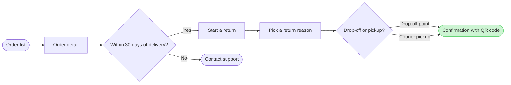

**Write gate: Fernhouse return flow**

**Question:** How does a Fernhouse customer start a return in the app, and where does that path stop?
**Outcome:** A reader can follow each screen from the order list to the QR confirmation and see the 30-day cut-off.

**Where the eye should go:**
- **First glance:** the QR confirmation, the goal, shown with a green fill and a pink outline
- **Second glance:** the 30-day check and its exit to Contact support
- **Can wait:** the choice between drop-off and courier pickup

**Checked model (passed the pre-write check: 8 nodes, 8 connectors, 0 crossings):**

**What gets written and where:**
- **Target:** a new FigJam file in the Fernhouse Product plan, not `<test-file-key>`. You didn't answer the file question, so I'm using my recommendation and treating it as assumed. If you need that existing file, say so now. I'll stop rather than write there.
- **Board:** one user flow, titled "Start a return", with a subtitle and a source line
- **Extension:** one sticky beside Courier pickup reading "Proposed, under review: free pickup for orders over €100"
- **Calls:** 5 in total. `whoami` confirms the plan (if your account has no Fernhouse Product plan, I stop and ask), then `create_new_file`, one `use_figma` call to draw the board, one call for the sticky and `get_figjam` to read the board back.
- **Rollback:** I only change the new file. Deleting it removes everything this write adds.

Shall I write this board to a new file in the Fernhouse Product plan?

HVR self-scan: 0 hard blockers. Fixed: none. Kept with reason: none.