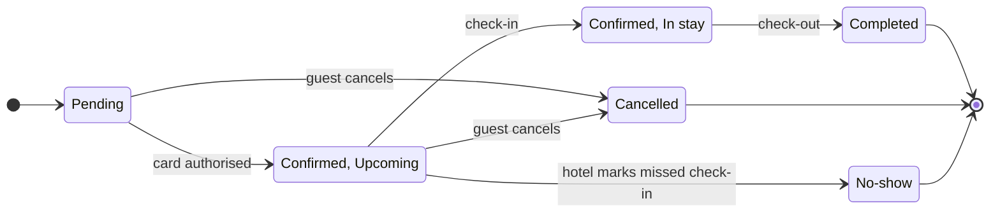

# FJ-026 turn 3 transcript

**User:** Yes, that reading is right.

**Tool call:** `Bash` `{"command": "cd /private/var/folders/3c/zfqcqsts0kn19cgblj82gqhm0000gn/T/devin-compare-bench/FJ-026; ls sk-create-figjam sk-create-figjam/scripts 2>/dev/null; awk '/^### The pre-write check|^## 2/,/^## 3/' sk-create-figjam/references/flow-mode.md | sed -n 1,40p | grep -n -i \"check\" | head"}`

**Tool result:** `Bash`

```text
"sk-create-figjam:\nassets\nREADME.md\nreferences\nscripts\nSKILL.md\n\nsk-create-figjam/scripts:\ncompose_board.py\ncompose-trace.mjs\nfigjam_checks\nflow_check.py\nvendored\n7:5. **Check.** Run `scripts/flow_check.py` on the model. A failing model is fixed or split, then checked again, and nothing is written until every diagram passes\n8:6. **Quality pass.** Walk `references/quality-rubric.md`. The script checks what a script can see, and the rubric checks whether every node earns its place\n12:10. **Read back.** Read the written board with `get_figjam` on the board id the write returned, never from memory, and compare it with the model as Section 7 and the type's reference set out. The composing call returns a screenshot of the whole board, which is the overview, and `get_figjam` returns the outline with a screenshot of each node. A node that needs its own view is read with `get_screenshot` and the node id from that read, because the tool fails without one. Then check the overview for stretching, a label cut off, overlap, a connector crossing, an edge that reads as joining the wrong node, a colour that does not match its entry in the key and whether the board answers the `userIntent` sentence. A finding there goes on a `Finding:` line of the reply, and it is fixed only by reshaping the model and recomposing after a yes, inside the two-attempt bound Section 9 sets. Section 7 names the read for each route. The rows that fail silently are read back the same way, one at a time
```

**Tool call:** `Bash` `{"command": "cd /private/var/folders/3c/zfqcqsts0kn19cgblj82gqhm0000gn/T/devin-compare-bench/FJ-026; python3 -I sk-create-figjam/scripts/flow_check.py --help 2>&1 | head -20; grep -n \"state\" sk-create-figjam/assets/flow-templates.md | head; ls sk-create-figjam/references/types 2>/dev/null"}`

**Tool result:** `Bash`

```text
"mermaid_extract: --help: not a Mermaid file\nUNREADABLE --help: the extractor refused it\n29:Every pattern below passes `scripts/flow_check.py` as a user flow, and `scripts/compose_board.py` composes it into a board. Start from the pattern closest to the flow, rename the nodes after the real screens and triggers, add the board lines below and run the check before the write gate. A process, an architecture, a sequence, a state diagram, an ER diagram or a gantt chart starts from its own file in `assets/templates/`, and keeps the provenance table and the reply shape below.\n56:- `%% zone: <label>: <id>, <id>` groups nodes in a tinted section. A user flow or a process without lanes reads its zones in flow order, and once a flow has zones every node sits in exactly one. An ER diagram draws each zone around its entities. Lanes and composite states are zones already, so a laned process, an architecture or a state diagram takes no zone line\n134:One row per item, written in the intake before any Mermaid, beside the model and never on the board. An item is a node, a state, a participant, an entity, a task or an edge. An edge earns a row whenever it was inferred rather than read off a source, because a row kept only for an edge whose ends differ leaves an inferred connector unclassified.\n138:| start | node | `<screenshot file, Figma node or doc section>` | current behavior | high | stated |\n139:| valid | node | `<source that states the check>` | current behavior | high | stated |\n1
```

**Tool call:** `Bash` `{"command": "cd /private/var/folders/3c/zfqcqsts0kn19cgblj82gqhm0000gn/T/devin-compare-bench/FJ-026; ls sk-create-figjam/assets/templates; cat sk-create-figjam/assets/templates/*state* 2>/dev/null | head -50; grep -n -i \"end state\\|style\\|final\\|terminal\" sk-create-figjam/references/types/state.md | head -20"}`

**Tool result:** `Bash`

```text
"architecture.md\ner.md\ngantt.md\nprocess.md\nsequence.md\nstate.md\n---\ntitle: \"FigJam State Templates\"\ndescription: \"State patterns that pass the pre-write check: a lifecycle, a composite with its own entry and a guarded choice.\"\ncontextType: general\nimportance_tier: important\ntrigger_phrases:\n  - \"state templates\"\n  - \"figjam state pattern\"\nversion: 1.0.0.0\n---\n\n# FigJam State Templates\n\nCopy/apply patterns for a state model. Each pattern passes `scripts/flow_check.py`, and `references/types/state.md` holds the rules.\n\n**Loading Condition:** CONDITIONAL, with `references/types/state.md`\n**Purpose:** Starting points for a state diagram\n**Scope:** Three patterns. The provenance table and the reply shape are in `assets/flow-templates.md`\n\n---\n\n## 1. USAGE\n\n- States are nouns or adjectives and labels are the events that move between them\n- A long state name goes in a description, `Pending: Waiting for payment`, so the id stays one word\n- No note and no style line, which would grow phantom states on the board\n\n---\n\n## 2. PATTERNS\n\n### Lifecycle\n\n```mermaid\nstateDiagram-v2\n    direction LR\n    [*] --> Draft\n    Draft --> InReview: submit\n    InReview --> Draft: request changes\n    InReview --> Published: approve\n    Published --> Archived: archive\n    Archived --> [*]\n```\n\n### Composite with its own entry\n\n```mermaid\nstateDiagram-v2\n    direction LR\n    [*] --> Trial\n63:- **No note and no styling.** The generated fallbac
```

**Tool call:** `Bash` `{"command": "cd /private/var/folders/3c/zfqcqsts0kn19cgblj82gqhm0000gn/T/devin-compare-bench/FJ-026; T=$(mktemp -d); cat > $T/model.mmd <<'EOF'\n%% title: Roamstay booking status lifecycle\n%% subtitle: Every status a booking can hold and what moves it on. End states are coloured\n%% source: Product request, 26 Oct 2026\n%% focus: Completed\nstateDiagram-v2\n    direction LR\n    [*] --> Pending\n    Pending --> Confirmed: card authorised\n    Pending --> Cancelled: guest cancels\n    state Confirmed {\n        [*] --> Upcoming\n        Upcoming --> InStay: check-in\n    }\n    InStay: In stay`

**Tool result:** `Bash`

```text
"  diagram 1, state: transition Upcoming to Cancelled reaches into another composite: transition to or from the composite itself\n  diagram 1, state: transition Upcoming to NoShow reaches into another composite: transition to or from the composite itself\n  diagram 1, state: transition InStay to Completed reaches into another composite: transition to or from the composite itself\nFAILED 1 of 1 diagram(s) in model.mmd\n/var/folders/3c/zfqcqsts0kn19cgblj82gqhm0000gn/T/tmp.B45JYWceOr"
```

**Tool call:** `Bash` `{"command": "cd /private/var/folders/3c/zfqcqsts0kn19cgblj82gqhm0000gn/T/devin-compare-bench/FJ-026; T=/var/folders/3c/zfqcqsts0kn19cgblj82gqhm0000gn/T/tmp.B45JYWceOr; cat > $T/model.mmd <<'EOF'\n%% title: Roamstay booking status lifecycle\n%% subtitle: Every status a booking can hold and what moves it on. End states are coloured\n%% source: Product request, 26 Oct 2026\n%% focus: Completed\nstateDiagram-v2\n    direction LR\n    Upcoming: Confirmed, Upcoming\n    InStay: Confirmed, In stay\n    NoShow: No-show\n    [*] --> Pending\n    Pending --> Upcoming: card authorised\n    Pending --> Ca`

**Tool result:** `Bash`

```text
"  diagram 1, state: ok, 6 states and 10 transitions\nPASSED 1 diagram(s) in model.mmd"
```

**Assistant:**

**The model passes the pre-write check.** Before writing anything to Figma, I need a separate yes from you.

**One change from the reading you approved:** the checker won't let an arrow leave from a state inside the Confirmed group. Cancel and No-show leave from Upcoming only, so I've removed the Confirmed box. Instead the two states are labelled "Confirmed, Upcoming" and "Confirmed, In stay". The states and moves are the same as before.



**What the board answers:** what status a booking can be in and what moves it on. The outcome is that support can spot the end states at a glance.

**What should catch the eye**
- **First:** the three coloured end states (Completed, Cancelled and No-show).
- **Second:** the happy path, from Pending through Upcoming and In stay to Completed.
- **Can wait:** the two cancel arrows.

**The write**
- **Where:** a new FigJam file in the Roamstay Product plan, titled "Roamstay booking status lifecycle". It will not go into `<test-file-key>`.
- **What gets drawn:** one state diagram with 6 states and 10 transitions, plus the key for the end-state colours. No other notes are added.
- **Not drawn:** what happens when a card is declined. I'll list it under "Left out" when I deliver the board.
- **Figma calls:** 4 in total:
  - `whoami`, to confirm the Roamstay Product plan
  - `create_new_file`
  - one `use_figma` call to draw the diagram
  - `get_figjam`, to read the board back and check it

  On a Starter plan, or with a View or Collab seat, these count against Figma's six calls a month.
- **To undo:** delete the new file. Nothing else is touched.

Shall I write this board to a new file in the Roamstay Product plan?
