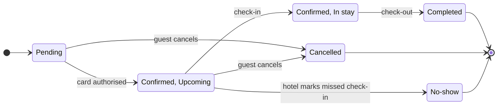

**The model passes the pre-write check.** Before writing anything to Figma, I need a separate yes from you.

**One change from the reading you approved:** the checker won't let an arrow leave from a state inside the Confirmed group. Cancel and No-show leave from Upcoming only, so I've removed the Confirmed box. Instead the two states are labelled "Confirmed, Upcoming" and "Confirmed, In stay". The states and moves are the same as before.

**What the board answers:** what status a booking can be in and what moves it on. The outcome is that support can spot the end states at a glance.

**What should catch the eye**
- **First:** the three coloured end states (Completed, Cancelled and No-show).
- **Second:** the happy path, from Pending through Upcoming and In stay to Completed.
- **Can wait:** the two cancel arrows.

**The write**
- **Where:** a new FigJam file in the Roamstay Product plan, titled "Roamstay booking status lifecycle". It will not go into `<test-file-key>`.
- **What gets drawn:** one state diagram with 6 states and 10 transitions, plus the key for the end-state colours. No other notes are added.
- **Not drawn:** what happens when a card is declined. I'll list it under "Left out" when I deliver the board.
- **Figma calls:** 4 in total:
  - `whoami`, to confirm the Roamstay Product plan
  - `create_new_file`
  - one `use_figma` call to draw the diagram
  - `get_figjam`, to read the board back and check it

  On a Starter plan, or with a View or Collab seat, these count against Figma's six calls a month.
- **To undo:** delete the new file. Nothing else is touched.

Shall I write this board to a new file in the Roamstay Product plan?