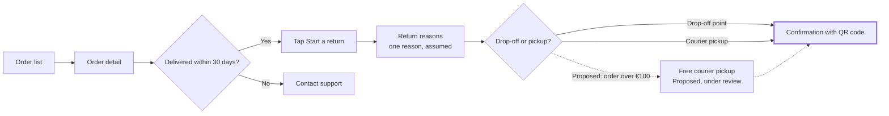

I never actually recommended a plan, so there's nothing to fall back on there. My recommendation is **<figma-plan-1>**: you're an admin on that plan with a Full seat, and it matches your work account. <figma-plan-2> belongs to a different organization. Below is the write gate with that plan filled in. Saying yes approves the plan too.

**The question the board answers:** how does a Fernhouse customer start a return in the app?
**What it should show:** the path from an order to a return QR code, including the 30-day cut-off and the proposed free pickup, clearly marked.

**What to read first, second and last:**
1. First: **Confirmation with QR code**, the goal, highlighted.
2. Second: the 30-day check and the choice between drop-off and courier.
3. Last: the dashed *Proposed* free-pickup node.

**Model:**

**What gets written:**
- **Target:** a new FigJam file, "Fernhouse - Start a return", in the **<figma-plan-1>** plan (Pro). File `ck6LT4…` isn't touched.
- **Content:** one framed board with a title, a subtitle, 9 nodes, a key that covers solid steps, dashed *Proposed* items and assumed rows, and a source line ("Your description; returns doc and app screens not supplied").
- **Extensions:** none.
- **Calls:** 4: `create_new_file`, `create_session`, one `use_figma` to draw the board, and `get_figjam` to read it back.
- **To undo:** delete the new file. Nothing else in Figma changes.

Write this board to a new file in <figma-plan-1>?

Finding: the plan is my recommendation, not something you confirmed. Answering yes approves it
HVR self-scan: 0 hard blockers. Fixed: none. Kept with reason: none.