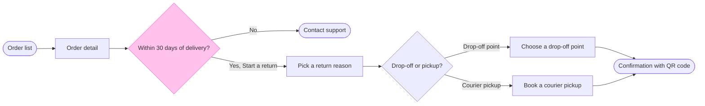

# FJ-022 turn 2 transcript

**User:** Use your recommended answers.

**Tool call:** `Bash` `{"command": "cd sk-create-figjam; ls scripts; sed -n 1,80p assets/flow-templates.md | head -80; grep -n -A12 \"^## 8\" references/flow-mode.md | head -60"}`

**Tool result:** `Bash`

```text
"compose_board.py\ncompose-trace.mjs\nfigjam_checks\nflow_check.py\nvendored\n---\ntitle: \"Product Owner Flow Templates\"\ndescription: \"User-flow Mermaid patterns, the provenance table and the reply shape for Product Owner Flow Mode, each pattern passing the pre-write check.\"\ncontextType: general\nimportance_tier: important\ntrigger_phrases:\n  - \"flow templates\"\n  - \"mermaid flow patterns\"\n  - \"flow provenance table\"\n  - \"flow reply shape\"\nversion: 1.0.1.0\n---\n\n# Product Owner Flow Templates\n\nCopy/apply patterns for Product Owner Flow Mode models.\n\n**Loading Condition:** CONDITIONAL, with `references/flow-mode.md` whenever Flow intent is selected\n**Purpose:** Provides the user-flow patterns, the provenance table every diagram type keeps and the reply shape every type delivers\n**Scope:** Five user-flow patterns, the intake questions, the provenance table and the reply shape. The other types keep their patterns in `assets/templates/`\n**Output Path:** None. The model is working data and the board is the deliverable\n\n---\n\n## 1. OVERVIEW\n\n### Purpose\n\nEvery pattern below passes `scripts/flow_check.py` as a user flow, and `scripts/compose_board.py` composes it into a board. Start from the pattern closest to the flow, rename the nodes after the real screens and triggers, add the board lines below and run the check before the write gate. A process, an architecture, a sequence, a state diagram, an ER diagram or a gantt chart starts from its own file
```

**Assistant:**

Drafting the model and running the pre-write check.

**Tool call:** `Bash` `{"command": "mkdir -p /tmp/fh && cat > /tmp/fh/model.md <<'EOF'\n```mermaid\n%% title: Fernhouse: start a return\n%% subtitle: How a customer starts a return in the app today, for product and design\n%% source: Sources: request summary of the app and the returns doc (screens and doc not supplied). Free pickup over 100 euros is a proposal under review.\n%% zone: Find the order: orders, detail, window\n%% zone: Request the return: start, reason, method\n%% zone: Hand it over: dropoff, pickup, done\nflowchart LR\n    orders([Order list]) --> detail[Order detail]\n    detail --> window{Within 30 d`

**Tool result:** `Bash`

```text
"/Applications/Xcode.app/Contents/Developer/usr/bin/python3: can't open file '/private/var/folders/3c/zfqcqsts0kn19cgblj82gqhm0000gn/T/devin-compare-bench/FJ-022/sk-create-figjam/sk-create-figjam/scripts/flow_check.py': [Errno 2] No such file or directory"
```

**Tool call:** `Bash` `{"command": "python3 scripts/flow_check.py /tmp/fh/model.md 2>&1 | tail -15"}`

**Tool result:** `Bash`

```text
"  diagram 1, user flow: fill #ffe0ec is not a FigJam light fill: pick a pair from references/style-guide.md\n  diagram 1, user flow: 10 nodes, at most 9: split the flow\nFAILED 1 of 1 diagram(s) in model.md"
```

**Tool call:** `Bash` `{"command": "grep -n -i \"pink\" references/style-guide.md | head"}`

**Tool result:** `Bash`

```text
"38:The board carries one accent, by default a heavy pink outline on the node, message or task the first glance names. A user flow or a process marks it with a `style` line and the check refuses a model that has none. The other five types may name it with a `%% focus:` line. A `style` line does not colour a node for the board. It tells the composer what the node means, as Section 3 sets out.\n56:| Focus | Rounded rectangle | Light pink, 8 pixel outline | In focus | A styled step that is none of the kinds above |\n64:The accent is not a kind. A styled goal, error, decision or any other node keeps the kind and fill it has and takes the pink outline on top, so a goal stays green and reads first. Only a styled step has no kind of its own to keep, so it is drawn light pink. The key adds `In focus` whenever the board carries an accent, and its sample is drawn as the marked node is, its own kind under the pink outline, so a goal in focus shows a green sample and a styled step a light pink one.\n93:| Accent | Pink `#F849C1`, 8 pixels around a node or bar and 4 pixels along a sequence message | The only pink and the only heavy line on a board |\n105:The check accepts exactly the pairs in this record. Each fill takes only the stroke FigJam pairs it with, and a connector takes either the stroke or nothing. The lane pair is Figma's own suggestion for a diagram's one container, and it never counts as the accent. The composer draws every kind from the same pairs, with white for the plain k
```

**Tool call:** `Bash` `{"command": "cd /tmp/fh && python3 - <<'EOF'\ns=open('model.md').read()\ns=s.replace(\"\"\"    window -->|Yes| start[Tap Start a return]\n    start --> reason[Pick a return reason]\"\"\",\"\"\"    window -->|Yes: Start a return| reason[Pick a return reason]\"\"\")\ns=s.replace(\"Request the return: start, reason, method\",\"Request the return: reason, method\")\ns=s.replace(\"style start fill:#FFE0EC,stroke:#F24E8E\",\"style window fill:#FFC2EC,stroke:#F849C1\")\nopen('model.md','w').write(s)\nEOF\ncd -; python3 scripts/flow_check.py /tmp/fh/model.md 2>&1 | tail -5"}`

**Tool result:** `Bash`

```text
"  diagram 1, user flow: edge window to reason label holds a parenthesis, a colon or a slash: put it in double quotes\nFAILED 1 of 1 diagram(s) in model.md"
```

**Tool call:** `Bash` `{"command": "sed -i '' 's/|Yes: Start a return|/|\"Yes, Start a return\"|/' /tmp/fh/model.md; python3 scripts/flow_check.py /tmp/fh/model.md 2>&1 | tail -3; cat /tmp/fh/model.md"}`

**Tool result:** `Bash`

```text
"  diagram 1, user flow: ok, 9 nodes and 9 connectors, widest rank 2 steps, longest path 7 steps, 1.0 connectors per step, labels average 19 characters, 0 crossing pairs\nPASSED 1 diagram(s) in model.md\n```mermaid\n%% title: Fernhouse: start a return\n%% subtitle: How a customer starts a return in the app today, for product and design\n%% source: Sources: request summary of the app and the returns doc (screens and doc not supplied). Free pickup over 100 euros is a proposal under review.\n%% zone: Find the order: orders, detail, window\n%% zone: Request the return: reason, method\n%% zone: Hand it over: dropoff, pickup, done\nflowchart LR\n    orders([Order list]) --> detail[Order detail]\n    detail --> window{Within 30 days of delivery?}\n    window -->|No| support([Contact support])\n    window -->|\"Yes, Start a return\"| reason[Pick a return reason]\n    reason --> method{Drop-off or pickup?}\n    method -->|Drop-off point| dropoff[Choose a drop-off point]\n    method -->|Courier pickup| pickup[Book a courier pickup]\n    dropoff --> done([Confirmation with QR code])\n    pickup --> done\n    style window fill:#FFC2EC,stroke:#F849C1\n```"
```

**Tool call:** `Bash` `{"command": "sed -i '' 's/orders, detail, window$/orders, detail, window, support/' /tmp/fh/model.md; python3 scripts/flow_check.py /tmp/fh/model.md 2>&1 | tail -1"}`

**Tool result:** `Bash`

```text
"PASSED 1 diagram(s) in model.md"
```

**Assistant:**

I've drafted the flow model and it passes the pre-write check. Nothing is written to Figma yet. Please check this outline before I set up the write.

**What the board answers:** how does a Fernhouse customer start a return in the app today?

**Model** (9 nodes, 9 connectors, passes the check with no crossings):



- **Sections:** *Find the order* (order list, detail, the 30-day check, Contact support), *Request the return* (reason, method) and *Hand it over* (drop-off, pickup, QR confirmation)
- **Highlighted step:** the 30-day check, because it decides whether a customer can return at all.

**Changes from what I proposed last time:**
- **Start a return** is now the label on the "Yes" arrow, not its own step. The check allows at most 9 nodes, and a separate step made 10.
- I'd moved the highlight from **Start a return** to the 30-day check, because **Start a return** is no longer a node. If you'd rather keep the highlight on **Start a return** as a node, I'll split the flow into two diagrams instead.
- The free pickup over €100 now goes in the board's source line as *proposal under review*, not as a note on the pickup step. A note would add an extra write to the board.

**Assumed** (you didn't send the screenshots or the returns doc):
- The screen order and labels come from your summary.
- The 30-day count method, multiple reasons per order and what happens after the QR screen are left off the board as unknowns.

**Title:** "Fernhouse: start a return", sized for a laptop screen.

Is this outline right? Once you confirm or correct it, I'll send the write step for its own yes: the target plan, the new file, the calls the write will use and the rollback.
