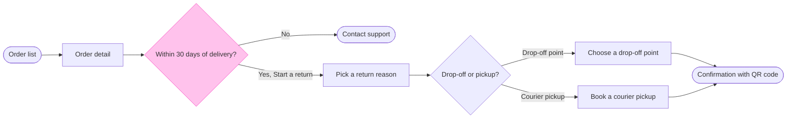

I've drafted the flow model and it passes the pre-write check. Nothing is written to Figma yet. Please check this outline before I set up the write.

**What the board answers:** how does a Fernhouse customer start a return in the app today?

**Model** (9 nodes, 9 connectors, passes the check with no crossings):

- **Sections:** *Find the order* (order list, detail, the 30-day check, Contact support), *Request the return* (reason, method) and *Hand it over* (drop-off, pickup, QR confirmation)
- **Highlighted step:** the 30-day check, because it decides whether a customer can return at all.

**Changes from what I proposed last time:**
- **Start a return** is now the label on the "Yes" arrow, not its own step. The check allows at most 9 nodes, and a separate step made 10.
- I'd moved the highlight from **Start a return** to the 30-day check, because **Start a return** is no longer a node. If you'd rather keep the highlight on **Start a return** as a node, I'll split the flow into two diagrams instead.
- The free pickup over €100 now goes in the board's source line as *proposal under review*, not as a note on the pickup step. A note would add an extra write to the board.

**Assumed** (you didn't send the screenshots or the returns doc):
- The screen order and labels come from your summary.
- The 30-day count method, multiple reasons per order and what happens after the QR screen are left off the board as unknowns.

**Title:** "Fernhouse: start a return", sized for a laptop screen.

Is this outline right? Once you confirm or correct it, I'll send the write step for its own yes: the target plan, the new file, the calls the write will use and the rollback.