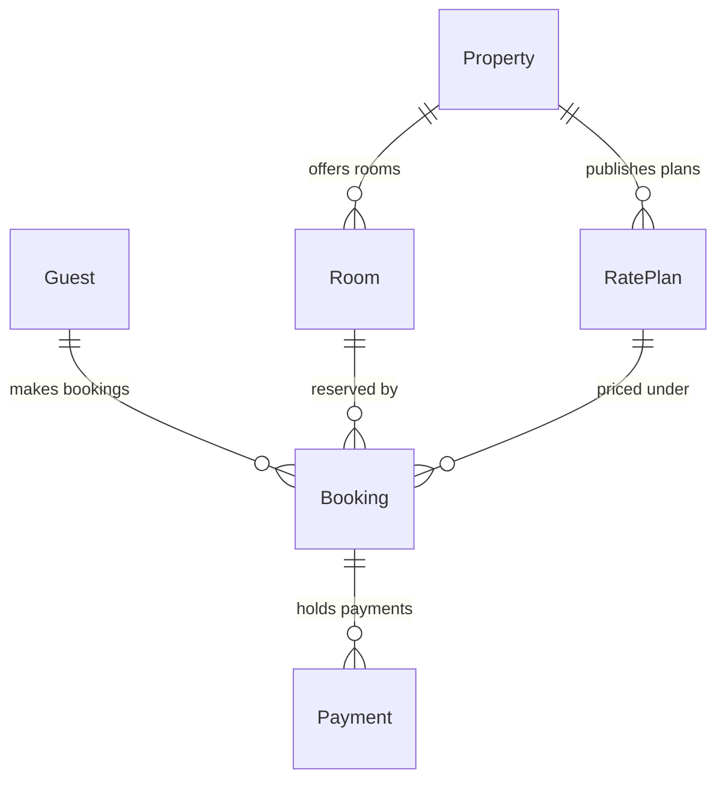

# FJ-027 turn 3 transcript

**User:** Yes, that reading is right.

**Tool call:** `Bash` `{"command": "cd /private/var/folders/3c/zfqcqsts0kn19cgblj82gqhm0000gn/T/devin-compare-bench/FJ-027; sed -n 1,80p sk-create-figjam/assets/templates/er.md; sed -n 28,80p sk-create-figjam/references/types/er.md"}`

**Tool result:** `Bash`

```text
"---\ntitle: \"FigJam ER Templates\"\ndescription: \"ER patterns that pass the pre-write check: a one-to-many core, a many-to-many junction and an aliased entity.\"\ncontextType: general\nimportance_tier: important\ntrigger_phrases:\n  - \"er templates\"\n  - \"figjam er pattern\"\nversion: 1.0.0.0\n---\n\n# FigJam ER Templates\n\nCopy/apply patterns for an ER model. Each pattern passes `scripts/flow_check.py`, and `references/types/er.md` holds the rules.\n\n**Loading Condition:** CONDITIONAL, with `references/types/er.md`\n**Purpose:** Starting points for an ER diagram\n**Scope:** Three patterns. The provenance table and the reply shape are in `assets/flow-templates.md`\n\n---\n\n## 1. USAGE\n\n- Get the relationships and their cardinality right first, then add the 5 to 10 columns a reader needs\n- Mark every `PK` and `FK`\n- An alias goes on the entity block only, and relationships use the plain id\n\n---\n\n## 2. PATTERNS\n\n### One-to-many core\n\n```mermaid\nerDiagram\n    Account ||--o{ Project : owns\n    Project ||--|{ Task : contains\n    Account {\n        uuid id PK\n        string name\n    }\n    Project {\n        uuid id PK\n        uuid accountId FK\n        string title\n    }\n    Task {\n        uuid id PK\n        uuid projectId FK\n        string status \"open | done\"\n    }\n```\n\n### Many-to-many through a junction\n\n```mermaid\nerDiagram\n    Member ||--o{ Membership : holds\n    Team ||--o{ Membership : includes\n    Member {\n        uuid id PK\n
```

**Tool call:** `Bash` `{"command": "D=$(mktemp -d); echo $D; cat > $D/model.md <<'EOF'\n```mermaid\n%% title: Roamstay stays model\n%% subtitle: How a guest's bookings and payments reach a property's rooms and rate plans\n%% source: Roamstay schema note, as summarised by the requester; key names not yet confirmed\n%% zone: Partner: Property, Room, RatePlan\n%% zone: Guest: Guest, Booking, Payment\nerDiagram\n    Guest ||--o{ Booking : \"makes bookings\"\n    Booking ||--o{ Payment : \"holds payments\"\n    Room ||--o{ Booking : \"reserved by\"\n    RatePlan ||--o{ Booking : \"priced under\"\n    Property ||--o{ Room`

**Tool result:** `Bash`

```text
"/var/folders/3c/zfqcqsts0kn19cgblj82gqhm0000gn/T/tmp.98j0Y45mCj\n  diagram 1, ER: ok, 6 entities and 6 relationships\nPASSED 1 diagram(s) in model.md\nexit 0"
```

**Assistant:**

The model passes the pre-write check: 1 ER diagram with 6 tables and 6 relationships.



**What the board answers:** Which tables hold a stay, and how do a guest's bookings and payments connect to a property's rooms and rate plans? Support can follow a booking to its guest, its payments, its room and rate plan, and the property behind them.

**What the reader sees, in order**
- **First:** Bookings, the one table both groups connect to.
- **Second:** Bookings' links into the Partner group, `reserved by` from a room and `priced under` from a rate plan.
- **Can wait:** Payments, and the key lines on each card.

**What gets drawn**
- A titled board section with a Partner group (Property, Room, Rate Plan) and a Guest group (Guest, Booking, Payment).
- 6 table cards. Each shows a `PK`, plus an `FK` line for each parent table.
- 6 solid lines with crow's-foot marks, each labelled in words, for example `makes bookings (1 to 0..n)`.
- A key, and a source line saying the key names aren't confirmed yet.
- Read at laptop distance. Nothing extra is added.

**Where it goes:** A new section in the existing FigJam file `<test-file-key>`, 400 px to the right of what's already there. Nothing on the file now will be moved or changed.

**Calls this will use (4):**
1. `create_session` for the file
2. `get_figjam` to read the existing content before writing
3. `use_figma` to draw the board
4. `get_figjam` to read it back

On a Starter plan, or on a View or Collab seat, Figma allows only 6 tool calls a month, so this would use 4 of them.

**Undo:** I'd delete only the one section this write creates, and only if you name it or say yes to a question that names it.

**Should I write this board into `<test-file-key>`?**

HVR self-scan: 0 hard blockers. Fixed: none. Kept with reason: none.
