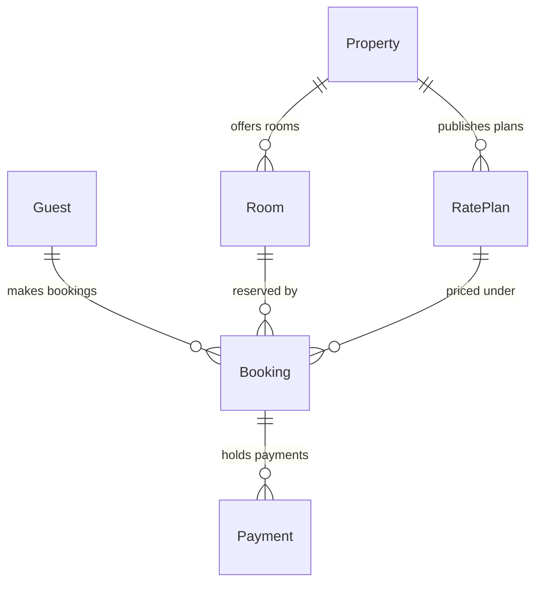

The model passes the pre-write check: 1 ER diagram with 6 tables and 6 relationships.

**What the board answers:** Which tables hold a stay, and how do a guest's bookings and payments connect to a property's rooms and rate plans? Support can follow a booking to its guest, its payments, its room and rate plan, and the property behind them.

**What the reader sees, in order**
- **First:** Bookings, the one table both groups connect to.
- **Second:** Bookings' links into the Partner group, `reserved by` from a room and `priced under` from a rate plan.
- **Can wait:** Payments, and the key lines on each card.

**What gets drawn**
- A titled board section with a Partner group (Property, Room, Rate Plan) and a Guest group (Guest, Booking, Payment).
- 6 table cards. Each shows a `PK`, plus an `FK` line for each parent table.
- 6 solid lines with crow's-foot marks, each labelled in words, for example `makes bookings (1 to 0..n)`.
- A key, and a source line saying the key names aren't confirmed yet.
- Read at laptop distance. Nothing extra is added.

**Where it goes:** A new section in the existing FigJam file `<test-file-key>`, 400 px to the right of what's already there. Nothing on the file now will be moved or changed.

**Calls this will use (4):**
1. `create_session` for the file
2. `get_figjam` to read the existing content before writing
3. `use_figma` to draw the board
4. `get_figjam` to read it back

On a Starter plan, or on a View or Collab seat, Figma allows only 6 tool calls a month, so this would use 4 of them.

**Undo:** I'd delete only the one section this write creates, and only if you name it or say yes to a question that names it.

**Should I write this board into `<test-file-key>`?**

HVR self-scan: 0 hard blockers. Fixed: none. Kept with reason: none.