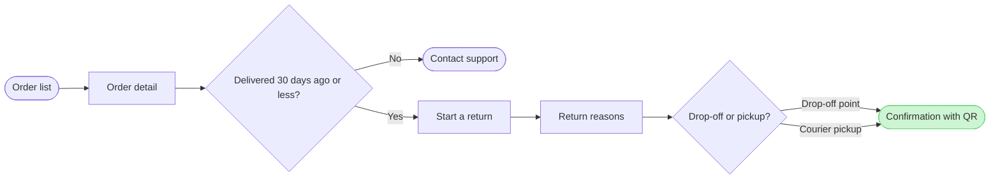

# FJ-022 turn 2 transcript

**User:** Yes, that reading is right.

**Tool call:** `ToolSearch` `{"query": "select:mcp__figma-remote__whoami,mcp__figma-remote__get_figjam", "max_results": 2}`

**Tool result:** `ToolSearch`

```text
[{"type": "tool_reference", "tool_name": "mcp__figma-remote__whoami"}, {"type": "tool_reference", "tool_name": "mcp__figma-remote__get_figjam"}]
```

**Tool call:** `Bash` `{"command": "cd /private/var/folders/3c/zfqcqsts0kn19cgblj82gqhm0000gn/T/devin-compare-bench/FJ-022/sk-create-figjam; ls references/types assets/templates scripts; cat assets/templates/*user* 2>/dev/null | head -80"}`

**Tool result:** `Bash`

```text
"assets/templates:\narchitecture.md\ner.md\ngantt.md\nprocess.md\nsequence.md\nstate.md\n\nreferences/types:\narchitecture.md\ner.md\ngantt.md\nprocess.md\nsequence.md\nstate.md\nuser-flow.md\n\nscripts:\ncompose_board.py\ncompose-trace.mjs\nfigjam_checks\nflow_check.py\nvendored\n(eval):1: no matches found: assets/templates/*user*"
```

**Tool call:** `mcp__figma-remote__whoami` `{}`

**Tool result:** `mcp__figma-remote__whoami`

```text
"{\"whoami\":{\"user_id\":\"<redacted>\",\"handle\":\"<redacted>\",\"email\":\"<email>\",\"code_layers_enabled\":true,\"plans\":[{\"name\":\"<figma-plan-3>\",\"seat\":\"View\",\"tier\":\"starter\",\"key\":\"team::<plan-id>\",\"role\":\"admin\",\"specs_enabled\":true,\"code_layers_enabled\":true},{\"name\":\"<figma-plan-1>\",\"seat\":\"Full\",\"tier\":\"pro\",\"key\":\"team::<plan-id>\",\"role\":\"admin\",\"specs_enabled\":false,\"code_layers_enabled\":true},{\"name\":\"<figma-plan-2>\",\"seat\":\"Full\",\"tier\":\"pro\",\"key\":\"team::<plan-id>\",\"role\":\"member\",\"specs_enabled\":false,\"code_layers_enabled\":true}]},\"instructions\":\"For more details on rate limits and access, refer to https://developers.figma.com/docs/figma-mcp-server/rate-limits-access/\"}"
```

**Tool call:** `Bash` `{"command": "cd /private/var/folders/3c/zfqcqsts0kn19cgblj82gqhm0000gn/T/devin-compare-bench/FJ-022/sk-create-figjam; grep -n -A40 \"User flow\" assets/flow-templates.md | head -70; python3 scripts/flow_check.py --help 2>&1 | head -15"}`

**Tool result:** `Bash`

```text
"mermaid_extract: --help: not a Mermaid file\nUNREADABLE --help: the extractor refused it"
```

**Tool call:** `Bash` `{"command": "cd /private/var/folders/3c/zfqcqsts0kn19cgblj82gqhm0000gn/T/devin-compare-bench/FJ-022/sk-create-figjam; sed -n 1,60p assets/flow-templates.md | grep -v \"^$\" | head -50"}`

**Tool result:** `Bash`

```text
"---\ntitle: \"Product Owner Flow Templates\"\ndescription: \"User-flow Mermaid patterns, the provenance table and the reply shape for Product Owner Flow Mode, each pattern passing the pre-write check.\"\ncontextType: general\nimportance_tier: important\ntrigger_phrases:\n  - \"flow templates\"\n  - \"mermaid flow patterns\"\n  - \"flow provenance table\"\n  - \"flow reply shape\"\nversion: 1.0.1.0\n---\n# Product Owner Flow Templates\nCopy/apply patterns for Product Owner Flow Mode models.\n**Loading Condition:** CONDITIONAL, with `references/flow-mode.md` whenever Flow intent is selected\n**Purpose:** Provides the user-flow patterns, the provenance table every diagram type keeps and the reply shape every type delivers\n**Scope:** Five user-flow patterns, the intake questions, the provenance table and the reply shape. The other types keep their patterns in `assets/templates/`\n**Output Path:** None. The model is working data and the board is the deliverable\n---\n## 1. OVERVIEW\n### Purpose\nEvery pattern below passes `scripts/flow_check.py` as a user flow, and `scripts/compose_board.py` composes it into a board. Start from the pattern closest to the flow, rename the nodes after the real screens and triggers, add the board lines below and run the check before the write gate. A process, an architecture, a sequence, a state diagram, an ER diagram or a gantt chart starts from its own file in `assets/templates/`, and keeps the provenance table and the reply shape below.\n### Usa
```

**Tool call:** `Bash` `{"command": "T=$(mktemp -d); cat > $T/m.mmd <<'EOF'\n%% title: Fernhouse: starting a return in the app\n%% subtitle: How a customer starts a return, from the order list to a confirmed return with a QR code\n%% source: Sources: the app and the returns doc. Free pickup over 100 euros is a proposal, shown as a note.\nflowchart LR\n  orders[Order list] --> detail[Order detail]\n  detail --> window{\"Delivered 30 days ago or less?\"}\n  window -->|No| support[Contact support]\n  window -->|Yes| start[Start a return]\n  start --> reasons[Return reasons]\n  reasons --> method{Drop-off or pickup?}\n  `

**Tool result:** `Bash`

```text
"  diagram 1, user flow: node orders has no way in: only a stadium starts a flow\n  diagram 1, user flow: node support has no way out: a flow ends on a stadium\n  diagram 1, user flow: node confirm has no way out: a flow ends on a stadium\nFAILED 1 of 1 diagram(s) in m.mmd\n/var/folders/3c/zfqcqsts0kn19cgblj82gqhm0000gn/T/tmp.8UGUIkes9T"
```

**Tool call:** `Bash` `{"command": "T=/var/folders/3c/zfqcqsts0kn19cgblj82gqhm0000gn/T/tmp.8UGUIkes9T; sed -i '' -e 's/orders\\[Order list\\]/orders([Order list])/' -e 's/support\\[Contact support\\]/support([Contact support])/' -e 's/confirm\\[Confirmation with QR\\]/confirm([Confirmation with QR])/' $T/m.mmd; cd /private/var/folders/3c/zfqcqsts0kn19cgblj82gqhm0000gn/T/devin-compare-bench/FJ-022/sk-create-figjam; python3 scripts/flow_check.py $T/m.mmd"}`

**Tool result:** `Bash`

```text
"  diagram 1, user flow: ok, 8 nodes and 8 connectors, widest rank 2 steps, longest path 7 steps, 1.0 connectors per step, labels average 17 characters, 0 crossing pairs\nPASSED 1 diagram(s) in m.mmd"
```

**Assistant:**

The model passes the check, so this is the write gate. Nothing has been written yet.

**What the board answers:** How does a Fernhouse customer start a return in the app, and what happens once the 30-day window has closed?
**Outcome:** One user-flow board running from the order list to the QR confirmation, with the Contact support exit and the proposed free pickup clearly marked.

**Glances**
- First: "Confirmation with QR", the goal, shown as the one green accent
- Second: the window check at Order detail and its Contact support exit
- Last: the proposal note on courier pickup

**Model (checked: 8 nodes, 8 connectors, 0 crossings)**

Title: "Fernhouse: starting a return in the app", with a subtitle and a source line.

**Where it would go, and why that differs from what you asked**
- **Your FigJam file isn't a safe target.** `<test-file-key>` wasn't created in this work. A FigJam file has only one page, so writing there would put this board on top of whatever is already on that canvas.
- **There's no Fernhouse Product plan on your account.** Your Figma account belongs to three plans: <figma-plan-3> (Starter, View seat), <figma-plan-1> (Pro, Full seat) and <figma-plan-2> (Pro). None of them is Fernhouse Product.
- **So the proposal is your fallback:** a new FigJam file called "Fernhouse: starting a return in the app" in the **<figma-plan-1>** plan, left in drafts with no project.

**What the write would do**
- Create the new file
- Draw the board
- Add one extension: a dashed sticky note on Courier pickup reading "Proposed, under review: free pickup for orders over 100 euros"
- Read the board back

That takes 4 Figma calls: `create_new_file`, two `use_figma` calls (the board and the note) and the `get_figjam` read-back. They run on your Full Pro seat, so the six-calls-a-month limit doesn't apply.

**Undoing it:** delete the new file from your <figma-plan-1> drafts. Nothing else is touched.

Shall I create the new board in <figma-plan-1> drafts and write it there?
