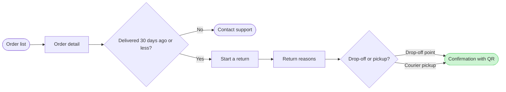

The model passes the check, so this is the write gate. Nothing has been written yet.

**What the board answers:** How does a Fernhouse customer start a return in the app, and what happens once the 30-day window has closed?
**Outcome:** One user-flow board running from the order list to the QR confirmation, with the Contact support exit and the proposed free pickup clearly marked.

**Glances**
- First: "Confirmation with QR", the goal, shown as the one green accent
- Second: the window check at Order detail and its Contact support exit
- Last: the proposal note on courier pickup

**Model (checked: 8 nodes, 8 connectors, 0 crossings)**

Title: "Fernhouse: starting a return in the app", with a subtitle and a source line.

**Where it would go, and why that differs from what you asked**
- **Your FigJam file isn't a safe target.** `<test-file-key>` wasn't created in this work. A FigJam file has only one page, so writing there would put this board on top of whatever is already on that canvas.
- **There's no Fernhouse Product plan on your account.** Your Figma account belongs to three plans: <figma-plan-3> (Starter, View seat), <figma-plan-1> (Pro, Full seat) and <figma-plan-2> (Pro). None of them is Fernhouse Product.
- **So the proposal is your fallback:** a new FigJam file called "Fernhouse: starting a return in the app" in the **<figma-plan-1>** plan, left in drafts with no project.

**What the write would do**
- Create the new file
- Draw the board
- Add one extension: a dashed sticky note on Courier pickup reading "Proposed, under review: free pickup for orders over 100 euros"
- Read the board back

That takes 4 Figma calls: `create_new_file`, two `use_figma` calls (the board and the note) and the `get_figjam` read-back. They run on your Full Pro seat, so the six-calls-a-month limit doesn't apply.

**Undoing it:** delete the new file from your <figma-plan-1> drafts. Nothing else is touched.

Shall I create the new board in <figma-plan-1> drafts and write it there?