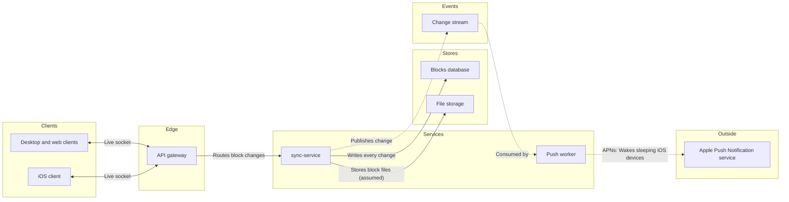

# FJ-024 turn 2 transcript

**User:** Yes, that reading is right.

**Tool call:** `Bash` `{"command": "cd /private/var/folders/3c/zfqcqsts0kn19cgblj82gqhm0000gn/T/devin-compare-bench/FJ-024/sk-create-figjam; ls references assets scripts; grep -n \"architecture\" -i SKILL.md | head; sed -n 1,80p assets/flow-templates.md"}`

**Tool result:** `Bash`

```text
"assets:\ncompose-board.js\nexamples\nfigjam-design.md\nflow-templates.md\nscreenshots\ntemplates\n\nreferences:\nflow-mode.md\nhybrid-workflow.md\nquality-rubric.md\nstyle-guide.md\ntypes\n\nscripts:\ncompose_board.py\ncompose-trace.mjs\nfigjam_checks\nflow_check.py\nvendored\n8:<!-- Keywords: sk-create-figjam, flow mode, figjam, user flow, process, architecture, sequence diagram, state diagram, er diagram, gantt, flowchart, mermaid, board, $flow, $figjam -->\n12:The Product Owner packet that draws FigJam diagrams. It picks the diagram type the reader's question needs, turns screenshots, a Figma flow, a product doc, a schema or a plan into a Mermaid model of that type with a provenance table, checks the model and, after a yes, composes it into a framed FigJam board with a title, zones, colour by kind and a key. Seven types are drawn: user flow, process, architecture, sequence, state, ER and gantt. The hub [`../SKILL.md`](../SKILL.md) picks this packet, the hub [`../ROUTER.md`](../ROUTER.md) maps a Flow request to its leaves, and Section 2 routes inside it.\n80:DIAGRAM_TYPES = (\"user-flow\", \"process\", \"architecture\", \"sequence\", \"state\", \"er\", \"gantt\")\n84:    \"architecture\": (\"service\", \"component\", \"system\", \"infrastructure\", \"architecture\"),\n---\ntitle: \"Product Owner Flow Templates\"\ndescription: \"User-flow Mermaid patterns, the provenance table and the reply shape for Product Owner Flow Mode, each pattern passing the pre-write check.\"\ncont
```

**Tool call:** `Bash` `{"command": "cd /private/var/folders/3c/zfqcqsts0kn19cgblj82gqhm0000gn/T/devin-compare-bench/FJ-024/sk-create-figjam; ls assets/templates references/types; sed -n 1,200p assets/templates/architecture*.md | grep -v \"^$\" | head -120"}`

**Tool result:** `Bash`

```text
"assets/templates:\narchitecture.md\ner.md\ngantt.md\nprocess.md\nsequence.md\nstate.md\n\nreferences/types:\narchitecture.md\ner.md\ngantt.md\nprocess.md\nsequence.md\nstate.md\nuser-flow.md\n---\ntitle: \"FigJam Architecture Templates\"\ndescription: \"Architecture patterns that pass the pre-write check: a request path through every lane and an event-driven path with a backward edge.\"\ncontextType: general\nimportance_tier: important\ntrigger_phrases:\n  - \"architecture templates\"\n  - \"figjam architecture pattern\"\nversion: 1.0.1.0\n---\n# FigJam Architecture Templates\nCopy/apply patterns for an architecture model. Each pattern passes `scripts/flow_check.py`, and `references/types/architecture.md` holds the lanes and the allowed edges.\n**Loading Condition:** CONDITIONAL, with `references/types/architecture.md`\n**Purpose:** Starting points for an architecture\n**Scope:** Two patterns. The provenance table and the reply shape are in `assets/flow-templates.md`\n---\n## 1. USAGE\n- Keep the `%% type: architecture` line first, before any `%% title:` or other board line. On the generated fallback, pass `useArchitectureLayoutCode` as `\"FIGMA_DIAGRAM_2026\"` on the call\n- Keep the six lane ids exactly and rename only the labels\n- Drop a lane the system does not have. An empty lane is never filled with an invented part\n- Label every edge from its source's side, and an external edge as `\"Service: Purpose\"`\n---\n## 2. PATTERNS\n### Request path\n```mermaid\n%% type: ar
```

**Tool call:** `Bash` `{"command": "cd /private/var/folders/3c/zfqcqsts0kn19cgblj82gqhm0000gn/T/devin-compare-bench/FJ-024/sk-create-figjam; mkdir -p /tmp/fj024; cat > /tmp/fj024/model.md <<'EOF'\n```mermaid\n%% type: architecture\n%% title: Loomlist block sync, services\n%% subtitle: Which services carry a block change from one client to every other device, including a sleeping iPhone\n%% source: Sources: the request brief. Assumed: sync-service stores block files. Left out: fan-out to awake clients, not stated.\n%% focus: stream\nflowchart LR\n    subgraph client [\"Clients\"]\n        desktop[Desktop client]\n   `

**Tool result:** `Bash`

```text
"  diagram 1, architecture: 10 nodes, at most 9: draw one flow per diagram\n  diagram 1, architecture: edge apns to ios runs external to client as a dotted edge, which is not in the allowed-edge table: a service mediates\nFAILED 1 of 1 diagram(s) in model.md\nexit 1"
```

**Tool call:** `Bash` `{"command": "cd /private/var/folders/3c/zfqcqsts0kn19cgblj82gqhm0000gn/T/devin-compare-bench/FJ-024/sk-create-figjam; f=/tmp/fj024/model.md\npython3 - \"$f\" <<'EOF'\nimport sys;p=sys.argv[1];s=open(p).read()\ns=s.replace('        desktop[Desktop client]\\n        web[Web client]\\n','        desktop[Desktop and web clients]\\n')\ns=s.replace('    web <-->|\"Live socket\"| api\\n','')\ns=s.replace('    push -.->|\"APNs: Wakes device\"| apns\\n    apns -.->|\"Silent push\"| ios\\n','    push -.->|\"APNs: Wakes sleeping iOS devices\"| apns\\n')\nopen(p,'w').write(s)\nEOF\npython3 scripts/flow_ch`

**Tool result:** `Bash`

```text
"  diagram 1, architecture: ok, 9 nodes and 8 connectors, widest rank 3 steps, longest path 6 steps, 0.9 connectors per step, labels average 15 characters, 0 crossing pairs\nPASSED 1 diagram(s) in model.md\nexit 0"
```

**Assistant:**

The model passes the pre-write check: 9 nodes, 8 connectors and 0 crossings. Here's what I'd write. Nothing is on a board yet.

**The question the board answers:** which services carry a Loomlist block change from one client to every other device, including a sleeping iPhone? A reader should see the write path and the wake-up path in one view.

**Glance order**
- **First:** the Change stream, where the write path hands off to the push path.
- **Second:** sync-service, which writes every change to the Blocks database and publishes it.
- **Last:** the Push worker → Apple Push Notification service edge.

**Changes to fit the check**
- **Desktop and web are one node:** an architecture diagram allows at most 9 nodes, so they're merged into "Desktop and web clients". iOS stays separate because it's the device that gets woken.
- **No connector from Apple's push service to the iOS client:** the check doesn't allow an external service to connect straight to a client. The wake-up is carried in the Push worker edge's label instead.

**The diagram model**

**Title:** "Loomlist block sync, services". The source line under the key names the file storage connector as assumed and says the fan-out of changes to awake clients is left out because you didn't describe it.

**The write**
- **Where:** a new FigJam file named "Loomlist block sync, services" in the **<figma-plan-1>** plan (Pro, Full seat), left in drafts with no project. File `<test-file-key>` stays untouched.
- **What:** one framed board with a title, a subtitle, six lanes, a key and the source line. No sticky notes or other extras.
- **Figma calls:** 4 (`create_new_file`, `create_session`, one `use_figma` and a `get_figjam` read-back).
- **Undo:** delete the new file. Nothing else is touched.

Shall I create the file in <figma-plan-1> and write this board?
