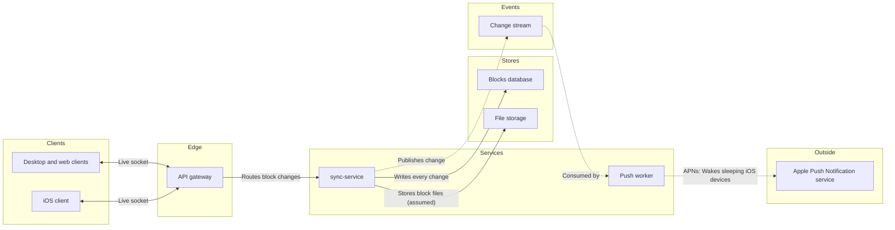

The model passes the pre-write check: 9 nodes, 8 connectors and 0 crossings. Here's what I'd write. Nothing is on a board yet.

**The question the board answers:** which services carry a Loomlist block change from one client to every other device, including a sleeping iPhone? A reader should see the write path and the wake-up path in one view.

**Glance order**
- **First:** the Change stream, where the write path hands off to the push path.
- **Second:** sync-service, which writes every change to the Blocks database and publishes it.
- **Last:** the Push worker → Apple Push Notification service edge.

**Changes to fit the check**
- **Desktop and web are one node:** an architecture diagram allows at most 9 nodes, so they're merged into "Desktop and web clients". iOS stays separate because it's the device that gets woken.
- **No connector from Apple's push service to the iOS client:** the check doesn't allow an external service to connect straight to a client. The wake-up is carried in the Push worker edge's label instead.

**The diagram model**

**Title:** "Loomlist block sync, services". The source line under the key names the file storage connector as assumed and says the fan-out of changes to awake clients is left out because you didn't describe it.

**The write**
- **Where:** a new FigJam file named "Loomlist block sync, services" in the **<figma-plan-1>** plan (Pro, Full seat), left in drafts with no project. File `<test-file-key>` stays untouched.
- **What:** one framed board with a title, a subtitle, six lanes, a key and the source line. No sticky notes or other extras.
- **Figma calls:** 4 (`create_new_file`, `create_session`, one `use_figma` and a `get_figjam` read-back).
- **Undo:** delete the new file. Nothing else is touched.

Shall I create the file in <figma-plan-1> and write this board?