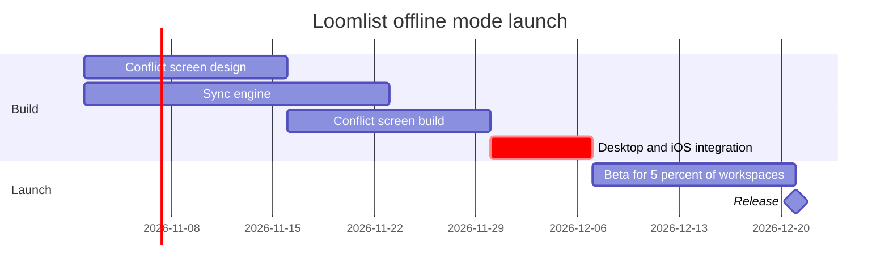

# FJ-028 turn 2 transcript

**User:** Yes, that reading is right.

**Tool call:** `Bash` `{"command": "cd /private/var/folders/3c/zfqcqsts0kn19cgblj82gqhm0000gn/T/devin-compare-bench/FJ-028/sk-create-figjam; cat references/types/gantt.md assets/templates/gantt.md | head -300"}`

**Tool result:** `Bash`

```text
"---\ntitle: \"FigJam Type - Gantt\"\ndescription: \"Tasks, phases and milestones on a time axis, drawn as a FigJam gantt chart in one of two date formats, with no styling, anchored dependencies, twelve tasks and five parallel bars per section.\"\ncontextType: implementation\nimportance_tier: important\ntrigger_phrases:\n  - \"figjam gantt chart\"\n  - \"roadmap timeline figjam\"\n  - \"launch plan figjam\"\n  - \"milestones on figjam\"\nversion: 1.0.3.0\n---\n\n# FigJam Type - Gantt\n\nA gantt chart puts tasks and phases on a time axis, with milestones as points. The composer draws each section as a tinted band, each task as a named row with its bar on a shared axis and each milestone as a diamond, and picks the tick spacing from the chart's length. Neither it nor the generated fallback honours colour, axis, weekend or marker settings, so the check refuses them.\n\n**Loading Condition:** CONDITIONAL, when the Flow route draws a gantt chart\n**Purpose:** The grammar, rules, budget and read-back for a gantt chart\n**Pairs With:** `assets/templates/gantt.md`\n\n---\n\n## 1. WHEN TO USE\n\n**The reader's question:** which tasks and phases are active when?\n\n- A release plan or a launch plan with dates\n- A sprint or a phase plan with dependencies between tasks\n- A one-day run of show, in hours\n\nUse a process when there are no dates and the order of steps is the point. Figma's `timeline` kind is not drawn, so a list of dated events with no durations is a gantt chart of milest
```

**Tool call:** `Bash` `{"command": "d=$(mktemp -d); cat > $d/m.md <<'EOF'\n```mermaid\n%% title: Loomlist offline mode launch plan\n%% subtitle: Desktop and iOS integration sets the release date\n%% source: Launch plan supplied in chat, 26 Oct 2026\n%% focus: integrate\ngantt\n    title Loomlist offline mode launch\n    dateFormat YYYY-MM-DD\n    section Build\n    Conflict screen design :design, 2026-11-02, 2w\n    Sync engine :sync, 2026-11-02, 3w\n    Conflict screen build :screen, after design, 2w\n    Desktop and iOS integration :crit, integrate, after sync screen, 1w\n    section Launch\n    Beta for 5 percent`

**Tool result:** `Bash`

```text
"  diagram 1, gantt: ok, 6 tasks in 2 sections\nPASSED 1 diagram(s) in m.md\n/var/folders/3c/zfqcqsts0kn19cgblj82gqhm0000gn/T/tmp.MAEMb3Skzx"
```

**Assistant:**

The plan passes the pre-write check: 1 gantt with 5 tasks and 1 milestone in 2 sections. It's ready to write once you say yes.



**What the board answers:** which offline mode tasks are active when, and what sets the release date. After reading it, you can see that a slip in desktop and iOS integration moves the 21 Dec release.

**What the eye lands on:**
- **First:** the critical integration bar, 30 Nov to 7 Dec
- **Second:** the two bars that feed into it, with dependency arrows. They show the design-and-build chain is a week longer than the sync engine.
- **Last:** the beta and the release diamond

**Android isn't on the board.** A gantt bar needs a start date, and Android has none. A bar with a guessed date would look like a scheduled task. I'll put it on the `Left out:` line as proposed for next quarter and not approved. If you want it on the board, I can add a sticky note beside the chart later.

**The write**
- **Target file:** existing FigJam file `<test-file-key>`. I'll read it first, then put the chart in a new section 400 px to the right of the existing content. Nothing already in the file is changed.
- **What I'll draw:** a framed board with a title, subtitle, 2 section bands, 5 task bars, 1 milestone, 4 dependency arrows, a key and the source line. No sticky notes or other extras.
- **Calls:** `create_session`, then `get_figjam` to read the file before writing, then one `use_figma` call to draw the board, then `get_figjam` to read it back. That's 4 calls. If your Figma plan or seat is limited to six calls a month, this run uses four of them. I won't create a new file, so `whoami` isn't needed.
- **Undo:** delete the one section this write creates, and only if you approve that deletion separately.
- **Reading distance:** set for viewing on a laptop.

Should I write this chart into `<test-file-key>` now?
