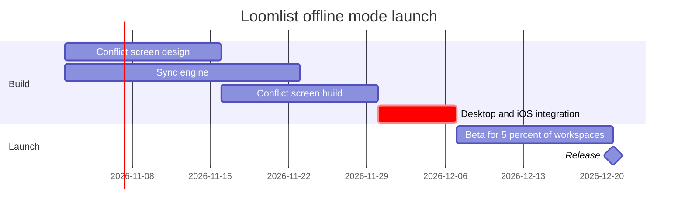

The plan passes the pre-write check: 1 gantt with 5 tasks and 1 milestone in 2 sections. It's ready to write once you say yes.

**What the board answers:** which offline mode tasks are active when, and what sets the release date. After reading it, you can see that a slip in desktop and iOS integration moves the 21 Dec release.

**What the eye lands on:**
- **First:** the critical integration bar, 30 Nov to 7 Dec
- **Second:** the two bars that feed into it, with dependency arrows. They show the design-and-build chain is a week longer than the sync engine.
- **Last:** the beta and the release diamond

**Android isn't on the board.** A gantt bar needs a start date, and Android has none. A bar with a guessed date would look like a scheduled task. I'll put it on the `Left out:` line as proposed for next quarter and not approved. If you want it on the board, I can add a sticky note beside the chart later.

**The write**
- **Target file:** existing FigJam file `<test-file-key>`. I'll read it first, then put the chart in a new section 400 px to the right of the existing content. Nothing already in the file is changed.
- **What I'll draw:** a framed board with a title, subtitle, 2 section bands, 5 task bars, 1 milestone, 4 dependency arrows, a key and the source line. No sticky notes or other extras.
- **Calls:** `create_session`, then `get_figjam` to read the file before writing, then one `use_figma` call to draw the board, then `get_figjam` to read it back. That's 4 calls. If your Figma plan or seat is limited to six calls a month, this run uses four of them. I won't create a new file, so `whoami` isn't needed.
- **Undo:** delete the one section this write creates, and only if you approve that deletion separately.
- **Reading distance:** set for viewing on a laptop.

Should I write this chart into `<test-file-key>` now?