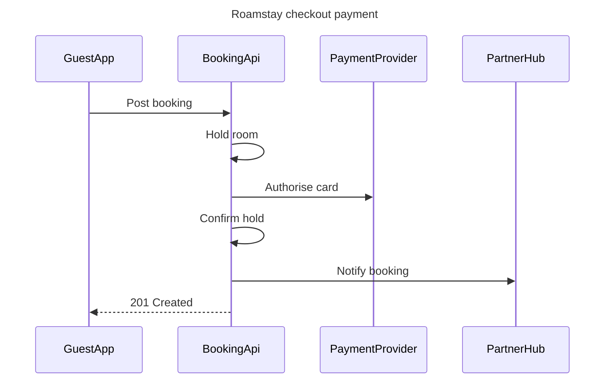

# FJ-001 turn 3 transcript

**User:** Yes, that reading is right.

**Tool call:** `Bash` `{"command": "cd /private/var/folders/3c/zfqcqsts0kn19cgblj82gqhm0000gn/T/devin-compare-bench/FJ-001/sk-create-figjam; ls references/types assets/templates assets/examples; cat references/types/sequence.md; cat assets/templates/*sequence*; sed -n '/^## 1/,/^## 2/p' assets/flow-templates.md", "description": "Read sequence type reference and template"}`

**Tool result:** `Bash`

```text
"assets/examples:\narchitecture-loomlist-sync.md\ner-roamstay-stays.md\ngantt-loomlist-offline.md\nprocess-fernhouse-refund.md\nsequence-roamstay-checkout.md\nstate-roamstay-booking.md\nuser-flow-fernhouse-return.md\n\nassets/templates:\narchitecture.md\ner.md\ngantt.md\nprocess.md\nsequence.md\nstate.md\n\nreferences/types:\narchitecture.md\ner.md\ngantt.md\nprocess.md\nsequence.md\nstate.md\nuser-flow.md\n---\ntitle: \"FigJam Type - Sequence\"\ndescription: \"Messages between parties in time order, held to the subset a FigJam board shows: four arrows, labelled and numbered messages, no notes or fragments, five participants and twelve messages.\"\ncontextType: implementation\nimportance_tier: important\ntrigger_phrases:\n  - \"figjam sequence diagram\"\n  - \"api call flow figjam\"\n  - \"auth handshake diagram\"\n  - \"sequence message order\"\nversion: 1.0.2.0\n---\n\n# FigJam Type - Sequence\n\nA sequence shows who sends what to whom, in order. Neither the composer nor Figma's generated fallback draws much of Mermaid's sequence grammar, and the generator drops what it cannot draw in silence, so a sequence model here is written in the subset the board actually shows.\n\n**Loading Condition:** CONDITIONAL, when the Flow route draws a sequence\n**Purpose:** The subset, the rules, the budget and the read-back for a sequence\n**Pairs With:** `assets/templates/sequence.md`\n\n---\n\n## 1. WHEN TO USE\n\n**The reader's question:** in what order do these parties exchange messages
```

**Tool call:** `Bash` `{"command": "D=$(mktemp -d /tmp/flow.XXXX); echo $D; cat > $D/model.md <<'EOF'\n```mermaid\n%% title: Roamstay checkout payment\n%% subtitle: Message order when a guest books and pays, success path only\n%% source: Source: Roamstay payments brief. Left out: provider and partner hub replies, declined card and other failures.\n%% focus: 3\nsequenceDiagram\n    title Roamstay checkout payment\n    participant GuestApp\n    participant BookingApi\n    participant PaymentProvider\n    participant PartnerHub\n    GuestApp->>BookingApi: Post booking\n    BookingApi->>BookingApi: Hold room\n    Bookin`

**Tool result:** `Bash`

```text
"/tmp/flow.c3U8\nmermaid_extract: --help: not a Mermaid file\nUNREADABLE --help: the extractor refused it\n  diagram 1, sequence: ok, 4 participants and 6 messages\nPASSED 1 diagram(s) in model.md\nexit=0"
```

**Assistant:**

The model passed the pre-write check: 4 participants, 6 messages. Here's what I'll write. Nothing goes to Figma until you say yes.

**Purpose:** the board shows the order in which the guest app, booking API, payment provider and partner hub send messages when a guest pays at checkout. Engineers and product people can then see who makes each call before they change the flow.

**What the eye should hit first, second and last**
- **First:** message 3, "Authorise card", which is the payment step and is highlighted.
- **Second:** message 6, "201 Created", which shows the guest's booking succeeded.
- **Last:** message 5, "Notify booking" to the partner hub.

**The model**


**Design checks**
- **Where the eye goes first:** the highlighted "Authorise card" call, which is the step the board most needs read.
- **Can every message be read on its own?** Yes. Each one has its own row and number.
- **Is anything drawn that the brief doesn't state?** No. Neither reply that the brief leaves out is drawn.
- **Would a list do instead?** No. Six messages moving between four parties is easier to follow as a sequence.

**Where it goes and what it costs**
- **Plan and file:** a new FigJam file called "Roamstay checkout payment" in <figma-plan-1> (Pro plan, your Full seat). It stays in drafts with no project. Nothing is written to <test-file-key>.
- **What's written:** one framed board with the title, the subtitle, 4 participants, 6 numbered messages, a key and the source line. No sticky notes or other additions.
- **Figma tool calls:** `whoami` is already spent. The write spends 4 more: `create_new_file`, `create_session`, one `use_figma` to draw the board and `get_figjam` to read it back. Your <figma-plan-1> seat isn't capped at six calls a month.
- **Undo:** delete the new file. Nothing else is touched.

Shall I create the file in <figma-plan-1> drafts and draw this board?
