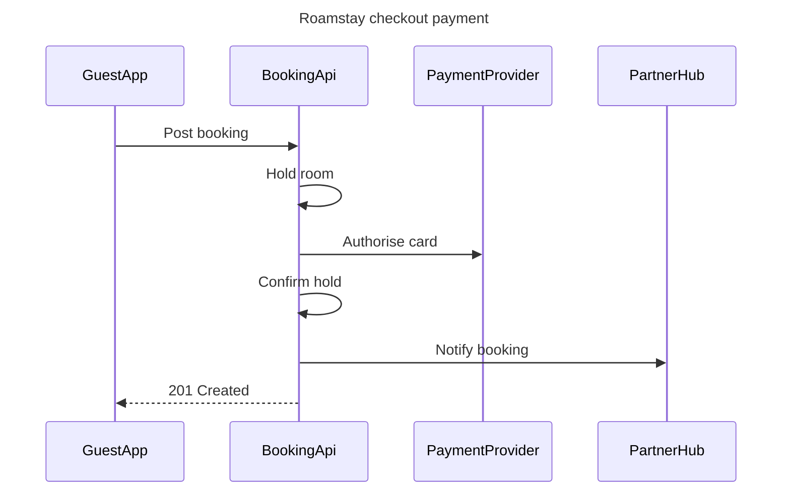

The model passed the pre-write check: 4 participants, 6 messages. Here's what I'll write. Nothing goes to Figma until you say yes.

**Purpose:** the board shows the order in which the guest app, booking API, payment provider and partner hub send messages when a guest pays at checkout. Engineers and product people can then see who makes each call before they change the flow.

**What the eye should hit first, second and last**
- **First:** message 3, "Authorise card", which is the payment step and is highlighted.
- **Second:** message 6, "201 Created", which shows the guest's booking succeeded.
- **Last:** message 5, "Notify booking" to the partner hub.

**The model**

**Design checks**
- **Where the eye goes first:** the highlighted "Authorise card" call, which is the step the board most needs read.
- **Can every message be read on its own?** Yes. Each one has its own row and number.
- **Is anything drawn that the brief doesn't state?** No. Neither reply that the brief leaves out is drawn.
- **Would a list do instead?** No. Six messages moving between four parties is easier to follow as a sequence.

**Where it goes and what it costs**
- **Plan and file:** a new FigJam file called "Roamstay checkout payment" in <figma-plan-1> (Pro plan, your Full seat). It stays in drafts with no project. Nothing is written to <test-file-key>.
- **What's written:** one framed board with the title, the subtitle, 4 participants, 6 numbered messages, a key and the source line. No sticky notes or other additions.
- **Figma tool calls:** `whoami` is already spent. The write spends 4 more: `create_new_file`, `create_session`, one `use_figma` to draw the board and `get_figjam` to read it back. Your <figma-plan-1> seat isn't capped at six calls a month.
- **Undo:** delete the new file. Nothing else is touched.

Shall I create the file in <figma-plan-1> drafts and draw this board?