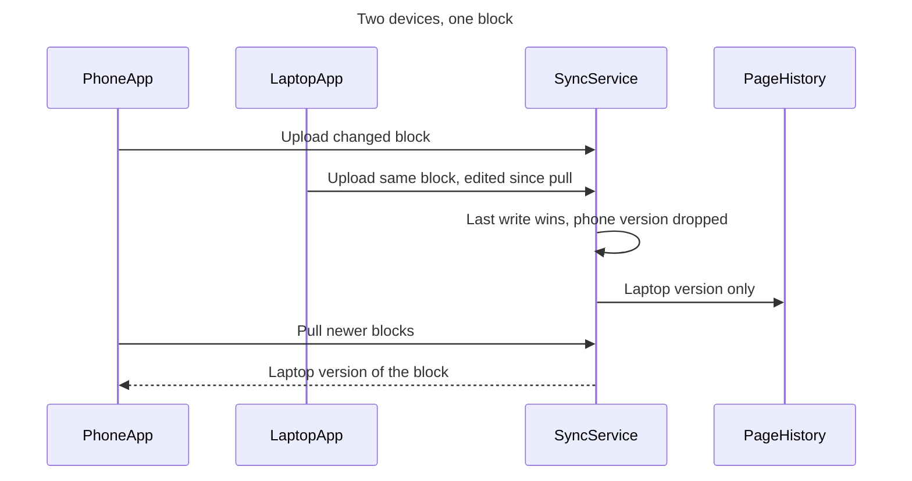
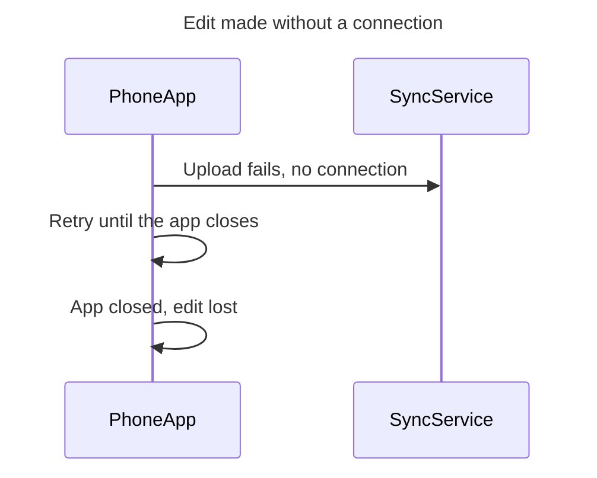

I checked the target file. Nothing has been written yet, and the write is the only step left before the board is drawn.

**What the board answers:** what happens to an edit when two devices change the same Loomlist block between their sync sessions? Support, Mobile and the offline-mode teams can then describe today's v3 behavior accurately ahead of the 2026-10-09 decision.

**What readers should notice, in order**
- **First:** message 3, "Last write wins, phone version dropped", on board 1, and message 3, "App closed, edit lost", on board 2.
- **Second:** message 4 on board 1, "Laptop version only", which shows that page history can't restore the lost edit.
- **Last:** the pull in messages 5 and 6.

**The diagrams**, which pass the pre-write check (2 of 2 diagrams):

**Target file:** your FigJam file `<test-file-key>`.
- It's a busy shared board with about 75 earlier boards. Two of them, "Block sync" and "Loomlist block sync", are system-overview diagrams from earlier sessions.
- They show parts our sources never mention, such as an API gateway, file storage and a push worker. I'll leave them untouched.
- The new boards are titled "1. Loomlist block sync, protocol v3" and "2. Loomlist edit made without a connection", so they won't replace either of those.
- I don't know which plan owns this file, and I'll only state it if you tell me. If a new file turns out to be needed, it will go to **<figma-plan-1>** (`team::<plan-id>`, Full seat) in drafts, with no project. That's the only Barter plan on your Figma account.

**What will be written:** two boards placed to the right of everything already on the page, read left to right. Each has a title, a subtitle, a key and a source line. Nothing else is added, and nothing already on the board is moved or deleted.

**Figma calls:**
- Already spent: 3 calls. One opened the session, one listed your plans and one read the board.
- Still to spend: 2 calls that draw the boards (one per diagram) and 1 to 2 calls to read them back.
- If this file is on a Starter plan with a View seat, those calls count toward the six-a-month limit.

**How to undo it:** I'd delete just the two new board sections, which removes everything inside them. I'd only do that on a later reply that names those two boards.

Should I write the two boards into `<test-file-key>` now?

HVR self-scan: 0 hard blockers. Fixed: none. Kept with reason: none.