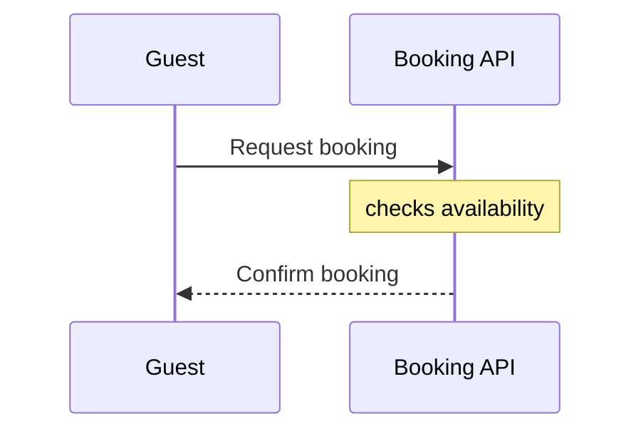

# FJ-005 turn 1 transcript

**User:** As the operator, run the sk-create-figjam check on a sequence model with an aliased participant and a note. Verify it fails and names both rules. Return the output and exit status.

Write the board into the existing FigJam file with key <test-file-key> rather than a new file. If you need a new file instead, create it in the Barter team plan and leave it in drafts, with no project.

**Tool call:** `Bash` `{"command": "cd /private/var/folders/3c/zfqcqsts0kn19cgblj82gqhm0000gn/T/devin-compare-bench/FJ-005; ls sk-create-figjam sk-create-figjam/*; grep -rn -i \"alias\\|note\" sk-create-figjam/scripts 2>/dev/null | head -40"}`

**Tool result:** `Bash`

```text
"sk-create-figjam/README.md\nsk-create-figjam/SKILL.md\n\nsk-create-figjam:\nassets\nREADME.md\nreferences\nscripts\nSKILL.md\n\nsk-create-figjam/assets:\ncompose-board.js\nexamples\nfigjam-design.md\nflow-templates.md\nscreenshots\ntemplates\n\nsk-create-figjam/references:\nflow-mode.md\nhybrid-workflow.md\nquality-rubric.md\nstyle-guide.md\ntypes\n\nsk-create-figjam/scripts:\ncompose_board.py\ncompose-trace.mjs\nfigjam_checks\nflow_check.py\nvendored\nsk-create-figjam/scripts/figjam_checks/sequence.py:9:notes, activations, every fragment (loop, alt, opt, par, critical, break),\nsk-create-figjam/scripts/figjam_checks/sequence.py:10:coloured rects, boxes, numbering and participant aliases. A model holding one\nsk-create-figjam/scripts/figjam_checks/sequence.py:39:    \"note\": \"a note\", \"activate\": \"an activation\", \"deactivate\": \"an activation\", \"loop\": \"a loop fragment\",\nsk-create-figjam/scripts/figjam_checks/sequence.py:61:            keyword, name, typed, alias = participant.groups()\nsk-create-figjam/scripts/figjam_checks/sequence.py:71:            if alias:\nsk-create-figjam/scripts/figjam_checks/sequence.py:72:                problems.append(f\"line {number}: {name} carries the alias {alias.strip()}, which the generator drops: \"\nsk-create-figjam/scripts/figjam_checks/gantt.py:11:and notes go on afterwards through the hybrid workflow.\nsk-create-figjam/scripts/figjam_checks/er.py:7:drops the fields of an entity that carries a display alias.\nsk-create-fi
```

**Tool call:** `Bash` `{"command": "cd /private/var/folders/3c/zfqcqsts0kn19cgblj82gqhm0000gn/T/devin-compare-bench/FJ-005/sk-create-figjam/scripts; sed -n 1,60p flow_check.py; sed -n 1,120p figjam_checks/sequence.py; sed -n 510,532p figjam_checks/fixtures.py"}`

**Tool result:** `Bash`

```text
"#!/usr/bin/env python3\n# \u2500\u2500\u2500\u2500\u2500\u2500\u2500\u2500\u2500\u2500\u2500\u2500\u2500\u2500\u2500\u2500\u2500\u2500\u2500\u2500\u2500\u2500\u2500\u2500\u2500\u2500\u2500\u2500\u2500\u2500\u2500\u2500\u2500\u2500\u2500\u2500\u2500\u2500\u2500\u2500\u2500\u2500\u2500\u2500\u2500\u2500\u2500\u2500\u2500\u2500\u2500\u2500\u2500\u2500\u2500\u2500\u2500\u2500\u2500\u2500\u2500\u2500\u2500\n# COMPONENT: FIGJAM MODEL PRE-WRITE CHECK\n# \u2500\u2500\u2500\u2500\u2500\u2500\u2500\u2500\u2500\u2500\u2500\u2500\u2500\u2500\u2500\u2500\u2500\u2500\u2500\u2500\u2500\u2500\u2500\u2500\u2500\u2500\u2500\u2500\u2500\u2500\u2500\u2500\u2500\u2500\u2500\u2500\u2500\u2500\u2500\u2500\u2500\u2500\u2500\u2500\u2500\u2500\u2500\u2500\u2500\u2500\u2500\u2500\u2500\u2500\u2500\u2500\u2500\u2500\u2500\u2500\u2500\u2500\u2500\n\n\"\"\"Check a FigJam diagram model before it is written to a board.\n\nA board is slow to fix once it exists: the composer owns its layout, so every\nfix is a new write. Worse, neither the composer nor the generated fallback\ndraws all that Mermaid can say, so a model can promise a reader something the\nboard never shows. The rules each diagram kind carries are checked on the\nMermaid model first, and a model that breaks one is never written. The same\nparse is measured, so a shape that is legal and still hard to read, such as a\nrank of six steps or a connector that doubles back, is caught here rather than\non the board.\n\nEach Mermaid block in the file is
```

**Assistant:**

Writing the model to a scratch directory outside the repo and running the check.

**Tool call:** `Bash` `{"command": "d=$(mktemp -d); cat > \"$d/model.md\" <<'EOF'\n```mermaid\nsequenceDiagram\n    participant Guest\n    participant BookingApi as Booking API\n    Guest->>BookingApi: Request booking\n    Note over BookingApi: checks availability\n    BookingApi-->>Guest: Confirm booking\n```\nEOF\ncat \"$d/model.md\"; echo ---; python3 -I /private/var/folders/3c/zfqcqsts0kn19cgblj82gqhm0000gn/T/devin-compare-bench/FJ-005/sk-create-figjam/scripts/flow_check.py \"$d/model.md\"; echo \"exit status: $?\""}`

**Tool result:** `Bash`

```text
"```mermaid\nsequenceDiagram\n    participant Guest\n    participant BookingApi as Booking API\n    Guest->>BookingApi: Request booking\n    Note over BookingApi: checks availability\n    BookingApi-->>Guest: Confirm booking\n```\n---\n  diagram 1, sequence: line 3: BookingApi carries the alias Booking API, which the generator drops: the id is what the board shows, so make the id readable\n  diagram 1, sequence: line 5: a note is dropped by the generator: draw it afterwards through the hybrid workflow\nFAILED 1 of 1 diagram(s) in model.md\nexit status: 1"
```

**Assistant:**

The check failed as you expected, with exit status 1, and it named both rules. I wrote nothing to FigJam file `<test-file-key>` and created no new file, because a model that fails the check never gets written to a board.

**Model** (a scratch file in a temp directory outside the repo):



**Command:** `python3 -I sk-create-figjam/scripts/flow_check.py <model.md>`

**Output:**

```
  diagram 1, sequence: line 3: BookingApi carries the alias Booking API, which the generator drops: the id is what the board shows, so make the id readable
  diagram 1, sequence: line 5: a note is dropped by the generator: draw it afterwards through the hybrid workflow
FAILED 1 of 1 diagram(s) in model.md
```

**Exit status:** `1`, which the script defines as "a rule fails" (0 means every diagram passes, 2 means the file couldn't be read).

- **Alias rule** (`figjam_checks/sequence.py:71`): the board generator drops `as Booking API`, so the participant's id has to be readable on its own.
- **Note rule** (`DROPPED` table, `sequence.py:38`): the generator drops notes. You add one after the board exists, using the hybrid workflow.

To get a model that passes, remove the alias and the `Note` line. You could then add the note to the board afterwards, in file `<test-file-key>` as you asked.
