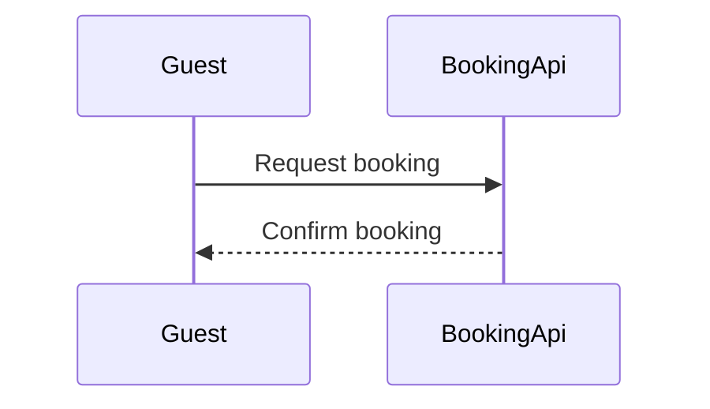

# FJ-005 turn 3 transcript

**User:** Yes, go ahead.

**Tool call:** `Bash` `{"command": "cd sk-create-figjam; cat references/types/sequence.md; cat assets/templates/sequence.md | head -80; grep -n \"%% title\\|%% subtitle\\|%% source\\|%% focus\" assets/flow-templates.md | head"}`

**Tool result:** `Bash`

```text
"---\ntitle: \"FigJam Type - Sequence\"\ndescription: \"Messages between parties in time order, held to the subset a FigJam board shows: four arrows, labelled and numbered messages, no notes or fragments, five participants and twelve messages.\"\ncontextType: implementation\nimportance_tier: important\ntrigger_phrases:\n  - \"figjam sequence diagram\"\n  - \"api call flow figjam\"\n  - \"auth handshake diagram\"\n  - \"sequence message order\"\nversion: 1.0.2.0\n---\n\n# FigJam Type - Sequence\n\nA sequence shows who sends what to whom, in order. Neither the composer nor Figma's generated fallback draws much of Mermaid's sequence grammar, and the generator drops what it cannot draw in silence, so a sequence model here is written in the subset the board actually shows.\n\n**Loading Condition:** CONDITIONAL, when the Flow route draws a sequence\n**Purpose:** The subset, the rules, the budget and the read-back for a sequence\n**Pairs With:** `assets/templates/sequence.md`\n\n---\n\n## 1. WHEN TO USE\n\n**The reader's question:** in what order do these parties exchange messages?\n\n- An API call flow, from an app through services to a store and back\n- A sign-in or payment handshake\n- Events passed between producers and consumers, where the order is the point\n\nUse an architecture for which parts exist without time order, a process for decisions and people, and a state diagram for one thing changing state.\n\n---\n\n## 2. WHAT THE BOARD DRAWS\n\n```text\nsequenceDiagram\n    ti
```

**Assistant:**

Writing the fixed model to a temp folder, then checking and composing it locally (nothing touches Figma yet).

**Tool call:** `Bash` `{"command": "d=/tmp/fj005; mkdir -p $d; cat > $d/model.md <<'EOF'\n```mermaid\n%% title: Booking request test\n%% subtitle: Test fixture for the sequence check, not live behavior\n%% source: Source: operator test model, 26 Oct 2026. Left out: the Booking API alias, refused by the check.\nsequenceDiagram\n    participant Guest\n    participant BookingApi\n    Guest->>BookingApi: Request booking\n    BookingApi-->>Guest: Confirm booking\n```\nEOF\nS=/private/var/folders/3c/zfqcqsts0kn19cgblj82gqhm0000gn/T/devin-compare-bench/FJ-005/sk-create-figjam/scripts\npython3 -I $S/flow_check.py $d/model.m`

**Tool result:** `Bash`

```text
"  diagram 1, sequence: ok, 2 participants and 2 messages\nPASSED 1 diagram(s) in model.md\ncheck exit: 0\nCOMPOSED diagram 1, 2 participants and 2 messages: 2 nodes and 2 connectors to read back, 47651 characters in /tmp/fj005/code.js, drawn in the design FigJam default\ncompose exit: 0\n   47651 /tmp/fj005/code.js"
```

**Tool call:** `ToolSearch` `{"query": "select:mcp__figma-remote__whoami", "max_results": 1}`

**Tool result:** `ToolSearch`

```text
[{"type": "tool_reference", "tool_name": "mcp__figma-remote__whoami"}]
```

**Tool call:** `mcp__figma-remote__whoami` `{}`

**Tool result:** `mcp__figma-remote__whoami`

```text
"{\"whoami\":{\"user_id\":\"<redacted>\",\"handle\":\"<redacted>\",\"email\":\"<email>\",\"code_layers_enabled\":true,\"plans\":[{\"name\":\"<figma-plan-3>\",\"seat\":\"View\",\"tier\":\"starter\",\"key\":\"team::955111831884247158\",\"role\":\"admin\",\"specs_enabled\":true,\"code_layers_enabled\":true},{\"name\":\"<figma-plan-1>\",\"seat\":\"Full\",\"tier\":\"pro\",\"key\":\"team::1297132374291579406\",\"role\":\"admin\",\"specs_enabled\":false,\"code_layers_enabled\":true},{\"name\":\"<figma-plan-2>\",\"seat\":\"Full\",\"tier\":\"pro\",\"key\":\"team::1285583218246154085\",\"role\":\"member\",\"specs_enabled\":false,\"code_layers_enabled\":true}]},\"instructions\":\"For more details on rate limits and access, refer to https://developers.figma.com/docs/figma-mcp-server/rate-limits-access/\"}"
```

**Assistant:**

**Write gate.** This is the step that writes to Figma. Your last "yes" approved the reading, not the write.

**Question and outcome:** in what order do Guest and BookingApi exchange the booking messages? After the write you can confirm that the fixed model draws, reads back, and takes the note added on top.

**Three glances**
- **First:** message 1, "Request booking". It's the board's opening message, so it doesn't need a highlight.
- **Second:** message 2, "Confirm booking", which closes the exchange.
- **Last:** the "checks availability" note on BookingApi.

**Checked model:** it passes the check (exit 0, 2 participants and 2 messages). The composed code is 47,651 characters, under the 50,000-character limit for one call.



**Target: a new FigJam file named "Booking request test"**
- It goes in the **<figma-plan-1>** plan (`team::1297132374291579406`), where you have a Full seat on Pro. It stays in drafts, with no project.
- I won't write into `<test-file-key>`. Flow Mode only writes into a new file or a board this work already drew, and that file wasn't drawn by this work. That makes your stated fallback the target.

**What gets written**
- One framed board with the title, subtitle, two participants with their lifelines, two numbered messages, the key and the source line.
- **Planned extension:** one sticky note reading "checks availability", placed beside BookingApi's lifeline.

**Calls, five in total:** `create_new_file`, `create_session`, one `use_figma` to draw the board, one `use_figma` to add the sticky, and one `get_figjam` to read it back. Your Full seat on Pro isn't affected by the Starter six-calls-a-month limit.

**Rollback:** delete the new file. The sticky can also be removed on its own.

Shall I write this board, with the note sticky, to a new file in the <figma-plan-1> plan's drafts?
